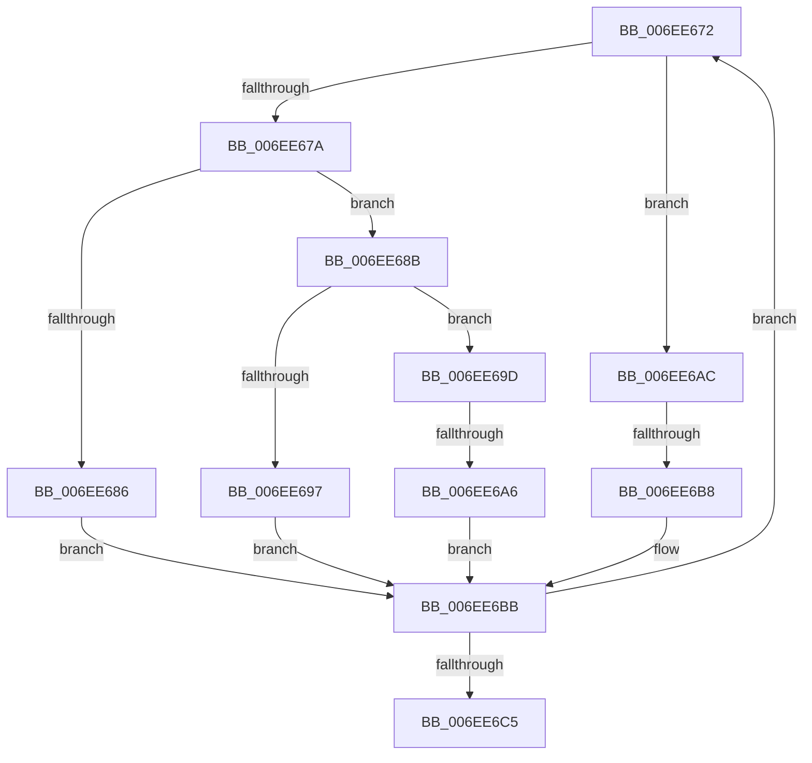

# sub_006EE672

- RVA: `0x006EE672`–`0x006EE6CA` (길이 `88` bytes)
- VA: `0x00000001406EE672`
- 실행 섹션: `.text`
- PDB 이름 있음: `아니요`; PDB Function 태그: `아니요`
- unwind 정보 RVA: `0x000A1BDC`
- 디코드: `26`개 명령, `88/88` bytes 표시
- 미해석 바이트: `0` (있으면 어셈블리에 `.byte`로 보존)

> 이 문서는 커널 이미지의 기계어와 PDB 기호를 분석해 생성했습니다. 4번과 5번은 함수 원형과 자료형을 바이너리 사용 방식에서 추정한 C 해석이며 원본 소스 복구 결과는 아닙니다.

## 1. Dependencies

- 직접 호출 지점: **0**; 고유 호출 대상: **0**
- 직접 호출자로 확인된 함수: **0**
- RIP 상대 이미지 참조: **0**

### Outgoing calls
- 직접 디코드된 call 명령이 없습니다.

### Direct callers
- 이 함수 시작 RVA로 연결되는 직접 call은 확인되지 않았습니다. 간접 호출은 완전히 역산할 수 없습니다.

### Static image references
- 디코드된 RIP-relative 메모리 참조가 없습니다.

## 2. Other-region calls and transfers

- 다른 실행 섹션으로 향하는 call: **0**
- call이 아닌 외부 분기/꼬리 이동: **3**
  - `0x006EE6A0` → [sub_0042E13E + 0x25](../42/Unknown_function_0042E13E.md) (`tail-transfer`)
  - `0x006EE6B2` → [sub_0042E13E + 0x25](../42/Unknown_function_0042E13E.md) (`tail-transfer`)
  - `0x006EE6C5` → [sub_0042E13E + 0x25](../42/Unknown_function_0042E13E.md) (`tail-transfer`)

## 3. Assembly (complete function range)

```asm
006EE672  4C 8B 1B                        mov r11, qword ptr [rbx]
006EE675  4D 85 DB                        test r11, r11
006EE678  78 32                           js 0x1406ee6ac
006EE67A  49 8D 83 00 2D 31 01            lea rax, [r11 + 0x1312d00]
006EE681  4C 3B C0                        cmp r8, rax
006EE684  7C 05                           jl 0x1406ee68b
006EE686  41 FF C2                        inc r10d
006EE689  EB 30                           jmp 0x1406ee6bb
006EE68B  49 8D 83 80 96 98 00            lea rax, [r11 + 0x989680]
006EE692  4C 3B C0                        cmp r8, rax
006EE695  7C 06                           jl 0x1406ee69d
006EE697  41 83 C9 02                     or r9d, 2
006EE69B  EB 1E                           jmp 0x1406ee6bb
006EE69D  4D 3B C3                        cmp r8, r11
006EE6A0  0F 8C BD FA D3 FF               jl 0x14042e163
006EE6A6  41 83 C9 04                     or r9d, 4
006EE6AA  EB 0F                           jmp 0x1406ee6bb
006EE6AC  4C 23 DF                        and r11, rdi
006EE6AF  4D 3B C3                        cmp r8, r11
006EE6B2  0F 8C AB FA D3 FF               jl 0x14042e163
006EE6B8  41 FF CA                        dec r10d
006EE6BB  FF C1                           inc ecx
006EE6BD  48 83 C3 08                     add rbx, 8
006EE6C1  3B CA                           cmp ecx, edx
006EE6C3  72 AD                           jb 0x1406ee672
006EE6C5  E9 99 FA D3 FF                  jmp 0x14042e163
```

## 4. C-style interpretation (structured pseudocode)

```c
__int64 __fastcall sub_006EE672(int a1, int a2, __int64 a3, int a4)
{
    __int64 v_r10;
    __int64 v_r11;
    __int64 v_rbx;

    if (sign_flag) goto loc_006EE6AC;
    if (a3 < (*(unsigned __int64 *)(v_rbx) + 20000000)) goto loc_006EE68B;
    v_r10 = (unsigned int)((v_r10) + 1);
    goto loc_006EE6BB;
loc_006EE68B:
    if (a3 < (*(unsigned __int64 *)(v_rbx) + 10000000)) goto loc_006EE69D;
    a4 = (unsigned int)((a4) | (2));
    goto loc_006EE6BB;
loc_006EE69D:
    a4 = (unsigned int)((a4) | (4));
    goto loc_006EE6BB;
loc_006EE6AC:
    v_r11 = (*(unsigned __int64 *)(v_rbx)) & (v_rdi);
    v_r10 = (unsigned int)((v_r10) - 1);
loc_006EE6BB:
    a1 = (unsigned int)((a1) + 1);
    v_rbx = (v_rbx) + (8);
    if (a1 < a2) goto loc_006EE672;
}
```

## 5. (Beta) C Style

```c
int64_t sub_006EE672(int32_t Arg1, int32_t Arg2, int64_t Arg3, int32_t Arg4)
{
    int64_t local_r10;
    int64_t local_r11;
    int64_t local_rbx;

    if (sign_flag) goto loc_006EE6AC;
    if (Arg3 < (*(uint64_t *)(local_rbx) + 20000000)) goto loc_006EE68B;
    local_r10 = (uint32_t)((local_r10) + 1);
    goto loc_006EE6BB;
loc_006EE68B:
    if (Arg3 < (*(uint64_t *)(local_rbx) + 10000000)) goto loc_006EE69D;
    Arg4 = (uint32_t)((Arg4) | (2));
    goto loc_006EE6BB;
loc_006EE69D:
    Arg4 = (uint32_t)((Arg4) | (4));
    goto loc_006EE6BB;
loc_006EE6AC:
    local_r11 = (*(uint64_t *)(local_rbx)) & (local_rdi);
    local_r10 = (uint32_t)((local_r10) - 1);
loc_006EE6BB:
    Arg1 = (uint32_t)((Arg1) + 1);
    local_rbx = (local_rbx) + (8);
    if (Arg1 < Arg2) goto loc_006EE672;
}
```

## 6. Execution-region graph

[열기: 2D/3D 그래프와 함수 탐색 컨트롤 패널](../../../control-panel.html?section=text&rva=0x006EE672&view=graph)

- 2D 그래프는 위에서 아래로 흐르고, 3D 그래프는 빈 공간을 드래그해 회전합니다. Shift+드래그는 이동, 휠은 확대·축소, 함수 노드 선택은 대상 보고서 이동입니다.

### Static fallback


