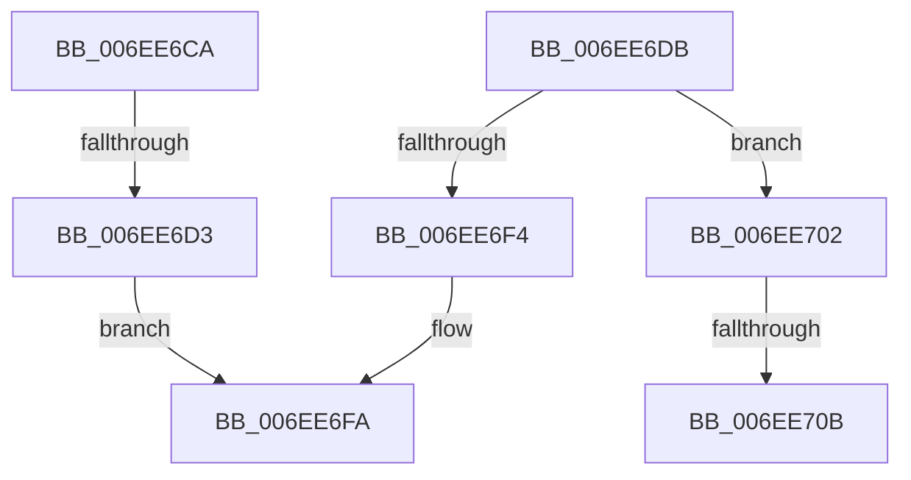

# sub_006EE6CA

- RVA: `0x006EE6CA`–`0x006EE710` (길이 `70` bytes)
- VA: `0x00000001406EE6CA`
- 실행 섹션: `.text`
- PDB 이름 있음: `아니요`; PDB Function 태그: `아니요`
- unwind 정보 RVA: `0x000A1C1C`
- 디코드: `16`개 명령, `70/70` bytes 표시
- 미해석 바이트: `0` (있으면 어셈블리에 `.byte`로 보존)

> 이 문서는 커널 이미지의 기계어와 PDB 기호를 분석해 생성했습니다. 4번과 5번은 함수 원형과 자료형을 바이너리 사용 방식에서 추정한 C 해석이며 원본 소스 복구 결과는 아닙니다.

## 1. Dependencies

- 직접 호출 지점: **0**; 고유 호출 대상: **0**
- 직접 호출자로 확인된 함수: **0**
- RIP 상대 이미지 참조: **0**

### Outgoing calls
- 직접 디코드된 call 명령이 없습니다.

### Direct callers
- 이 함수 시작 RVA로 연결되는 직접 call은 확인되지 않았습니다. 간접 호출은 완전히 역산할 수 없습니다.

### Static image references
- 디코드된 RIP-relative 메모리 참조가 없습니다.

## 2. Other-region calls and transfers

- 다른 실행 섹션으로 향하는 call: **0**
- call이 아닌 외부 분기/꼬리 이동: **4**
  - `0x006EE6CD` → [RtlpTimeFieldsToTime + 0x4F](../42/RtlpTimeFieldsToTime_function_0042E6C8.md) (`tail-transfer`)
  - `0x006EE6FD` → [RtlpTimeFieldsToTime + 0x4A](../42/RtlpTimeFieldsToTime_function_0042E6C8.md) (`tail-transfer`)
  - `0x006EE705` → [RtlpTimeFieldsToTime + 0x65](../42/RtlpTimeFieldsToTime_function_0042E6C8.md) (`tail-transfer`)
  - `0x006EE70B` → [RtlpTimeFieldsToTime + 0x4F](../42/RtlpTimeFieldsToTime_function_0042E6C8.md) (`tail-transfer`)

## 3. Assembly (complete function range)

```asm
006EE6CA  48 3B C2                        cmp rax, rdx
006EE6CD  0F 8C 44 00 D4 FF               jl 0x14042e717
006EE6D3  48 03 C0                        add rax, rax
006EE6D6  48 2B C2                        sub rax, rdx
006EE6D9  EB 1F                           jmp 0x1406ee6fa
006EE6DB  48 B9 FF FF FF FF FF FF FF 7F   movabs rcx, 0x7fffffffffffffff
006EE6E5  48 23 D1                        and rdx, rcx
006EE6E8  48 8D 8A 80 96 98 00            lea rcx, [rdx + 0x989680]
006EE6EF  48 3B C1                        cmp rax, rcx
006EE6F2  7C 0E                           jl 0x1406ee702
006EE6F4  48 05 80 69 67 FF               add rax, -0x989680
006EE6FA  41 FF C0                        inc r8d
006EE6FD  E9 10 00 D4 FF                  jmp 0x14042e712
006EE702  48 3B C2                        cmp rax, rdx
006EE705  0F 8D 22 00 D4 FF               jge 0x14042e72d
006EE70B  E9 07 00 D4 FF                  jmp 0x14042e717
```

## 4. C-style interpretation (structured pseudocode)

```c
__int64 __fastcall sub_006EE6CA(__int64 a1, __int64 a2, int a3)
{
    __int64 result;

    result = (result) + (result);
    result = (result) - (a2);
    goto loc_006EE6FA;
loc_006EE6FA:
    a3 = (unsigned int)((a3) + 1);
}
```

## 5. (Beta) C Style

```c
int64_t sub_006EE6CA(int64_t Arg1, int64_t Arg2, int32_t Arg3)
{
    int64_t result;

    result = (result) + (result);
    result = (result) - (Arg2);
    goto loc_006EE6FA;
loc_006EE6FA:
    Arg3 = (uint32_t)((Arg3) + 1);
}
```

## 6. Execution-region graph

[열기: 2D/3D 그래프와 함수 탐색 컨트롤 패널](../../../control-panel.html?section=text&rva=0x006EE6CA&view=graph)

- 2D 그래프는 위에서 아래로 흐르고, 3D 그래프는 빈 공간을 드래그해 회전합니다. Shift+드래그는 이동, 휠은 확대·축소, 함수 노드 선택은 대상 보고서 이동입니다.

### Static fallback


