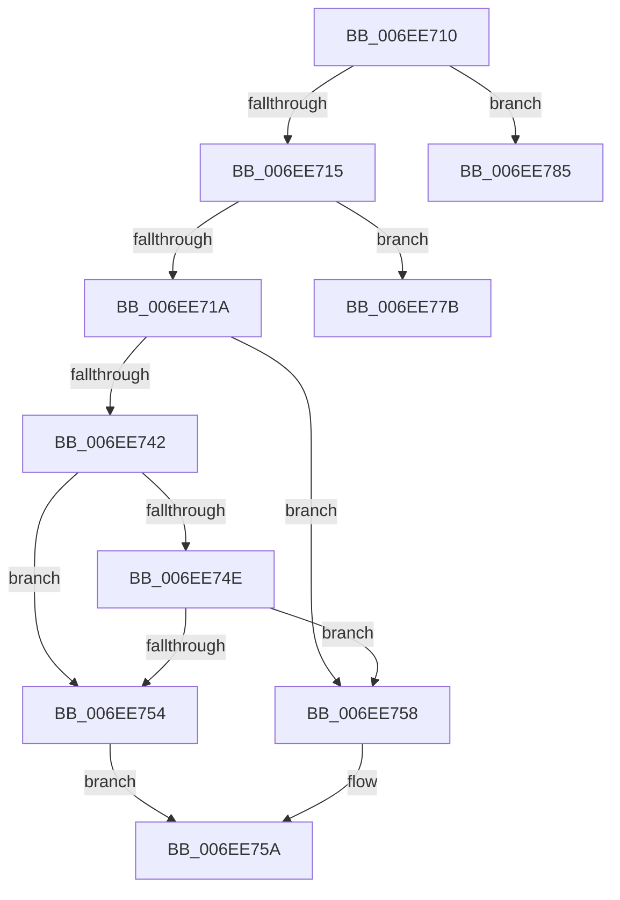

# sub_006EE710

- RVA: `0x006EE710`–`0x006EE78F` (길이 `127` bytes)
- VA: `0x00000001406EE710`
- 실행 섹션: `.text`
- PDB 이름 있음: `아니요`; PDB Function 태그: `아니요`
- unwind 정보 RVA: `0x000A1E08`
- 디코드: `35`개 명령, `127/127` bytes 표시
- 미해석 바이트: `0` (있으면 어셈블리에 `.byte`로 보존)

> 이 문서는 커널 이미지의 기계어와 PDB 기호를 분석해 생성했습니다. 4번과 5번은 함수 원형과 자료형을 바이너리 사용 방식에서 추정한 C 해석이며 원본 소스 복구 결과는 아닙니다.

## 1. Dependencies

- 직접 호출 지점: **0**; 고유 호출 대상: **0**
- 직접 호출자로 확인된 함수: **0**
- RIP 상대 이미지 참조: **0**

### Outgoing calls
- 직접 디코드된 call 명령이 없습니다.

### Direct callers
- 이 함수 시작 RVA로 연결되는 직접 call은 확인되지 않았습니다. 간접 호출은 완전히 역산할 수 없습니다.

### Static image references
- 디코드된 RIP-relative 메모리 참조가 없습니다.

## 2. Other-region calls and transfers

- 다른 실행 섹션으로 향하는 call: **0**
- call이 아닌 외부 분기/꼬리 이동: **3**
  - `0x006EE776` → [IopAdjustFileObjectKeepAliveCount + 0xEC](../42/IopAdjustFileObjectKeepAliveCount_function_0042EBE8.md) (`tail-transfer`)
  - `0x006EE780` → [IopAdjustFileObjectKeepAliveCount + 0xEC](../42/IopAdjustFileObjectKeepAliveCount_function_0042EBE8.md) (`tail-transfer`)
  - `0x006EE78A` → [IopAdjustFileObjectKeepAliveCount + 0xEC](../42/IopAdjustFileObjectKeepAliveCount_function_0042EBE8.md) (`tail-transfer`)

## 3. Assembly (complete function range)

```asm
006EE710  45 85 FF                        test r15d, r15d
006EE713  74 70                           je 0x1406ee785
006EE715  48 85 DB                        test rbx, rbx
006EE718  74 61                           je 0x1406ee77b
006EE71A  48 89 0B                        mov qword ptr [rbx], rcx
006EE71D  B9 01 00 00 00                  mov ecx, 1
006EE722  49 89 5E 18                     mov qword ptr [r14 + 0x18], rbx
006EE726  89 4B 10                        mov dword ptr [rbx + 0x10], ecx
006EE729  4C 89 63 08                     mov qword ptr [rbx + 8], r12
006EE72D  48 89 73 18                     mov qword ptr [rbx + 0x18], rsi
006EE731  4C 89 66 18                     mov qword ptr [rsi + 0x18], r12
006EE735  48 89 6E 28                     mov qword ptr [rsi + 0x28], rbp
006EE739  F7 45 50 00 00 00 20            test dword ptr [rbp + 0x50], 0x20000000
006EE740  74 16                           je 0x1406ee758
006EE742  48 8B 85 D0 00 00 00            mov rax, qword ptr [rbp + 0xd0]
006EE749  48 85 C0                        test rax, rax
006EE74C  74 06                           je 0x1406ee754
006EE74E  8B 00                           mov eax, dword ptr [rax]
006EE750  A8 08                           test al, 8
006EE752  75 04                           jne 0x1406ee758
006EE754  8A C1                           mov al, cl
006EE756  EB 02                           jmp 0x1406ee75a
006EE758  32 C0                           xor al, al
006EE75A  88 46 12                        mov byte ptr [rsi + 0x12], al
006EE75D  33 DB                           xor ebx, ebx
006EE75F  48 8B 84 24 90 00 00 00         mov rax, qword ptr [rsp + 0x90]
006EE767  48 89 30                        mov qword ptr [rax], rsi
006EE76A  33 F6                           xor esi, esi
006EE76C  48 8B 84 24 88 00 00 00         mov rax, qword ptr [rsp + 0x88]
006EE774  89 08                           mov dword ptr [rax], ecx
006EE776  E9 59 05 D4 FF                  jmp 0x14042ecd4
006EE77B  BF 9A 00 00 C0                  mov edi, 0xc000009a
006EE780  E9 4F 05 D4 FF                  jmp 0x14042ecd4
006EE785  BF 0D 00 00 C0                  mov edi, 0xc000000d
006EE78A  E9 45 05 D4 FF                  jmp 0x14042ecd4
```

## 4. C-style interpretation (structured pseudocode)

```c
__int64 __fastcall sub_006EE710(__int64 a1, __int64 a2, __int64 a3, __int64 a4, __int64 a5, __int64 a6, __int64 a7, __int64 a8, __int64 a9, __int64 a10, __int64 a11, __int64 a12, __int64 a13, __int64 a14, __int64 a15, __int64 a16, __int64 a17, __int64 a18)
{
    __int64 result;
    __int64 v_rbx;
    __int64 v_rsi;

    if ((unsigned int)(v_r15) == 0) goto loc_006EE785;
    if (v_rbx == 0) goto loc_006EE77B;
    *(unsigned __int64 *)(v_rbx) = a1;
    *(unsigned __int64 *)(v_r14 + 24) = v_rbx;
    *(unsigned int *)(v_rbx + 16) = 1;
    *(unsigned __int64 *)(v_rbx + 8) = v_r12;
    *(unsigned __int64 *)(v_rbx + 24) = v_rsi;
    *(unsigned __int64 *)(v_rsi + 24) = v_r12;
    *(unsigned __int64 *)(v_rsi + 40) = v_rbp;
    if (((*(unsigned int *)(v_rbp + 80)) & (0x20000000ULL)) == 0) goto loc_006EE758;
    if (*(unsigned __int64 *)(v_rbp + 208) == 0) goto loc_006EE754;
    if ((((unsigned __int8)((unsigned int)(*(unsigned int *)(*(unsigned __int64 *)(v_rbp + 208))))) & (8)) != 0) goto loc_006EE758;
loc_006EE754:
    goto loc_006EE75A;
loc_006EE758:
    result = 0;
loc_006EE75A:
    *(unsigned __int8 *)(v_rsi + 18) = 0;
    v_rbx = 0;
    *(unsigned __int64 *)(a18) = v_rsi;
    v_rsi = 0;
    *(unsigned int *)(a17) = 1;
loc_006EE77B:
loc_006EE785:
}
```

## 5. (Beta) C Style

```c
int64_t sub_006EE710(int64_t Arg1, int64_t Arg2, int64_t Arg3, int64_t Arg4, uint64_t Arg5, uint64_t Arg6, uint64_t Arg7, uint64_t Arg8, uint64_t Arg9, uint64_t Arg10, uint64_t Arg11, uint64_t Arg12, uint64_t Arg13, uint64_t Arg14, uint64_t Arg15, uint64_t Arg16, void *Arg17, void *Arg18)
{
    uint8_t *arg17 = (uint8_t *)Arg17;
    uint8_t *arg18 = (uint8_t *)Arg18;

    int64_t result;
    int64_t local_rbx;
    int64_t local_rsi;

    if ((uint32_t)(local_r15) == 0) goto loc_006EE785;
    if (local_rbx == 0) goto loc_006EE77B;
    *(uint64_t *)(local_rbx) = Arg1;
    *(uint64_t *)(local_r14 + 0x18) = local_rbx;
    *(uint32_t *)(local_rbx + 0x10) = 1;
    *(uint64_t *)(local_rbx + 0x8) = local_r12;
    *(uint64_t *)(local_rbx + 0x18) = local_rsi;
    *(uint64_t *)(local_rsi + 0x18) = local_r12;
    *(uint64_t *)(local_rsi + 0x28) = local_rbp;
    if (((*(uint32_t *)(local_rbp + 0x50)) & (0x20000000ULL)) == 0) goto loc_006EE758;
    if (*(uint64_t *)(local_rbp + 0xD0) == 0) goto loc_006EE754;
    if ((((uint8_t)((uint32_t)(*(uint32_t *)(*(uint64_t *)(local_rbp + 0xD0))))) & (8)) != 0) goto loc_006EE758;
loc_006EE754:
    goto loc_006EE75A;
loc_006EE758:
    result = 0;
loc_006EE75A:
    *(uint8_t *)(local_rsi + 0x12) = 0;
    local_rbx = 0;
    *(uint64_t *)(arg18) = local_rsi;
    local_rsi = 0;
    *(uint32_t *)(arg17) = 1;
loc_006EE77B:
loc_006EE785:
}
```

### 관측된 메모리 오프셋

구조체 형식이 확인되지 않은 접근은 인자 기준의 오프셋으로만 기록했습니다.

| 기준 인자 | 오프셋 표현 | 폭 (bit) | 접근 |
|---|---:|---:|---|
| `Arg17` | `+ 0x0` | `32` | `W` |
| `Arg18` | `+ 0x0` | `64` | `W` |

## 6. Execution-region graph

[열기: 2D/3D 그래프와 함수 탐색 컨트롤 패널](../../../control-panel.html?section=text&rva=0x006EE710&view=graph)

- 2D 그래프는 위에서 아래로 흐르고, 3D 그래프는 빈 공간을 드래그해 회전합니다. Shift+드래그는 이동, 휠은 확대·축소, 함수 노드 선택은 대상 보고서 이동입니다.

### Static fallback


