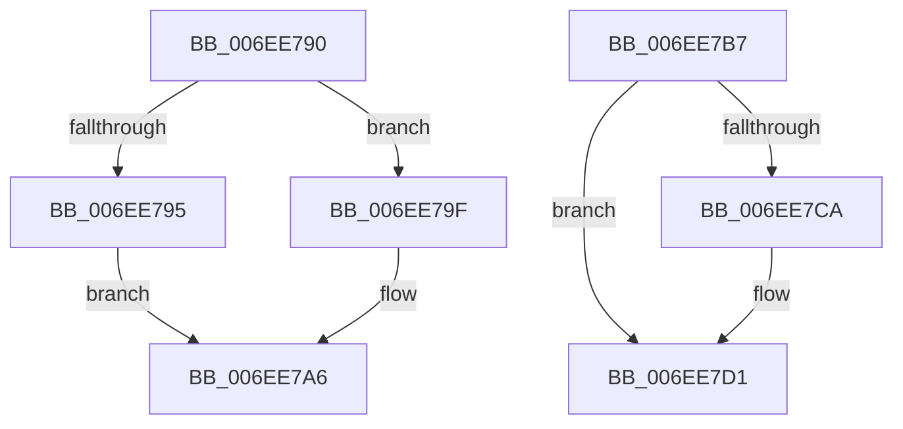

# sub_006EE790

- RVA: `0x006EE790`–`0x006EE7FD` (길이 `109` bytes)
- VA: `0x00000001406EE790`
- 실행 섹션: `.text`
- PDB 이름 있음: `아니요`; PDB Function 태그: `아니요`
- unwind 정보 RVA: `0x000A1E38`
- 디코드: `32`개 명령, `109/109` bytes 표시
- 미해석 바이트: `0` (있으면 어셈블리에 `.byte`로 보존)

> 이 문서는 커널 이미지의 기계어와 PDB 기호를 분석해 생성했습니다. 4번과 5번은 함수 원형과 자료형을 바이너리 사용 방식에서 추정한 C 해석이며 원본 소스 복구 결과는 아닙니다.

## 1. Dependencies

- 직접 호출 지점: **3**; 고유 호출 대상: **2**
- 직접 호출자로 확인된 함수: **0**
- RIP 상대 이미지 참조: **0**

### Outgoing calls
- `0x006EE7AB` → [KeReleaseSpinLock](../39/KeReleaseSpinLock_function_00392BA0.md) (function, `0x00392BA0`)
- `0x006EE7BA` → [KeAcquireSpinLockRaiseToDpc](../20/KeAcquireSpinLockRaiseToDpc_function_00208470.md) (function, `0x00208470`)
- `0x006EE7F1` → [KeReleaseSpinLock](../39/KeReleaseSpinLock_function_00392BA0.md) (function, `0x00392BA0`)

### Direct callers
- 이 함수 시작 RVA로 연결되는 직접 call은 확인되지 않았습니다. 간접 호출은 완전히 역산할 수 없습니다.

### Static image references
- 디코드된 RIP-relative 메모리 참조가 없습니다.

## 2. Other-region calls and transfers

- 다른 실행 섹션으로 향하는 call: **0**
- call이 아닌 외부 분기/꼬리 이동: **2**
  - `0x006EE7B2` → [IopGetSetStreamIdentifier + 0x94](../42/IopGetSetStreamIdentifier_function_0042ED7C.md) (`tail-transfer`)
  - `0x006EE7F8` → [IopGetSetStreamIdentifier + 0x94](../42/IopGetSetStreamIdentifier_function_0042ED7C.md) (`tail-transfer`)

## 3. Assembly (complete function range)

```asm
006EE790  40 84 F6                        test sil, sil
006EE793  74 0A                           je 0x1406ee79f
006EE795  49 89 1E                        mov qword ptr [r14], rbx
006EE798  BB 21 00 00 C0                  mov ebx, 0xc0000021
006EE79D  EB 07                           jmp 0x1406ee7a6
006EE79F  48 8B 52 10                     mov rdx, qword ptr [rdx + 0x10]
006EE7A3  49 89 16                        mov qword ptr [r14], rdx
006EE7A6  8A D0                           mov dl, al
006EE7A8  48 8B CD                        mov rcx, rbp
006EE7AB  E8 F0 43 CA FF                  call 0x140392ba0
006EE7B0  8B C3                           mov eax, ebx
006EE7B2  E9 59 06 D4 FF                  jmp 0x14042ee10
006EE7B7  48 8B CD                        mov rcx, rbp
006EE7BA  E8 B1 9C B1 FF                  call 0x140208470
006EE7BF  48 8B 4F 08                     mov rcx, qword ptr [rdi + 8]
006EE7C3  8A D0                           mov dl, al
006EE7C5  48 39 39                        cmp qword ptr [rcx], rdi
006EE7C8  74 07                           je 0x1406ee7d1
006EE7CA  B9 03 00 00 00                  mov ecx, 3
006EE7CF  CD 29                           int 0x29
006EE7D1  48 89 4E 08                     mov qword ptr [rsi + 8], rcx
006EE7D5  48 8D 46 20                     lea rax, [rsi + 0x20]
006EE7D9  48 89 3E                        mov qword ptr [rsi], rdi
006EE7DC  48 89 31                        mov qword ptr [rcx], rsi
006EE7DF  48 8B CD                        mov rcx, rbp
006EE7E2  48 89 77 08                     mov qword ptr [rdi + 8], rsi
006EE7E6  48 89 46 10                     mov qword ptr [rsi + 0x10], rax
006EE7EA  4C 89 7E 18                     mov qword ptr [rsi + 0x18], r15
006EE7EE  49 89 06                        mov qword ptr [r14], rax
006EE7F1  E8 AA 43 CA FF                  call 0x140392ba0
006EE7F6  33 C0                           xor eax, eax
006EE7F8  E9 13 06 D4 FF                  jmp 0x14042ee10
```

## 4. C-style interpretation (structured pseudocode)

```c
__int64 __fastcall sub_006EE790(__int64 a1, __int64 a2)
{
    __int64 result;

    if ((unsigned __int8)(v_rsi) == 0) goto loc_006EE79F;
    *(unsigned __int64 *)(v_r14) = v_rbx;
    goto loc_006EE7A6;
loc_006EE79F:
    *(unsigned __int64 *)(v_r14) = *(unsigned __int64 *)(a2 + 16);
loc_006EE7A6:
    result = KeReleaseSpinLock(v_rbp, (unsigned __int8)(result), a3, a4);
}
```

## 5. (Beta) C Style

```c
int64_t sub_006EE790(int64_t Arg1, void *Arg2)
{
    uint8_t *arg2 = (uint8_t *)Arg2;

    int64_t result;

    if ((uint8_t)(local_rsi) == 0) goto loc_006EE79F;
    *(uint64_t *)(local_r14) = local_rbx;
    goto loc_006EE7A6;
loc_006EE79F:
    *(uint64_t *)(local_r14) = *(uint64_t *)(arg2 + 0x10);
loc_006EE7A6:
    result = KeReleaseSpinLock(local_rbp, (uint8_t)(result), a3, a4);
}
```

### 관측된 메모리 오프셋

구조체 형식이 확인되지 않은 접근은 인자 기준의 오프셋으로만 기록했습니다.

| 기준 인자 | 오프셋 표현 | 폭 (bit) | 접근 |
|---|---:|---:|---|
| `Arg2` | `+ 0x10` | `64` | `R` |

## 6. Execution-region graph

[열기: 2D/3D 그래프와 함수 탐색 컨트롤 패널](../../../control-panel.html?section=text&rva=0x006EE790&view=graph)

- 2D 그래프는 위에서 아래로 흐르고, 3D 그래프는 빈 공간을 드래그해 회전합니다. Shift+드래그는 이동, 휠은 확대·축소, 함수 노드 선택은 대상 보고서 이동입니다.

### Static fallback


