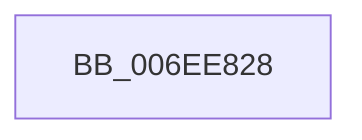

# sub_006EE828

- RVA: `0x006EE828`–`0x006EE845` (길이 `29` bytes)
- VA: `0x00000001406EE828`
- 실행 섹션: `.text`
- PDB 이름 있음: `아니요`; PDB Function 태그: `아니요`
- unwind 정보 RVA: `0x000A207C`
- 디코드: `8`개 명령, `29/29` bytes 표시
- 미해석 바이트: `0` (있으면 어셈블리에 `.byte`로 보존)

> 이 문서는 커널 이미지의 기계어와 PDB 기호를 분석해 생성했습니다. 4번과 5번은 함수 원형과 자료형을 바이너리 사용 방식에서 추정한 C 해석이며 원본 소스 복구 결과는 아닙니다.

## 1. Dependencies

- 직접 호출 지점: **1**; 고유 호출 대상: **1**
- 직접 호출자로 확인된 함수: **0**
- RIP 상대 이미지 참조: **0**

### Outgoing calls
- `0x006EE839` → [KeWaitForSingleObject](../20/KeWaitForSingleObject_function_0020E6B0.md) (function, `0x0020E6B0`)

### Direct callers
- 이 함수 시작 RVA로 연결되는 직접 call은 확인되지 않았습니다. 간접 호출은 완전히 역산할 수 없습니다.

### Static image references
- 디코드된 RIP-relative 메모리 참조가 없습니다.

## 2. Other-region calls and transfers

- 다른 실행 섹션으로 향하는 call: **0**
- call이 아닌 외부 분기/꼬리 이동: **1**
  - `0x006EE840` → [PopWakeDeviceList + 0x215](../43/PopWakeDeviceList_function_00430238.md) (`tail-transfer`)

## 3. Assembly (complete function range)

```asm
006EE828  45 33 C9                        xor r9d, r9d
006EE82B  4C 89 6C 24 20                  mov qword ptr [rsp + 0x20], r13
006EE830  45 33 C0                        xor r8d, r8d
006EE833  48 8D 4D EF                     lea rcx, [rbp - 0x11]
006EE837  33 D2                           xor edx, edx
006EE839  E8 72 FE B1 FF                  call 0x14020e6b0
006EE83E  FF CB                           dec ebx
006EE840  E9 08 1C D4 FF                  jmp 0x14043044d
```

## 4. C-style interpretation (structured pseudocode)

```c
__int64 __fastcall sub_006EE828(__int64 a1, int a2, int a3, int a4)
{
    __int64 result;
    __int64 v_rbx;
    unsigned __int64 v_stack_p20;

    a4 = 0;
    v_stack_p20 = v_r13;
    a3 = 0;
    a2 = 0;
    result = KeWaitForSingleObject(v_rbp - 17, a2, a3, a4);
    v_rbx = (unsigned int)((v_rbx) - 1);
}
```

## 5. (Beta) C Style

```c
int64_t sub_006EE828(int64_t Arg1, int32_t Arg2, int32_t Arg3, int32_t Arg4)
{
    int64_t result;
    int64_t local_rbx;
    uint64_t v_stack_p20;

    Arg4 = 0;
    v_stack_p20 = local_r13;
    Arg3 = 0;
    Arg2 = 0;
    result = KeWaitForSingleObject(local_rbp - 17, Arg2, Arg3, Arg4);
    local_rbx = (uint32_t)((local_rbx) - 1);
}
```

## 6. Execution-region graph

[열기: 2D/3D 그래프와 함수 탐색 컨트롤 패널](../../../control-panel.html?section=text&rva=0x006EE828&view=graph)

- 2D 그래프는 위에서 아래로 흐르고, 3D 그래프는 빈 공간을 드래그해 회전합니다. Shift+드래그는 이동, 휠은 확대·축소, 함수 노드 선택은 대상 보고서 이동입니다.

### Static fallback


