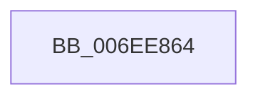

# sub_006EE864

- RVA: `0x006EE864`–`0x006EE8F2` (길이 `142` bytes)
- VA: `0x00000001406EE864`
- 실행 섹션: `.text`
- PDB 이름 있음: `아니요`; PDB Function 태그: `아니요`
- unwind 정보 RVA: `0x000A20E8`
- 디코드: `32`개 명령, `142/142` bytes 표시
- 미해석 바이트: `0` (있으면 어셈블리에 `.byte`로 보존)

> 이 문서는 커널 이미지의 기계어와 PDB 기호를 분석해 생성했습니다. 4번과 5번은 함수 원형과 자료형을 바이너리 사용 방식에서 추정한 C 해석이며 원본 소스 복구 결과는 아닙니다.

## 1. Dependencies

- 직접 호출 지점: **1**; 고유 호출 대상: **1**
- 직접 호출자로 확인된 함수: **0**
- RIP 상대 이미지 참조: **2**

### Outgoing calls
- `0x006EE8E7` → [tlgWriteTransfer_EtwWriteTransfer](../42/tlgWriteTransfer_EtwWriteTransfer_function_004260E0.md) (function, `0x004260E0`)

### Direct callers
- 이 함수 시작 RVA로 연결되는 직접 call은 확인되지 않았습니다. 간접 호출은 완전히 역산할 수 없습니다.

### Static image references
- `0x006EE8B3` → RVA `0x00049401` (`.rdata`; read)
- `0x006EE8BD` → RVA `0x00E07748` (`.data`; read)

## 2. Other-region calls and transfers

- 다른 실행 섹션으로 향하는 call: **0**
- call이 아닌 외부 분기/꼬리 이동: **1**
  - `0x006EE8ED` → [PopWriteBsdPoInfo + 0x104](../43/PopWriteBsdPoInfo_function_00430768.md) (`tail-transfer`)

## 3. Assembly (complete function range)

```asm
006EE864  83 65 F3 00                     and dword ptr [rbp - 0xd], 0
006EE868  48 8D 44 24 30                  lea rax, [rsp + 0x30]
006EE86D  83 65 03 00                     and dword ptr [rbp + 3], 0
006EE871  BA 04 00 00 00                  mov edx, 4
006EE876  83 65 13 00                     and dword ptr [rbp + 0x13], 0
006EE87A  45 33 C9                        xor r9d, r9d
006EE87D  83 65 23 00                     and dword ptr [rbp + 0x23], 0
006EE881  45 33 C0                        xor r8d, r8d
006EE884  48 89 45 E7                     mov qword ptr [rbp - 0x19], rax
006EE888  48 8D 44 24 40                  lea rax, [rsp + 0x40]
006EE88D  8D 4A 04                        lea ecx, [rdx + 4]
006EE890  48 89 45 F7                     mov qword ptr [rbp - 9], rax
006EE894  48 8D 44 24 38                  lea rax, [rsp + 0x38]
006EE899  89 55 EF                        mov dword ptr [rbp - 0x11], edx
006EE89C  48 89 45 07                     mov qword ptr [rbp + 7], rax
006EE8A0  48 8D 44 24 48                  lea rax, [rsp + 0x48]
006EE8A5  48 89 45 17                     mov qword ptr [rbp + 0x17], rax
006EE8A9  48 8D 45 C7                     lea rax, [rbp - 0x39]
006EE8AD  89 4D FF                        mov dword ptr [rbp - 1], ecx
006EE8B0  89 55 0F                        mov dword ptr [rbp + 0xf], edx
006EE8B3  48 8D 15 47 AB 95 FF            lea rdx, [rip - 0x6a54b9]
006EE8BA  89 4D 1F                        mov dword ptr [rbp + 0x1f], ecx
006EE8BD  48 8D 0D 84 8E 71 00            lea rcx, [rip + 0x718e84]
006EE8C4  48 89 44 24 28                  mov qword ptr [rsp + 0x28], rax
006EE8C9  C7 44 24 20 06 00 00 00         mov dword ptr [rsp + 0x20], 6
006EE8D1  89 7C 24 30                     mov dword ptr [rsp + 0x30], edi
006EE8D5  4C 89 54 24 40                  mov qword ptr [rsp + 0x40], r10
006EE8DA  89 5C 24 38                     mov dword ptr [rsp + 0x38], ebx
006EE8DE  48 C7 44 24 48 00 00 00 01      mov qword ptr [rsp + 0x48], 0x1000000
006EE8E7  E8 F4 77 D3 FF                  call 0x1404260e0
006EE8EC  90                              nop
006EE8ED  E9 7A 1F D4 FF                  jmp 0x14043086c
```

## 4. C-style interpretation (structured pseudocode)

```c
__int64 __fastcall sub_006EE864(__int64 a1, __int64 a2, int a3, int a4, __int64 a5, __int64 a6, __int64 a7, __int64 a8, __int64 a9)
{
    __int64 result;
    unsigned int v_stack_p20;
    unsigned __int64 v_stack_p28;
    unsigned int v_stack_p30;
    unsigned int v_stack_p38;
    unsigned __int64 v_stack_p40;
    unsigned __int64 v_stack_p48;

    a4 = 0;
    a3 = 0;
    *(unsigned __int64 *)(v_rbp - 25) = a6;
    *(unsigned __int64 *)(v_rbp - 9) = a8;
    *(unsigned int *)(v_rbp - 17) = 4;
    *(unsigned __int64 *)(v_rbp + 7) = a7;
    *(unsigned __int64 *)(v_rbp + 23) = a9;
    *(unsigned int *)(v_rbp - 1) = (unsigned int)(4 + 4);
    *(unsigned int *)(v_rbp + 15) = 4;
    *(unsigned int *)(v_rbp + 31) = (unsigned int)(4 + 4);
    v_stack_p28 = v_rbp - 57;
    v_stack_p20 = 6;
    v_stack_p30 = (unsigned int)(v_rdi);
    v_stack_p40 = v_r10;
    v_stack_p38 = (unsigned int)(v_rbx);
    v_stack_p48 = 0x1000000ULL;
    result = tlgWriteTransfer_EtwWriteTransfer(v_rip + 7442052, v_rip - 6968505, a3, a4);
}
```

## 5. (Beta) C Style

```c
int64_t sub_006EE864(int64_t Arg1, int64_t Arg2, int32_t Arg3, int32_t Arg4, uint64_t Arg5, int64_t Arg6, int64_t Arg7, int64_t Arg8, int64_t Arg9)
{
    int64_t result;
    uint32_t v_stack_p20;
    uint64_t v_stack_p28;
    uint32_t v_stack_p30;
    uint32_t v_stack_p38;
    uint64_t v_stack_p40;
    uint64_t v_stack_p48;

    Arg4 = 0;
    Arg3 = 0;
    *(uint64_t *)(local_rbp - 0x19) = Arg6;
    *(uint64_t *)(local_rbp - 0x9) = Arg8;
    *(uint32_t *)(local_rbp - 0x11) = 4;
    *(uint64_t *)(local_rbp + 0x7) = Arg7;
    *(uint64_t *)(local_rbp + 0x17) = Arg9;
    *(uint32_t *)(local_rbp - 0x1) = (uint32_t)(4 + 4);
    *(uint32_t *)(local_rbp + 0xF) = 4;
    *(uint32_t *)(local_rbp + 0x1F) = (uint32_t)(4 + 4);
    v_stack_p28 = local_rbp - 57;
    v_stack_p20 = 6;
    v_stack_p30 = (uint32_t)(local_rdi);
    v_stack_p40 = local_r10;
    v_stack_p38 = (uint32_t)(local_rbx);
    v_stack_p48 = 0x1000000ULL;
    result = tlgWriteTransfer_EtwWriteTransfer(v_rip + 7442052, v_rip - 6968505, Arg3, Arg4);
}
```

## 6. Execution-region graph

[열기: 2D/3D 그래프와 함수 탐색 컨트롤 패널](../../../control-panel.html?section=text&rva=0x006EE864&view=graph)

- 2D 그래프는 위에서 아래로 흐르고, 3D 그래프는 빈 공간을 드래그해 회전합니다. Shift+드래그는 이동, 휠은 확대·축소, 함수 노드 선택은 대상 보고서 이동입니다.

### Static fallback


