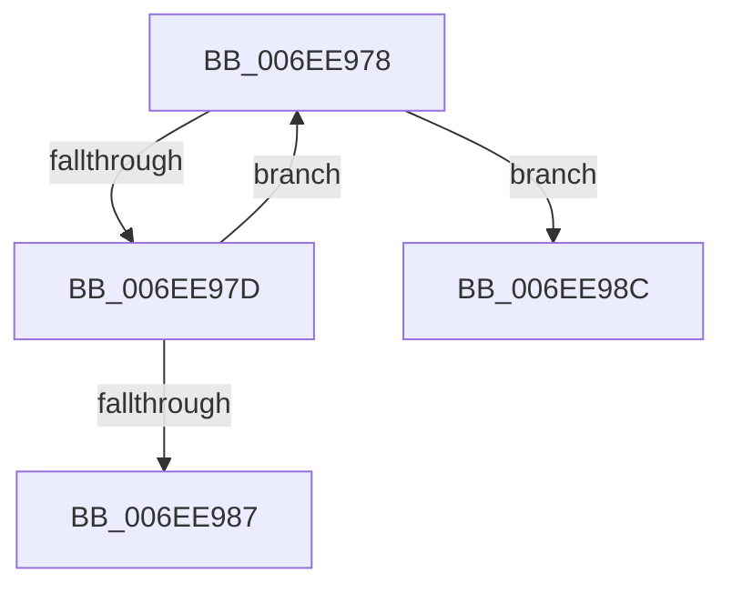

# sub_006EE978

- RVA: `0x006EE978`–`0x006EE99A` (길이 `34` bytes)
- VA: `0x00000001406EE978`
- 실행 섹션: `.text`
- PDB 이름 있음: `아니요`; PDB Function 태그: `아니요`
- unwind 정보 RVA: `0x000A2254`
- 디코드: `10`개 명령, `34/34` bytes 표시
- 미해석 바이트: `0` (있으면 어셈블리에 `.byte`로 보존)

> 이 문서는 커널 이미지의 기계어와 PDB 기호를 분석해 생성했습니다. 4번과 5번은 함수 원형과 자료형을 바이너리 사용 방식에서 추정한 C 해석이며 원본 소스 복구 결과는 아닙니다.

## 1. Dependencies

- 직접 호출 지점: **1**; 고유 호출 대상: **1**
- 직접 호출자로 확인된 함수: **0**
- RIP 상대 이미지 참조: **0**

### Outgoing calls
- `0x006EE98F` → [RtlpRemoveInvertedFunctionTableEntry](../5E/RtlpRemoveInvertedFunctionTableEntry_function_005EF354.md) (function, `0x005EF354`)

### Direct callers
- 이 함수 시작 RVA로 연결되는 직접 call은 확인되지 않았습니다. 간접 호출은 완전히 역산할 수 없습니다.

### Static image references
- 디코드된 RIP-relative 메모리 참조가 없습니다.

## 2. Other-region calls and transfers

- 다른 실행 섹션으로 향하는 call: **0**
- call이 아닌 외부 분기/꼬리 이동: **2**
  - `0x006EE987` → [RtlRemoveInvertedFunctionTable + 0x21](../43/RtlRemoveInvertedFunctionTable_function_004320E8.md) (`tail-transfer`)
  - `0x006EE995` → [RtlRemoveInvertedFunctionTable + 0x21](../43/RtlRemoveInvertedFunctionTable_function_004320E8.md) (`tail-transfer`)

## 3. Assembly (complete function range)

```asm
006EE978  48 3B 3A                        cmp rdi, qword ptr [rdx]
006EE97B  74 0F                           je 0x1406ee98c
006EE97D  48 83 EA 18                     sub rdx, 0x18
006EE981  41 83 C1 FF                     add r9d, -1
006EE985  75 F1                           jne 0x1406ee978
006EE987  E9 7D 37 D4 FF                  jmp 0x140432109
006EE98C  41 8B D1                        mov edx, r9d
006EE98F  E8 C0 09 F0 FF                  call 0x1405ef354
006EE994  90                              nop
006EE995  E9 6F 37 D4 FF                  jmp 0x140432109
```

## 4. C-style interpretation (structured pseudocode)

```c
__int64 __fastcall sub_006EE978(__int64 a1, __int64 a2, __int64 a3, int a4)
{
    __int64 result;

    if (v_rdi == (*(unsigned __int64 *)(a2))) goto loc_006EE98C;
    a2 = (a2) - (24);
    a4 = (unsigned int)((a4) + (-1));
    if (condition_is_not_equal) goto loc_006EE978;
loc_006EE98C:
    result = RtlpRemoveInvertedFunctionTableEntry(a1, (unsigned int)(a4), a3, a4);
}
```

## 5. (Beta) C Style

```c
int64_t sub_006EE978(int64_t Arg1, void *Arg2, int64_t Arg3, int32_t Arg4)
{
    uint8_t *arg2 = (uint8_t *)Arg2;

    int64_t result;

    if (local_rdi == (*(uint64_t *)(arg2))) goto loc_006EE98C;
    Arg2 = (Arg2) - (24);
    Arg4 = (uint32_t)((Arg4) + (-1));
    if (condition_is_not_equal) goto loc_006EE978;
loc_006EE98C:
    result = RtlpRemoveInvertedFunctionTableEntry(Arg1, (uint32_t)(Arg4), Arg3, Arg4);
}
```

### 관측된 메모리 오프셋

구조체 형식이 확인되지 않은 접근은 인자 기준의 오프셋으로만 기록했습니다.

| 기준 인자 | 오프셋 표현 | 폭 (bit) | 접근 |
|---|---:|---:|---|
| `Arg2` | `+ 0x0` | `64` | `R` |

## 6. Execution-region graph

[열기: 2D/3D 그래프와 함수 탐색 컨트롤 패널](../../../control-panel.html?section=text&rva=0x006EE978&view=graph)

- 2D 그래프는 위에서 아래로 흐르고, 3D 그래프는 빈 공간을 드래그해 회전합니다. Shift+드래그는 이동, 휠은 확대·축소, 함수 노드 선택은 대상 보고서 이동입니다.

### Static fallback


