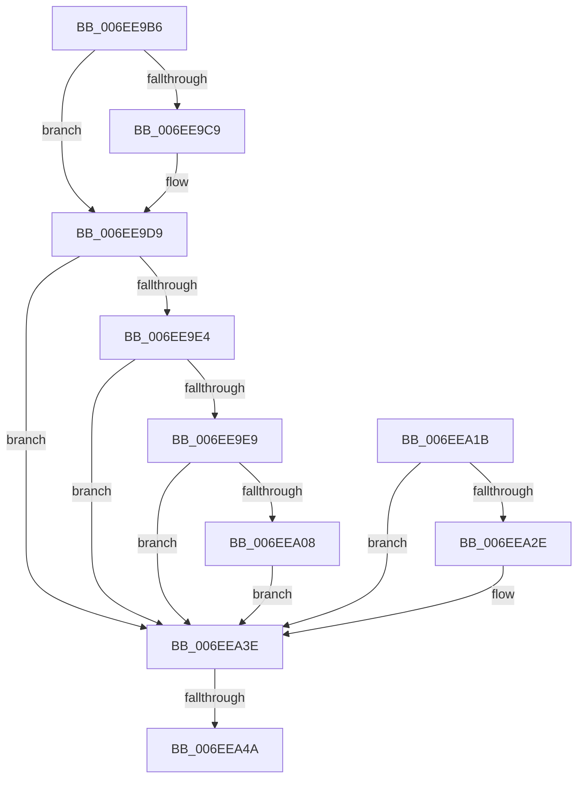

# sub_006EE9B6

- RVA: `0x006EE9B6`–`0x006EEA5B` (길이 `165` bytes)
- VA: `0x00000001406EE9B6`
- 실행 섹션: `.text`
- PDB 이름 있음: `아니요`; PDB Function 태그: `아니요`
- unwind 정보 RVA: `0x000A230C`
- 디코드: `43`개 명령, `165/165` bytes 표시
- 미해석 바이트: `0` (있으면 어셈블리에 `.byte`로 보존)

> 이 문서는 커널 이미지의 기계어와 PDB 기호를 분석해 생성했습니다. 4번과 5번은 함수 원형과 자료형을 바이너리 사용 방식에서 추정한 C 해석이며 원본 소스 복구 결과는 아닙니다.

## 1. Dependencies

- 직접 호출 지점: **6**; 고유 호출 대상: **4**
- 직접 호출자로 확인된 함수: **0**
- RIP 상대 이미지 참조: **1**

### Outgoing calls
- `0x006EE9C0` → [MiPteInShadowRange](../23/MiPteInShadowRange_function_0023FB00.md) (function, `0x0023FB00`)
- `0x006EE9CD` → [MiSanitizeShadowPxe](../29/MiSanitizeShadowPxe_function_00294B68.md) (function, `0x00294B68`)
- `0x006EEA14` → [MiCheckLinearProtectedPteAccessedBit](../29/MiCheckLinearProtectedPteAccessedBit_function_00292D80.md) (function, `0x00292D80`)
- `0x006EEA25` → [MiPteInShadowRange](../23/MiPteInShadowRange_function_0023FB00.md) (function, `0x0023FB00`)
- `0x006EEA32` → [MiSanitizeShadowPxe](../29/MiSanitizeShadowPxe_function_00294B68.md) (function, `0x00294B68`)
- `0x006EEA50` → [MiWritePteShadow](../29/MiWritePteShadow_function_00294EAC.md) (function, `0x00294EAC`)

### Direct callers
- 이 함수 시작 RVA로 연결되는 직접 call은 확인되지 않았습니다. 간접 호출은 완전히 역산할 수 없습니다.

### Static image references
- `0x006EE9D9` → RVA `0x00FC6A88` (`ALMOSTRO`; read)

## 2. Other-region calls and transfers

- 다른 실행 섹션으로 향하는 call: **0**
- call이 아닌 외부 분기/꼬리 이동: **2**
  - `0x006EEA44` → [MiReadWriteAnyLevelShadowPte + 0x139](../43/MiReadWriteAnyLevelShadowPte_function_00432654.md) (`tail-transfer`)
  - `0x006EEA56` → [MiReadWriteAnyLevelShadowPte + 0x139](../43/MiReadWriteAnyLevelShadowPte_function_00432654.md) (`tail-transfer`)

## 3. Assembly (complete function range)

```asm
006EE9B6  48 8B CE                        mov rcx, rsi
006EE9B9  48 89 5D D0                     mov qword ptr [rbp - 0x30], rbx
006EE9BD  45 33 F6                        xor r14d, r14d
006EE9C0  E8 3B 11 B5 FF                  call 0x14023fb00
006EE9C5  85 C0                           test eax, eax
006EE9C7  74 10                           je 0x1406ee9d9
006EE9C9  48 8D 55 D0                     lea rdx, [rbp - 0x30]
006EE9CD  E8 96 61 BA FF                  call 0x140294b68
006EE9D2  48 8B 5D D0                     mov rbx, qword ptr [rbp - 0x30]
006EE9D6  44 8B F0                        mov r14d, eax
006EE9D9  48 0F BA 25 A6 80 8D 00 24      bt qword ptr [rip + 0x8d80a6], 0x24
006EE9E2  73 5A                           jae 0x1406eea3e
006EE9E4  F6 C3 20                        test bl, 0x20
006EE9E7  75 55                           jne 0x1406eea3e
006EE9E9  48 B8 00 00 00 00 80 F6 FF FF   movabs rax, 0xfffff68000000000
006EE9F3  48 8B D0                        mov rdx, rax
006EE9F6  48 B8 00 00 00 00 40 00 00 00   movabs rax, 0x4000000000
006EEA00  48 03 D0                        add rdx, rax
006EEA03  48 3B F2                        cmp rsi, rdx
006EEA06  72 36                           jb 0x1406eea3e
006EEA08  41 B8 80 00 00 00               mov r8d, 0x80
006EEA0E  48 8B D3                        mov rdx, rbx
006EEA11  48 8B CE                        mov rcx, rsi
006EEA14  E8 67 43 BA FF                  call 0x140292d80
006EEA19  EB 23                           jmp 0x1406eea3e
006EEA1B  48 8B CE                        mov rcx, rsi
006EEA1E  48 89 5D D8                     mov qword ptr [rbp - 0x28], rbx
006EEA22  45 33 F6                        xor r14d, r14d
006EEA25  E8 D6 10 B5 FF                  call 0x14023fb00
006EEA2A  85 C0                           test eax, eax
006EEA2C  74 10                           je 0x1406eea3e
006EEA2E  48 8D 55 D8                     lea rdx, [rbp - 0x28]
006EEA32  E8 31 61 BA FF                  call 0x140294b68
006EEA37  48 8B 5D D8                     mov rbx, qword ptr [rbp - 0x28]
006EEA3B  44 8B F0                        mov r14d, eax
006EEA3E  48 89 1E                        mov qword ptr [rsi], rbx
006EEA41  45 85 F6                        test r14d, r14d
006EEA44  0F 84 43 3D D4 FF               je 0x14043278d
006EEA4A  48 8B D3                        mov rdx, rbx
006EEA4D  48 8B CE                        mov rcx, rsi
006EEA50  E8 57 64 BA FF                  call 0x140294eac
006EEA55  90                              nop
006EEA56  E9 32 3D D4 FF                  jmp 0x14043278d
```

## 4. C-style interpretation (structured pseudocode)

```c
__int64 __fastcall sub_006EE9B6(void)
{
    __int64 result;
    __int64 v_r14;
    __int64 v_rbx;

    *(unsigned __int64 *)(v_rbp - 48) = v_rbx;
    v_r14 = 0;
    result = MiPteInShadowRange(v_rsi, a2, a3, a4);
    if ((unsigned int)(result) != 0) {
        a2 = v_rbp - 48;
        result = MiSanitizeShadowPxe(v_rsi, a2, a3, a4);
        v_rbx = *(unsigned __int64 *)(v_rbp - 48);
        v_r14 = (unsigned int)(result);
    }
    if (condition_is_above_or_equal) goto loc_006EEA3E;
    if ((((unsigned __int8)(v_rbx)) & (32)) != 0) goto loc_006EEA3E;
    a2 = (result) + (result);
    if (v_rsi < a2) goto loc_006EEA3E;
    result = MiCheckLinearProtectedPteAccessedBit(v_rsi, v_rbx, 128, a4);
    goto loc_006EEA3E;
loc_006EEA3E:
    *(unsigned __int64 *)(v_rsi) = v_rbx;
    result = MiWritePteShadow(v_rsi, v_rbx, 128, a4);
}
```

## 5. (Beta) C Style

```c
void sub_006EE9B6(void)
{
    int64_t result;
    int64_t local_r14;
    int64_t local_rbx;

    *(uint64_t *)(local_rbp - 0x30) = local_rbx;
    local_r14 = 0;
    result = MiPteInShadowRange(local_rsi, a2, a3, a4);
    if ((uint32_t)(result) != 0) {
        a2 = local_rbp - 48;
        result = MiSanitizeShadowPxe(local_rsi, a2, a3, a4);
        local_rbx = *(uint64_t *)(local_rbp - 0x30);
        local_r14 = (uint32_t)(result);
    }
    if (condition_is_above_or_equal) goto loc_006EEA3E;
    if ((((uint8_t)(local_rbx)) & (32)) != 0) goto loc_006EEA3E;
    a2 = (result) + (result);
    if (local_rsi < a2) goto loc_006EEA3E;
    result = MiCheckLinearProtectedPteAccessedBit(local_rsi, local_rbx, 128, a4);
    goto loc_006EEA3E;
loc_006EEA3E:
    *(uint64_t *)(local_rsi) = local_rbx;
    result = MiWritePteShadow(local_rsi, local_rbx, 128, a4);
}
```

## 6. Execution-region graph

[열기: 2D/3D 그래프와 함수 탐색 컨트롤 패널](../../../control-panel.html?section=text&rva=0x006EE9B6&view=graph)

- 2D 그래프는 위에서 아래로 흐르고, 3D 그래프는 빈 공간을 드래그해 회전합니다. Shift+드래그는 이동, 휠은 확대·축소, 함수 노드 선택은 대상 보고서 이동입니다.

### Static fallback


