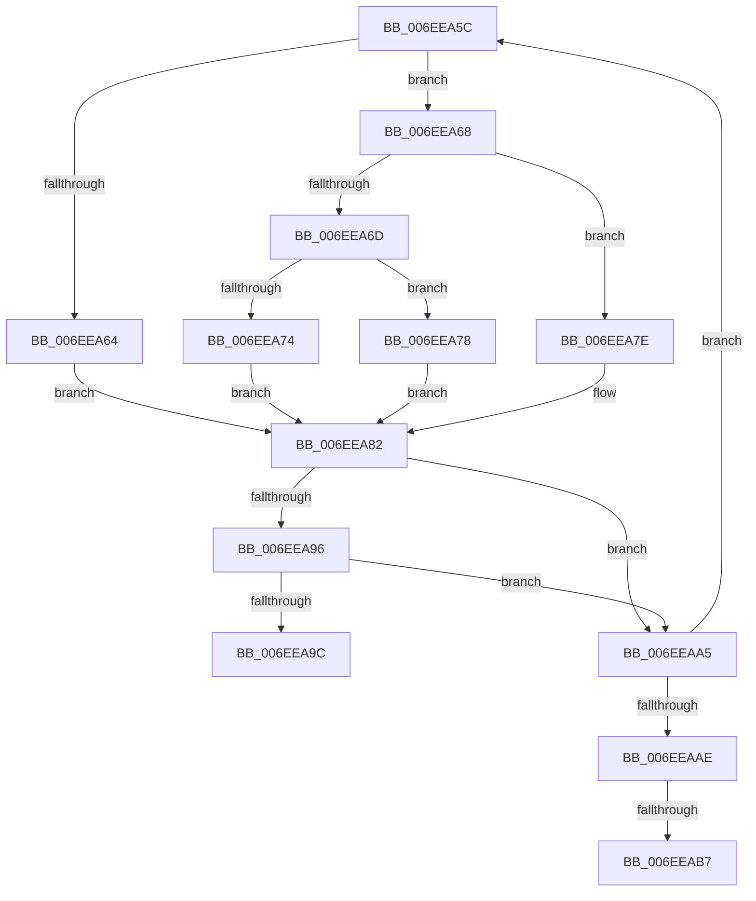

# sub_006EEA5C

- RVA: `0x006EEA5C`–`0x006EEAC3` (길이 `103` bytes)
- VA: `0x00000001406EEA5C`
- 실행 섹션: `.text`
- PDB 이름 있음: `아니요`; PDB Function 태그: `아니요`
- unwind 정보 RVA: `0x000A24A8`
- 디코드: `32`개 명령, `103/103` bytes 표시
- 미해석 바이트: `0` (있으면 어셈블리에 `.byte`로 보존)

> 이 문서는 커널 이미지의 기계어와 PDB 기호를 분석해 생성했습니다. 4번과 5번은 함수 원형과 자료형을 바이너리 사용 방식에서 추정한 C 해석이며 원본 소스 복구 결과는 아닙니다.

## 1. Dependencies

- 직접 호출 지점: **1**; 고유 호출 대상: **1**
- 직접 호출자로 확인된 함수: **0**
- RIP 상대 이미지 참조: **0**

### Outgoing calls
- `0x006EEA8C` → [RtlFindAceByType](../41/RtlFindAceByType_function_00410AF0.md) (function, `0x00410AF0`)

### Direct callers
- 이 함수 시작 RVA로 연결되는 직접 call은 확인되지 않았습니다. 간접 호출은 완전히 역산할 수 없습니다.

### Static image references
- 디코드된 RIP-relative 메모리 참조가 없습니다.

## 2. Other-region calls and transfers

- 다른 실행 섹션으로 향하는 call: **0**
- call이 아닌 외부 분기/꼬리 이동: **3**
  - `0x006EEAA0` → [sub_004332C5 + 0x3D](../43/Unknown_function_004332C5.md) (`tail-transfer`)
  - `0x006EEAB1` → [sub_004332C5 + 0x3D](../43/Unknown_function_004332C5.md) (`tail-transfer`)
  - `0x006EEABE` → [sub_004332C5 + 0x3D](../43/Unknown_function_004332C5.md) (`tail-transfer`)

## 3. Assembly (complete function range)

```asm
006EEA5C  0F B7 46 02                     movzx eax, word ptr [rsi + 2]
006EEA60  A8 10                           test al, 0x10
006EEA62  75 04                           jne 0x1406eea68
006EEA64  33 C9                           xor ecx, ecx
006EEA66  EB 1A                           jmp 0x1406eea82
006EEA68  66 85 C0                        test ax, ax
006EEA6B  79 11                           jns 0x1406eea7e
006EEA6D  8B 46 0C                        mov eax, dword ptr [rsi + 0xc]
006EEA70  85 C0                           test eax, eax
006EEA72  75 04                           jne 0x1406eea78
006EEA74  33 C9                           xor ecx, ecx
006EEA76  EB 0A                           jmp 0x1406eea82
006EEA78  48 8D 0C 06                     lea rcx, [rsi + rax]
006EEA7C  EB 04                           jmp 0x1406eea82
006EEA7E  48 8B 4E 18                     mov rcx, qword ptr [rsi + 0x18]
006EEA82  4C 8D 44 24 60                  lea r8, [rsp + 0x60]
006EEA87  BA 11 00 00 00                  mov edx, 0x11
006EEA8C  E8 5F 20 D2 FF                  call 0x140410af0
006EEA91  48 85 C0                        test rax, rax
006EEA94  74 0F                           je 0x1406eeaa5
006EEA96  F6 40 01 08                     test byte ptr [rax + 1], 8
006EEA9A  75 09                           jne 0x1406eeaa5
006EEA9C  44 21 78 04                     and dword ptr [rax + 4], r15d
006EEAA0  E9 5D 48 D4 FF                  jmp 0x140433302
006EEAA5  FF 44 24 60                     inc dword ptr [rsp + 0x60]
006EEAA9  48 85 C0                        test rax, rax
006EEAAC  75 AE                           jne 0x1406eea5c
006EEAAE  48 85 DB                        test rbx, rbx
006EEAB1  0F 84 4B 48 D4 FF               je 0x140433302
006EEAB7  44 89 7B 04                     mov dword ptr [rbx + 4], r15d
006EEABB  41 0B FC                        or edi, r12d
006EEABE  E9 3F 48 D4 FF                  jmp 0x140433302
```

## 4. C-style interpretation (structured pseudocode)

```c
__int64 __fastcall sub_006EEA5C(int a1, __int64 a2, __int64 a3, __int64 a4, __int64 a5, __int64 a6, __int64 a7, __int64 a8, __int64 a9, __int64 a10, __int64 a11, unsigned int a12)
{
    __int64 result;
    __int64 v_rdi;

    if ((((unsigned __int8)(*(unsigned __int16 *)(v_rsi + 2))) & (16)) != 0) goto loc_006EEA68;
    a1 = 0;
    goto loc_006EEA82;
loc_006EEA68:
    if (!sign_flag) goto loc_006EEA7E;
    if ((unsigned int)((unsigned int)(*(unsigned int *)(v_rsi + 12))) != 0) goto loc_006EEA78;
    a1 = 0;
    goto loc_006EEA82;
loc_006EEA78:
    goto loc_006EEA82;
loc_006EEA7E:
loc_006EEA82:
    result = RtlFindAceByType(*(unsigned __int64 *)(v_rsi + 24), 17, a12, a4);
    if (result == 0) goto loc_006EEAA5;
    if (((*(unsigned __int8 *)(result + 1)) & (8)) != 0) goto loc_006EEAA5;
loc_006EEAA5:
    if (result != 0) goto loc_006EEA5C;
    *(unsigned int *)(v_rbx + 4) = (unsigned int)(v_r15);
    v_rdi = (unsigned int)((v_rdi) | ((unsigned int)(v_r12)));
}
```

## 5. (Beta) C Style

```c
int64_t sub_006EEA5C(int32_t Arg1, int64_t Arg2, int64_t Arg3, int64_t Arg4, uint64_t Arg5, uint64_t Arg6, uint64_t Arg7, uint64_t Arg8, uint64_t Arg9, uint64_t Arg10, uint64_t Arg11, uint32_t Arg12)
{
    int64_t result;
    int64_t local_rdi;

    if ((((uint8_t)(*(uint16_t *)(local_rsi + 0x2))) & (16)) != 0) goto loc_006EEA68;
    Arg1 = 0;
    goto loc_006EEA82;
loc_006EEA68:
    if (!sign_flag) goto loc_006EEA7E;
    if ((uint32_t)((uint32_t)(*(uint32_t *)(local_rsi + 0xC))) != 0) goto loc_006EEA78;
    Arg1 = 0;
    goto loc_006EEA82;
loc_006EEA78:
    goto loc_006EEA82;
loc_006EEA7E:
loc_006EEA82:
    result = RtlFindAceByType(*(uint64_t *)(local_rsi + 0x18), 17, Arg12, Arg4);
    if (result == 0) goto loc_006EEAA5;
    if (((*(uint8_t *)(result + 0x1)) & (8)) != 0) goto loc_006EEAA5;
loc_006EEAA5:
    if (result != 0) goto loc_006EEA5C;
    *(uint32_t *)(local_rbx + 0x4) = (uint32_t)(local_r15);
    local_rdi = (uint32_t)((local_rdi) | ((uint32_t)(local_r12)));
}
```

## 6. Execution-region graph

[열기: 2D/3D 그래프와 함수 탐색 컨트롤 패널](../../../control-panel.html?section=text&rva=0x006EEA5C&view=graph)

- 2D 그래프는 위에서 아래로 흐르고, 3D 그래프는 빈 공간을 드래그해 회전합니다. Shift+드래그는 이동, 휠은 확대·축소, 함수 노드 선택은 대상 보고서 이동입니다.

### Static fallback


