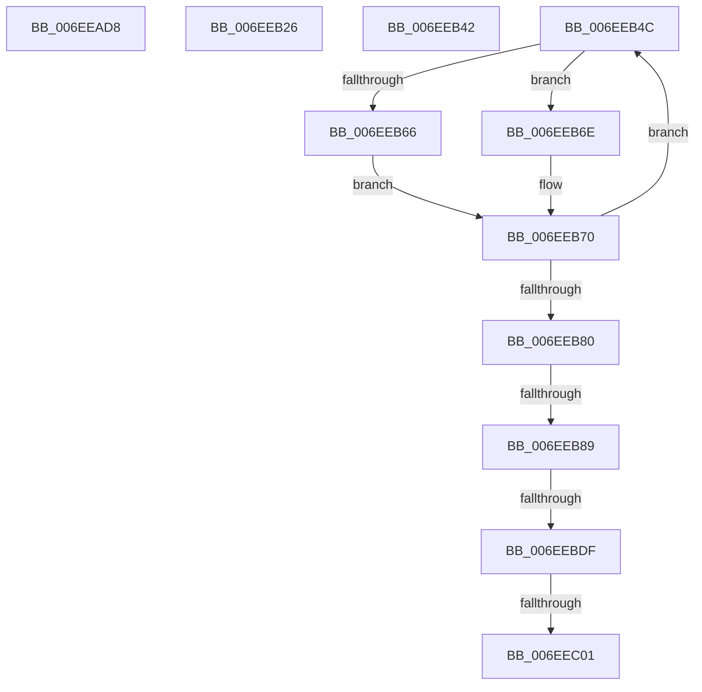

# sub_006EEAD8

- RVA: `0x006EEAD8`–`0x006EEC06` (길이 `302` bytes)
- VA: `0x00000001406EEAD8`
- 실행 섹션: `.text`
- PDB 이름 있음: `아니요`; PDB Function 태그: `아니요`
- unwind 정보 RVA: `0x000A26F4`
- 디코드: `77`개 명령, `302/302` bytes 표시
- 미해석 바이트: `0` (있으면 어셈블리에 `.byte`로 보존)

> 이 문서는 커널 이미지의 기계어와 PDB 기호를 분석해 생성했습니다. 4번과 5번은 함수 원형과 자료형을 바이너리 사용 방식에서 추정한 C 해석이며 원본 소스 복구 결과는 아닙니다.

## 1. Dependencies

- 직접 호출 지점: **3**; 고유 호출 대상: **2**
- 직접 호출자로 확인된 함수: **0**
- RIP 상대 이미지 참조: **0**

### Outgoing calls
- `0x006EEBA8` → [memset](../6C/memset_function_006C6C40.md) (function, `0x006C6C40`)
- `0x006EEBD2` → [ST_STORE<SM_TRAITS>::StDmGetStatsBitmap](../60/ST_STORE_SM_TRAITS_StDmGetStatsBitmap_function_0060D838.md) (function, `0x0060D838`)
- `0x006EEBF4` → [ST_STORE<SM_TRAITS>::StDmGetStatsBitmap](../60/ST_STORE_SM_TRAITS_StDmGetStatsBitmap_function_0060D838.md) (function, `0x0060D838`)

### Direct callers
- 이 함수 시작 RVA로 연결되는 직접 call은 확인되지 않았습니다. 간접 호출은 완전히 역산할 수 없습니다.

### Static image references
- 디코드된 RIP-relative 메모리 참조가 없습니다.

## 2. Other-region calls and transfers

- 다른 실행 섹션으로 향하는 call: **0**
- call이 아닌 외부 분기/꼬리 이동: **7**
  - `0x006EEB21` → [ST_STORE<SM_TRAITS>::StGetStatsWorker + 0x45](../43/ST_STORE_SM_TRAITS_StGetStatsWorker_function_00433C80.md) (`tail-transfer`)
  - `0x006EEB3D` → [ST_STORE<SM_TRAITS>::StGetStatsWorker + 0x45](../43/ST_STORE_SM_TRAITS_StGetStatsWorker_function_00433C80.md) (`tail-transfer`)
  - `0x006EEB47` → [ST_STORE<SM_TRAITS>::StGetStatsWorker + 0x45](../43/ST_STORE_SM_TRAITS_StGetStatsWorker_function_00433C80.md) (`tail-transfer`)
  - `0x006EEB83` → [ST_STORE<SM_TRAITS>::StGetStatsWorker + 0x204](../43/ST_STORE_SM_TRAITS_StGetStatsWorker_function_00433C80.md) (`tail-transfer`)
  - `0x006EEBD9` → [ST_STORE<SM_TRAITS>::StGetStatsWorker + 0x20D](../43/ST_STORE_SM_TRAITS_StGetStatsWorker_function_00433C80.md) (`tail-transfer`)
  - `0x006EEBFB` → [ST_STORE<SM_TRAITS>::StGetStatsWorker + 0x20D](../43/ST_STORE_SM_TRAITS_StGetStatsWorker_function_00433C80.md) (`tail-transfer`)
  - `0x006EEC01` → [ST_STORE<SM_TRAITS>::StGetStatsWorker + 0x204](../43/ST_STORE_SM_TRAITS_StGetStatsWorker_function_00433C80.md) (`tail-transfer`)

## 3. Assembly (complete function range)

```asm
006EEAD8  41 8B 4E 0C                     mov ecx, dword ptr [r14 + 0xc]
006EEADC  49 8D 87 01 06 00 00            lea rax, [r15 + 0x601]
006EEAE3  48 83 E0 FE                     and rax, 0xfffffffffffffffe
006EEAE7  48 8D 34 8D 07 00 00 00         lea rsi, [rcx*4 + 7]
006EEAEF  48 03 F0                        add rsi, rax
006EEAF2  48 83 E6 F8                     and rsi, 0xfffffffffffffff8
006EEAF6  41 8B 86 78 03 00 00            mov eax, dword ptr [r14 + 0x378]
006EEAFD  41 2B F7                        sub esi, r15d
006EEB00  FF C0                           inc eax
006EEB02  41 BA 00 02 00 00               mov r10d, 0x200
006EEB08  41 3B C2                        cmp eax, r10d
006EEB0B  41 0F 47 C2                     cmova eax, r10d
006EEB0F  83 C6 0C                        add esi, 0xc
006EEB12  44 8D 60 07                     lea r12d, [rax + 7]
006EEB16  41 C1 EC 03                     shr r12d, 3
006EEB1A  44 0F AF E1                     imul r12d, ecx
006EEB1E  41 03 F4                        add esi, r12d
006EEB21  E9 9F 51 D4 FF                  jmp 0x140433cc5
006EEB26  49 8D 87 01 06 00 00            lea rax, [r15 + 0x601]
006EEB2D  48 83 E0 FE                     and rax, 0xfffffffffffffffe
006EEB31  41 8B 76 0C                     mov esi, dword ptr [r14 + 0xc]
006EEB35  C1 E6 02                        shl esi, 2
006EEB38  41 2B F7                        sub esi, r15d
006EEB3B  03 F0                           add esi, eax
006EEB3D  E9 83 51 D4 FF                  jmp 0x140433cc5
006EEB42  BE 00 06 00 00                  mov esi, 0x600
006EEB47  E9 79 51 D4 FF                  jmp 0x140433cc5
006EEB4C  0F B7 01                        movzx eax, word ptr [rcx]
006EEB4F  41 BA FF 1F 00 00               mov r10d, 0x1fff
006EEB55  66 41 23 C2                     and ax, r10w
006EEB59  66 89 02                        mov word ptr [rdx], ax
006EEB5C  41 80 BE 58 03 00 00 00         cmp byte ptr [r14 + 0x358], 0
006EEB64  75 08                           jne 0x1406eeb6e
006EEB66  0F B7 01                        movzx eax, word ptr [rcx]
006EEB69  C1 E8 0D                        shr eax, 0xd
006EEB6C  EB 02                           jmp 0x1406eeb70
006EEB6E  33 C0                           xor eax, eax
006EEB70  48 83 C1 02                     add rcx, 2
006EEB74  88 42 02                        mov byte ptr [rdx + 2], al
006EEB77  48 83 C2 04                     add rdx, 4
006EEB7B  49 3B C9                        cmp rcx, r9
006EEB7E  72 CC                           jb 0x1406eeb4c
006EEB80  83 FD 02                        cmp ebp, 2
006EEB83  0F 84 FB 52 D4 FF               je 0x140433e84
006EEB89  41 8B 47 14                     mov eax, dword ptr [r15 + 0x14]
006EEB8D  48 8D 3C 85 07 00 00 00         lea rdi, [rax*4 + 7]
006EEB95  49 03 F8                        add rdi, r8
006EEB98  48 83 E7 F8                     and rdi, 0xfffffffffffffff8
006EEB9C  48 8D 6F 0C                     lea rbp, [rdi + 0xc]
006EEBA0  45 8B C4                        mov r8d, r12d
006EEBA3  48 8B CD                        mov rcx, rbp
006EEBA6  33 D2                           xor edx, edx
006EEBA8  E8 93 80 FD FF                  call 0x1406c6c40
006EEBAD  41 8B 5E 08                     mov ebx, dword ptr [r14 + 8]
006EEBB1  4C 8D 4C 24 60                  lea r9, [rsp + 0x60]
006EEBB6  C1 EB 09                        shr ebx, 9
006EEBB9  49 8D 4E 50                     lea rcx, [r14 + 0x50]
006EEBBD  B8 10 00 00 00                  mov eax, 0x10
006EEBC2  4C 8B C5                        mov r8, rbp
006EEBC5  3B D8                           cmp ebx, eax
006EEBC7  0F 46 D8                        cmovbe ebx, eax
006EEBCA  89 5F 08                        mov dword ptr [rdi + 8], ebx
006EEBCD  C1 EB 04                        shr ebx, 4
006EEBD0  8B D3                           mov edx, ebx
006EEBD2  E8 61 EC F1 FF                  call 0x14060d838
006EEBD7  85 C0                           test eax, eax
006EEBD9  0F 88 AE 52 D4 FF               js 0x140433e8d
006EEBDF  48 8B 44 24 60                  mov rax, qword ptr [rsp + 0x60]
006EEBE4  4C 8D 4C 24 60                  lea r9, [rsp + 0x60]
006EEBE9  4C 8B C5                        mov r8, rbp
006EEBEC  48 89 07                        mov qword ptr [rdi], rax
006EEBEF  8B D3                           mov edx, ebx
006EEBF1  49 8B CD                        mov rcx, r13
006EEBF4  E8 3F EC F1 FF                  call 0x14060d838
006EEBF9  85 C0                           test eax, eax
006EEBFB  0F 88 8C 52 D4 FF               js 0x140433e8d
006EEC01  E9 7E 52 D4 FF                  jmp 0x140433e84
```

## 4. C-style interpretation (structured pseudocode)

```c
__int64 __fastcall sub_006EEAD8(__int64 a1, __int64 a2, __int64 a3, __int64 a4)
{
    __int64 result;
    __int64 v_r12;
    __int64 v_rsi;
    unsigned __int64 v_stack_p60;

    result = (v_r15 + 1537) & (-2);
    v_rsi = ((unsigned int)(*(unsigned int *)(v_r14 + 12)) * 4 + 7) + (result);
    v_rsi = (v_rsi) & (-8);
    v_rsi = (unsigned int)((v_rsi) - ((unsigned int)(v_r15)));
    result = (unsigned int)(((unsigned int)(*(unsigned int *)(v_r14 + 888))) + 1);
    if (((unsigned int)(result)) > 512) { result = 512; }
    v_rsi = (unsigned int)((v_rsi) + (12));
    v_r12 = (unsigned int)((result + 7) >> (3));
    v_r12 = (unsigned int)((v_r12) * ((unsigned int)((unsigned int)(*(unsigned int *)(v_r14 + 12)))));
    v_rsi = (unsigned int)((v_rsi) + ((unsigned int)(v_r12)));
}
```

## 5. (Beta) C Style

```c
int64_t sub_006EEAD8(int64_t Arg1, int64_t Arg2, int64_t Arg3, int64_t Arg4)
{
    int64_t result;
    int64_t local_r12;
    int64_t local_rsi;
    uint64_t v_stack_p60;

    result = (local_r15 + 1537) & (-2);
    local_rsi = ((uint32_t)(*(uint32_t *)(local_r14 + 0xC)) * 4 + 7) + (result);
    local_rsi = (local_rsi) & (-8);
    local_rsi = (uint32_t)((local_rsi) - ((uint32_t)(local_r15)));
    result = (uint32_t)(((uint32_t)(*(uint32_t *)(local_r14 + 0x378))) + 1);
    if (((uint32_t)(result)) > 512) { result = 512; }
    local_rsi = (uint32_t)((local_rsi) + (12));
    local_r12 = (uint32_t)((result + 7) >> (3));
    local_r12 = (uint32_t)((local_r12) * ((uint32_t)((uint32_t)(*(uint32_t *)(local_r14 + 0xC)))));
    local_rsi = (uint32_t)((local_rsi) + ((uint32_t)(local_r12)));
}
```

## 6. Execution-region graph

[열기: 2D/3D 그래프와 함수 탐색 컨트롤 패널](../../../control-panel.html?section=text&rva=0x006EEAD8&view=graph)

- 2D 그래프는 위에서 아래로 흐르고, 3D 그래프는 빈 공간을 드래그해 회전합니다. Shift+드래그는 이동, 휠은 확대·축소, 함수 노드 선택은 대상 보고서 이동입니다.

### Static fallback


