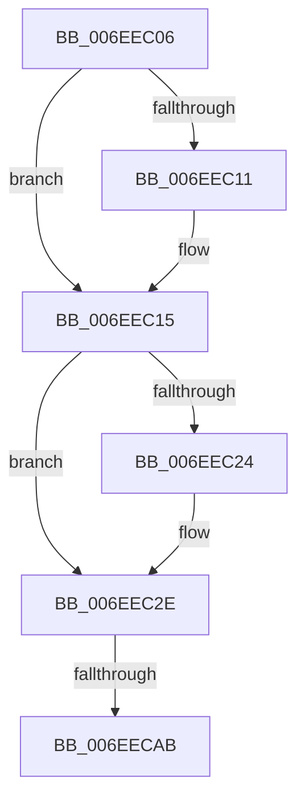

# sub_006EEC06

- RVA: `0x006EEC06`–`0x006EECBF` (길이 `185` bytes)
- VA: `0x00000001406EEC06`
- 실행 섹션: `.text`
- PDB 이름 있음: `아니요`; PDB Function 태그: `아니요`
- unwind 정보 RVA: `0x000A274C`
- 디코드: `47`개 명령, `185/185` bytes 표시
- 미해석 바이트: `0` (있으면 어셈블리에 `.byte`로 보존)

> 이 문서는 커널 이미지의 기계어와 PDB 기호를 분석해 생성했습니다. 4번과 5번은 함수 원형과 자료형을 바이너리 사용 방식에서 추정한 C 해석이며 원본 소스 복구 결과는 아닙니다.

## 1. Dependencies

- 직접 호출 지점: **4**; 고유 호출 대상: **4**
- 직접 호출자로 확인된 함수: **0**
- RIP 상대 이미지 참조: **0**

### Outgoing calls
- `0x006EEC35` → [_chkstk](../6B/_chkstk_function_006BA960.md) (function, `0x006BA960`)
- `0x006EEC67` → [B_TREE<_SM_PAGE_KEY,ST_STORE<SM_TRAITS>::_ST_PAGE_ENTRY,4096,NP_CONTEXT,B_TREE_KEY_COMPARATOR<_SM_PAGE_KEY> >::BTreeSearchKey](../3A/B_TREE__SM_PAGE_KEY_ST_STORE_SM_TRAITS__ST_PAGE_ENTRY_4096_NP_CONTEXT_B_TREE_KEY_COMPARATOR__SM_PAGE_function_003AC3C0.md) (function, `0x003AC3C0`)
- `0x006EEC82` → [B_TREE<_SM_PAGE_KEY,ST_STORE<SM_TRAITS>::_ST_PAGE_ENTRY,4096,NP_CONTEXT,B_TREE_KEY_COMPARATOR<_SM_PAGE_KEY> >::BTreeSearchResultDeref](../3A/B_TREE__SM_PAGE_KEY_ST_STORE_SM_TRAITS__ST_PAGE_ENTRY_4096_NP_CONTEXT_B_TREE_KEY_COMPARATOR__SM_PAGE_function_003AC5D0.md) (function, `0x003AC5D0`)
- `0x006EECB4` → [NP_CONTEXT::NpLeafRefInternal](../3A/NP_CONTEXT_NpLeafRefInternal_function_003AA340.md) (function, `0x003AA340`)

### Direct callers
- 이 함수 시작 RVA로 연결되는 직접 call은 확인되지 않았습니다. 간접 호출은 완전히 역산할 수 없습니다.

### Static image references
- 디코드된 RIP-relative 메모리 참조가 없습니다.

## 2. Other-region calls and transfers

- 다른 실행 섹션으로 향하는 call: **0**
- call이 아닌 외부 분기/꼬리 이동: **2**
  - `0x006EECA5` → [B_TREE<_SM_PAGE_KEY,ST_STORE<SM_TRAITS>::_ST_PAGE_ENTRY,4096,NP_CONTEXT,B_TREE_KEY_COMPARATOR<_SM_PAGE_KEY> >::BTreeIteratorFromSearchResult + 0x62](../43/B_TREE__SM_PAGE_KEY_ST_STORE_SM_TRAITS__ST_PAGE_ENTRY_4096_NP_CONTEXT_B_TREE_KEY_COMPARATOR__SM_PAGE_function_00434250.md) (`tail-transfer`)
  - `0x006EECBA` → [B_TREE<_SM_PAGE_KEY,ST_STORE<SM_TRAITS>::_ST_PAGE_ENTRY,4096,NP_CONTEXT,B_TREE_KEY_COMPARATOR<_SM_PAGE_KEY> >::BTreeIteratorFromSearchResult + 0x62](../43/B_TREE__SM_PAGE_KEY_ST_STORE_SM_TRAITS__ST_PAGE_ENTRY_4096_NP_CONTEXT_B_TREE_KEY_COMPARATOR__SM_PAGE_function_00434250.md) (`tail-transfer`)

## 3. Assembly (complete function range)

```asm
006EEC06  48 8B 10                        mov rdx, qword ptr [rax]
006EEC09  41 8B F9                        mov edi, r9d
006EEC0C  48 85 C9                        test rcx, rcx
006EEC0F  74 04                           je 0x1406eec15
006EEC11  0F B6 79 02                     movzx edi, byte ptr [rcx + 2]
006EEC15  8B C7                           mov eax, edi
006EEC17  48 C1 E0 04                     shl rax, 4
006EEC1B  48 8D 48 0F                     lea rcx, [rax + 0xf]
006EEC1F  48 3B C8                        cmp rcx, rax
006EEC22  77 0A                           ja 0x1406eec2e
006EEC24  48 B9 F0 FF FF FF FF FF FF 0F   movabs rcx, 0xffffffffffffff0
006EEC2E  48 83 E1 F0                     and rcx, 0xfffffffffffffff0
006EEC32  48 8B C1                        mov rax, rcx
006EEC35  E8 26 BD FC FF                  call 0x1406ba960
006EEC3A  8B 52 10                        mov edx, dword ptr [rdx + 0x10]
006EEC3D  4C 8D 45 00                     lea r8, [rbp]
006EEC41  48 2B E1                        sub rsp, rcx
006EEC44  48 C7 45 20 01 00 00 00         mov qword ptr [rbp + 0x20], 1
006EEC4C  0F 57 C0                        xorps xmm0, xmm0
006EEC4F  44 89 4D 18                     mov dword ptr [rbp + 0x18], r9d
006EEC53  49 8B CE                        mov rcx, r14
006EEC56  89 7D 1C                        mov dword ptr [rbp + 0x1c], edi
006EEC59  F3 0F 7F 45 08                  movdqu xmmword ptr [rbp + 8], xmm0
006EEC5E  48 8D 5C 24 20                  lea rbx, [rsp + 0x20]
006EEC63  48 89 5D 00                     mov qword ptr [rbp], rbx
006EEC67  E8 54 D7 CB FF                  call 0x1403ac3c0
006EEC6C  8D 4F FE                        lea ecx, [rdi - 2]
006EEC6F  48 03 C9                        add rcx, rcx
006EEC72  48 8D 55 00                     lea rdx, [rbp]
006EEC76  48 8B 7C CB 08                  mov rdi, qword ptr [rbx + rcx*8 + 8]
006EEC7B  48 8B 1C CB                     mov rbx, qword ptr [rbx + rcx*8]
006EEC7F  49 8B CE                        mov rcx, r14
006EEC82  E8 49 D9 CB FF                  call 0x1403ac5d0
006EEC87  48 8D 4B 10                     lea rcx, [rbx + 0x10]
006EEC8B  48 3B F9                        cmp rdi, rcx
006EEC8E  48 8D 43 08                     lea rax, [rbx + 8]
006EEC92  4C 8D 4F F8                     lea r9, [rdi - 8]
006EEC96  4C 0F 46 C8                     cmovbe r9, rax
006EEC9A  49 8B 46 10                     mov rax, qword ptr [r14 + 0x10]
006EEC9E  49 8D 4E 10                     lea rcx, [r14 + 0x10]
006EECA2  83 38 FF                        cmp dword ptr [rax], -1
006EECA5  0F 84 07 56 D4 FF               je 0x1404342b2
006EECAB  41 B8 03 00 00 00               mov r8d, 3
006EECB1  49 8B D1                        mov rdx, r9
006EECB4  E8 87 B6 CB FF                  call 0x1403aa340
006EECB9  90                              nop
006EECBA  E9 F3 55 D4 FF                  jmp 0x1404342b2
```

## 4. C-style interpretation (structured pseudocode)

```c
__int64 __fastcall sub_006EEC06(__int64 a1, __int64 a2, __int64 a3, int a4)
{
    __int64 result;
    __int64 v_rdi;
    __int64 v_rsp;
    unsigned __int64 v_stack_p20;

    v_rdi = (unsigned int)(a4);
    if (a1 != 0) {
        v_rdi = *(unsigned __int8 *)(a1 + 2);
    }
    result = ((unsigned int)((unsigned int)(v_rdi))) << (4);
    if ((result + 15) <= result) {
    }
    a1 = (result + 15) & (-16);
    result = _chkstk(a1, *(unsigned __int64 *)(result), a3, a4);
    v_rsp = (v_rsp) - (a1);
    *(unsigned __int64 *)(v_rbp + 32) = 1;
    *(unsigned int *)(v_rbp + 24) = a4;
    *(unsigned int *)(v_rbp + 28) = (unsigned int)(v_rdi);
    *(unsigned __int64 *)(v_rbp + 8) = v_xmm0;
    *(unsigned __int64 *)(v_rbp) = v_stack_p20;
    result = B_TREE__SM_PAGE_KEY_ST_STORE_SM_TRAITS____ST_PAGE_ENTRY_4096_NP_CONTEXT_B_TREE_KEY_COMPARATOR__SM_PA(v_r14, (unsigned int)(*(unsigned int *)(*(unsigned __int64 *)(result) + 16)), v_rbp, a4);
    a1 = (v_rdi - 2) + (v_rdi - 2);
    result = B_TREE__SM_PAGE_KEY_ST_STORE_SM_TRAITS____ST_PAGE_ENTRY_4096_NP_CONTEXT_B_TREE_KEY_COMPARATOR__SM_PA(v_r14, v_rbp, v_rbp, a4);
    a4 = *(unsigned __int64 *)(v_stack_p20 + a1 * 8 + 8) - 8;
    if ((*(unsigned __int64 *)(v_stack_p20 + a1 * 8 + 8)) <= (*(unsigned __int64 *)(v_stack_p20 + a1 * 8) + 16)) { a4 = *(unsigned __int64 *)(v_stack_p20 + a1 * 8) + 8; }
    result = NP_CONTEXT__NpLeafRefInternal(v_r14 + 16, a4, 3, a4);
}
```

## 5. (Beta) C Style

```c
int64_t sub_006EEC06(int64_t Arg1, int64_t Arg2, int64_t Arg3, int32_t Arg4)
{
    int64_t result;
    int64_t local_rdi;
    int64_t local_rsp;
    uint64_t v_stack_p20;

    local_rdi = (uint32_t)(Arg4);
    if (Arg1 != 0) {
        local_rdi = *(uint8_t *)(Arg1 + 0x2);
    }
    result = ((uint32_t)((uint32_t)(local_rdi))) << (4);
    if ((result + 15) <= result) {
    }
    Arg1 = (result + 15) & (-16);
    result = _chkstk(Arg1, *(uint64_t *)(result), Arg3, Arg4);
    local_rsp = (local_rsp) - (Arg1);
    *(uint64_t *)(local_rbp + 0x20) = 1;
    *(uint32_t *)(local_rbp + 0x18) = Arg4;
    *(uint32_t *)(local_rbp + 0x1C) = (uint32_t)(local_rdi);
    *(uint64_t *)(local_rbp + 0x8) = v_xmm0;
    *(uint64_t *)(local_rbp) = v_stack_p20;
    result = B_TREE__SM_PAGE_KEY_ST_STORE_SM_TRAITS____ST_PAGE_ENTRY_4096_NP_CONTEXT_B_TREE_KEY_COMPARATOR__SM_PA(local_r14, (uint32_t)(*(uint32_t *)(*(uint64_t *)(result) + 0x10)), local_rbp, Arg4);
    Arg1 = (local_rdi - 2) + (local_rdi - 2);
    result = B_TREE__SM_PAGE_KEY_ST_STORE_SM_TRAITS____ST_PAGE_ENTRY_4096_NP_CONTEXT_B_TREE_KEY_COMPARATOR__SM_PA(local_r14, local_rbp, local_rbp, Arg4);
    Arg4 = *(uint64_t *)(v_stack_p20 + Arg1 * 8 + 0x8) - 8;
    if ((*(uint64_t *)(v_stack_p20 + Arg1 * 8 + 0x8)) <= (*(uint64_t *)(v_stack_p20 + Arg1 * 8) + 16)) { Arg4 = *(uint64_t *)(v_stack_p20 + Arg1 * 8) + 8; }
    result = NP_CONTEXT__NpLeafRefInternal(local_r14 + 16, Arg4, 3, Arg4);
}
```

## 6. Execution-region graph

[열기: 2D/3D 그래프와 함수 탐색 컨트롤 패널](../../../control-panel.html?section=text&rva=0x006EEC06&view=graph)

- 2D 그래프는 위에서 아래로 흐르고, 3D 그래프는 빈 공간을 드래그해 회전합니다. Shift+드래그는 이동, 휠은 확대·축소, 함수 노드 선택은 대상 보고서 이동입니다.

### Static fallback


