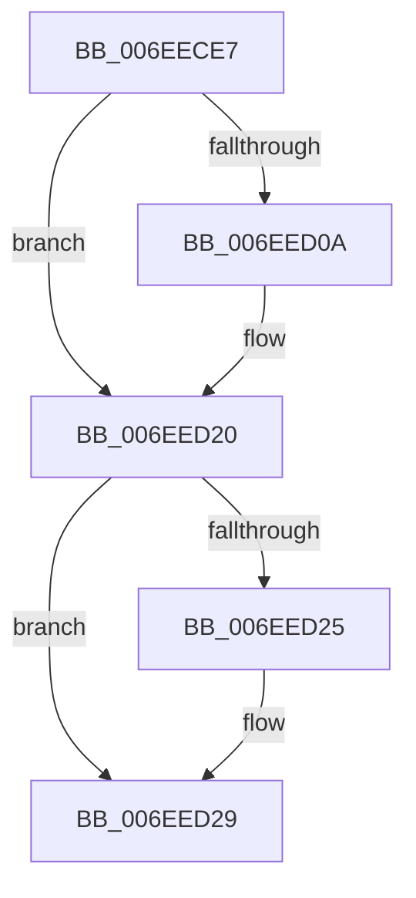

# sub_006EECE7

- RVA: `0x006EECE7`–`0x006EED3B` (길이 `84` bytes)
- VA: `0x00000001406EECE7`
- 실행 섹션: `.text`
- PDB 이름 있음: `아니요`; PDB Function 태그: `아니요`
- unwind 정보 RVA: `0x000A2BAC`
- 디코드: `19`개 명령, `84/84` bytes 표시
- 미해석 바이트: `0` (있으면 어셈블리에 `.byte`로 보존)

> 이 문서는 커널 이미지의 기계어와 PDB 기호를 분석해 생성했습니다. 4번과 5번은 함수 원형과 자료형을 바이너리 사용 방식에서 추정한 C 해석이며 원본 소스 복구 결과는 아닙니다.

## 1. Dependencies

- 직접 호출 지점: **2**; 고유 호출 대상: **2**
- 직접 호출자로 확인된 함수: **0**
- RIP 상대 이미지 참조: **3**

### Outgoing calls
- `0x006EECF6` → [KeAbPreAcquire](../21/KeAbPreAcquire_function_00210230.md) (function, `0x00210230`)
- `0x006EED1B` → [ExfAcquirePushLockExclusiveEx](../20/ExfAcquirePushLockExclusiveEx_function_0020FC90.md) (function, `0x0020FC90`)

### Direct callers
- 이 함수 시작 RVA로 연결되는 직접 call은 확인되지 않았습니다. 간접 호출은 완전히 역산할 수 없습니다.

### Static image references
- `0x006EECFB` → RVA `0x00E37640` (`.data`; read/write)
- `0x006EED0A` → RVA `0x00E37640` (`.data`; read)
- `0x006EED29` → RVA `0x00E38DF8` (`.data`; read)

## 2. Other-region calls and transfers

- 다른 실행 섹션으로 향하는 call: **0**
- call이 아닌 외부 분기/꼬리 이동: **1**
  - `0x006EED39` → [sub_006EED3B + 0xA](Unknown_function_006EED3B.md) (`tail-transfer`)

## 3. Assembly (complete function range)

```asm
006EECE7  48 89 74 24 30                  mov qword ptr [rsp + 0x30], rsi
006EECEC  33 D2                           xor edx, edx
006EECEE  66 FF 8B E6 01 00 00            dec word ptr [rbx + 0x1e6]
006EECF5  90                              nop
006EECF6  E8 35 15 B2 FF                  call 0x140210230
006EECFB  F0 48 0F BA 2D 3B 89 74 00 00   lock bts qword ptr [rip + 0x74893b], 0
006EED05  48 8B F0                        mov rsi, rax
006EED08  73 16                           jae 0x1406eed20
006EED0A  4C 8D 05 2F 89 74 00            lea r8, [rip + 0x74892f]
006EED11  48 8B D0                        mov rdx, rax
006EED14  48 8D 0D 25 89 74 00            lea rcx, [rip + 0x748925]
006EED1B  E8 70 0F B2 FF                  call 0x14020fc90
006EED20  48 85 F6                        test rsi, rsi
006EED23  74 04                           je 0x1406eed29
006EED25  C6 46 0A 01                     mov byte ptr [rsi + 0xa], 1
006EED29  48 8B 0D C8 A0 74 00            mov rcx, qword ptr [rip + 0x74a0c8]
006EED30  48 8B 74 24 30                  mov rsi, qword ptr [rsp + 0x30]
006EED35  83 79 04 00                     cmp dword ptr [rcx + 4], 0
006EED39  75 0A                           jne 0x1406eed45
```

## 4. C-style interpretation (structured pseudocode)

```c
__int64 __fastcall sub_006EECE7(__int64 a1, int a2, __int64 a3, __int64 a4, __int64 a5, __int64 a6)
{
    __int64 result;
    unsigned __int64 v_stack_p30;

    v_stack_p30 = v_rsi;
    a2 = 0;
    result = KeAbPreAcquire(a1, a2, a3, a4);
    if (!(condition_is_above_or_equal)) {
        a3 = v_rip + 7637295;
        a2 = result;
        a1 = v_rip + 7637285;
        result = ExfAcquirePushLockExclusiveEx(a1, a2, a3, a4);
    }
    if (result != 0) {
        *(unsigned __int8 *)(result + 10) = 1;
    }
}
```

## 5. (Beta) C Style

```c
int64_t sub_006EECE7(int64_t Arg1, int32_t Arg2, int64_t Arg3, int64_t Arg4, uint64_t Arg5, int64_t Arg6)
{
    int64_t result;
    uint64_t v_stack_p30;

    v_stack_p30 = local_rsi;
    Arg2 = 0;
    result = KeAbPreAcquire(Arg1, Arg2, Arg3, Arg4);
    if (!(condition_is_above_or_equal)) {
        Arg3 = v_rip + 7637295;
        Arg2 = result;
        Arg1 = v_rip + 7637285;
        result = ExfAcquirePushLockExclusiveEx(Arg1, Arg2, Arg3, Arg4);
    }
    if (result != 0) {
        *(uint8_t *)(result + 0xA) = 1;
    }
}
```

## 6. Execution-region graph

[열기: 2D/3D 그래프와 함수 탐색 컨트롤 패널](../../../control-panel.html?section=text&rva=0x006EECE7&view=graph)

- 2D 그래프는 위에서 아래로 흐르고, 3D 그래프는 빈 공간을 드래그해 회전합니다. Shift+드래그는 이동, 휠은 확대·축소, 함수 노드 선택은 대상 보고서 이동입니다.

### Static fallback


