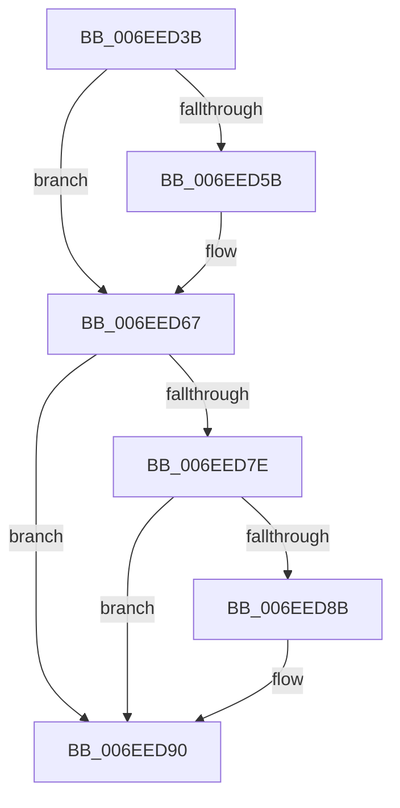

# sub_006EED3B

- RVA: `0x006EED3B`–`0x006EED9E` (길이 `99` bytes)
- VA: `0x00000001406EED3B`
- 실행 섹션: `.text`
- PDB 이름 있음: `아니요`; PDB Function 태그: `아니요`
- unwind 정보 RVA: `0x000A2BC0`
- 디코드: `24`개 명령, `99/99` bytes 표시
- 미해석 바이트: `0` (있으면 어셈블리에 `.byte`로 보존)

> 이 문서는 커널 이미지의 기계어와 PDB 기호를 분석해 생성했습니다. 4번과 5번은 함수 원형과 자료형을 바이너리 사용 방식에서 추정한 C 해석이며 원본 소스 복구 결과는 아닙니다.

## 1. Dependencies

- 직접 호출 지점: **5**; 고유 호출 대상: **5**
- 직접 호출자로 확인된 함수: **0**
- RIP 상대 이미지 참조: **2**

### Outgoing calls
- `0x006EED40` → [KePulseEvent](../35/KePulseEvent_function_00351EF0.md) (function, `0x00351EF0`)
- `0x006EED62` → [ExfTryToWakePushLock](../26/ExfTryToWakePushLock_function_00265DD0.md) (function, `0x00265DD0`)
- `0x006EED6E` → [KeAbPostRelease](../2E/KeAbPostRelease_function_002E1600.md) (function, `0x002E1600`)
- `0x006EED8B` → [KiCheckForKernelApcDelivery](../2E/KiCheckForKernelApcDelivery_function_002E2C80.md) (function, `0x002E2C80`)
- `0x006EED92` → [MiFreeExcessSegments](../32/MiFreeExcessSegments_function_00327F50.md) (function, `0x00327F50`)

### Direct callers
- 이 함수 시작 RVA로 연결되는 직접 call은 확인되지 않았습니다. 간접 호출은 완전히 역산할 수 없습니다.

### Static image references
- `0x006EED4C` → RVA `0x00E37640` (`.data`; read/write)
- `0x006EED5B` → RVA `0x00E37640` (`.data`; read)

## 2. Other-region calls and transfers

- 다른 실행 섹션으로 향하는 call: **0**
- call이 아닌 외부 분기/꼬리 이동: **1**
  - `0x006EED99` → [MmResourcesAvailable + 0x72](../43/MmResourcesAvailable_function_00434FF0.md) (`tail-transfer`)

## 3. Assembly (complete function range)

```asm
006EED3B  45 33 C0                        xor r8d, r8d
006EED3E  33 D2                           xor edx, edx
006EED40  E8 AB 31 C6 FF                  call 0x140351ef0
006EED45  48 C7 C0 FF FF FF FF            mov rax, 0xffffffffffffffff
006EED4C  F0 48 0F C1 05 EB 88 74 00      lock xadd qword ptr [rip + 0x7488eb], rax
006EED55  24 06                           and al, 6
006EED57  3C 02                           cmp al, 2
006EED59  75 0C                           jne 0x1406eed67
006EED5B  48 8D 0D DE 88 74 00            lea rcx, [rip + 0x7488de]
006EED62  E8 69 70 B7 FF                  call 0x140265dd0
006EED67  48 8D 0D D2 88 74 00            lea rcx, [rip + 0x7488d2]
006EED6E  E8 8D 28 BF FF                  call 0x1402e1600
006EED73  90                              nop
006EED74  66 83 83 E6 01 00 00 01         add word ptr [rbx + 0x1e6], 1
006EED7C  75 12                           jne 0x1406eed90
006EED7E  48 8D 8B 98 00 00 00            lea rcx, [rbx + 0x98]
006EED85  90                              nop
006EED86  48 39 09                        cmp qword ptr [rcx], rcx
006EED89  74 05                           je 0x1406eed90
006EED8B  E8 F0 3E BF FF                  call 0x1402e2c80
006EED90  33 C9                           xor ecx, ecx
006EED92  E8 B9 91 C3 FF                  call 0x140327f50
006EED97  8B C7                           mov eax, edi
006EED99  E9 C4 62 D4 FF                  jmp 0x140435062
```

## 4. C-style interpretation (structured pseudocode)

```c
__int64 __fastcall sub_006EED3B(__int64 a1, int a2, int a3)
{
    __int64 result;

    a3 = 0;
    a2 = 0;
    result = KePulseEvent(a1, a2, a3, a4);
    result = (unsigned __int8)((-1) & (6));
    if (((unsigned __int8)(result)) == 2) {
        a1 = v_rip + 7637214;
        result = ExfTryToWakePushLock(a1, a2, a3, a4);
    }
    result = KeAbPostRelease(v_rip + 7637202, a2, a3, a4);
    if (((unsigned __int8)(result)) != 2) goto loc_006EED90;
    if ((*(unsigned __int64 *)(v_rbx + 152)) != (v_rbx + 152)) {
        result = KiCheckForKernelApcDelivery(v_rbx + 152, a2, a3, a4);
    }
    a1 = 0;
    result = MiFreeExcessSegments(a1, a2, a3, a4);
}
```

## 5. (Beta) C Style

```c
int64_t sub_006EED3B(int64_t Arg1, int32_t Arg2, int32_t Arg3)
{
    int64_t result;

    Arg3 = 0;
    Arg2 = 0;
    result = KePulseEvent(Arg1, Arg2, Arg3, a4);
    result = (uint8_t)((-1) & (6));
    if (((uint8_t)(result)) == 2) {
        Arg1 = v_rip + 7637214;
        result = ExfTryToWakePushLock(Arg1, Arg2, Arg3, a4);
    }
    result = KeAbPostRelease(v_rip + 7637202, Arg2, Arg3, a4);
    if (((uint8_t)(result)) != 2) goto loc_006EED90;
    if ((*(uint64_t *)(local_rbx + 0x98)) != (local_rbx + 152)) {
        result = KiCheckForKernelApcDelivery(local_rbx + 152, Arg2, Arg3, a4);
    }
    Arg1 = 0;
    result = MiFreeExcessSegments(Arg1, Arg2, Arg3, a4);
}
```

## 6. Execution-region graph

[열기: 2D/3D 그래프와 함수 탐색 컨트롤 패널](../../../control-panel.html?section=text&rva=0x006EED3B&view=graph)

- 2D 그래프는 위에서 아래로 흐르고, 3D 그래프는 빈 공간을 드래그해 회전합니다. Shift+드래그는 이동, 휠은 확대·축소, 함수 노드 선택은 대상 보고서 이동입니다.

### Static fallback


