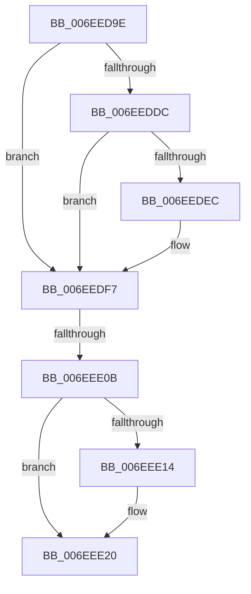

# sub_006EED9E

- RVA: `0x006EED9E`–`0x006EEE2D` (길이 `143` bytes)
- VA: `0x00000001406EED9E`
- 실행 섹션: `.text`
- PDB 이름 있음: `아니요`; PDB Function 태그: `아니요`
- unwind 정보 RVA: `0x000A2C2C`
- 디코드: `35`개 명령, `143/143` bytes 표시
- 미해석 바이트: `0` (있으면 어셈블리에 `.byte`로 보존)

> 이 문서는 커널 이미지의 기계어와 PDB 기호를 분석해 생성했습니다. 4번과 5번은 함수 원형과 자료형을 바이너리 사용 방식에서 추정한 C 해석이며 원본 소스 복구 결과는 아닙니다.

## 1. Dependencies

- 직접 호출 지점: **3**; 고유 호출 대상: **3**
- 직접 호출자로 확인된 함수: **0**
- RIP 상대 이미지 참조: **1**

### Outgoing calls
- `0x006EEDF2` → [KiRaiseIrqlProcessIrqlFlags](../4F/KiRaiseIrqlProcessIrqlFlags_function_004F56FC.md) (function, `0x004F56FC`)
- `0x006EEDFD` → [MiInsertPossiblyBadPage](../68/MiInsertPossiblyBadPage_function_00689DF0.md) (function, `0x00689DF0`)
- `0x006EEE1B` → [KiLowerIrqlProcessIrqlFlags](../4F/KiLowerIrqlProcessIrqlFlags_function_004F5698.md) (function, `0x004F5698`)

### Direct callers
- 이 함수 시작 RVA로 연결되는 직접 call은 확인되지 않았습니다. 간접 호출은 완전히 역산할 수 없습니다.

### Static image references
- `0x006EEDE4` → RVA `0x00FC6D20` (`ALMOSTRO`; read)

## 2. Other-region calls and transfers

- 다른 실행 섹션으로 향하는 call: **0**
- call이 아닌 외부 분기/꼬리 이동: **2**
  - `0x006EEE05` → [MiObtainedPageIsGood + 0x3A](../43/MiObtainedPageIsGood_function_00435448.md) (`tail-transfer`)
  - `0x006EEE28` → [MiObtainedPageIsGood + 0x3A](../43/MiObtainedPageIsGood_function_00435448.md) (`tail-transfer`)

## 3. Assembly (complete function range)

```asm
006EED9E  48 8B 41 10                     mov rax, qword ptr [rcx + 0x10]
006EEDA2  33 F6                           xor esi, esi
006EEDA4  25 E0 03 00 00                  and eax, 0x3e0
006EEDA9  48 F7 D8                        neg rax
006EEDAC  1B ED                           sbb ebp, ebp
006EEDAE  F7 DD                           neg ebp
006EEDB0  48 B8 00 00 00 00 00 DE FF FF   movabs rax, 0xffffde0000000000
006EEDBA  48 2B D8                        sub rbx, rax
006EEDBD  48 B8 AB AA AA AA AA AA AA AA   movabs rax, 0xaaaaaaaaaaaaaaab
006EEDC7  48 C1 FB 04                     sar rbx, 4
006EEDCB  48 0F AF D8                     imul rbx, rax
006EEDCF  44 0F 20 C7                     mov rdi, cr8
006EEDD3  44 8D 76 02                     lea r14d, [rsi + 2]
006EEDD7  41 3A FE                        cmp dil, r14b
006EEDDA  73 1B                           jae 0x1406eedf7
006EEDDC  44 0F 20 C7                     mov rdi, cr8
006EEDE0  45 0F 22 C6                     mov cr8, r14
006EEDE4  39 35 36 7F 8D 00               cmp dword ptr [rip + 0x8d7f36], esi
006EEDEA  74 0B                           je 0x1406eedf7
006EEDEC  41 8A D6                        mov dl, r14b
006EEDEF  40 8A CF                        mov cl, dil
006EEDF2  E8 05 69 E0 FF                  call 0x1404f56fc
006EEDF7  8D 55 01                        lea edx, [rbp + 1]
006EEDFA  48 8B CB                        mov rcx, rbx
006EEDFD  E8 EE AF F9 FF                  call 0x140689df0
006EEE02  41 3A FE                        cmp dil, r14b
006EEE05  0F 83 77 66 D4 FF               jae 0x140435482
006EEE0B  83 3D 0E 7F 8D 00 00            cmp dword ptr [rip + 0x8d7f0e], 0
006EEE12  74 0C                           je 0x1406eee20
006EEE14  44 0F 20 C1                     mov rcx, cr8
006EEE18  40 8A D7                        mov dl, dil
006EEE1B  E8 78 68 E0 FF                  call 0x1404f5698
006EEE20  40 0F B6 CF                     movzx ecx, dil
006EEE24  44 0F 22 C1                     mov cr8, rcx
006EEE28  E9 55 66 D4 FF                  jmp 0x140435482
```

## 4. C-style interpretation (structured pseudocode)

```c
__int64 __fastcall sub_006EED9E(__int64 a1)
{
    __int64 result;
    __int64 v_rbp;
    __int64 v_rbx;
    __int64 v_rsi;

    v_rsi = 0;
    result = (unsigned int)((*(unsigned __int64 *)(a1 + 16)) & (992));
    result = -(result);
    v_rbp = (unsigned int)(-(v_rbp));
    v_rbx = (v_rbx) - (result);
    v_rbx = (v_rbx) >> (4);
    v_rbx = (v_rbx) * (result);
    if (((unsigned __int8)(v_cr8)) >= ((unsigned __int8)(v_rsi + 2))) goto loc_006EEDF7;
    if ((*(unsigned int *)(v_rip + 9273142)) != 0) {
        a2 = (unsigned __int8)(v_rsi + 2);
        a1 = (unsigned __int8)(v_cr8);
        result = KiRaiseIrqlProcessIrqlFlags(a1, a2, a3, a4);
    }
    result = MiInsertPossiblyBadPage(v_rbx, v_rbp + 1, a3, a4);
    if ((*(unsigned int *)(v_rip + 9273102)) != 0) {
        a1 = v_rsi + 2;
        a2 = (unsigned __int8)(v_cr8);
        result = KiLowerIrqlProcessIrqlFlags(a1, a2, a3, a4);
    }
}
```

## 5. (Beta) C Style

```c
int64_t sub_006EED9E(void *Arg1)
{
    uint8_t *arg1 = (uint8_t *)Arg1;

    int64_t result;
    int64_t local_rbp;
    int64_t local_rbx;
    int64_t local_rsi;

    local_rsi = 0;
    result = (uint32_t)((*(uint64_t *)(arg1 + 0x10)) & (992));
    result = -(result);
    local_rbp = (uint32_t)(-(local_rbp));
    local_rbx = (local_rbx) - (result);
    local_rbx = (local_rbx) >> (4);
    local_rbx = (local_rbx) * (result);
    if (((uint8_t)(v_cr8)) >= ((uint8_t)(local_rsi + 2))) goto loc_006EEDF7;
    if ((*(uint32_t *)(v_rip + 0x8D7F36)) != 0) {
        a2 = (uint8_t)(local_rsi + 2);
        Arg1 = (uint8_t)(v_cr8);
        result = KiRaiseIrqlProcessIrqlFlags(Arg1, a2, a3, a4);
    }
    result = MiInsertPossiblyBadPage(local_rbx, local_rbp + 1, a3, a4);
    if ((*(uint32_t *)(v_rip + 0x8D7F0E)) != 0) {
        Arg1 = local_rsi + 2;
        a2 = (uint8_t)(v_cr8);
        result = KiLowerIrqlProcessIrqlFlags(Arg1, a2, a3, a4);
    }
}
```

### 관측된 메모리 오프셋

구조체 형식이 확인되지 않은 접근은 인자 기준의 오프셋으로만 기록했습니다.

| 기준 인자 | 오프셋 표현 | 폭 (bit) | 접근 |
|---|---:|---:|---|
| `Arg1` | `+ 0x10` | `64` | `R` |

## 6. Execution-region graph

[열기: 2D/3D 그래프와 함수 탐색 컨트롤 패널](../../../control-panel.html?section=text&rva=0x006EED9E&view=graph)

- 2D 그래프는 위에서 아래로 흐르고, 3D 그래프는 빈 공간을 드래그해 회전합니다. Shift+드래그는 이동, 휠은 확대·축소, 함수 노드 선택은 대상 보고서 이동입니다.

### Static fallback


