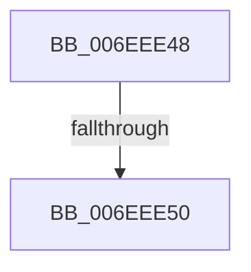

# sub_006EEE48

- RVA: `0x006EEE48`–`0x006EEE68` (길이 `32` bytes)
- VA: `0x00000001406EEE48`
- 실행 섹션: `.text`
- PDB 이름 있음: `아니요`; PDB Function 태그: `아니요`
- unwind 정보 RVA: `0x000A2D40`
- 디코드: `6`개 명령, `32/32` bytes 표시
- 미해석 바이트: `0` (있으면 어셈블리에 `.byte`로 보존)

> 이 문서는 커널 이미지의 기계어와 PDB 기호를 분석해 생성했습니다. 4번과 5번은 함수 원형과 자료형을 바이너리 사용 방식에서 추정한 C 해석이며 원본 소스 복구 결과는 아닙니다.

## 1. Dependencies

- 직접 호출 지점: **0**; 고유 호출 대상: **0**
- 직접 호출자로 확인된 함수: **0**
- RIP 상대 이미지 참조: **1**

### Outgoing calls
- 직접 디코드된 call 명령이 없습니다.

### Direct callers
- 이 함수 시작 RVA로 연결되는 직접 call은 확인되지 않았습니다. 간접 호출은 완전히 역산할 수 없습니다.

### Static image references
- `0x006EEE50` → RVA `0x00FC5008` (`ALMOSTRO`; read)

## 2. Other-region calls and transfers

- 다른 실행 섹션으로 향하는 call: **0**
- call이 아닌 외부 분기/꼬리 이동: **2**
  - `0x006EEE4A` → [RtlSetSystemGlobalData + 0x1D4](../43/RtlSetSystemGlobalData_function_00435AF0.md) (`tail-transfer`)
  - `0x006EEE63` → [RtlSetSystemGlobalData + 0x29](../43/RtlSetSystemGlobalData_function_00435AF0.md) (`tail-transfer`)

## 3. Assembly (complete function range)

```asm
006EEE48  85 C9                           test ecx, ecx
006EEE4A  0F 89 74 6E D4 FF               jns 0x140435cc4
006EEE50  48 8B 05 B1 61 8D 00            mov rax, qword ptr [rip + 0x8d61b1]
006EEE57  0F BA F1 1F                     btr ecx, 0x1f
006EEE5B  F0 0F B3 88 F0 02 00 00         lock btr dword ptr [rax + 0x2f0], ecx
006EEE63  E9 B1 6C D4 FF                  jmp 0x140435b19
```

## 4. C-style interpretation (structured pseudocode)

```c
__int64 __fastcall sub_006EEE48(int a1)
{
}
```

## 5. (Beta) C Style

```c
int64_t sub_006EEE48(int32_t Arg1)
{
}
```

## 6. Execution-region graph

[열기: 2D/3D 그래프와 함수 탐색 컨트롤 패널](../../../control-panel.html?section=text&rva=0x006EEE48&view=graph)

- 2D 그래프는 위에서 아래로 흐르고, 3D 그래프는 빈 공간을 드래그해 회전합니다. Shift+드래그는 이동, 휠은 확대·축소, 함수 노드 선택은 대상 보고서 이동입니다.

### Static fallback


