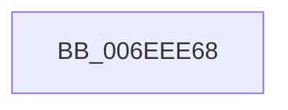

# sub_006EEE68

- RVA: `0x006EEE68`–`0x006EEE7D` (길이 `21` bytes)
- VA: `0x00000001406EEE68`
- 실행 섹션: `.text`
- PDB 이름 있음: `아니요`; PDB Function 태그: `아니요`
- unwind 정보 RVA: `0x000A2D68`
- 디코드: `6`개 명령, `21/21` bytes 표시
- 미해석 바이트: `0` (있으면 어셈블리에 `.byte`로 보존)

> 이 문서는 커널 이미지의 기계어와 PDB 기호를 분석해 생성했습니다. 4번과 5번은 함수 원형과 자료형을 바이너리 사용 방식에서 추정한 C 해석이며 원본 소스 복구 결과는 아닙니다.

## 1. Dependencies

- 직접 호출 지점: **1**; 고유 호출 대상: **1**
- 직접 호출자로 확인된 함수: **0**
- RIP 상대 이미지 참조: **0**

### Outgoing calls
- `0x006EEE71` → [KeDelayExecutionThread](../20/KeDelayExecutionThread_function_00209550.md) (function, `0x00209550`)

### Direct callers
- 이 함수 시작 RVA로 연결되는 직접 call은 확인되지 않았습니다. 간접 호출은 완전히 역산할 수 없습니다.

### Static image references
- 디코드된 RIP-relative 메모리 참조가 없습니다.

## 2. Other-region calls and transfers

- 다른 실행 섹션으로 향하는 call: **0**
- call이 아닌 외부 분기/꼬리 이동: **1**
  - `0x006EEE78` → [PoBlockConsoleSwitchEx + 0x49](../43/PoBlockConsoleSwitchEx_function_00435CD4.md) (`tail-transfer`)

## 3. Assembly (complete function range)

```asm
006EEE68  4C 8D 44 24 68                  lea r8, [rsp + 0x68]
006EEE6D  33 D2                           xor edx, edx
006EEE6F  33 C9                           xor ecx, ecx
006EEE71  E8 DA A6 B1 FF                  call 0x140209550
006EEE76  FF C6                           inc esi
006EEE78  E9 A0 6E D4 FF                  jmp 0x140435d1d
```

## 4. C-style interpretation (structured pseudocode)

```c
__int64 __fastcall sub_006EEE68(int a1, int a2, __int64 a3, __int64 a4, __int64 a5, __int64 a6, __int64 a7, __int64 a8, __int64 a9, __int64 a10, __int64 a11, __int64 a12, __int64 a13)
{
    __int64 result;
    __int64 v_rsi;

    a2 = 0;
    a1 = 0;
    result = KeDelayExecutionThread(a1, a2, a13, a4);
    v_rsi = (unsigned int)((v_rsi) + 1);
}
```

## 5. (Beta) C Style

```c
int64_t sub_006EEE68(int32_t Arg1, int32_t Arg2, int64_t Arg3, int64_t Arg4, uint64_t Arg5, uint64_t Arg6, uint64_t Arg7, uint64_t Arg8, uint64_t Arg9, uint64_t Arg10, uint64_t Arg11, uint64_t Arg12, int64_t Arg13)
{
    int64_t result;
    int64_t local_rsi;

    Arg2 = 0;
    Arg1 = 0;
    result = KeDelayExecutionThread(Arg1, Arg2, Arg13, Arg4);
    local_rsi = (uint32_t)((local_rsi) + 1);
}
```

## 6. Execution-region graph

[열기: 2D/3D 그래프와 함수 탐색 컨트롤 패널](../../../control-panel.html?section=text&rva=0x006EEE68&view=graph)

- 2D 그래프는 위에서 아래로 흐르고, 3D 그래프는 빈 공간을 드래그해 회전합니다. Shift+드래그는 이동, 휠은 확대·축소, 함수 노드 선택은 대상 보고서 이동입니다.

### Static fallback


