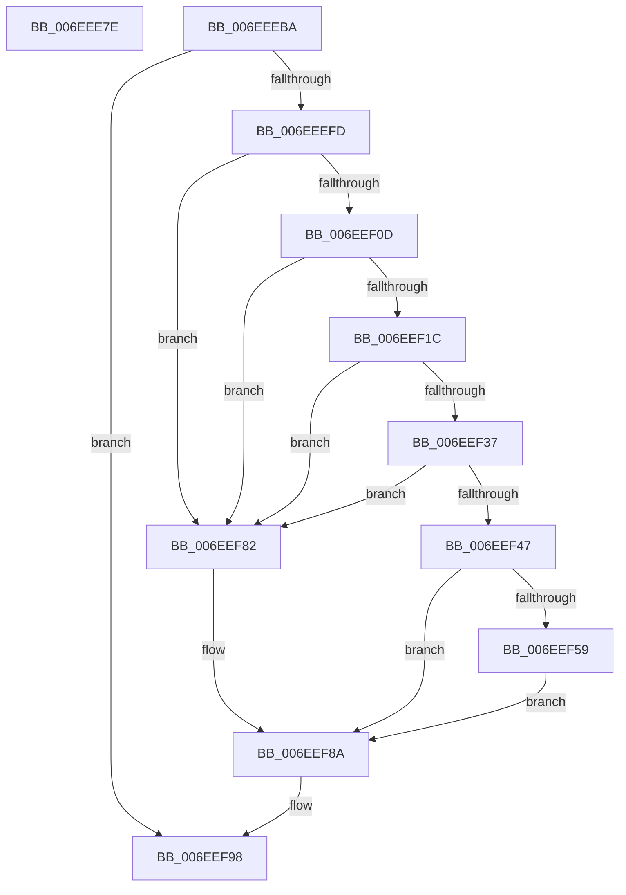

# sub_006EEE7E

- RVA: `0x006EEE7E`–`0x006EEFAF` (길이 `305` bytes)
- VA: `0x00000001406EEE7E`
- 실행 섹션: `.text`
- PDB 이름 있음: `아니요`; PDB Function 태그: `아니요`
- unwind 정보 RVA: `0x000A2D98`
- 디코드: `75`개 명령, `305/305` bytes 표시
- 미해석 바이트: `0` (있으면 어셈블리에 `.byte`로 보존)

> 이 문서는 커널 이미지의 기계어와 PDB 기호를 분석해 생성했습니다. 4번과 5번은 함수 원형과 자료형을 바이너리 사용 방식에서 추정한 C 해석이며 원본 소스 복구 결과는 아닙니다.

## 1. Dependencies

- 직접 호출 지점: **9**; 고유 호출 대상: **8**
- 직접 호출자로 확인된 함수: **0**
- RIP 상대 이미지 참조: **1**

### Outgoing calls
- `0x006EEEA9` → [memcpy](../6C/memcpy_function_006C6840.md) (function, `0x006C6840`)
- `0x006EEEE3` → [ExAcquireResourceSharedLite](../21/ExAcquireResourceSharedLite_function_00211BC0.md) (function, `0x00211BC0`)
- `0x006EEEF0` → [IoGetLoadedDriverInfo](../4B/IoGetLoadedDriverInfo_function_004B6C20.md) (function, `0x004B6C20`)
- `0x006EEF13` → [IopValidateSectionSize](../4E/IopValidateSectionSize_function_004E27C0.md) (function, `0x004E27C0`)
- `0x006EEF3E` → [IopValidateSectionSize](../4E/IopValidateSectionSize_function_004E27C0.md) (function, `0x004E27C0`)
- `0x006EEF50` → [IopWriteDriverList](../4B/IopWriteDriverList_function_004B6AD0.md) (function, `0x004B6AD0`)
- `0x006EEF93` → [IopAddCodeRegion](../59/IopAddCodeRegion_function_005941B4.md) (function, `0x005941B4`)
- `0x006EEF9F` → [ExReleaseResourceLite](../25/ExReleaseResourceLite_function_0025FA10.md) (function, `0x0025FA10`)
- `0x006EEFA4` → [KeLeaveCriticalRegion](../25/KeLeaveCriticalRegion_function_0025D8B0.md) (function, `0x0025D8B0`)

### Direct callers
- 이 함수 시작 RVA로 연결되는 직접 call은 확인되지 않았습니다. 간접 호출은 완전히 역산할 수 없습니다.

### Static image references
- `0x006EEECB` → RVA `0x00EF54E0` (`.data`; read)

## 2. Other-region calls and transfers

- 다른 실행 섹션으로 향하는 call: **0**
- call이 아닌 외부 분기/꼬리 이동: **2**
  - `0x006EEEB5` → [KeCapturePersistentThreadState + 0x3E6](../43/KeCapturePersistentThreadState_function_00435D90.md) (`tail-transfer`)
  - `0x006EEFAA` → [KeCapturePersistentThreadState + 0x3F2](../43/KeCapturePersistentThreadState_function_00435D90.md) (`tail-transfer`)

## 3. Assembly (complete function range)

```asm
006EEE7E  83 8B 38 10 00 00 20            or dword ptr [rbx + 0x1038], 0x20
006EEE85  48 8D 8B F8 02 01 00            lea rcx, [rbx + 0x102f8]
006EEE8C  8B 7D 58                        mov edi, dword ptr [rbp + 0x58]
006EEE8F  48 8B D6                        mov rdx, rsi
006EEE92  44 8B C7                        mov r8d, edi
006EEE95  44 89 BB 28 20 00 00            mov dword ptr [rbx + 0x2028], r15d
006EEE9C  89 BB 2C 20 00 00               mov dword ptr [rbx + 0x202c], edi
006EEEA2  48 89 B3 48 20 00 00            mov qword ptr [rbx + 0x2048], rsi
006EEEA9  E8 92 79 FD FF                  call 0x1406c6840
006EEEAE  44 8D BF F8 02 01 00            lea r15d, [rdi + 0x102f8]
006EEEB5  E9 BC 72 D4 FF                  jmp 0x140436176
006EEEBA  65 48 8B 04 25 88 01 00 00      mov rax, qword ptr gs:[0x188]
006EEEC3  41 8D 7F 07                     lea edi, [r15 + 7]
006EEEC7  83 65 58 00                     and dword ptr [rbp + 0x58], 0
006EEECB  48 8D 0D 0E 66 80 00            lea rcx, [rip + 0x80660e]
006EEED2  83 65 E0 00                     and dword ptr [rbp - 0x20], 0
006EEED6  B2 01                           mov dl, 1
006EEED8  83 E7 F8                        and edi, 0xfffffff8
006EEEDB  66 FF 88 E4 01 00 00            dec word ptr [rax + 0x1e4]
006EEEE2  90                              nop
006EEEE3  E8 D8 2C B2 FF                  call 0x140211bc0
006EEEE8  4C 8D 45 E0                     lea r8, [rbp - 0x20]
006EEEEC  48 8D 55 58                     lea rdx, [rbp + 0x58]
006EEEF0  E8 2B 7D DC FF                  call 0x1404b6c20
006EEEF5  85 C0                           test eax, eax
006EEEF7  0F 88 9B 00 00 00               js 0x1406eef98
006EEEFD  8B 75 58                        mov esi, dword ptr [rbp + 0x58]
006EEF00  8D 04 F6                        lea eax, [rsi + rsi*8]
006EEF03  C1 E0 04                        shl eax, 4
006EEF06  89 45 58                        mov dword ptr [rbp + 0x58], eax
006EEF09  85 C0                           test eax, eax
006EEF0B  74 75                           je 0x1406eef82
006EEF0D  48 8D 55 58                     lea rdx, [rbp + 0x58]
006EEF11  8B CF                           mov ecx, edi
006EEF13  E8 A8 38 DF FF                  call 0x1404e27c0
006EEF18  84 C0                           test al, al
006EEF1A  74 66                           je 0x1406eef82
006EEF1C  44 8B 75 58                     mov r14d, dword ptr [rbp + 0x58]
006EEF20  8D 0C 76                        lea ecx, [rsi + rsi*2]
006EEF23  8B 55 E0                        mov edx, dword ptr [rbp - 0x20]
006EEF26  44 03 F7                        add r14d, edi
006EEF29  83 C2 07                        add edx, 7
006EEF2C  8D 14 4A                        lea edx, [rdx + rcx*2]
006EEF2F  83 E2 F8                        and edx, 0xfffffff8
006EEF32  89 55 58                        mov dword ptr [rbp + 0x58], edx
006EEF35  74 4B                           je 0x1406eef82
006EEF37  48 8D 55 58                     lea rdx, [rbp + 0x58]
006EEF3B  41 8B CE                        mov ecx, r14d
006EEF3E  E8 7D 38 DF FF                  call 0x1404e27c0
006EEF43  84 C0                           test al, al
006EEF45  74 3B                           je 0x1406eef82
006EEF47  45 8B CE                        mov r9d, r14d
006EEF4A  44 8B C7                        mov r8d, edi
006EEF4D  48 8B CB                        mov rcx, rbx
006EEF50  E8 7B 7B DC FF                  call 0x1404b6ad0
006EEF55  85 C0                           test eax, eax
006EEF57  78 31                           js 0x1406eef8a
006EEF59  83 8B 38 10 00 00 40            or dword ptr [rbx + 0x1038], 0x40
006EEF60  8B 45 58                        mov eax, dword ptr [rbp + 0x58]
006EEF63  89 BB 30 20 00 00               mov dword ptr [rbx + 0x2030], edi
006EEF69  89 B3 34 20 00 00               mov dword ptr [rbx + 0x2034], esi
006EEF6F  44 89 B3 38 20 00 00            mov dword ptr [rbx + 0x2038], r14d
006EEF76  45 8D 3C 06                     lea r15d, [r14 + rax]
006EEF7A  89 83 3C 20 00 00               mov dword ptr [rbx + 0x203c], eax
006EEF80  EB 08                           jmp 0x1406eef8a
006EEF82  0F BA AB 44 20 00 00 08         bts dword ptr [rbx + 0x2044], 8
006EEF8A  4C 8B C3                        mov r8, rbx
006EEF8D  41 8B D7                        mov edx, r15d
006EEF90  49 8B CD                        mov rcx, r13
006EEF93  E8 1C 52 EA FF                  call 0x1405941b4
006EEF98  48 8D 0D 41 65 80 00            lea rcx, [rip + 0x806541]
006EEF9F  E8 6C 0A B7 FF                  call 0x14025fa10
006EEFA4  E8 07 E9 B6 FF                  call 0x14025d8b0
006EEFA9  90                              nop
006EEFAA  E9 D3 71 D4 FF                  jmp 0x140436182
```

## 4. C-style interpretation (structured pseudocode)

```c
__int64 __fastcall sub_006EEE7E(void)
{
    __int64 result;

    *(unsigned int *)(v_rbx + 8232) = (unsigned int)(v_r15);
    *(unsigned int *)(v_rbx + 8236) = (unsigned int)((unsigned int)(*(unsigned int *)(v_rbp + 88)));
    *(unsigned __int64 *)(v_rbx + 8264) = v_rsi;
    result = memcpy(v_rbx + 66296, v_rsi, (unsigned int)((unsigned int)((unsigned int)(*(unsigned int *)(v_rbp + 88)))), a4);
}
```

## 5. (Beta) C Style

```c
void sub_006EEE7E(void)
{
    int64_t result;

    *(uint32_t *)(local_rbx + 0x2028) = (uint32_t)(local_r15);
    *(uint32_t *)(local_rbx + 0x202C) = (uint32_t)((uint32_t)(*(uint32_t *)(local_rbp + 0x58)));
    *(uint64_t *)(local_rbx + 0x2048) = local_rsi;
    result = memcpy(local_rbx + 66296, local_rsi, (uint32_t)((uint32_t)((uint32_t)(*(uint32_t *)(local_rbp + 0x58)))), a4);
}
```

## 6. Execution-region graph

[열기: 2D/3D 그래프와 함수 탐색 컨트롤 패널](../../../control-panel.html?section=text&rva=0x006EEE7E&view=graph)

- 2D 그래프는 위에서 아래로 흐르고, 3D 그래프는 빈 공간을 드래그해 회전합니다. Shift+드래그는 이동, 휠은 확대·축소, 함수 노드 선택은 대상 보고서 이동입니다.

### Static fallback


