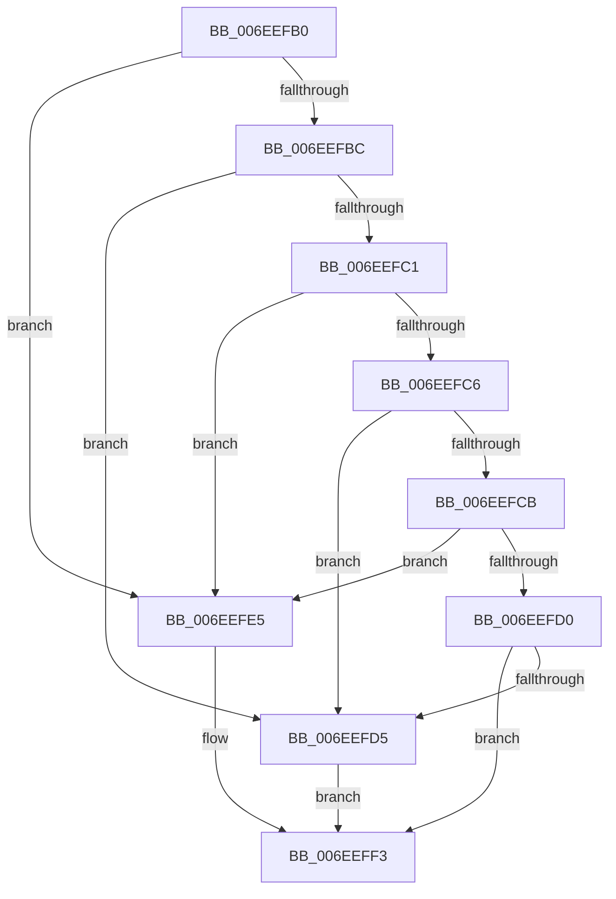

# sub_006EEFB0

- RVA: `0x006EEFB0`–`0x006EF032` (길이 `130` bytes)
- VA: `0x00000001406EEFB0`
- 실행 섹션: `.text`
- PDB 이름 있음: `아니요`; PDB Function 태그: `아니요`
- unwind 정보 RVA: `0x000A2E64`
- 디코드: `33`개 명령, `130/130` bytes 표시
- 미해석 바이트: `0` (있으면 어셈블리에 `.byte`로 보존)

> 이 문서는 커널 이미지의 기계어와 PDB 기호를 분석해 생성했습니다. 4번과 5번은 함수 원형과 자료형을 바이너리 사용 방식에서 추정한 C 해석이며 원본 소스 복구 결과는 아닙니다.

## 1. Dependencies

- 직접 호출 지점: **2**; 고유 호출 대상: **2**
- 직접 호출자로 확인된 함수: **0**
- RIP 상대 이미지 참조: **4**

### Outgoing calls
- `0x006EF004` → [KeWaitForSingleObject](../20/KeWaitForSingleObject_function_0020E6B0.md) (function, `0x0020E6B0`)
- `0x006EF024` → [memset](../6C/memset_function_006C6C40.md) (function, `0x006C6C40`)

### Direct callers
- 이 함수 시작 RVA로 연결되는 직접 call은 확인되지 않았습니다. 간접 호출은 완전히 역산할 수 없습니다.

### Static image references
- `0x006EEFD5` → RVA `0x00F8F040` (`.data`; read)
- `0x006EEFDC` → RVA `0x00F8F020` (`.data`; read)
- `0x006EEFE5` → RVA `0x00F8F038` (`.data`; read)
- `0x006EEFEC` → RVA `0x00F8F060` (`.data`; read)

## 2. Other-region calls and transfers

- 다른 실행 섹션으로 향하는 call: **0**
- call이 아닌 외부 분기/꼬리 이동: **1**
  - `0x006EF02D` → [FsFilterAllocateCompletionStack + 0x41](../43/FsFilterAllocateCompletionStack_function_00436538.md) (`tail-transfer`)

## 3. Assembly (complete function range)

```asm
006EEFB0  0F B6 4B 04                     movzx ecx, byte ptr [rbx + 4]
006EEFB4  81 E9 FA 00 00 00               sub ecx, 0xfa
006EEFBA  74 29                           je 0x1406eefe5
006EEFBC  83 E9 01                        sub ecx, 1
006EEFBF  74 14                           je 0x1406eefd5
006EEFC1  83 E9 01                        sub ecx, 1
006EEFC4  74 1F                           je 0x1406eefe5
006EEFC6  83 E9 01                        sub ecx, 1
006EEFC9  74 0A                           je 0x1406eefd5
006EEFCB  83 E9 01                        sub ecx, 1
006EEFCE  74 15                           je 0x1406eefe5
006EEFD0  83 F9 01                        cmp ecx, 1
006EEFD3  75 1E                           jne 0x1406eeff3
006EEFD5  48 8B 3D 64 00 8A 00            mov rdi, qword ptr [rip + 0x8a0064]
006EEFDC  48 8D 35 3D 00 8A 00            lea rsi, [rip + 0x8a003d]
006EEFE3  EB 0E                           jmp 0x1406eeff3
006EEFE5  48 8B 3D 4C 00 8A 00            mov rdi, qword ptr [rip + 0x8a004c]
006EEFEC  48 8D 35 6D 00 8A 00            lea rsi, [rip + 0x8a006d]
006EEFF3  48 83 64 24 20 00               and qword ptr [rsp + 0x20], 0
006EEFF9  45 33 C9                        xor r9d, r9d
006EEFFC  45 33 C0                        xor r8d, r8d
006EEFFF  33 D2                           xor edx, edx
006EF001  48 8B CE                        mov rcx, rsi
006EF004  E8 A7 F6 B1 FF                  call 0x14020e6b0
006EF009  65 48 8B 04 25 88 01 00 00      mov rax, qword ptr gs:[0x188]
006EF012  48 8D 6F 08                     lea rbp, [rdi + 8]
006EF016  48 8B CD                        mov rcx, rbp
006EF019  48 89 07                        mov qword ptr [rdi], rax
006EF01C  33 D2                           xor edx, edx
006EF01E  41 B8 C8 03 00 00               mov r8d, 0x3c8
006EF024  E8 17 7C FD FF                  call 0x1406c6c40
006EF029  83 4B 40 02                     or dword ptr [rbx + 0x40], 2
006EF02D  E9 47 75 D4 FF                  jmp 0x140436579
```

## 4. C-style interpretation (structured pseudocode)

```c
__int64 __fastcall sub_006EEFB0(__int64 a1, int a2, int a3, int a4)
{
    __int64 result;
    unsigned __int64 v_stack_p20;

    a1 = (unsigned int)((*(unsigned __int8 *)(v_rbx + 4)) - (250));
    if (condition_is_equal) goto loc_006EEFE5;
    a1 = (unsigned int)((a1) - (1));
    if (condition_is_equal) goto loc_006EEFD5;
    a1 = (unsigned int)((a1) - (1));
    if (condition_is_equal) goto loc_006EEFE5;
    a1 = (unsigned int)((a1) - (1));
    if (condition_is_equal) goto loc_006EEFD5;
    a1 = (unsigned int)((a1) - (1));
    if (condition_is_equal) goto loc_006EEFE5;
    if (((unsigned int)(a1)) != 1) goto loc_006EEFF3;
loc_006EEFD5:
    goto loc_006EEFF3;
loc_006EEFE5:
loc_006EEFF3:
    a4 = 0;
    a3 = 0;
    a2 = 0;
    result = KeWaitForSingleObject(v_rip + 9044077, a2, a3, a4);
    *(unsigned __int64 *)(*(unsigned __int64 *)(v_rip + 9044044)) = *(unsigned __int64 *)(gs_base + (0 + 392));
    a2 = 0;
    result = memset(*(unsigned __int64 *)(v_rip + 9044044) + 8, a2, 968, a4);
}
```

## 5. (Beta) C Style

```c
int64_t sub_006EEFB0(int64_t Arg1, int32_t Arg2, int32_t Arg3, int32_t Arg4)
{
    int64_t result;
    uint64_t v_stack_p20;

    Arg1 = (uint32_t)((*(uint8_t *)(local_rbx + 0x4)) - (250));
    if (condition_is_equal) goto loc_006EEFE5;
    Arg1 = (uint32_t)((Arg1) - (1));
    if (condition_is_equal) goto loc_006EEFD5;
    Arg1 = (uint32_t)((Arg1) - (1));
    if (condition_is_equal) goto loc_006EEFE5;
    Arg1 = (uint32_t)((Arg1) - (1));
    if (condition_is_equal) goto loc_006EEFD5;
    Arg1 = (uint32_t)((Arg1) - (1));
    if (condition_is_equal) goto loc_006EEFE5;
    if (((uint32_t)(Arg1)) != 1) goto loc_006EEFF3;
loc_006EEFD5:
    goto loc_006EEFF3;
loc_006EEFE5:
loc_006EEFF3:
    Arg4 = 0;
    Arg3 = 0;
    Arg2 = 0;
    result = KeWaitForSingleObject(v_rip + 9044077, Arg2, Arg3, Arg4);
    *(uint64_t *)(*(uint64_t *)(v_rip + 0x8A004C)) = *(uint64_t *)(gs_base + (0 + 0x188));
    Arg2 = 0;
    result = memset(*(uint64_t *)(v_rip + 0x8A004C) + 8, Arg2, 968, Arg4);
}
```

## 6. Execution-region graph

[열기: 2D/3D 그래프와 함수 탐색 컨트롤 패널](../../../control-panel.html?section=text&rva=0x006EEFB0&view=graph)

- 2D 그래프는 위에서 아래로 흐르고, 3D 그래프는 빈 공간을 드래그해 회전합니다. Shift+드래그는 이동, 휠은 확대·축소, 함수 노드 선택은 대상 보고서 이동입니다.

### Static fallback


