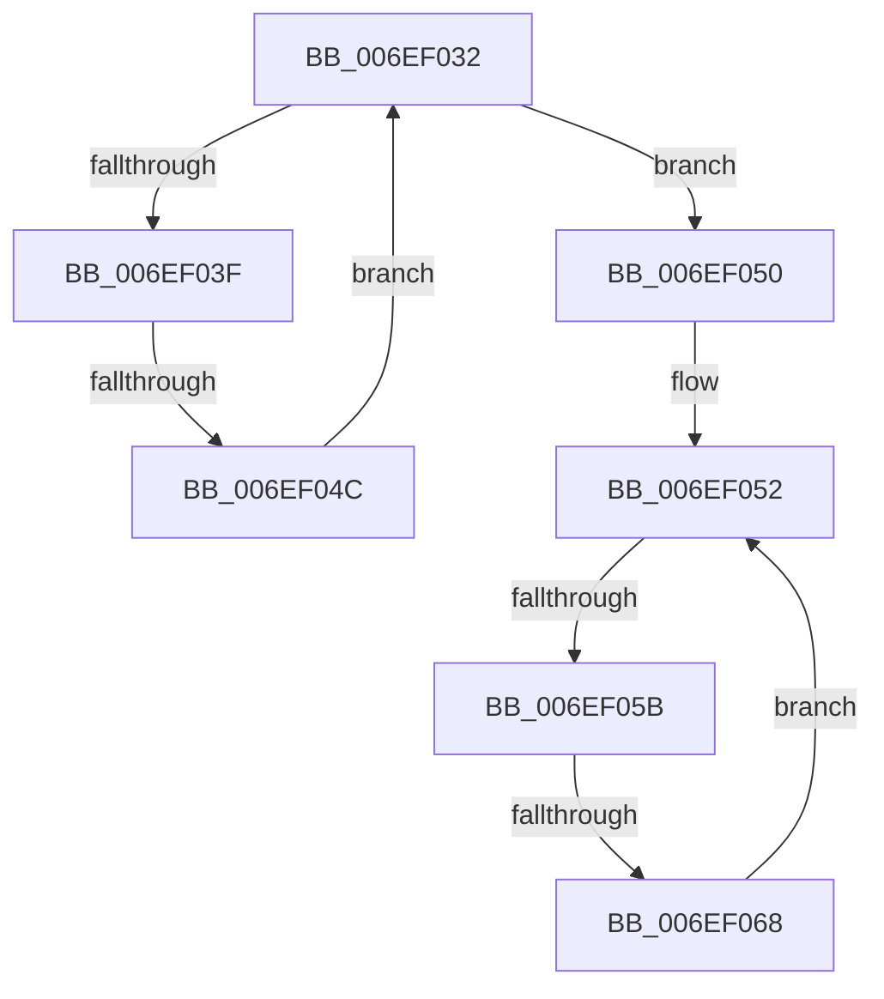

# sub_006EF032

- RVA: `0x006EF032`–`0x006EF06C` (길이 `58` bytes)
- VA: `0x00000001406EF032`
- 실행 섹션: `.text`
- PDB 이름 있음: `아니요`; PDB Function 태그: `아니요`
- unwind 정보 RVA: `0x000A30A0`
- 디코드: `16`개 명령, `58/58` bytes 표시
- 미해석 바이트: `0` (있으면 어셈블리에 `.byte`로 보존)

> 이 문서는 커널 이미지의 기계어와 PDB 기호를 분석해 생성했습니다. 4번과 5번은 함수 원형과 자료형을 바이너리 사용 방식에서 추정한 C 해석이며 원본 소스 복구 결과는 아닙니다.

## 1. Dependencies

- 직접 호출 지점: **0**; 고유 호출 대상: **0**
- 직접 호출자로 확인된 함수: **0**
- RIP 상대 이미지 참조: **1**

### Outgoing calls
- 직접 디코드된 call 명령이 없습니다.

### Direct callers
- 이 함수 시작 RVA로 연결되는 직접 call은 확인되지 않았습니다. 간접 호출은 완전히 역산할 수 없습니다.

### Static image references
- `0x006EF032` → RVA `0x00FC5002` (`ALMOSTRO`; read)

## 2. Other-region calls and transfers

- 다른 실행 섹션으로 향하는 call: **0**
- call이 아닌 외부 분기/꼬리 이동: **3**
  - `0x006EF046` → [sub_0043684F + 0x1D](../43/Unknown_function_0043684F.md) (`tail-transfer`)
  - `0x006EF055` → [sub_0043684F + 0x1B](../43/Unknown_function_0043684F.md) (`tail-transfer`)
  - `0x006EF062` → [sub_0043684F + 0x1D](../43/Unknown_function_0043684F.md) (`tail-transfer`)

## 3. Assembly (complete function range)

```asm
006EF032  44 0F B6 0D C8 5F 8D 00         movzx r9d, byte ptr [rip + 0x8d5fc8]
006EF03A  41 3A D1                        cmp dl, r9b
006EF03D  73 11                           jae 0x1406ef050
006EF03F  0F B6 CA                        movzx ecx, dl
006EF042  80 3C 31 01                     cmp byte ptr [rcx + rsi], 1
006EF046  0F 84 20 78 D4 FF               je 0x14043686c
006EF04C  FE C2                           inc dl
006EF04E  EB E2                           jmp 0x1406ef032
006EF050  32 D2                           xor dl, dl
006EF052  41 3A D1                        cmp dl, r9b
006EF055  0F 83 0F 78 D4 FF               jae 0x14043686a
006EF05B  0F B6 CA                        movzx ecx, dl
006EF05E  80 3C 31 02                     cmp byte ptr [rcx + rsi], 2
006EF062  0F 84 04 78 D4 FF               je 0x14043686c
006EF068  FE C2                           inc dl
006EF06A  EB E6                           jmp 0x1406ef052
```

## 4. C-style interpretation (structured pseudocode)

```c
void __fastcall sub_006EF032(__int64 a1, unsigned __int8 a2)
{
    if (a2 >= ((unsigned __int8)(*(unsigned __int8 *)(v_rip + 9265096)))) goto loc_006EF050;
    a2 = (unsigned __int8)((a2) + 1);
    goto loc_006EF032;
loc_006EF050:
    a2 = 0;
loc_006EF052:
    a2 = (unsigned __int8)((a2) + 1);
    goto loc_006EF052;
}
```

## 5. (Beta) C Style

```c
void sub_006EF032(int64_t Arg1, uint8_t Arg2)
{
    if (Arg2 >= ((uint8_t)(*(uint8_t *)(v_rip + 0x8D5FC8)))) goto loc_006EF050;
    Arg2 = (uint8_t)((Arg2) + 1);
    goto loc_006EF032;
loc_006EF050:
    Arg2 = 0;
loc_006EF052:
    Arg2 = (uint8_t)((Arg2) + 1);
    goto loc_006EF052;
}
```

## 6. Execution-region graph

[열기: 2D/3D 그래프와 함수 탐색 컨트롤 패널](../../../control-panel.html?section=text&rva=0x006EF032&view=graph)

- 2D 그래프는 위에서 아래로 흐르고, 3D 그래프는 빈 공간을 드래그해 회전합니다. Shift+드래그는 이동, 휠은 확대·축소, 함수 노드 선택은 대상 보고서 이동입니다.

### Static fallback


