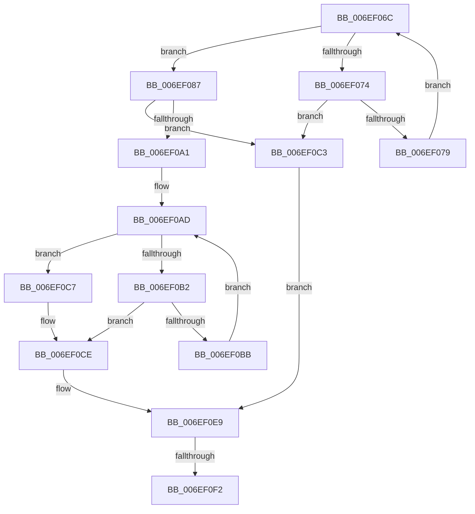

# sub_006EF06C

- RVA: `0x006EF06C`–`0x006EF0FB` (길이 `143` bytes)
- VA: `0x00000001406EF06C`
- 실행 섹션: `.text`
- PDB 이름 있음: `아니요`; PDB Function 태그: `아니요`
- unwind 정보 RVA: `0x000A3208`
- 디코드: `46`개 명령, `143/143` bytes 표시
- 미해석 바이트: `0` (있으면 어셈블리에 `.byte`로 보존)

> 이 문서는 커널 이미지의 기계어와 PDB 기호를 분석해 생성했습니다. 4번과 5번은 함수 원형과 자료형을 바이너리 사용 방식에서 추정한 C 해석이며 원본 소스 복구 결과는 아닙니다.

## 1. Dependencies

- 직접 호출 지점: **0**; 고유 호출 대상: **0**
- 직접 호출자로 확인된 함수: **0**
- RIP 상대 이미지 참조: **0**

### Outgoing calls
- 직접 디코드된 call 명령이 없습니다.

### Direct callers
- 이 함수 시작 RVA로 연결되는 직접 call은 확인되지 않았습니다. 간접 호출은 완전히 역산할 수 없습니다.

### Static image references
- 디코드된 RIP-relative 메모리 참조가 없습니다.

## 2. Other-region calls and transfers

- 다른 실행 섹션으로 향하는 call: **0**
- call이 아닌 외부 분기/꼬리 이동: **2**
  - `0x006EF0EC` → [HvpFindNextDirtyRun + 0x100](../43/HvpFindNextDirtyRun_function_00437880.md) (`tail-transfer`)
  - `0x006EF0F6` → [HvpFindNextDirtyRun + 0x102](../43/HvpFindNextDirtyRun_function_00437880.md) (`tail-transfer`)

## 3. Assembly (complete function range)

```asm
006EF06C  41 F7 D2                        not r10d
006EF06F  45 85 D2                        test r10d, r10d
006EF072  75 13                           jne 0x1406ef087
006EF074  48 3B C3                        cmp rax, rbx
006EF077  77 4A                           ja 0x1406ef0c3
006EF079  45 8B 51 04                     mov r10d, dword ptr [r9 + 4]
006EF07D  49 83 C1 04                     add r9, 4
006EF081  48 83 C0 04                     add rax, 4
006EF085  EB E5                           jmp 0x1406ef06c
006EF087  41 8B C2                        mov eax, r10d
006EF08A  49 8B D1                        mov rdx, r9
006EF08D  49 2B D3                        sub rdx, r11
006EF090  48 C1 FA 02                     sar rdx, 2
006EF094  48 0F BC C8                     bsf rcx, rax
006EF098  C1 E2 05                        shl edx, 5
006EF09B  03 D1                           add edx, ecx
006EF09D  3B D7                           cmp edx, edi
006EF09F  77 22                           ja 0x1406ef0c3
006EF0A1  41 D3 E5                        shl r13d, cl
006EF0A4  41 FF CD                        dec r13d
006EF0A7  45 0B EA                        or r13d, r10d
006EF0AA  41 F7 D5                        not r13d
006EF0AD  45 85 ED                        test r13d, r13d
006EF0B0  75 15                           jne 0x1406ef0c7
006EF0B2  49 8D 41 04                     lea rax, [r9 + 4]
006EF0B6  48 3B C3                        cmp rax, rbx
006EF0B9  77 13                           ja 0x1406ef0ce
006EF0BB  44 8B 28                        mov r13d, dword ptr [rax]
006EF0BE  4C 8B C8                        mov r9, rax
006EF0C1  EB EA                           jmp 0x1406ef0ad
006EF0C3  8B D7                           mov edx, edi
006EF0C5  EB 22                           jmp 0x1406ef0e9
006EF0C7  41 8B C5                        mov eax, r13d
006EF0CA  4C 0F BC C0                     bsf r8, rax
006EF0CE  4D 2B CB                        sub r9, r11
006EF0D1  4D 8B E1                        mov r12, r9
006EF0D4  49 C1 FC 02                     sar r12, 2
006EF0D8  41 C1 E4 05                     shl r12d, 5
006EF0DC  45 03 E0                        add r12d, r8d
006EF0DF  44 3B E7                        cmp r12d, edi
006EF0E2  44 0F 47 E7                     cmova r12d, edi
006EF0E6  44 2B E2                        sub r12d, edx
006EF0E9  45 85 E4                        test r12d, r12d
006EF0EC  0F 84 8E 88 D4 FF               je 0x140437980
006EF0F2  42 8D 3C 22                     lea edi, [rdx + r12]
006EF0F6  E9 87 88 D4 FF                  jmp 0x140437982
```

## 4. C-style interpretation (structured pseudocode)

```c
__int64 __fastcall sub_006EF06C(__int64 a1, __int64 a2, __int64 a3, __int64 a4)
{
    __int64 result;
    __int64 v_r10;
    __int64 v_r12;
    __int64 v_r13;

    v_r10 = (unsigned int)(~(v_r10));
    if ((unsigned int)(v_r10) != 0) goto loc_006EF087;
    if (result > v_rbx) goto loc_006EF0C3;
    a4 = (a4) + (4);
    result = (result) + (4);
    goto loc_006EF06C;
loc_006EF087:
    a2 = (a4) - (v_r11);
    a2 = (a2) >> (2);
    a2 = (unsigned int)((a2) << (5));
    a2 = (unsigned int)((a2) + ((unsigned int)(a1)));
    if (((unsigned int)(a2)) > ((unsigned int)(v_rdi))) goto loc_006EF0C3;
    v_r13 = (unsigned int)((v_r13) << ((unsigned __int8)(a1)));
    v_r13 = (unsigned int)((v_r13) - 1);
    v_r13 = (unsigned int)((v_r13) | ((unsigned int)((unsigned int)(*(unsigned int *)(a4 + 4)))));
    v_r13 = (unsigned int)(~(v_r13));
loc_006EF0AD:
    if ((unsigned int)(v_r13) != 0) goto loc_006EF0C7;
    if ((a4 + 4) > v_rbx) goto loc_006EF0CE;
    goto loc_006EF0AD;
loc_006EF0C3:
    goto loc_006EF0E9;
loc_006EF0C7:
loc_006EF0CE:
    a4 = (a4 + 4) - (v_r11);
    v_r12 = (a4) >> (2);
    v_r12 = (unsigned int)((v_r12) << (5));
    v_r12 = (unsigned int)((v_r12) + ((unsigned int)(a3)));
    if (((unsigned int)(v_r12)) > ((unsigned int)(v_rdi))) { v_r12 = (unsigned int)(v_rdi); }
    v_r12 = (unsigned int)((v_r12) - ((unsigned int)((unsigned int)((unsigned int)(v_rdi)))));
loc_006EF0E9:
}
```

## 5. (Beta) C Style

```c
int64_t sub_006EF06C(int64_t Arg1, int64_t Arg2, int64_t Arg3, void *Arg4)
{
    uint8_t *arg4 = (uint8_t *)Arg4;

    int64_t result;
    int64_t local_r10;
    int64_t local_r12;
    int64_t local_r13;

    local_r10 = (uint32_t)(~(local_r10));
    if ((uint32_t)(local_r10) != 0) goto loc_006EF087;
    if (result > local_rbx) goto loc_006EF0C3;
    Arg4 = (Arg4) + (4);
    result = (result) + (4);
    goto loc_006EF06C;
loc_006EF087:
    Arg2 = (Arg4) - (local_r11);
    Arg2 = (Arg2) >> (2);
    Arg2 = (uint32_t)((Arg2) << (5));
    Arg2 = (uint32_t)((Arg2) + ((uint32_t)(Arg1)));
    if (((uint32_t)(Arg2)) > ((uint32_t)(local_rdi))) goto loc_006EF0C3;
    local_r13 = (uint32_t)((local_r13) << ((uint8_t)(Arg1)));
    local_r13 = (uint32_t)((local_r13) - 1);
    local_r13 = (uint32_t)((local_r13) | ((uint32_t)((uint32_t)(*(uint32_t *)(arg4 + 0x4)))));
    local_r13 = (uint32_t)(~(local_r13));
loc_006EF0AD:
    if ((uint32_t)(local_r13) != 0) goto loc_006EF0C7;
    if ((Arg4 + 4) > local_rbx) goto loc_006EF0CE;
    goto loc_006EF0AD;
loc_006EF0C3:
    goto loc_006EF0E9;
loc_006EF0C7:
loc_006EF0CE:
    Arg4 = (Arg4 + 4) - (local_r11);
    local_r12 = (Arg4) >> (2);
    local_r12 = (uint32_t)((local_r12) << (5));
    local_r12 = (uint32_t)((local_r12) + ((uint32_t)(Arg3)));
    if (((uint32_t)(local_r12)) > ((uint32_t)(local_rdi))) { local_r12 = (uint32_t)(local_rdi); }
    local_r12 = (uint32_t)((local_r12) - ((uint32_t)((uint32_t)((uint32_t)(local_rdi)))));
loc_006EF0E9:
}
```

### 관측된 메모리 오프셋

구조체 형식이 확인되지 않은 접근은 인자 기준의 오프셋으로만 기록했습니다.

| 기준 인자 | 오프셋 표현 | 폭 (bit) | 접근 |
|---|---:|---:|---|
| `Arg4` | `+ 0x4` | `32` | `R` |

## 6. Execution-region graph

[열기: 2D/3D 그래프와 함수 탐색 컨트롤 패널](../../../control-panel.html?section=text&rva=0x006EF06C&view=graph)

- 2D 그래프는 위에서 아래로 흐르고, 3D 그래프는 빈 공간을 드래그해 회전합니다. Shift+드래그는 이동, 휠은 확대·축소, 함수 노드 선택은 대상 보고서 이동입니다.

### Static fallback


