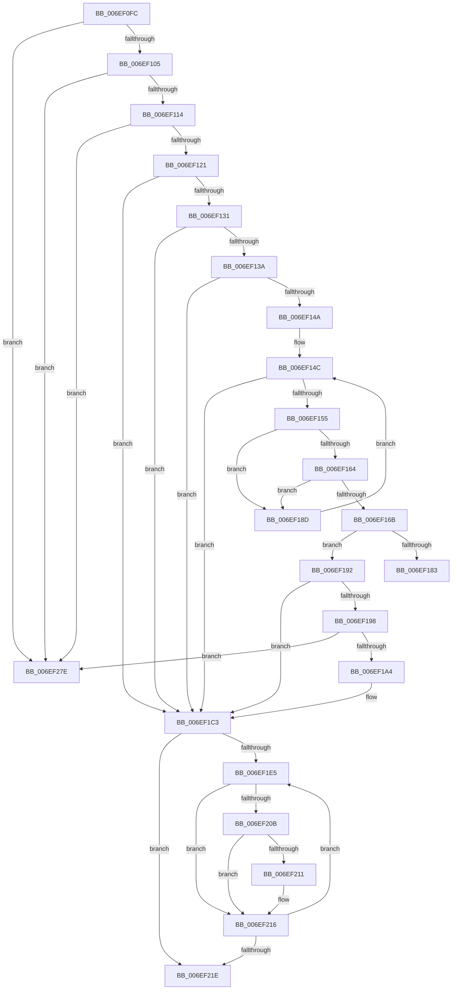

# sub_006EF0FC

- RVA: `0x006EF0FC`–`0x006EF288` (길이 `396` bytes)
- VA: `0x00000001406EF0FC`
- 실행 섹션: `.text`
- PDB 이름 있음: `아니요`; PDB Function 태그: `아니요`
- unwind 정보 RVA: `0x000A3250`
- 디코드: `97`개 명령, `396/396` bytes 표시
- 미해석 바이트: `0` (있으면 어셈블리에 `.byte`로 보존)

> 이 문서는 커널 이미지의 기계어와 PDB 기호를 분석해 생성했습니다. 4번과 5번은 함수 원형과 자료형을 바이너리 사용 방식에서 추정한 C 해석이며 원본 소스 복구 결과는 아닙니다.

## 1. Dependencies

- 직접 호출 지점: **5**; 고유 호출 대상: **5**
- 직접 호출자로 확인된 함수: **0**
- RIP 상대 이미지 참조: **3**

### Outgoing calls
- `0x006EF1BE` → [EtwpUpdateTagFilter](../../page/7B/EtwpUpdateTagFilter_function_007B7D04.md) (function, `0x007B7D04`)
- `0x006EF248` → [KeWaitForSingleObject](../20/KeWaitForSingleObject_function_0020E6B0.md) (function, `0x0020E6B0`)
- `0x006EF25A` → [EtwpUpdateSelectedGroupMasks](../49/EtwpUpdateSelectedGroupMasks_function_0049B114.md) (function, `0x0049B114`)
- `0x006EF26D` → [KeReleaseMutant](../39/KeReleaseMutant_function_003967D0.md) (function, `0x003967D0`)
- `0x006EF272` → [KeLeaveCriticalRegion](../25/KeLeaveCriticalRegion_function_0025D8B0.md) (function, `0x0025D8B0`)

### Direct callers
- 이 함수 시작 RVA로 연결되는 직접 call은 확인되지 않았습니다. 간접 호출은 완전히 역산할 수 없습니다.

### Static image references
- `0x006EF121` → RVA `0x0000BA18` (`.rdata`; read)
- `0x006EF13A` → RVA `0x00FC6AA8` (`ALMOSTRO`; read)
- `0x006EF1AF` → RVA `0x00EFF940` (`.data`; read)

## 2. Other-region calls and transfers

- 다른 실행 섹션으로 향하는 call: **1**
  - `0x006EF1BE` → [EtwpUpdateTagFilter](../../page/7B/EtwpUpdateTagFilter_function_007B7D04.md) (`.text` → `PAGE`)
- call이 아닌 외부 분기/꼬리 이동: **3**
  - `0x006EF188` → [EtwpEnableMetaProviderGuid + 0x59](../43/EtwpEnableMetaProviderGuid_function_00437AE0.md) (`tail-transfer`)
  - `0x006EF279` → [EtwpEnableMetaProviderGuid + 0x59](../43/EtwpEnableMetaProviderGuid_function_00437AE0.md) (`tail-transfer`)
  - `0x006EF283` → [EtwpEnableMetaProviderGuid + 0x59](../43/EtwpEnableMetaProviderGuid_function_00437AE0.md) (`tail-transfer`)

## 3. Assembly (complete function range)

```asm
006EF0FC  48 85 F6                        test rsi, rsi
006EF0FF  0F 84 79 01 00 00               je 0x1406ef27e
006EF105  41 BF 01 00 00 00               mov r15d, 1
006EF10B  45 3B F7                        cmp r14d, r15d
006EF10E  0F 87 6A 01 00 00               ja 0x1406ef27e
006EF114  F7 46 0C 00 00 00 02            test dword ptr [rsi + 0xc], 0x2000000
006EF11B  0F 84 5D 01 00 00               je 0x1406ef27e
006EF121  48 8D 05 F0 C8 91 FF            lea rax, [rip - 0x6e3710]
006EF128  48 3B F8                        cmp rdi, rax
006EF12B  0F 85 92 00 00 00               jne 0x1406ef1c3
006EF131  48 85 DB                        test rbx, rbx
006EF134  0F 84 89 00 00 00               je 0x1406ef1c3
006EF13A  48 8B 05 67 79 8D 00            mov rax, qword ptr [rip + 0x8d7967]
006EF141  48 39 86 50 05 00 00            cmp qword ptr [rsi + 0x550], rax
006EF148  75 79                           jne 0x1406ef1c3
006EF14A  33 C9                           xor ecx, ecx
006EF14C  3B 8C 24 D8 00 00 00            cmp ecx, dword ptr [rsp + 0xd8]
006EF153  73 6E                           jae 0x1406ef1c3
006EF155  8B C1                           mov eax, ecx
006EF157  48 03 C0                        add rax, rax
006EF15A  81 7C C3 0C 00 00 00 80         cmp dword ptr [rbx + rax*8 + 0xc], 0x80000000
006EF162  75 29                           jne 0x1406ef18d
006EF164  83 7C C3 08 18                  cmp dword ptr [rbx + rax*8 + 8], 0x18
006EF169  76 22                           jbe 0x1406ef18d
006EF16B  0F AE E8                        lfence
006EF16E  4C 8B 0C C3                     mov r9, qword ptr [rbx + rax*8]
006EF172  8B 44 C3 08                     mov eax, dword ptr [rbx + rax*8 + 8]
006EF176  41 8B 51 10                     mov edx, dword ptr [r9 + 0x10]
006EF17A  48 8D 4A 18                     lea rcx, [rdx + 0x18]
006EF17E  48 3B C1                        cmp rax, rcx
006EF181  73 0F                           jae 0x1406ef192
006EF183  B8 05 00 00 80                  mov eax, 0x80000005
006EF188  E9 AC 89 D4 FF                  jmp 0x140437b39
006EF18D  41 03 CF                        add ecx, r15d
006EF190  EB BA                           jmp 0x1406ef14c
006EF192  66 45 39 39                     cmp word ptr [r9], r15w
006EF196  75 2B                           jne 0x1406ef1c3
006EF198  C1 EA 02                        shr edx, 2
006EF19B  83 FA 04                        cmp edx, 4
006EF19E  0F 87 DA 00 00 00               ja 0x1406ef27e
006EF1A4  0F B6 86 32 03 00 00            movzx eax, byte ptr [rsi + 0x332]
006EF1AB  48 8D 0C 80                     lea rcx, [rax + rax*4]
006EF1AF  48 8D 05 8A 07 81 00            lea rax, [rip + 0x81078a]
006EF1B6  4C 8D 04 88                     lea r8, [rax + rcx*4]
006EF1BA  49 8D 49 18                     lea rcx, [r9 + 0x18]
006EF1BE  E8 41 8B 0C 00                  call 0x1407b7d04
006EF1C3  49 83 CB FF                     or r11, 0xffffffffffffffff
006EF1C7  0F 57 C0                        xorps xmm0, xmm0
006EF1CA  48 85 ED                        test rbp, rbp
006EF1CD  49 8B D3                        mov rdx, r11
006EF1D0  0F 11 44 24 50                  movups xmmword ptr [rsp + 0x50], xmm0
006EF1D5  48 0F 45 D5                     cmovne rdx, rbp
006EF1D9  33 C0                           xor eax, eax
006EF1DB  0F 11 44 24 60                  movups xmmword ptr [rsp + 0x60], xmm0
006EF1E0  39 47 08                        cmp dword ptr [rdi + 8], eax
006EF1E3  76 39                           jbe 0x1406ef21e
006EF1E5  4C 8B 17                        mov r10, qword ptr [rdi]
006EF1E8  44 8B C8                        mov r9d, eax
006EF1EB  4D 03 C9                        add r9, r9
006EF1EE  47 8B 44 CA 08                  mov r8d, dword ptr [r10 + r9*8 + 8]
006EF1F3  41 8B C8                        mov ecx, r8d
006EF1F6  41 81 E0 FF FF FF 1F            and r8d, 0x1fffffff
006EF1FD  48 C1 E9 1D                     shr rcx, 0x1d
006EF201  44 09 44 8C 50                  or dword ptr [rsp + rcx*4 + 0x50], r8d
006EF206  45 3B F7                        cmp r14d, r15d
006EF209  75 0B                           jne 0x1406ef216
006EF20B  4B 85 14 CA                     test qword ptr [r10 + r9*8], rdx
006EF20F  74 05                           je 0x1406ef216
006EF211  44 09 44 8C 30                  or dword ptr [rsp + rcx*4 + 0x30], r8d
006EF216  41 03 C7                        add eax, r15d
006EF219  3B 47 08                        cmp eax, dword ptr [rdi + 8]
006EF21C  72 C7                           jb 0x1406ef1e5
006EF21E  65 48 8B 04 25 88 01 00 00      mov rax, qword ptr gs:[0x188]
006EF227  48 8D BE 78 02 00 00            lea rdi, [rsi + 0x278]
006EF22E  48 83 64 24 20 00               and qword ptr [rsp + 0x20], 0
006EF234  45 33 C9                        xor r9d, r9d
006EF237  45 33 C0                        xor r8d, r8d
006EF23A  33 D2                           xor edx, edx
006EF23C  48 8B CF                        mov rcx, rdi
006EF23F  66 44 01 98 E4 01 00 00         add word ptr [rax + 0x1e4], r11w
006EF247  90                              nop
006EF248  E8 63 F4 B1 FF                  call 0x14020e6b0
006EF24D  4C 8D 44 24 30                  lea r8, [rsp + 0x30]
006EF252  48 8B CE                        mov rcx, rsi
006EF255  48 8D 54 24 50                  lea rdx, [rsp + 0x50]
006EF25A  E8 B5 BE DA FF                  call 0x14049b114
006EF25F  45 33 C9                        xor r9d, r9d
006EF262  45 33 C0                        xor r8d, r8d
006EF265  41 8B D7                        mov edx, r15d
006EF268  48 8B CF                        mov rcx, rdi
006EF26B  8B D8                           mov ebx, eax
006EF26D  E8 5E 75 CA FF                  call 0x1403967d0
006EF272  E8 39 E6 B6 FF                  call 0x14025d8b0
006EF277  8B C3                           mov eax, ebx
006EF279  E9 BB 88 D4 FF                  jmp 0x140437b39
006EF27E  B8 0D 00 00 C0                  mov eax, 0xc000000d
006EF283  E9 B1 88 D4 FF                  jmp 0x140437b39
```

## 4. C-style interpretation (structured pseudocode)

```c
__int64 __fastcall sub_006EF0FC(int a1, __int64 a2, __int64 a3, __int64 a4, __int64 a5, unsigned int a6, __int64 a7, __int64 a8, __int64 a9, unsigned int a10, __int64 a11, __int64 a12, __int64 a13, __int64 a14, __int64 a15, __int64 a16, __int64 a17, __int64 a18, __int64 a19, __int64 a20, __int64 a21, __int64 a22, __int64 a23, __int64 a24, __int64 a25, __int64 a26, unsigned int a27)
{
    __int64 result;
    __int64 v_r11;
    unsigned __int64 v_stack_p20;

    if (v_rsi == 0) goto loc_006EF27E;
    if (((unsigned int)(v_r14)) > 1) goto loc_006EF27E;
    if (((*(unsigned int *)(v_rsi + 12)) & (0x2000000ULL)) == 0) goto loc_006EF27E;
    if (v_rdi != (v_rip - 7223056)) goto loc_006EF1C3;
    if (v_rbx == 0) goto loc_006EF1C3;
    if ((*(unsigned __int64 *)(v_rsi + 1360)) != (*(unsigned __int64 *)(v_rip + 9271655))) goto loc_006EF1C3;
    a1 = 0;
loc_006EF14C:
    if (0 >= a27) goto loc_006EF1C3;
    result = (0) + (0);
    if ((*(unsigned int *)(v_rbx + result * 8 + 12)) != 0x80000000ULL) goto loc_006EF18D;
    if ((*(unsigned int *)(v_rbx + result * 8 + 8)) <= 24) goto loc_006EF18D;
    if (((unsigned int)(*(unsigned int *)(v_rbx + result * 8 + 8))) >= ((unsigned int)(*(unsigned int *)(*(unsigned __int64 *)(v_rbx + result * 8) + 16)) + 24)) goto loc_006EF192;
loc_006EF18D:
    a1 = (unsigned int)(((unsigned int)(*(unsigned int *)(*(unsigned __int64 *)(v_rbx + result * 8) + 16)) + 24) + (1));
    goto loc_006EF14C;
loc_006EF192:
    if ((*(unsigned __int16 *)(*(unsigned __int64 *)(v_rbx + result * 8))) != 1) goto loc_006EF1C3;
    a2 = (unsigned int)(((unsigned int)(*(unsigned int *)(*(unsigned __int64 *)(v_rbx + result * 8) + 16))) >> (2));
    if (((unsigned int)(a2)) > 4) goto loc_006EF27E;
    result = EtwpUpdateTagFilter(*(unsigned __int64 *)(v_rbx + result * 8) + 24, a2, v_rip + 8456074 + *(unsigned __int8 *)(v_rsi + 818) + *(unsigned __int8 *)(v_rsi + 818) * 4 * 4, *(unsigned __int64 *)(v_rbx + result * 8));
loc_006EF1C3:
    v_r11 = (v_r11) | (-1);
    a10 = v_xmm0;
    a2 = v_r11;
    if (v_rbp != 0) { a2 = v_rbp; }
    result = 0;
    a12 = v_xmm0;
    if ((*(unsigned int *)(v_rdi + 8)) <= 0) goto loc_006EF21E;
loc_006EF1E5:
    a4 = (0) + (0);
    a3 = (unsigned int)(((unsigned int)(*(unsigned int *)(*(unsigned __int64 *)(v_rdi) + a4 * 8 + 8))) & (0x1FFFFFFFULL));
    a1 = ((unsigned int)((unsigned int)((unsigned int)(*(unsigned int *)(*(unsigned __int64 *)(v_rdi) + a4 * 8 + 8))))) >> (29);
    if (((unsigned int)(v_r14)) != 1) goto loc_006EF216;
    if (((*(unsigned __int64 *)(*(unsigned __int64 *)(v_rdi) + a4 * 8)) & (a2)) != 0) {
    }
    result = (unsigned int)((result) + (1));
    if (((unsigned int)(result)) < (*(unsigned int *)(v_rdi + 8))) goto loc_006EF1E5;
loc_006EF21E:
    a4 = 0;
    a3 = 0;
    a2 = 0;
    result = KeWaitForSingleObject(v_rsi + 632, a2, a3, a4);
    result = EtwpUpdateSelectedGroupMasks(v_rsi, a10, a6, a4);
    a4 = 0;
    a3 = 0;
    result = KeReleaseMutant(v_rsi + 632, 1, a3, a4);
    result = KeLeaveCriticalRegion(v_rsi + 632, 1, a3, a4);
loc_006EF27E:
}
```

## 5. (Beta) C Style

```c
int64_t sub_006EF0FC(int32_t Arg1, int64_t Arg2, int64_t Arg3, int64_t Arg4, uint64_t Arg5, uint32_t Arg6, uint64_t Arg7, uint64_t Arg8, uint64_t Arg9, uint32_t Arg10, uint64_t Arg11, int64_t Arg12, uint64_t Arg13, uint64_t Arg14, uint64_t Arg15, uint64_t Arg16, uint64_t Arg17, uint64_t Arg18, uint64_t Arg19, uint64_t Arg20, uint64_t Arg21, uint64_t Arg22, uint64_t Arg23, uint64_t Arg24, uint64_t Arg25, uint64_t Arg26, uint32_t Arg27)
{
    int64_t result;
    int64_t local_r11;
    uint64_t v_stack_p20;

    if (local_rsi == 0) goto loc_006EF27E;
    if (((uint32_t)(local_r14)) > 1) goto loc_006EF27E;
    if (((*(uint32_t *)(local_rsi + 0xC)) & (0x2000000ULL)) == 0) goto loc_006EF27E;
    if (local_rdi != (v_rip - 7223056)) goto loc_006EF1C3;
    if (local_rbx == 0) goto loc_006EF1C3;
    if ((*(uint64_t *)(local_rsi + 0x550)) != (*(uint64_t *)(v_rip + 0x8D7967))) goto loc_006EF1C3;
    Arg1 = 0;
loc_006EF14C:
    if (0 >= Arg27) goto loc_006EF1C3;
    result = (0) + (0);
    if ((*(uint32_t *)(local_rbx + result * 8 + 0xC)) != 0x80000000ULL) goto loc_006EF18D;
    if ((*(uint32_t *)(local_rbx + result * 8 + 0x8)) <= 24) goto loc_006EF18D;
    if (((uint32_t)(*(uint32_t *)(local_rbx + result * 8 + 0x8))) >= ((uint32_t)(*(uint32_t *)(*(uint64_t *)(local_rbx + result * 8) + 0x10)) + 24)) goto loc_006EF192;
loc_006EF18D:
    Arg1 = (uint32_t)(((uint32_t)(*(uint32_t *)(*(uint64_t *)(local_rbx + result * 8) + 0x10)) + 24) + (1));
    goto loc_006EF14C;
loc_006EF192:
    if ((*(uint16_t *)(*(uint64_t *)(local_rbx + result * 8))) != 1) goto loc_006EF1C3;
    Arg2 = (uint32_t)(((uint32_t)(*(uint32_t *)(*(uint64_t *)(local_rbx + result * 8) + 0x10))) >> (2));
    if (((uint32_t)(Arg2)) > 4) goto loc_006EF27E;
    result = EtwpUpdateTagFilter(*(uint64_t *)(local_rbx + result * 8) + 24, Arg2, v_rip + 8456074 + *(uint8_t *)(local_rsi + 0x332) + *(uint8_t *)(local_rsi + 0x332) * 4 * 4, *(uint64_t *)(local_rbx + result * 8));
loc_006EF1C3:
    local_r11 = (local_r11) | (-1);
    Arg10 = v_xmm0;
    Arg2 = local_r11;
    if (local_rbp != 0) { Arg2 = local_rbp; }
    result = 0;
    Arg12 = v_xmm0;
    if ((*(uint32_t *)(local_rdi + 0x8)) <= 0) goto loc_006EF21E;
loc_006EF1E5:
    Arg4 = (0) + (0);
    Arg3 = (uint32_t)(((uint32_t)(*(uint32_t *)(*(uint64_t *)(local_rdi) + Arg4 * 8 + 0x8))) & (0x1FFFFFFFULL));
    Arg1 = ((uint32_t)((uint32_t)((uint32_t)(*(uint32_t *)(*(uint64_t *)(local_rdi) + Arg4 * 8 + 0x8))))) >> (29);
    if (((uint32_t)(local_r14)) != 1) goto loc_006EF216;
    if (((*(uint64_t *)(*(uint64_t *)(local_rdi) + Arg4 * 8)) & (Arg2)) != 0) {
    }
    result = (uint32_t)((result) + (1));
    if (((uint32_t)(result)) < (*(uint32_t *)(local_rdi + 0x8))) goto loc_006EF1E5;
loc_006EF21E:
    Arg4 = 0;
    Arg3 = 0;
    Arg2 = 0;
    result = KeWaitForSingleObject(local_rsi + 632, Arg2, Arg3, Arg4);
    result = EtwpUpdateSelectedGroupMasks(local_rsi, Arg10, Arg6, Arg4);
    Arg4 = 0;
    Arg3 = 0;
    result = KeReleaseMutant(local_rsi + 632, 1, Arg3, Arg4);
    result = KeLeaveCriticalRegion(local_rsi + 632, 1, Arg3, Arg4);
loc_006EF27E:
}
```

## 6. Execution-region graph

[열기: 2D/3D 그래프와 함수 탐색 컨트롤 패널](../../../control-panel.html?section=text&rva=0x006EF0FC&view=graph)

- 2D 그래프는 위에서 아래로 흐르고, 3D 그래프는 빈 공간을 드래그해 회전합니다. Shift+드래그는 이동, 휠은 확대·축소, 함수 노드 선택은 대상 보고서 이동입니다.

### Static fallback


