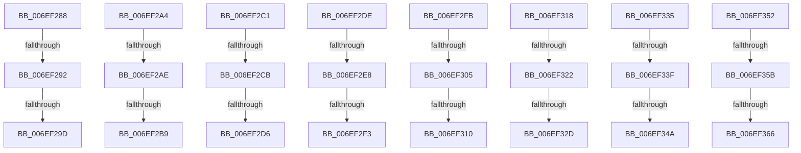

# sub_006EF288

- RVA: `0x006EF288`–`0x006EF36E` (길이 `230` bytes)
- VA: `0x00000001406EF288`
- 실행 섹션: `.text`
- PDB 이름 있음: `아니요`; PDB Function 태그: `아니요`
- unwind 정보 RVA: `0x000A33DC`
- 디코드: `48`개 명령, `230/230` bytes 표시
- 미해석 바이트: `0` (있으면 어셈블리에 `.byte`로 보존)

> 이 문서는 커널 이미지의 기계어와 PDB 기호를 분석해 생성했습니다. 4번과 5번은 함수 원형과 자료형을 바이너리 사용 방식에서 추정한 C 해석이며 원본 소스 복구 결과는 아닙니다.

## 1. Dependencies

- 직접 호출 지점: **0**; 고유 호출 대상: **0**
- 직접 호출자로 확인된 함수: **0**
- RIP 상대 이미지 참조: **0**

### Outgoing calls
- 직접 디코드된 call 명령이 없습니다.

### Direct callers
- 이 함수 시작 RVA로 연결되는 직접 call은 확인되지 않았습니다. 간접 호출은 완전히 역산할 수 없습니다.

### Static image references
- 디코드된 RIP-relative 메모리 참조가 없습니다.

## 2. Other-region calls and transfers

- 다른 실행 섹션으로 향하는 call: **0**
- call이 아닌 외부 분기/꼬리 이동: **24**
  - `0x006EF28C` → [RtlFxToFnFrame + 0x86](../43/RtlFxToFnFrame_function_00437F10.md) (`tail-transfer`)
  - `0x006EF297` → [RtlFxToFnFrame + 0x86](../43/RtlFxToFnFrame_function_00437F10.md) (`tail-transfer`)
  - `0x006EF29F` → [RtlFxToFnFrame + 0x86](../43/RtlFxToFnFrame_function_00437F10.md) (`tail-transfer`)
  - `0x006EF2A8` → [RtlFxToFnFrame + 0xBB](../43/RtlFxToFnFrame_function_00437F10.md) (`tail-transfer`)
  - `0x006EF2B3` → [RtlFxToFnFrame + 0xBB](../43/RtlFxToFnFrame_function_00437F10.md) (`tail-transfer`)
  - `0x006EF2BC` → [RtlFxToFnFrame + 0xBB](../43/RtlFxToFnFrame_function_00437F10.md) (`tail-transfer`)
  - `0x006EF2C5` → [RtlFxToFnFrame + 0xE8](../43/RtlFxToFnFrame_function_00437F10.md) (`tail-transfer`)
  - `0x006EF2D0` → [RtlFxToFnFrame + 0xE8](../43/RtlFxToFnFrame_function_00437F10.md) (`tail-transfer`)
  - `0x006EF2D9` → [RtlFxToFnFrame + 0xE8](../43/RtlFxToFnFrame_function_00437F10.md) (`tail-transfer`)
  - `0x006EF2E2` → [RtlFxToFnFrame + 0x115](../43/RtlFxToFnFrame_function_00437F10.md) (`tail-transfer`)
  - `0x006EF2ED` → [RtlFxToFnFrame + 0x115](../43/RtlFxToFnFrame_function_00437F10.md) (`tail-transfer`)
  - `0x006EF2F6` → [RtlFxToFnFrame + 0x115](../43/RtlFxToFnFrame_function_00437F10.md) (`tail-transfer`)
  - `0x006EF2FF` → [RtlFxToFnFrame + 0x142](../43/RtlFxToFnFrame_function_00437F10.md) (`tail-transfer`)
  - `0x006EF30A` → [RtlFxToFnFrame + 0x142](../43/RtlFxToFnFrame_function_00437F10.md) (`tail-transfer`)
  - `0x006EF313` → [RtlFxToFnFrame + 0x142](../43/RtlFxToFnFrame_function_00437F10.md) (`tail-transfer`)
  - `0x006EF31C` → [RtlFxToFnFrame + 0x16F](../43/RtlFxToFnFrame_function_00437F10.md) (`tail-transfer`)
  - `0x006EF327` → [RtlFxToFnFrame + 0x16F](../43/RtlFxToFnFrame_function_00437F10.md) (`tail-transfer`)
  - `0x006EF330` → [RtlFxToFnFrame + 0x16F](../43/RtlFxToFnFrame_function_00437F10.md) (`tail-transfer`)
  - `0x006EF339` → [RtlFxToFnFrame + 0x1A2](../43/RtlFxToFnFrame_function_00437F10.md) (`tail-transfer`)
  - `0x006EF344` → [RtlFxToFnFrame + 0x1A2](../43/RtlFxToFnFrame_function_00437F10.md) (`tail-transfer`)
  - `0x006EF34D` → [RtlFxToFnFrame + 0x1A2](../43/RtlFxToFnFrame_function_00437F10.md) (`tail-transfer`)
  - `0x006EF355` → [RtlFxToFnFrame + 0x1D5](../43/RtlFxToFnFrame_function_00437F10.md) (`tail-transfer`)
  - `0x006EF360` → [RtlFxToFnFrame + 0x1D5](../43/RtlFxToFnFrame_function_00437F10.md) (`tail-transfer`)
  - `0x006EF369` → [RtlFxToFnFrame + 0x1D5](../43/RtlFxToFnFrame_function_00437F10.md) (`tail-transfer`)

## 3. Assembly (complete function range)

```asm
006EF288  66 44 3B DE                     cmp r11w, si
006EF28C  0F 84 04 8D D4 FF               je 0x140437f96
006EF292  4A 83 3C 11 00                  cmp qword ptr [rcx + r10], 0
006EF297  0F 8D F9 8C D4 FF               jge 0x140437f96
006EF29D  33 C0                           xor eax, eax
006EF29F  E9 F2 8C D4 FF                  jmp 0x140437f96
006EF2A4  66 44 3B DE                     cmp r11w, si
006EF2A8  0F 84 1D 8D D4 FF               je 0x140437fcb
006EF2AE  4A 83 3C 11 00                  cmp qword ptr [rcx + r10], 0
006EF2B3  0F 8D 12 8D D4 FF               jge 0x140437fcb
006EF2B9  66 23 C3                        and ax, bx
006EF2BC  E9 0A 8D D4 FF                  jmp 0x140437fcb
006EF2C1  66 44 3B DE                     cmp r11w, si
006EF2C5  0F 84 2D 8D D4 FF               je 0x140437ff8
006EF2CB  4A 83 3C 11 00                  cmp qword ptr [rcx + r10], 0
006EF2D0  0F 8D 22 8D D4 FF               jge 0x140437ff8
006EF2D6  66 23 C3                        and ax, bx
006EF2D9  E9 1A 8D D4 FF                  jmp 0x140437ff8
006EF2DE  66 44 3B DE                     cmp r11w, si
006EF2E2  0F 84 3D 8D D4 FF               je 0x140438025
006EF2E8  4A 83 3C 11 00                  cmp qword ptr [rcx + r10], 0
006EF2ED  0F 8D 32 8D D4 FF               jge 0x140438025
006EF2F3  66 23 C3                        and ax, bx
006EF2F6  E9 2A 8D D4 FF                  jmp 0x140438025
006EF2FB  66 44 3B DE                     cmp r11w, si
006EF2FF  0F 84 4D 8D D4 FF               je 0x140438052
006EF305  4A 83 3C 11 00                  cmp qword ptr [rcx + r10], 0
006EF30A  0F 8D 42 8D D4 FF               jge 0x140438052
006EF310  66 23 C3                        and ax, bx
006EF313  E9 3A 8D D4 FF                  jmp 0x140438052
006EF318  66 44 3B DE                     cmp r11w, si
006EF31C  0F 84 5D 8D D4 FF               je 0x14043807f
006EF322  4A 83 3C 11 00                  cmp qword ptr [rcx + r10], 0
006EF327  0F 8D 52 8D D4 FF               jge 0x14043807f
006EF32D  66 23 C3                        and ax, bx
006EF330  E9 4A 8D D4 FF                  jmp 0x14043807f
006EF335  66 44 3B DE                     cmp r11w, si
006EF339  0F 84 73 8D D4 FF               je 0x1404380b2
006EF33F  4A 83 3C 11 00                  cmp qword ptr [rcx + r10], 0
006EF344  0F 8D 68 8D D4 FF               jge 0x1404380b2
006EF34A  66 23 C3                        and ax, bx
006EF34D  E9 60 8D D4 FF                  jmp 0x1404380b2
006EF352  66 3B D6                        cmp dx, si
006EF355  0F 84 8A 8D D4 FF               je 0x1404380e5
006EF35B  4A 83 3C 11 00                  cmp qword ptr [rcx + r10], 0
006EF360  0F 8D 7F 8D D4 FF               jge 0x1404380e5
006EF366  66 23 C3                        and ax, bx
006EF369  E9 77 8D D4 FF                  jmp 0x1404380e5
```

## 4. C-style interpretation (structured pseudocode)

```c
__int64 __fastcall sub_006EF288(__int64 a1, unsigned __int16 a2)
{
    __int64 result;

    result = 0;
}
```

## 5. (Beta) C Style

```c
int64_t sub_006EF288(void *Arg1, uint16_t Arg2)
{
    uint8_t *arg1 = (uint8_t *)Arg1;

    int64_t result;

    result = 0;
}
```

### 관측된 메모리 오프셋

구조체 형식이 확인되지 않은 접근은 인자 기준의 오프셋으로만 기록했습니다.

| 기준 인자 | 오프셋 표현 | 폭 (bit) | 접근 |
|---|---:|---:|---|
| `Arg1` | `+ 0x0 + r10*1` | `64` | `R` |

## 6. Execution-region graph

[열기: 2D/3D 그래프와 함수 탐색 컨트롤 패널](../../../control-panel.html?section=text&rva=0x006EF288&view=graph)

- 2D 그래프는 위에서 아래로 흐르고, 3D 그래프는 빈 공간을 드래그해 회전합니다. Shift+드래그는 이동, 휠은 확대·축소, 함수 노드 선택은 대상 보고서 이동입니다.

### Static fallback


