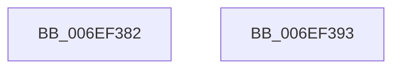

# sub_006EF382

- RVA: `0x006EF382`–`0x006EF3A9` (길이 `39` bytes)
- VA: `0x00000001406EF382`
- 실행 섹션: `.text`
- PDB 이름 있음: `아니요`; PDB Function 태그: `아니요`
- unwind 정보 RVA: `0x000A353C`
- 디코드: `9`개 명령, `39/39` bytes 표시
- 미해석 바이트: `0` (있으면 어셈블리에 `.byte`로 보존)

> 이 문서는 커널 이미지의 기계어와 PDB 기호를 분석해 생성했습니다. 4번과 5번은 함수 원형과 자료형을 바이너리 사용 방식에서 추정한 C 해석이며 원본 소스 복구 결과는 아닙니다.

## 1. Dependencies

- 직접 호출 지점: **1**; 고유 호출 대상: **1**
- 직접 호출자로 확인된 함수: **0**
- RIP 상대 이미지 참조: **0**

### Outgoing calls
- `0x006EF39B` → [ObfDereferenceObjectWithTag](../2F/ObfDereferenceObjectWithTag_function_002F78E0.md) (function, `0x002F78E0`)

### Direct callers
- 이 함수 시작 RVA로 연결되는 직접 call은 확인되지 않았습니다. 간접 호출은 완전히 역산할 수 없습니다.

### Static image references
- 디코드된 RIP-relative 메모리 참조가 없습니다.

## 2. Other-region calls and transfers

- 다른 실행 섹션으로 향하는 call: **0**
- call이 아닌 외부 분기/꼬리 이동: **2**
  - `0x006EF38E` → [RtlpQueryLowBoxId + 0x52](../43/RtlpQueryLowBoxId_function_00438A50.md) (`tail-transfer`)
  - `0x006EF3A4` → [RtlpQueryLowBoxId + 0x52](../43/RtlpQueryLowBoxId_function_00438A50.md) (`tail-transfer`)

## 3. Assembly (complete function range)

```asm
006EF382  48 8B DF                        mov rbx, rdi
006EF385  BF 01 00 00 00                  mov edi, 1
006EF38A  89 7C 24 70                     mov dword ptr [rsp + 0x70], edi
006EF38E  E9 0F 97 D4 FF                  jmp 0x140438aa2
006EF393  BA 41 74 6F 6D                  mov edx, 0x6d6f7441
006EF398  48 8B CF                        mov rcx, rdi
006EF39B  E8 40 85 C0 FF                  call 0x1402f78e0
006EF3A0  8B 7C 24 70                     mov edi, dword ptr [rsp + 0x70]
006EF3A4  E9 F9 96 D4 FF                  jmp 0x140438aa2
```

## 4. C-style interpretation (structured pseudocode)

```c
__int64 __fastcall sub_006EF382(void)
{
    unsigned int v_stack_p70;

    v_stack_p70 = 1;
}
```

## 5. (Beta) C Style

```c
void sub_006EF382(void)
{
    uint32_t v_stack_p70;

    v_stack_p70 = 1;
}
```

## 6. Execution-region graph

[열기: 2D/3D 그래프와 함수 탐색 컨트롤 패널](../../../control-panel.html?section=text&rva=0x006EF382&view=graph)

- 2D 그래프는 위에서 아래로 흐르고, 3D 그래프는 빈 공간을 드래그해 회전합니다. Shift+드래그는 이동, 휠은 확대·축소, 함수 노드 선택은 대상 보고서 이동입니다.

### Static fallback


