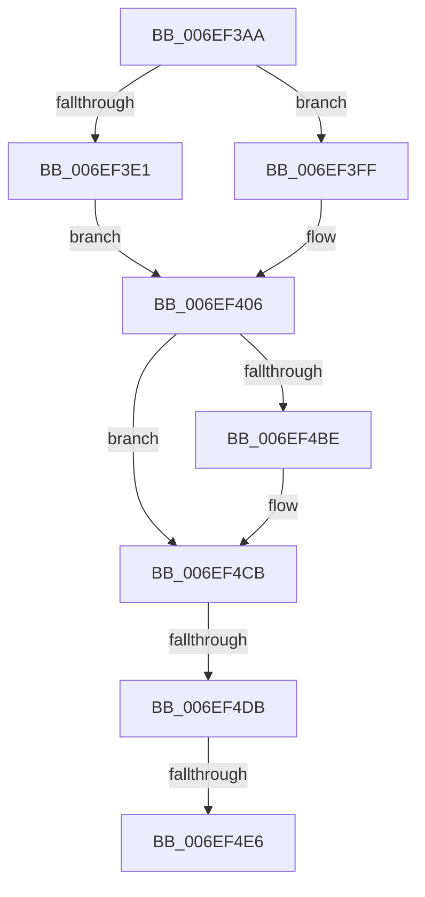

# sub_006EF3AA

- RVA: `0x006EF3AA`–`0x006EF4EB` (길이 `321` bytes)
- VA: `0x00000001406EF3AA`
- 실행 섹션: `.text`
- PDB 이름 있음: `아니요`; PDB Function 태그: `아니요`
- unwind 정보 RVA: `0x000A3570`
- 디코드: `69`개 명령, `321/321` bytes 표시
- 미해석 바이트: `0` (있으면 어셈블리에 `.byte`로 보존)

> 이 문서는 커널 이미지의 기계어와 PDB 기호를 분석해 생성했습니다. 4번과 5번은 함수 원형과 자료형을 바이너리 사용 방식에서 추정한 C 해석이며 원본 소스 복구 결과는 아닙니다.

## 1. Dependencies

- 직접 호출 지점: **9**; 고유 호출 대상: **8**
- 직접 호출자로 확인된 함수: **0**
- RIP 상대 이미지 참조: **4**

### Outgoing calls
- `0x006EF3B5` → [RtlInitUnicodeString](../42/RtlInitUnicodeString_function_0042A780.md) (function, `0x0042A780`)
- `0x006EF3D4` → [ExAllocatePool2](../../poolcode/B8/ExAllocatePool2_function_00B820F0.md) (function, `0x00B820F0`)
- `0x006EF3EB` → [RtlStringCbCopyW](../43/RtlStringCbCopyW_function_0043B910.md) (function, `0x0043B910`)
- `0x006EF40A` → [RtlInitUnicodeString](../42/RtlInitUnicodeString_function_0042A780.md) (function, `0x0042A780`)
- `0x006EF423` → [SeSetLearningModeObjectInformation](../4C/SeSetLearningModeObjectInformation_function_004C7098.md) (function, `0x004C7098`)
- `0x006EF4A3` → [SeAccessCheckWithHint](../3A/SeAccessCheckWithHint_function_003A6C30.md) (function, `0x003A6C30`)
- `0x006EF4B4` → [ObfDereferenceObjectWithTag](../2F/ObfDereferenceObjectWithTag_function_002F78E0.md) (function, `0x002F78E0`)
- `0x006EF4C6` → [ExFreePoolWithTag](../../poolcode/B8/ExFreePoolWithTag_function_00B82870.md) (function, `0x00B82870`)
- `0x006EF4CB` → [SeClearLearningModeObjectInformation](../40/SeClearLearningModeObjectInformation_function_0040D470.md) (function, `0x0040D470`)

### Direct callers
- 이 함수 시작 RVA로 연결되는 직접 call은 확인되지 않았습니다. 간접 호출은 완전히 역산할 수 없습니다.

### Static image references
- `0x006EF3AA` → RVA `0x006CC6B0` (` ?? ::FNODOBFM::`string'`; read)
- `0x006EF3F2` → RVA `0x006CC670` (` ?? ::FNODOBFM::`string'`; read)
- `0x006EF3FF` → RVA `0x006CC620` (` ?? ::FNODOBFM::`string'`; read)
- `0x006EF480` → RVA `0x00FD9E80` (`PAGEDATA`; read)

## 2. Other-region calls and transfers

- 다른 실행 섹션으로 향하는 call: **2**
  - `0x006EF3D4` → [ExAllocatePool2](../../poolcode/B8/ExAllocatePool2_function_00B820F0.md) (`.text` → `POOLCODE`)
  - `0x006EF4C6` → [ExFreePoolWithTag](../../poolcode/B8/ExFreePoolWithTag_function_00B82870.md) (`.text` → `POOLCODE`)
- call이 아닌 외부 분기/꼬리 이동: **3**
  - `0x006EF4D5` → [RtlpAllowsLowBoxAccess + 0xCD](../43/RtlpAllowsLowBoxAccess_function_00438B9C.md) (`tail-transfer`)
  - `0x006EF4E0` → [RtlpAllowsLowBoxAccess + 0xCF](../43/RtlpAllowsLowBoxAccess_function_00438B9C.md) (`tail-transfer`)
  - `0x006EF4E6` → [RtlpAllowsLowBoxAccess + 0xCD](../43/RtlpAllowsLowBoxAccess_function_00438B9C.md) (`tail-transfer`)

## 3. Assembly (complete function range)

```asm
006EF3AA  48 8D 15 FF D2 FD FF            lea rdx, [rip - 0x22d01]
006EF3B1  48 8D 4D 80                     lea rcx, [rbp - 0x80]
006EF3B5  E8 C6 B3 D3 FF                  call 0x14042a780
006EF3BA  0F B6 47 28                     movzx eax, byte ptr [rdi + 0x28]
006EF3BE  41 B8 41 74 4E 6D               mov r8d, 0x6d4e7441
006EF3C4  B9 00 01 00 00                  mov ecx, 0x100
006EF3C9  48 8D 34 45 02 00 00 00         lea rsi, [rax*2 + 2]
006EF3D1  48 8B D6                        mov rdx, rsi
006EF3D4  E8 17 2D 49 00                  call 0x140b820f0
006EF3D9  48 8B D8                        mov rbx, rax
006EF3DC  48 85 C0                        test rax, rax
006EF3DF  74 1E                           je 0x1406ef3ff
006EF3E1  4C 8D 47 2A                     lea r8, [rdi + 0x2a]
006EF3E5  48 8B D6                        mov rdx, rsi
006EF3E8  48 8B C8                        mov rcx, rax
006EF3EB  E8 20 C5 D4 FF                  call 0x14043b910
006EF3F0  85 C0                           test eax, eax
006EF3F2  48 8D 15 77 D2 FD FF            lea rdx, [rip - 0x22d89]
006EF3F9  48 0F 49 D3                     cmovns rdx, rbx
006EF3FD  EB 07                           jmp 0x1406ef406
006EF3FF  48 8D 15 1A D2 FD FF            lea rdx, [rip - 0x22de6]
006EF406  48 8D 4D 90                     lea rcx, [rbp - 0x70]
006EF40A  E8 71 B3 D3 FF                  call 0x14042a780
006EF40F  48 8D 45 80                     lea rax, [rbp - 0x80]
006EF413  48 89 45 D0                     mov qword ptr [rbp - 0x30], rax
006EF417  48 8D 4D C0                     lea rcx, [rbp - 0x40]
006EF41B  48 8D 45 90                     lea rax, [rbp - 0x70]
006EF41F  48 89 45 D8                     mov qword ptr [rbp - 0x28], rax
006EF423  E8 70 7C DD FF                  call 0x1404c7098
006EF428  48 8D 45 08                     lea rax, [rbp + 8]
006EF42C  45 33 C9                        xor r9d, r9d
006EF42F  48 89 44 24 78                  mov qword ptr [rsp + 0x78], rax
006EF434  4C 8D 45 A0                     lea r8, [rbp - 0x60]
006EF438  65 48 8B 04 25 88 01 00 00      mov rax, qword ptr gs:[0x188]
006EF441  33 D2                           xor edx, edx
006EF443  48 8B 88 B8 00 00 00            mov rcx, qword ptr [rax + 0xb8]
006EF44A  48 8B 81 D0 01 00 00            mov rax, qword ptr [rcx + 0x1d0]
006EF451  48 89 45 B8                     mov qword ptr [rbp - 0x48], rax
006EF455  65 48 8B 04 25 88 01 00 00      mov rax, qword ptr gs:[0x188]
006EF45E  8A 88 32 02 00 00               mov cl, byte ptr [rax + 0x232]
006EF464  48 8D 44 24 68                  lea rax, [rsp + 0x68]
006EF469  48 89 44 24 50                  mov qword ptr [rsp + 0x50], rax
006EF46E  48 8D 44 24 64                  lea rax, [rsp + 0x64]
006EF473  48 89 44 24 48                  mov qword ptr [rsp + 0x48], rax
006EF478  48 8D 45 F8                     lea rax, [rbp - 8]
006EF47C  88 4C 24 40                     mov byte ptr [rsp + 0x40], cl
006EF480  48 8B 0D F9 A9 8E 00            mov rcx, qword ptr [rip + 0x8ea9f9]
006EF487  48 89 44 24 38                  mov qword ptr [rsp + 0x38], rax
006EF48C  48 8D 44 24 78                  lea rax, [rsp + 0x78]
006EF491  48 89 44 24 30                  mov qword ptr [rsp + 0x30], rax
006EF496  83 64 24 28 00                  and dword ptr [rsp + 0x28], 0
006EF49B  C7 44 24 20 00 00 02 00         mov dword ptr [rsp + 0x20], 0x20000
006EF4A3  E8 88 77 CB FF                  call 0x1403a6c30
006EF4A8  48 8B 4D B0                     mov rcx, qword ptr [rbp - 0x50]
006EF4AC  BA 41 74 6F 6D                  mov edx, 0x6d6f7441
006EF4B1  40 8A F8                        mov dil, al
006EF4B4  E8 27 84 C0 FF                  call 0x1402f78e0
006EF4B9  48 85 DB                        test rbx, rbx
006EF4BC  74 0D                           je 0x1406ef4cb
006EF4BE  BA 41 74 4E 6D                  mov edx, 0x6d4e7441
006EF4C3  48 8B CB                        mov rcx, rbx
006EF4C6  E8 A5 33 49 00                  call 0x140b82870
006EF4CB  E8 A0 DF D1 FF                  call 0x14040d470
006EF4D0  B0 01                           mov al, 1
006EF4D2  40 3A F8                        cmp dil, al
006EF4D5  0F 85 8E 97 D4 FF               jne 0x140438c69
006EF4DB  83 7C 24 64 00                  cmp dword ptr [rsp + 0x64], 0
006EF4E0  0F 85 85 97 D4 FF               jne 0x140438c6b
006EF4E6  E9 7E 97 D4 FF                  jmp 0x140438c69
```

## 4. C-style interpretation (structured pseudocode)

```c
__int64 __fastcall sub_006EF3AA(__int64 a1, __int64 a2, __int64 a3, int a4, unsigned int a5, __int64 a6, __int64 a7, __int64 a8, __int64 a9, __int64 a10, __int64 a11, __int64 a12, __int64 a13, __int64 a14, __int64 a15)
{
    __int64 result;
    unsigned int v_stack_p20;
    unsigned __int64 v_stack_p30;
    unsigned __int64 v_stack_p38;
    unsigned __int8 v_stack_p40;
    unsigned __int64 v_stack_p48;
    unsigned __int64 v_stack_p50;
    unsigned __int64 v_stack_p64;
    unsigned __int64 v_stack_p78;

    result = RtlInitUnicodeString(v_rbp - 128, v_rip - 142593, a3, a4);
    result = ExAllocatePool2(256, *(unsigned __int8 *)(v_rdi + 40) * 2 + 2, (unsigned int)(0x6D4E7441ULL), a4);
    if (result == 0) goto loc_006EF3FF;
    result = RtlStringCbCopyW(result, *(unsigned __int8 *)(v_rdi + 40) * 2 + 2, v_rdi + 42, a4);
    a2 = v_rip - 142729;
    if (!sign_flag) { a2 = result; }
    goto loc_006EF406;
loc_006EF3FF:
loc_006EF406:
    result = RtlInitUnicodeString(v_rbp - 112, v_rip - 142822, v_rdi + 42, a4);
    *(unsigned __int64 *)(v_rbp - 48) = v_rbp - 128;
    *(unsigned __int64 *)(v_rbp - 40) = v_rbp - 112;
    result = SeSetLearningModeObjectInformation(v_rbp - 64, v_rip - 142822, v_rdi + 42, a4);
    a4 = 0;
    v_stack_p78 = v_rbp + 8;
    a2 = 0;
    *(unsigned __int64 *)(v_rbp - 72) = *(unsigned __int64 *)(*(unsigned __int64 *)(*(unsigned __int64 *)(gs_base + (0 + 392)) + 184) + 464);
    v_stack_p50 = a13;
    v_stack_p48 = v_stack_p64;
    v_stack_p40 = (unsigned __int8)(*(unsigned __int8 *)(*(unsigned __int64 *)(gs_base + (0 + 392)) + 562));
    v_stack_p38 = v_rbp - 8;
    v_stack_p30 = a15;
    v_stack_p20 = 0x20000ULL;
    result = SeAccessCheckWithHint(*(unsigned __int64 *)(v_rip + 9349625), a2, v_rbp - 96, a4);
    result = ObfDereferenceObjectWithTag(*(unsigned __int64 *)(v_rbp - 80), (unsigned int)(0x6D6F7441ULL), v_rbp - 96, a4);
    if (result != 0) {
        a2 = 0x6D4E7441ULL;
        a1 = result;
        result = ExFreePoolWithTag(a1, a2, v_rbp - 96, a4);
    }
    result = SeClearLearningModeObjectInformation(a1, a2, v_rbp - 96, a4);
}
```

## 5. (Beta) C Style

```c
int64_t sub_006EF3AA(int64_t Arg1, int64_t Arg2, int64_t Arg3, int32_t Arg4, uint32_t Arg5, uint64_t Arg6, uint64_t Arg7, uint64_t Arg8, uint64_t Arg9, uint64_t Arg10, uint64_t Arg11, uint64_t Arg12, int64_t Arg13, uint64_t Arg14, int64_t Arg15)
{
    int64_t result;
    uint32_t v_stack_p20;
    uint64_t v_stack_p30;
    uint64_t v_stack_p38;
    uint8_t v_stack_p40;
    uint64_t v_stack_p48;
    uint64_t v_stack_p50;
    uint64_t v_stack_p64;
    uint64_t v_stack_p78;

    result = RtlInitUnicodeString(local_rbp - 128, v_rip - 142593, Arg3, Arg4);
    result = ExAllocatePool2(256, *(uint8_t *)(local_rdi + 0x28) * 2 + 2, (uint32_t)(0x6D4E7441ULL), Arg4);
    if (result == 0) goto loc_006EF3FF;
    result = RtlStringCbCopyW(result, *(uint8_t *)(local_rdi + 0x28) * 2 + 2, local_rdi + 42, Arg4);
    Arg2 = v_rip - 142729;
    if (!sign_flag) { Arg2 = result; }
    goto loc_006EF406;
loc_006EF3FF:
loc_006EF406:
    result = RtlInitUnicodeString(local_rbp - 112, v_rip - 142822, local_rdi + 42, Arg4);
    *(uint64_t *)(local_rbp - 0x30) = local_rbp - 128;
    *(uint64_t *)(local_rbp - 0x28) = local_rbp - 112;
    result = SeSetLearningModeObjectInformation(local_rbp - 64, v_rip - 142822, local_rdi + 42, Arg4);
    Arg4 = 0;
    v_stack_p78 = local_rbp + 8;
    Arg2 = 0;
    *(uint64_t *)(local_rbp - 0x48) = *(uint64_t *)(*(uint64_t *)(*(uint64_t *)(gs_base + (0 + 0x188)) + 0xB8) + 0x1D0);
    v_stack_p50 = Arg13;
    v_stack_p48 = v_stack_p64;
    v_stack_p40 = (uint8_t)(*(uint8_t *)(*(uint64_t *)(gs_base + (0 + 0x188)) + 0x232));
    v_stack_p38 = local_rbp - 8;
    v_stack_p30 = Arg15;
    v_stack_p20 = 0x20000ULL;
    result = SeAccessCheckWithHint(*(uint64_t *)(v_rip + 0x8EA9F9), Arg2, local_rbp - 96, Arg4);
    result = ObfDereferenceObjectWithTag(*(uint64_t *)(local_rbp - 0x50), (uint32_t)(0x6D6F7441ULL), local_rbp - 96, Arg4);
    if (result != 0) {
        Arg2 = 0x6D4E7441ULL;
        Arg1 = result;
        result = ExFreePoolWithTag(Arg1, Arg2, local_rbp - 96, Arg4);
    }
    result = SeClearLearningModeObjectInformation(Arg1, Arg2, local_rbp - 96, Arg4);
}
```

## 6. Execution-region graph

[열기: 2D/3D 그래프와 함수 탐색 컨트롤 패널](../../../control-panel.html?section=text&rva=0x006EF3AA&view=graph)

- 2D 그래프는 위에서 아래로 흐르고, 3D 그래프는 빈 공간을 드래그해 회전합니다. Shift+드래그는 이동, 휠은 확대·축소, 함수 노드 선택은 대상 보고서 이동입니다.

### Static fallback


