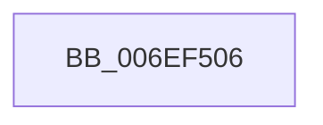

# sub_006EF506

- RVA: `0x006EF506`–`0x006EF587` (길이 `129` bytes)
- VA: `0x00000001406EF506`
- 실행 섹션: `.text`
- PDB 이름 있음: `아니요`; PDB Function 태그: `아니요`
- unwind 정보 RVA: `0x000A444C`
- 디코드: `28`개 명령, `129/129` bytes 표시
- 미해석 바이트: `0` (있으면 어셈블리에 `.byte`로 보존)

> 이 문서는 커널 이미지의 기계어와 PDB 기호를 분석해 생성했습니다. 4번과 5번은 함수 원형과 자료형을 바이너리 사용 방식에서 추정한 C 해석이며 원본 소스 복구 결과는 아닙니다.

## 1. Dependencies

- 직접 호출 지점: **1**; 고유 호출 대상: **1**
- 직접 호출자로 확인된 함수: **0**
- RIP 상대 이미지 참조: **1**

### Outgoing calls
- `0x006EF57C` → [PopDiagTraceSleepStudyBlocker](../4A/PopDiagTraceSleepStudyBlocker_function_004A5930.md) (function, `0x004A5930`)

### Direct callers
- 이 함수 시작 RVA로 연결되는 직접 call은 확인되지 않았습니다. 간접 호출은 완전히 역산할 수 없습니다.

### Static image references
- `0x006EF50D` → RVA `0x00E67678` (`.data`; read)

## 2. Other-region calls and transfers

- 다른 실행 섹션으로 향하는 call: **0**
- call이 아닌 외부 분기/꼬리 이동: **1**
  - `0x006EF582` → [PpmIdleCaptureCsVetoAccounting + 0x12A](../43/PpmIdleCaptureCsVetoAccounting_function_0043B6CC.md) (`tail-transfer`)

## 3. Assembly (complete function range)

```asm
006EF506  8B 40 10                        mov eax, dword ptr [rax + 0x10]
006EF509  4C 8D 04 49                     lea r8, [rcx + rcx*2]
006EF50D  48 8B 15 64 81 77 00            mov rdx, qword ptr [rip + 0x778164]
006EF514  89 45 A7                        mov dword ptr [rbp - 0x59], eax
006EF517  42 0F B7 44 C2 10               movzx eax, word ptr [rdx + r8*8 + 0x10]
006EF51D  D1 E8                           shr eax, 1
006EF51F  89 45 8B                        mov dword ptr [rbp - 0x75], eax
006EF522  48 8D 45 8B                     lea rax, [rbp - 0x75]
006EF526  48 89 45 D7                     mov qword ptr [rbp - 0x29], rax
006EF52A  48 C7 45 DF 04 00 00 00         mov qword ptr [rbp - 0x21], 4
006EF532  4A 8B 44 C2 18                  mov rax, qword ptr [rdx + r8*8 + 0x18]
006EF537  42 0F B7 4C C2 10               movzx ecx, word ptr [rdx + r8*8 + 0x10]
006EF53D  48 89 45 E7                     mov qword ptr [rbp - 0x19], rax
006EF541  48 8D 45 8F                     lea rax, [rbp - 0x71]
006EF545  48 89 45 17                     mov qword ptr [rbp + 0x17], rax
006EF549  48 8D 45 97                     lea rax, [rbp - 0x69]
006EF54D  89 4D EF                        mov dword ptr [rbp - 0x11], ecx
006EF550  48 8D 4D B7                     lea rcx, [rbp - 0x49]
006EF554  48 89 45 27                     mov qword ptr [rbp + 0x27], rax
006EF558  44 89 7D F3                     mov dword ptr [rbp - 0xd], r15d
006EF55C  4C 89 4D 07                     mov qword ptr [rbp + 7], r9
006EF560  48 C7 45 0F 08 00 00 00         mov qword ptr [rbp + 0xf], 8
006EF568  48 C7 45 1F 08 00 00 00         mov qword ptr [rbp + 0x1f], 8
006EF570  4C 89 7D 97                     mov qword ptr [rbp - 0x69], r15
006EF574  48 C7 45 2F 08 00 00 00         mov qword ptr [rbp + 0x2f], 8
006EF57C  E8 AF 63 DB FF                  call 0x1404a5930
006EF581  90                              nop
006EF582  E9 6F C2 D4 FF                  jmp 0x14043b7f6
```

## 4. C-style interpretation (structured pseudocode)

```c
__int64 __fastcall sub_006EF506(__int64 a1, __int64 a2, __int64 a3, __int64 a4)
{
    __int64 result;

    *(unsigned int *)(v_rbp - 89) = (unsigned int)((unsigned int)(*(unsigned int *)(result + 16)));
    result = (unsigned int)((*(unsigned __int16 *)(*(unsigned __int64 *)(v_rip + 7831908) + a1 + a1 * 2 * 8 + 16)) >> (1));
    *(unsigned int *)(v_rbp - 117) = (unsigned int)(result);
    *(unsigned __int64 *)(v_rbp - 41) = v_rbp - 117;
    *(unsigned __int64 *)(v_rbp - 33) = 4;
    *(unsigned __int64 *)(v_rbp - 25) = *(unsigned __int64 *)(*(unsigned __int64 *)(v_rip + 7831908) + a1 + a1 * 2 * 8 + 24);
    *(unsigned __int64 *)(v_rbp + 23) = v_rbp - 113;
    *(unsigned int *)(v_rbp - 17) = (unsigned int)(*(unsigned __int16 *)(*(unsigned __int64 *)(v_rip + 7831908) + a1 + a1 * 2 * 8 + 16));
    *(unsigned __int64 *)(v_rbp + 39) = v_rbp - 105;
    *(unsigned int *)(v_rbp - 13) = (unsigned int)(v_r15);
    *(unsigned __int64 *)(v_rbp + 7) = a4;
    *(unsigned __int64 *)(v_rbp + 15) = 8;
    *(unsigned __int64 *)(v_rbp + 31) = 8;
    *(unsigned __int64 *)(v_rbp - 105) = v_r15;
    *(unsigned __int64 *)(v_rbp + 47) = 8;
    result = PopDiagTraceSleepStudyBlocker(v_rbp - 73, *(unsigned __int64 *)(v_rip + 7831908), a1 + a1 * 2, a4);
}
```

## 5. (Beta) C Style

```c
int64_t sub_006EF506(void *Arg1, int64_t Arg2, int64_t Arg3, int64_t Arg4)
{
    uint8_t *arg1 = (uint8_t *)Arg1;

    int64_t result;

    *(uint32_t *)(local_rbp - 0x59) = (uint32_t)((uint32_t)(*(uint32_t *)(result + 0x10)));
    result = (uint32_t)((*(uint16_t *)(*(uint64_t *)(v_rip + 0x778164) + arg1 + arg1 * 2 * 8 + 0x10)) >> (1));
    *(uint32_t *)(local_rbp - 0x75) = (uint32_t)(result);
    *(uint64_t *)(local_rbp - 0x29) = local_rbp - 117;
    *(uint64_t *)(local_rbp - 0x21) = 4;
    *(uint64_t *)(local_rbp - 0x19) = *(uint64_t *)(*(uint64_t *)(v_rip + 0x778164) + arg1 + arg1 * 2 * 8 + 0x18);
    *(uint64_t *)(local_rbp + 0x17) = local_rbp - 113;
    *(uint32_t *)(local_rbp - 0x11) = (uint32_t)(*(uint16_t *)(*(uint64_t *)(v_rip + 0x778164) + arg1 + arg1 * 2 * 8 + 0x10));
    *(uint64_t *)(local_rbp + 0x27) = local_rbp - 105;
    *(uint32_t *)(local_rbp - 0xD) = (uint32_t)(local_r15);
    *(uint64_t *)(local_rbp + 0x7) = Arg4;
    *(uint64_t *)(local_rbp + 0xF) = 8;
    *(uint64_t *)(local_rbp + 0x1F) = 8;
    *(uint64_t *)(local_rbp - 0x69) = local_r15;
    *(uint64_t *)(local_rbp + 0x2F) = 8;
    result = PopDiagTraceSleepStudyBlocker(local_rbp - 73, *(uint64_t *)(v_rip + 0x778164), Arg1 + Arg1 * 2, Arg4);
}
```

### 관측된 메모리 오프셋

구조체 형식이 확인되지 않은 접근은 인자 기준의 오프셋으로만 기록했습니다.

| 기준 인자 | 오프셋 표현 | 폭 (bit) | 접근 |
|---|---:|---:|---|
| `Arg1` | `+ 0x0 + rcx*2` | `64` | `R` |

## 6. Execution-region graph

[열기: 2D/3D 그래프와 함수 탐색 컨트롤 패널](../../../control-panel.html?section=text&rva=0x006EF506&view=graph)

- 2D 그래프는 위에서 아래로 흐르고, 3D 그래프는 빈 공간을 드래그해 회전합니다. Shift+드래그는 이동, 휠은 확대·축소, 함수 노드 선택은 대상 보고서 이동입니다.

### Static fallback


