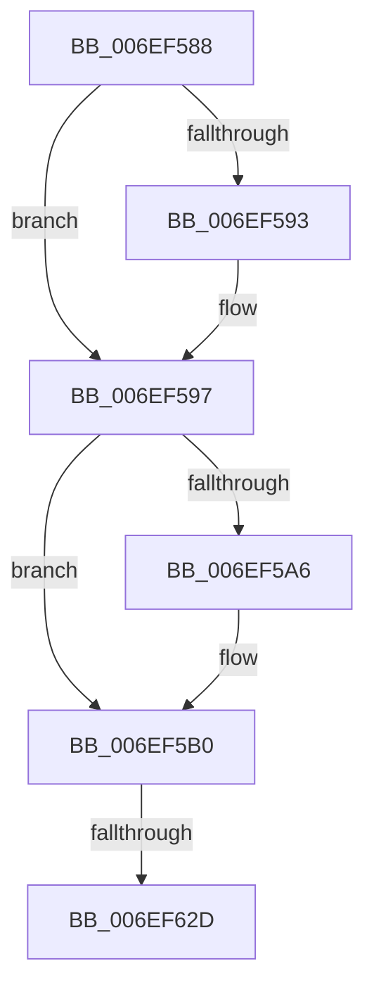

# sub_006EF588

- RVA: `0x006EF588`–`0x006EF641` (길이 `185` bytes)
- VA: `0x00000001406EF588`
- 실행 섹션: `.text`
- PDB 이름 있음: `아니요`; PDB Function 태그: `아니요`
- unwind 정보 RVA: `0x000A445C`
- 디코드: `47`개 명령, `185/185` bytes 표시
- 미해석 바이트: `0` (있으면 어셈블리에 `.byte`로 보존)

> 이 문서는 커널 이미지의 기계어와 PDB 기호를 분석해 생성했습니다. 4번과 5번은 함수 원형과 자료형을 바이너리 사용 방식에서 추정한 C 해석이며 원본 소스 복구 결과는 아닙니다.

## 1. Dependencies

- 직접 호출 지점: **4**; 고유 호출 대상: **4**
- 직접 호출자로 확인된 함수: **0**
- RIP 상대 이미지 참조: **0**

### Outgoing calls
- `0x006EF5B7` → [_chkstk](../6B/_chkstk_function_006BA960.md) (function, `0x006BA960`)
- `0x006EF5E9` → [B_TREE<unsigned long,ST_STORE<SM_TRAITS>::_ST_HASH_ENTRY,4096,NP_CONTEXT,ST_STORE<SM_TRAITS>::ST_HASH_ENTRY_COMPARATOR>::BTreeSearchKey](../3A/B_TREE_unsigned_long_ST_STORE_SM_TRAITS__ST_HASH_ENTRY_4096_NP_CONTEXT_ST_STORE_SM_TRAITS_ST_HASH_EN_function_003ADDB0.md) (function, `0x003ADDB0`)
- `0x006EF604` → [B_TREE<unsigned long,ST_STORE<SM_TRAITS>::_ST_HASH_ENTRY,4096,NP_CONTEXT,ST_STORE<SM_TRAITS>::ST_HASH_ENTRY_COMPARATOR>::BTreeSearchResultDeref](../3A/B_TREE_unsigned_long_ST_STORE_SM_TRAITS__ST_HASH_ENTRY_4096_NP_CONTEXT_ST_STORE_SM_TRAITS_ST_HASH_EN_function_003AE310.md) (function, `0x003AE310`)
- `0x006EF636` → [NP_CONTEXT::NpLeafRefInternal](../3A/NP_CONTEXT_NpLeafRefInternal_function_003AA340.md) (function, `0x003AA340`)

### Direct callers
- 이 함수 시작 RVA로 연결되는 직접 call은 확인되지 않았습니다. 간접 호출은 완전히 역산할 수 없습니다.

### Static image references
- 디코드된 RIP-relative 메모리 참조가 없습니다.

## 2. Other-region calls and transfers

- 다른 실행 섹션으로 향하는 call: **0**
- call이 아닌 외부 분기/꼬리 이동: **2**
  - `0x006EF627` → [B_TREE<unsigned long,ST_STORE<SM_TRAITS>::_ST_HASH_ENTRY,4096,NP_CONTEXT,ST_STORE<SM_TRAITS>::ST_HASH_ENTRY_COMPARATOR>::BTreeIteratorFromSearchResult + 0x62](../43/B_TREE_unsigned_long_ST_STORE_SM_TRAITS__ST_HASH_ENTRY_4096_NP_CONTEXT_ST_STORE_SM_TRAITS_ST_HASH_EN_function_0043B840.md) (`tail-transfer`)
  - `0x006EF63C` → [B_TREE<unsigned long,ST_STORE<SM_TRAITS>::_ST_HASH_ENTRY,4096,NP_CONTEXT,ST_STORE<SM_TRAITS>::ST_HASH_ENTRY_COMPARATOR>::BTreeIteratorFromSearchResult + 0x62](../43/B_TREE_unsigned_long_ST_STORE_SM_TRAITS__ST_HASH_ENTRY_4096_NP_CONTEXT_ST_STORE_SM_TRAITS_ST_HASH_EN_function_0043B840.md) (`tail-transfer`)

## 3. Assembly (complete function range)

```asm
006EF588  48 8B 10                        mov rdx, qword ptr [rax]
006EF58B  41 8B F9                        mov edi, r9d
006EF58E  48 85 C9                        test rcx, rcx
006EF591  74 04                           je 0x1406ef597
006EF593  0F B6 79 02                     movzx edi, byte ptr [rcx + 2]
006EF597  8B C7                           mov eax, edi
006EF599  48 C1 E0 04                     shl rax, 4
006EF59D  48 8D 48 0F                     lea rcx, [rax + 0xf]
006EF5A1  48 3B C8                        cmp rcx, rax
006EF5A4  77 0A                           ja 0x1406ef5b0
006EF5A6  48 B9 F0 FF FF FF FF FF FF 0F   movabs rcx, 0xffffffffffffff0
006EF5B0  48 83 E1 F0                     and rcx, 0xfffffffffffffff0
006EF5B4  48 8B C1                        mov rax, rcx
006EF5B7  E8 A4 B3 FC FF                  call 0x1406ba960
006EF5BC  8B 52 10                        mov edx, dword ptr [rdx + 0x10]
006EF5BF  4C 8D 45 00                     lea r8, [rbp]
006EF5C3  48 2B E1                        sub rsp, rcx
006EF5C6  48 C7 45 20 01 00 00 00         mov qword ptr [rbp + 0x20], 1
006EF5CE  0F 57 C0                        xorps xmm0, xmm0
006EF5D1  44 89 4D 18                     mov dword ptr [rbp + 0x18], r9d
006EF5D5  49 8B CE                        mov rcx, r14
006EF5D8  89 7D 1C                        mov dword ptr [rbp + 0x1c], edi
006EF5DB  F3 0F 7F 45 08                  movdqu xmmword ptr [rbp + 8], xmm0
006EF5E0  48 8D 5C 24 20                  lea rbx, [rsp + 0x20]
006EF5E5  48 89 5D 00                     mov qword ptr [rbp], rbx
006EF5E9  E8 C2 E7 CB FF                  call 0x1403addb0
006EF5EE  8D 4F FE                        lea ecx, [rdi - 2]
006EF5F1  48 03 C9                        add rcx, rcx
006EF5F4  48 8D 55 00                     lea rdx, [rbp]
006EF5F8  48 8B 7C CB 08                  mov rdi, qword ptr [rbx + rcx*8 + 8]
006EF5FD  48 8B 1C CB                     mov rbx, qword ptr [rbx + rcx*8]
006EF601  49 8B CE                        mov rcx, r14
006EF604  E8 07 ED CB FF                  call 0x1403ae310
006EF609  48 8D 4B 10                     lea rcx, [rbx + 0x10]
006EF60D  48 3B F9                        cmp rdi, rcx
006EF610  48 8D 43 08                     lea rax, [rbx + 8]
006EF614  4C 8D 4F F8                     lea r9, [rdi - 8]
006EF618  4C 0F 46 C8                     cmovbe r9, rax
006EF61C  49 8B 46 10                     mov rax, qword ptr [r14 + 0x10]
006EF620  49 8D 4E 10                     lea rcx, [r14 + 0x10]
006EF624  83 38 FF                        cmp dword ptr [rax], -1
006EF627  0F 84 75 C2 D4 FF               je 0x14043b8a2
006EF62D  41 B8 03 00 00 00               mov r8d, 3
006EF633  49 8B D1                        mov rdx, r9
006EF636  E8 05 AD CB FF                  call 0x1403aa340
006EF63B  90                              nop
006EF63C  E9 61 C2 D4 FF                  jmp 0x14043b8a2
```

## 4. C-style interpretation (structured pseudocode)

```c
__int64 __fastcall sub_006EF588(__int64 a1, __int64 a2, __int64 a3, int a4)
{
    __int64 result;
    __int64 v_rdi;
    __int64 v_rsp;
    unsigned __int64 v_stack_p20;

    v_rdi = (unsigned int)(a4);
    if (a1 != 0) {
        v_rdi = *(unsigned __int8 *)(a1 + 2);
    }
    result = ((unsigned int)((unsigned int)(v_rdi))) << (4);
    if ((result + 15) <= result) {
    }
    a1 = (result + 15) & (-16);
    result = _chkstk(a1, *(unsigned __int64 *)(result), a3, a4);
    v_rsp = (v_rsp) - (a1);
    *(unsigned __int64 *)(v_rbp + 32) = 1;
    *(unsigned int *)(v_rbp + 24) = a4;
    *(unsigned int *)(v_rbp + 28) = (unsigned int)(v_rdi);
    *(unsigned __int64 *)(v_rbp + 8) = v_xmm0;
    *(unsigned __int64 *)(v_rbp) = v_stack_p20;
    result = B_TREE_unsigned_long_ST_STORE_SM_TRAITS____ST_HASH_ENTRY_4096_NP_CONTEXT_ST_STORE_SM_TRAITS___ST_HAS(v_r14, (unsigned int)(*(unsigned int *)(*(unsigned __int64 *)(result) + 16)), v_rbp, a4);
    a1 = (v_rdi - 2) + (v_rdi - 2);
    result = B_TREE_unsigned_long_ST_STORE_SM_TRAITS____ST_HASH_ENTRY_4096_NP_CONTEXT_ST_STORE_SM_TRAITS___ST_HAS(v_r14, v_rbp, v_rbp, a4);
    a4 = *(unsigned __int64 *)(v_stack_p20 + a1 * 8 + 8) - 8;
    if ((*(unsigned __int64 *)(v_stack_p20 + a1 * 8 + 8)) <= (*(unsigned __int64 *)(v_stack_p20 + a1 * 8) + 16)) { a4 = *(unsigned __int64 *)(v_stack_p20 + a1 * 8) + 8; }
    result = NP_CONTEXT__NpLeafRefInternal(v_r14 + 16, a4, 3, a4);
}
```

## 5. (Beta) C Style

```c
int64_t sub_006EF588(int64_t Arg1, int64_t Arg2, int64_t Arg3, int32_t Arg4)
{
    int64_t result;
    int64_t local_rdi;
    int64_t local_rsp;
    uint64_t v_stack_p20;

    local_rdi = (uint32_t)(Arg4);
    if (Arg1 != 0) {
        local_rdi = *(uint8_t *)(Arg1 + 0x2);
    }
    result = ((uint32_t)((uint32_t)(local_rdi))) << (4);
    if ((result + 15) <= result) {
    }
    Arg1 = (result + 15) & (-16);
    result = _chkstk(Arg1, *(uint64_t *)(result), Arg3, Arg4);
    local_rsp = (local_rsp) - (Arg1);
    *(uint64_t *)(local_rbp + 0x20) = 1;
    *(uint32_t *)(local_rbp + 0x18) = Arg4;
    *(uint32_t *)(local_rbp + 0x1C) = (uint32_t)(local_rdi);
    *(uint64_t *)(local_rbp + 0x8) = v_xmm0;
    *(uint64_t *)(local_rbp) = v_stack_p20;
    result = B_TREE_unsigned_long_ST_STORE_SM_TRAITS____ST_HASH_ENTRY_4096_NP_CONTEXT_ST_STORE_SM_TRAITS___ST_HAS(local_r14, (uint32_t)(*(uint32_t *)(*(uint64_t *)(result) + 0x10)), local_rbp, Arg4);
    Arg1 = (local_rdi - 2) + (local_rdi - 2);
    result = B_TREE_unsigned_long_ST_STORE_SM_TRAITS____ST_HASH_ENTRY_4096_NP_CONTEXT_ST_STORE_SM_TRAITS___ST_HAS(local_r14, local_rbp, local_rbp, Arg4);
    Arg4 = *(uint64_t *)(v_stack_p20 + Arg1 * 8 + 0x8) - 8;
    if ((*(uint64_t *)(v_stack_p20 + Arg1 * 8 + 0x8)) <= (*(uint64_t *)(v_stack_p20 + Arg1 * 8) + 16)) { Arg4 = *(uint64_t *)(v_stack_p20 + Arg1 * 8) + 8; }
    result = NP_CONTEXT__NpLeafRefInternal(local_r14 + 16, Arg4, 3, Arg4);
}
```

## 6. Execution-region graph

[열기: 2D/3D 그래프와 함수 탐색 컨트롤 패널](../../../control-panel.html?section=text&rva=0x006EF588&view=graph)

- 2D 그래프는 위에서 아래로 흐르고, 3D 그래프는 빈 공간을 드래그해 회전합니다. Shift+드래그는 이동, 휠은 확대·축소, 함수 노드 선택은 대상 보고서 이동입니다.

### Static fallback


