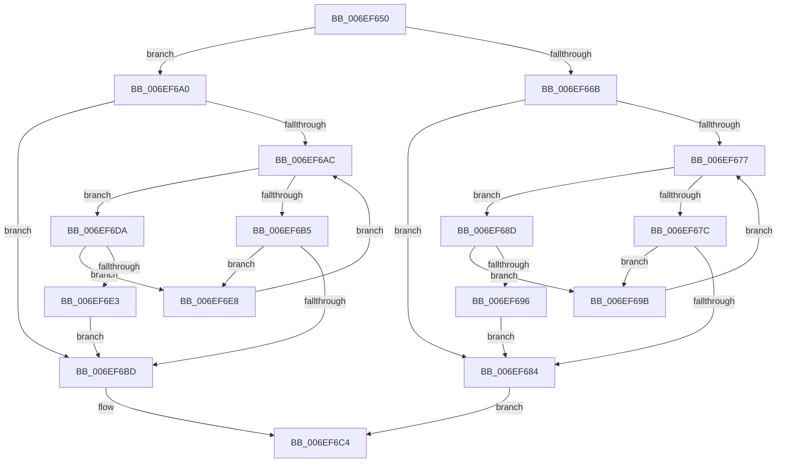

# sub_006EF650

- RVA: `0x006EF650`–`0x006EF6ED` (길이 `157` bytes)
- VA: `0x00000001406EF650`
- 실행 섹션: `.text`
- PDB 이름 있음: `아니요`; PDB Function 태그: `아니요`
- unwind 정보 RVA: `0x000A44B0`
- 디코드: `45`개 명령, `157/157` bytes 표시
- 미해석 바이트: `0` (있으면 어셈블리에 `.byte`로 보존)

> 이 문서는 커널 이미지의 기계어와 PDB 기호를 분석해 생성했습니다. 4번과 5번은 함수 원형과 자료형을 바이너리 사용 방식에서 추정한 C 해석이며 원본 소스 복구 결과는 아닙니다.

## 1. Dependencies

- 직접 호출 지점: **3**; 고유 호출 대상: **3**
- 직접 호출자로 확인된 함수: **0**
- RIP 상대 이미지 참조: **2**

### Outgoing calls
- `0x006EF653` → [ExAcquireSpinLockExclusiveAtDpcLevel](../24/ExAcquireSpinLockExclusiveAtDpcLevel_function_00248E80.md) (function, `0x00248E80`)
- `0x006EF6C7` → [RtlAvlInsertNodeEx](../26/RtlAvlInsertNodeEx_function_00265790.md) (function, `0x00265790`)
- `0x006EF6CF` → [ExReleaseSpinLockExclusiveFromDpcLevel](../24/ExReleaseSpinLockExclusiveFromDpcLevel_function_002497E0.md) (function, `0x002497E0`)

### Direct callers
- 이 함수 시작 RVA로 연결되는 직접 call은 확인되지 않았습니다. 간접 호출은 완전히 역산할 수 없습니다.

### Static image references
- `0x006EF66B` → RVA `0x00E2FF38` (`.data`; read)
- `0x006EF6A0` → RVA `0x00E2FF28` (`.data`; read)

## 2. Other-region calls and transfers

- 다른 실행 섹션으로 향하는 call: **0**
- call이 아닌 외부 분기/꼬리 이동: **1**
  - `0x006EF6D5` → [MiBeginPageAccessor + 0x10E](../43/MiBeginPageAccessor_function_0043BBE0.md) (`tail-transfer`)

## 3. Assembly (complete function range)

```asm
006EF650  48 8B CF                        mov rcx, rdi
006EF653  E8 28 98 B5 FF                  call 0x140248e80
006EF658  45 32 C0                        xor r8b, r8b
006EF65B  C6 83 45 01 00 00 01            mov byte ptr [rbx + 0x145], 1
006EF662  44 38 83 46 01 00 00            cmp byte ptr [rbx + 0x146], r8b
006EF669  75 35                           jne 0x1406ef6a0
006EF66B  48 8B 15 C6 08 74 00            mov rdx, qword ptr [rip + 0x7408c6]
006EF672  48 85 D2                        test rdx, rdx
006EF675  74 0D                           je 0x1406ef684
006EF677  48 3B DA                        cmp rbx, rdx
006EF67A  73 11                           jae 0x1406ef68d
006EF67C  48 8B 02                        mov rax, qword ptr [rdx]
006EF67F  48 85 C0                        test rax, rax
006EF682  75 17                           jne 0x1406ef69b
006EF684  48 8D 0D AD 08 74 00            lea rcx, [rip + 0x7408ad]
006EF68B  EB 37                           jmp 0x1406ef6c4
006EF68D  48 8B 42 08                     mov rax, qword ptr [rdx + 8]
006EF691  48 85 C0                        test rax, rax
006EF694  75 05                           jne 0x1406ef69b
006EF696  41 B0 01                        mov r8b, 1
006EF699  EB E9                           jmp 0x1406ef684
006EF69B  48 8B D0                        mov rdx, rax
006EF69E  EB D7                           jmp 0x1406ef677
006EF6A0  48 8B 15 81 08 74 00            mov rdx, qword ptr [rip + 0x740881]
006EF6A7  48 85 D2                        test rdx, rdx
006EF6AA  74 11                           je 0x1406ef6bd
006EF6AC  48 3B AA 38 01 00 00            cmp rbp, qword ptr [rdx + 0x138]
006EF6B3  73 25                           jae 0x1406ef6da
006EF6B5  48 8B 02                        mov rax, qword ptr [rdx]
006EF6B8  48 85 C0                        test rax, rax
006EF6BB  75 2B                           jne 0x1406ef6e8
006EF6BD  48 8D 0D 64 08 74 00            lea rcx, [rip + 0x740864]
006EF6C4  4C 8B CB                        mov r9, rbx
006EF6C7  E8 C4 60 B7 FF                  call 0x140265790
006EF6CC  48 8B CF                        mov rcx, rdi
006EF6CF  E8 0C A1 B5 FF                  call 0x1402497e0
006EF6D4  90                              nop
006EF6D5  E9 14 C6 D4 FF                  jmp 0x14043bcee
006EF6DA  48 8B 42 08                     mov rax, qword ptr [rdx + 8]
006EF6DE  48 85 C0                        test rax, rax
006EF6E1  75 05                           jne 0x1406ef6e8
006EF6E3  41 B0 01                        mov r8b, 1
006EF6E6  EB D5                           jmp 0x1406ef6bd
006EF6E8  48 8B D0                        mov rdx, rax
006EF6EB  EB BF                           jmp 0x1406ef6ac
```

## 4. C-style interpretation (structured pseudocode)

```c
__int64 __fastcall sub_006EF650(__int64 a1, __int64 a2, unsigned __int8 a3)
{
    __int64 result;

    result = ExAcquireSpinLockExclusiveAtDpcLevel(v_rdi, a2, a3, a4);
    a3 = 0;
    *(unsigned __int8 *)(v_rbx + 325) = 1;
    if ((*(unsigned __int8 *)(v_rbx + 326)) != 0) goto loc_006EF6A0;
    if (*(unsigned __int64 *)(v_rip + 7604422) == 0) goto loc_006EF684;
loc_006EF677:
    if (v_rbx >= (*(unsigned __int64 *)(v_rip + 7604422))) goto loc_006EF68D;
    if (*(unsigned __int64 *)(*(unsigned __int64 *)(v_rip + 7604422)) != 0) goto loc_006EF69B;
loc_006EF684:
    goto loc_006EF6C4;
loc_006EF68D:
    if (*(unsigned __int64 *)(*(unsigned __int64 *)(v_rip + 7604422) + 8) != 0) goto loc_006EF69B;
    goto loc_006EF684;
loc_006EF69B:
    goto loc_006EF677;
loc_006EF6A0:
    if (*(unsigned __int64 *)(v_rip + 7604353) == 0) goto loc_006EF6BD;
loc_006EF6AC:
    if (v_rbp >= (*(unsigned __int64 *)(*(unsigned __int64 *)(v_rip + 7604353) + 312))) goto loc_006EF6DA;
    if (*(unsigned __int64 *)(*(unsigned __int64 *)(v_rip + 7604353)) != 0) goto loc_006EF6E8;
loc_006EF6BD:
loc_006EF6C4:
    result = RtlAvlInsertNodeEx(v_rip + 7604324, *(unsigned __int64 *)(v_rip + 7604353), 1, v_rbx);
    result = ExReleaseSpinLockExclusiveFromDpcLevel(v_rdi, *(unsigned __int64 *)(v_rip + 7604353), 1, v_rbx);
loc_006EF6DA:
    if (*(unsigned __int64 *)(*(unsigned __int64 *)(v_rip + 7604353) + 8) != 0) goto loc_006EF6E8;
    goto loc_006EF6BD;
loc_006EF6E8:
    goto loc_006EF6AC;
}
```

## 5. (Beta) C Style

```c
int64_t sub_006EF650(int64_t Arg1, int64_t Arg2, uint8_t Arg3)
{
    int64_t result;

    result = ExAcquireSpinLockExclusiveAtDpcLevel(local_rdi, Arg2, Arg3, a4);
    Arg3 = 0;
    *(uint8_t *)(local_rbx + 0x145) = 1;
    if ((*(uint8_t *)(local_rbx + 0x146)) != 0) goto loc_006EF6A0;
    if (*(uint64_t *)(v_rip + 0x7408C6) == 0) goto loc_006EF684;
loc_006EF677:
    if (local_rbx >= (*(uint64_t *)(v_rip + 0x7408C6))) goto loc_006EF68D;
    if (*(uint64_t *)(*(uint64_t *)(v_rip + 0x7408C6)) != 0) goto loc_006EF69B;
loc_006EF684:
    goto loc_006EF6C4;
loc_006EF68D:
    if (*(uint64_t *)(*(uint64_t *)(v_rip + 0x7408C6) + 0x8) != 0) goto loc_006EF69B;
    goto loc_006EF684;
loc_006EF69B:
    goto loc_006EF677;
loc_006EF6A0:
    if (*(uint64_t *)(v_rip + 0x740881) == 0) goto loc_006EF6BD;
loc_006EF6AC:
    if (local_rbp >= (*(uint64_t *)(*(uint64_t *)(v_rip + 0x740881) + 0x138))) goto loc_006EF6DA;
    if (*(uint64_t *)(*(uint64_t *)(v_rip + 0x740881)) != 0) goto loc_006EF6E8;
loc_006EF6BD:
loc_006EF6C4:
    result = RtlAvlInsertNodeEx(v_rip + 7604324, *(uint64_t *)(v_rip + 0x740881), 1, local_rbx);
    result = ExReleaseSpinLockExclusiveFromDpcLevel(local_rdi, *(uint64_t *)(v_rip + 0x740881), 1, local_rbx);
loc_006EF6DA:
    if (*(uint64_t *)(*(uint64_t *)(v_rip + 0x740881) + 0x8) != 0) goto loc_006EF6E8;
    goto loc_006EF6BD;
loc_006EF6E8:
    goto loc_006EF6AC;
}
```

## 6. Execution-region graph

[열기: 2D/3D 그래프와 함수 탐색 컨트롤 패널](../../../control-panel.html?section=text&rva=0x006EF650&view=graph)

- 2D 그래프는 위에서 아래로 흐르고, 3D 그래프는 빈 공간을 드래그해 회전합니다. Shift+드래그는 이동, 휠은 확대·축소, 함수 노드 선택은 대상 보고서 이동입니다.

### Static fallback


