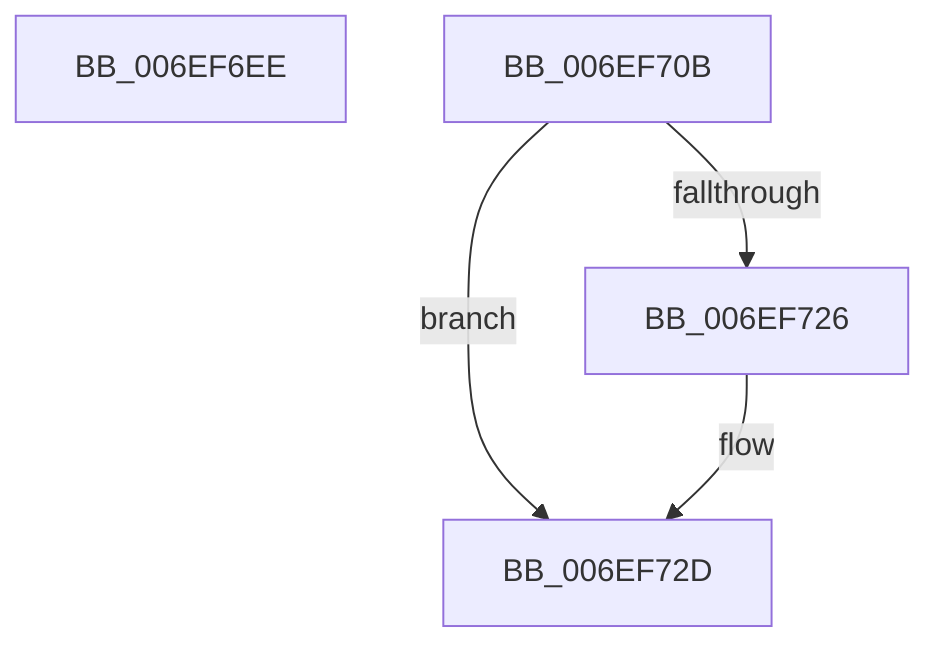

# sub_006EF6EE

- RVA: `0x006EF6EE`–`0x006EF751` (길이 `99` bytes)
- VA: `0x00000001406EF6EE`
- 실행 섹션: `.text`
- PDB 이름 있음: `아니요`; PDB Function 태그: `아니요`
- unwind 정보 RVA: `0x000A4534`
- 디코드: `27`개 명령, `99/99` bytes 표시
- 미해석 바이트: `0` (있으면 어셈블리에 `.byte`로 보존)

> 이 문서는 커널 이미지의 기계어와 PDB 기호를 분석해 생성했습니다. 4번과 5번은 함수 원형과 자료형을 바이너리 사용 방식에서 추정한 C 해석이며 원본 소스 복구 결과는 아닙니다.

## 1. Dependencies

- 직접 호출 지점: **3**; 고유 호출 대상: **2**
- 직접 호출자로 확인된 함수: **0**
- RIP 상대 이미지 참조: **0**

### Outgoing calls
- `0x006EF6F5` → [KeReleaseSpinLock](../39/KeReleaseSpinLock_function_00392BA0.md) (function, `0x00392BA0`)
- `0x006EF700` → [EtwpCovSampSampleBufferDecRef](../65/EtwpCovSampSampleBufferDecRef_function_006543B4.md) (function, `0x006543B4`)
- `0x006EF734` → [KeReleaseSpinLock](../39/KeReleaseSpinLock_function_00392BA0.md) (function, `0x00392BA0`)

### Direct callers
- 이 함수 시작 RVA로 연결되는 직접 call은 확인되지 않았습니다. 간접 호출은 완전히 역산할 수 없습니다.

### Static image references
- 디코드된 RIP-relative 메모리 참조가 없습니다.

## 2. Other-region calls and transfers

- 다른 실행 섹션으로 향하는 call: **0**
- call이 아닌 외부 분기/꼬리 이동: **2**
  - `0x006EF706` → [EtwpCovSampSampleBufferReserve + 0xE6](../43/EtwpCovSampSampleBufferReserve_function_0043C348.md) (`tail-transfer`)
  - `0x006EF74C` → [EtwpCovSampSampleBufferReserve + 0x15B](../43/EtwpCovSampSampleBufferReserve_function_0043C348.md) (`tail-transfer`)

## 3. Assembly (complete function range)

```asm
006EF6EE  8A 54 24 68                     mov dl, byte ptr [rsp + 0x68]
006EF6F2  48 8B CF                        mov rcx, rdi
006EF6F5  E8 A6 34 CA FF                  call 0x140392ba0
006EF6FA  48 8B D6                        mov rdx, rsi
006EF6FD  48 8B CD                        mov rcx, rbp
006EF700  E8 AF 4C F6 FF                  call 0x1406543b4
006EF705  90                              nop
006EF706  E9 23 CD D4 FF                  jmp 0x14043c42e
006EF70B  B9 01 00 00 00                  mov ecx, 1
006EF710  89 43 3C                        mov dword ptr [rbx + 0x3c], eax
006EF713  01 4B 38                        add dword ptr [rbx + 0x38], ecx
006EF716  8B C1                           mov eax, ecx
006EF718  F0 48 0F C1 43 30               lock xadd qword ptr [rbx + 0x30], rax
006EF71E  48 03 C1                        add rax, rcx
006EF721  48 3B C1                        cmp rax, rcx
006EF724  7F 07                           jg 0x1406ef72d
006EF726  B9 0E 00 00 00                  mov ecx, 0xe
006EF72B  CD 29                           int 0x29
006EF72D  8A 54 24 68                     mov dl, byte ptr [rsp + 0x68]
006EF731  48 8B CF                        mov rcx, rdi
006EF734  E8 67 34 CA FF                  call 0x140392ba0
006EF739  4D 8D 77 48                     lea r14, [r15 + 0x48]
006EF73D  49 89 5D 00                     mov qword ptr [r13], rbx
006EF741  4C 03 F3                        add r14, rbx
006EF744  45 89 3E                        mov dword ptr [r14], r15d
006EF747  66 45 89 66 04                  mov word ptr [r14 + 4], r12w
006EF74C  E9 52 CD D4 FF                  jmp 0x14043c4a3
```

## 4. C-style interpretation (structured pseudocode)

```c
__int64 __fastcall sub_006EF6EE(__int64 a1, __int64 a2, __int64 a3, __int64 a4, __int64 a5, __int64 a6, __int64 a7, __int64 a8, __int64 a9, __int64 a10, __int64 a11, __int64 a12, unsigned __int8 a13)
{
    __int64 result;
    unsigned __int8 v_stack_p68;

    result = KeReleaseSpinLock(v_rdi, a13, a3, a4);
    result = EtwpCovSampSampleBufferDecRef(v_rbp, v_rsi, a3, a4);
}
```

## 5. (Beta) C Style

```c
int64_t sub_006EF6EE(int64_t Arg1, int64_t Arg2, int64_t Arg3, int64_t Arg4, uint64_t Arg5, uint64_t Arg6, uint64_t Arg7, uint64_t Arg8, uint64_t Arg9, uint64_t Arg10, uint64_t Arg11, uint64_t Arg12, uint8_t Arg13)
{
    int64_t result;
    uint8_t v_stack_p68;

    result = KeReleaseSpinLock(local_rdi, Arg13, Arg3, Arg4);
    result = EtwpCovSampSampleBufferDecRef(local_rbp, local_rsi, Arg3, Arg4);
}
```

## 6. Execution-region graph

[열기: 2D/3D 그래프와 함수 탐색 컨트롤 패널](../../../control-panel.html?section=text&rva=0x006EF6EE&view=graph)

- 2D 그래프는 위에서 아래로 흐르고, 3D 그래프는 빈 공간을 드래그해 회전합니다. Shift+드래그는 이동, 휠은 확대·축소, 함수 노드 선택은 대상 보고서 이동입니다.

### Static fallback


