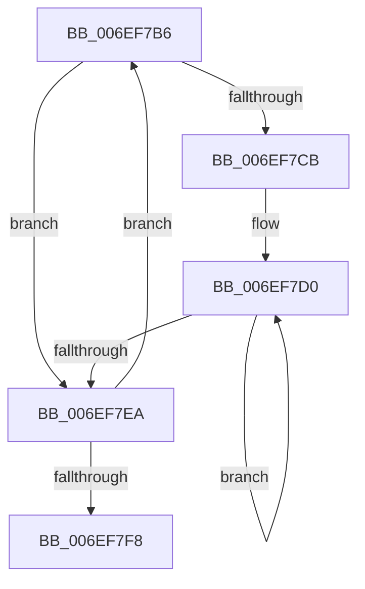

# sub_006EF7B6

- RVA: `0x006EF7B6`–`0x006EF7FD` (길이 `71` bytes)
- VA: `0x00000001406EF7B6`
- 실행 섹션: `.text`
- PDB 이름 있음: `아니요`; PDB Function 태그: `아니요`
- unwind 정보 RVA: `0x000A4A5C`
- 디코드: `22`개 명령, `71/71` bytes 표시
- 미해석 바이트: `0` (있으면 어셈블리에 `.byte`로 보존)

> 이 문서는 커널 이미지의 기계어와 PDB 기호를 분석해 생성했습니다. 4번과 5번은 함수 원형과 자료형을 바이너리 사용 방식에서 추정한 C 해석이며 원본 소스 복구 결과는 아닙니다.

## 1. Dependencies

- 직접 호출 지점: **1**; 고유 호출 대상: **1**
- 직접 호출자로 확인된 함수: **0**
- RIP 상대 이미지 참조: **0**

### Outgoing calls
- `0x006EF7DE` → [KiHaltOnAddress](../4F/KiHaltOnAddress_function_004FBA3C.md) (function, `0x004FBA3C`)

### Direct callers
- 이 함수 시작 RVA로 연결되는 직접 call은 확인되지 않았습니다. 간접 호출은 완전히 역산할 수 없습니다.

### Static image references
- 디코드된 RIP-relative 메모리 참조가 없습니다.

## 2. Other-region calls and transfers

- 다른 실행 섹션으로 향하는 call: **0**
- call이 아닌 외부 분기/꼬리 이동: **1**
  - `0x006EF7F8` → [KeSignalCallDpcSynchronize + 0x53](../43/KeSignalCallDpcSynchronize_function_0043DFA0.md) (`tail-transfer`)

## 3. Assembly (complete function range)

```asm
006EF7B6  0F BA E9 1E                     bts ecx, 0x1e
006EF7BA  8B C2                           mov eax, edx
006EF7BC  44 8B F1                        mov r14d, ecx
006EF7BF  F0 44 0F B1 37                  lock cmpxchg dword ptr [rdi], r14d
006EF7C4  8B C8                           mov ecx, eax
006EF7C6  41 3B C0                        cmp eax, r8d
006EF7C9  75 1F                           jne 0x1406ef7ea
006EF7CB  44 89 74 24 50                  mov dword ptr [rsp + 0x50], r14d
006EF7D0  41 B8 04 00 00 00               mov r8d, 4
006EF7D6  48 8D 54 24 50                  lea rdx, [rsp + 0x50]
006EF7DB  48 8B CF                        mov rcx, rdi
006EF7DE  E8 59 C2 E0 FF                  call 0x1404fba3c
006EF7E3  8B 0F                           mov ecx, dword ptr [rdi]
006EF7E5  41 3B CE                        cmp ecx, r14d
006EF7E8  74 E6                           je 0x1406ef7d0
006EF7EA  8B C1                           mov eax, ecx
006EF7EC  8B D1                           mov edx, ecx
006EF7EE  41 23 C4                        and eax, r12d
006EF7F1  44 8B C1                        mov r8d, ecx
006EF7F4  3B C3                           cmp eax, ebx
006EF7F6  75 BE                           jne 0x1406ef7b6
006EF7F8  E9 F6 E7 D4 FF                  jmp 0x14043dff3
```

## 4. C-style interpretation (structured pseudocode)

```c
__int64 __fastcall sub_006EF7B6(int a1, int a2, int a3, __int64 a4, __int64 a5, __int64 a6, __int64 a7, __int64 a8, __int64 a9, __int64 a10)
{
    __int64 result;
    unsigned int v_stack_p50;

    if (((unsigned int)((unsigned int)(a2))) != a3) goto loc_006EF7EA;
    v_stack_p50 = (unsigned int)((unsigned int)(a1));
loc_006EF7D0:
    result = KiHaltOnAddress(v_rdi, a10, 4, a4);
    if (((unsigned int)((unsigned int)(*(unsigned int *)(v_rdi)))) == ((unsigned int)((unsigned int)(a1)))) goto loc_006EF7D0;
loc_006EF7EA:
    result = (unsigned int)(((unsigned int)((unsigned int)((unsigned int)(*(unsigned int *)(v_rdi))))) & ((unsigned int)(v_r12)));
    if (((unsigned int)(result)) != ((unsigned int)(v_rbx))) goto loc_006EF7B6;
}
```

## 5. (Beta) C Style

```c
int64_t sub_006EF7B6(int32_t Arg1, int32_t Arg2, int32_t Arg3, int64_t Arg4, uint64_t Arg5, uint64_t Arg6, uint64_t Arg7, uint64_t Arg8, uint64_t Arg9, int64_t Arg10)
{
    int64_t result;
    uint32_t v_stack_p50;

    if (((uint32_t)((uint32_t)(Arg2))) != Arg3) goto loc_006EF7EA;
    v_stack_p50 = (uint32_t)((uint32_t)(Arg1));
loc_006EF7D0:
    result = KiHaltOnAddress(local_rdi, Arg10, 4, Arg4);
    if (((uint32_t)((uint32_t)(*(uint32_t *)(local_rdi)))) == ((uint32_t)((uint32_t)(Arg1)))) goto loc_006EF7D0;
loc_006EF7EA:
    result = (uint32_t)(((uint32_t)((uint32_t)((uint32_t)(*(uint32_t *)(local_rdi))))) & ((uint32_t)(local_r12)));
    if (((uint32_t)(result)) != ((uint32_t)(local_rbx))) goto loc_006EF7B6;
}
```

## 6. Execution-region graph

[열기: 2D/3D 그래프와 함수 탐색 컨트롤 패널](../../../control-panel.html?section=text&rva=0x006EF7B6&view=graph)

- 2D 그래프는 위에서 아래로 흐르고, 3D 그래프는 빈 공간을 드래그해 회전합니다. Shift+드래그는 이동, 휠은 확대·축소, 함수 노드 선택은 대상 보고서 이동입니다.

### Static fallback


