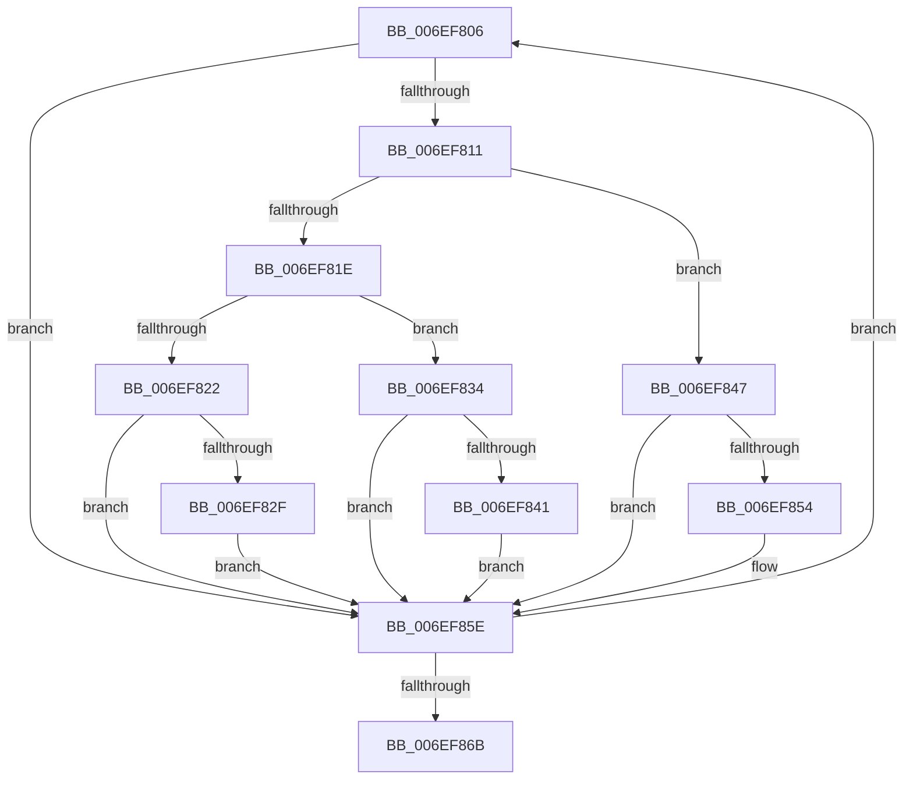

# sub_006EF806

- RVA: `0x006EF806`–`0x006EF87E` (길이 `120` bytes)
- VA: `0x00000001406EF806`
- 실행 섹션: `.text`
- PDB 이름 있음: `아니요`; PDB Function 태그: `아니요`
- unwind 정보 RVA: `0x000A4E2C`
- 디코드: `35`개 명령, `120/120` bytes 표시
- 미해석 바이트: `0` (있으면 어셈블리에 `.byte`로 보존)

> 이 문서는 커널 이미지의 기계어와 PDB 기호를 분석해 생성했습니다. 4번과 5번은 함수 원형과 자료형을 바이너리 사용 방식에서 추정한 C 해석이며 원본 소스 복구 결과는 아닙니다.

## 1. Dependencies

- 직접 호출 지점: **0**; 고유 호출 대상: **0**
- 직접 호출자로 확인된 함수: **0**
- RIP 상대 이미지 참조: **0**

### Outgoing calls
- 직접 디코드된 call 명령이 없습니다.

### Direct callers
- 이 함수 시작 RVA로 연결되는 직접 call은 확인되지 않았습니다. 간접 호출은 완전히 역산할 수 없습니다.

### Static image references
- 디코드된 RIP-relative 메모리 참조가 없습니다.

## 2. Other-region calls and transfers

- 다른 실행 섹션으로 향하는 call: **0**
- call이 아닌 외부 분기/꼬리 이동: **1**
  - `0x006EF879` → [SepConstrainByConstraintMask + 0x12](../43/SepConstrainByConstraintMask_function_0043FDE0.md) (`tail-transfer`)

## 3. Assembly (complete function range)

```asm
006EF806  41 8B 00                        mov eax, dword ptr [r8]
006EF809  8B D8                           mov ebx, eax
006EF80B  23 D9                           and ebx, ecx
006EF80D  3B D8                           cmp ebx, eax
006EF80F  74 4D                           je 0x1406ef85e
006EF811  41 C6 02 01                     mov byte ptr [r10], 1
006EF815  41 89 18                        mov dword ptr [r8], ebx
006EF818  0F BA E2 19                     bt edx, 0x19
006EF81C  73 29                           jae 0x1406ef847
006EF81E  85 DB                           test ebx, ebx
006EF820  75 12                           jne 0x1406ef834
006EF822  43 C7 04 01 22 00 00 C0         mov dword ptr [r9 + r8], 0xc0000022
006EF82A  48 85 FF                        test rdi, rdi
006EF82D  74 2F                           je 0x1406ef85e
006EF82F  41 88 1B                        mov byte ptr [r11], bl
006EF832  EB 2A                           jmp 0x1406ef85e
006EF834  43 C7 04 01 00 00 00 00         mov dword ptr [r9 + r8], 0
006EF83C  48 85 FF                        test rdi, rdi
006EF83F  74 1D                           je 0x1406ef85e
006EF841  41 C6 03 01                     mov byte ptr [r11], 1
006EF845  EB 17                           jmp 0x1406ef85e
006EF847  43 C7 04 01 22 00 00 C0         mov dword ptr [r9 + r8], 0xc0000022
006EF84F  48 85 FF                        test rdi, rdi
006EF852  74 0A                           je 0x1406ef85e
006EF854  41 83 38 00                     cmp dword ptr [r8], 0
006EF858  0F 95 C0                        setne al
006EF85B  41 88 03                        mov byte ptr [r11], al
006EF85E  49 83 C0 04                     add r8, 4
006EF862  49 FF C3                        inc r11
006EF865  48 83 EE 01                     sub rsi, 1
006EF869  75 9B                           jne 0x1406ef806
006EF86B  48 8B 3C 24                     mov rdi, qword ptr [rsp]
006EF86F  48 8B 74 24 18                  mov rsi, qword ptr [rsp + 0x18]
006EF874  48 8B 5C 24 10                  mov rbx, qword ptr [rsp + 0x10]
006EF879  E9 74 05 D5 FF                  jmp 0x14043fdf2
```

## 4. C-style interpretation (structured pseudocode)

```c
__int64 __fastcall sub_006EF806(int a1, int a2, __int64 a3, __int64 a4)
{
    __int64 result;
    __int64 v_r11;
    __int64 v_rbx;
    __int64 v_rsi;
    unsigned __int64 v_stack_p0;
    unsigned __int64 v_stack_p10;
    unsigned __int64 v_stack_p18;

    v_rbx = (unsigned int)(((unsigned int)((unsigned int)((unsigned int)(*(unsigned int *)(a3))))) & (a1));
    if (((unsigned int)(v_rbx)) == ((unsigned int)((unsigned int)(*(unsigned int *)(a3))))) goto loc_006EF85E;
    *(unsigned __int8 *)(v_r10) = 1;
    *(unsigned int *)(a3) = (unsigned int)(v_rbx);
    if (((unsigned int)(v_rbx)) >= ((unsigned int)((unsigned int)(*(unsigned int *)(a3))))) goto loc_006EF847;
    if ((unsigned int)(v_rbx) != 0) goto loc_006EF834;
    *(unsigned int *)(a4 + a3 * 1) = 0xC0000022ULL;
    if (v_rdi == 0) goto loc_006EF85E;
    *(unsigned __int8 *)(v_r11) = (unsigned __int8)(v_rbx);
    goto loc_006EF85E;
loc_006EF834:
    *(unsigned int *)(a4 + a3 * 1) = 0;
    if (v_rdi == 0) goto loc_006EF85E;
    *(unsigned __int8 *)(v_r11) = 1;
    goto loc_006EF85E;
loc_006EF847:
    *(unsigned int *)(a4 + a3 * 1) = 0xC0000022ULL;
    result = (unsigned int)(*(unsigned int *)(a3));
    if (v_rdi != 0) {
        result = ((*(unsigned int *)(a3)) != 0) ? 1 : 0;
        *(unsigned __int8 *)(v_r11) = (unsigned __int8)(result);
    }
    a3 = (a3) + (4);
    v_r11 = (v_r11) + 1;
    v_rsi = (v_rsi) - (1);
    if (condition_is_not_equal) goto loc_006EF806;
}
```

## 5. (Beta) C Style

```c
int64_t sub_006EF806(int32_t Arg1, int32_t Arg2, void *Arg3, void *Arg4)
{
    uint8_t *arg3 = (uint8_t *)Arg3;
    uint8_t *arg4 = (uint8_t *)Arg4;

    int64_t result;
    int64_t local_r11;
    int64_t local_rbx;
    int64_t local_rsi;
    uint64_t v_stack_p0;
    uint64_t v_stack_p10;
    uint64_t v_stack_p18;

    local_rbx = (uint32_t)(((uint32_t)((uint32_t)((uint32_t)(*(uint32_t *)(arg3))))) & (Arg1));
    if (((uint32_t)(local_rbx)) == ((uint32_t)((uint32_t)(*(uint32_t *)(arg3))))) goto loc_006EF85E;
    *(uint8_t *)(local_r10) = 1;
    *(uint32_t *)(arg3) = (uint32_t)(local_rbx);
    if (((uint32_t)(local_rbx)) >= ((uint32_t)((uint32_t)(*(uint32_t *)(arg3))))) goto loc_006EF847;
    if ((uint32_t)(local_rbx) != 0) goto loc_006EF834;
    *(uint32_t *)(arg4 + arg3 * 1) = 0xC0000022ULL;
    if (local_rdi == 0) goto loc_006EF85E;
    *(uint8_t *)(local_r11) = (uint8_t)(local_rbx);
    goto loc_006EF85E;
loc_006EF834:
    *(uint32_t *)(arg4 + arg3 * 1) = 0;
    if (local_rdi == 0) goto loc_006EF85E;
    *(uint8_t *)(local_r11) = 1;
    goto loc_006EF85E;
loc_006EF847:
    *(uint32_t *)(arg4 + arg3 * 1) = 0xC0000022ULL;
    result = (uint32_t)(*(uint32_t *)(arg3));
    if (local_rdi != 0) {
        result = ((*(uint32_t *)(arg3)) != 0) ? 1 : 0;
        *(uint8_t *)(local_r11) = (uint8_t)(result);
    }
    Arg3 = (Arg3) + (4);
    local_r11 = (local_r11) + 1;
    local_rsi = (local_rsi) - (1);
    if (condition_is_not_equal) goto loc_006EF806;
}
```

### 관측된 메모리 오프셋

구조체 형식이 확인되지 않은 접근은 인자 기준의 오프셋으로만 기록했습니다.

| 기준 인자 | 오프셋 표현 | 폭 (bit) | 접근 |
|---|---:|---:|---|
| `Arg3` | `+ 0x0` | `32` | `R` |
| `Arg3` | `+ 0x0` | `32` | `W` |
| `Arg4` | `+ 0x0 + r8*1` | `32` | `W` |

## 6. Execution-region graph

[열기: 2D/3D 그래프와 함수 탐색 컨트롤 패널](../../../control-panel.html?section=text&rva=0x006EF806&view=graph)

- 2D 그래프는 위에서 아래로 흐르고, 3D 그래프는 빈 공간을 드래그해 회전합니다. Shift+드래그는 이동, 휠은 확대·축소, 함수 노드 선택은 대상 보고서 이동입니다.

### Static fallback


