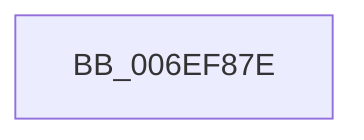

# sub_006EF87E

- RVA: `0x006EF87E`–`0x006EF8DE` (길이 `96` bytes)
- VA: `0x00000001406EF87E`
- 실행 섹션: `.text`
- PDB 이름 있음: `아니요`; PDB Function 태그: `아니요`
- unwind 정보 RVA: `0x000A4E70`
- 디코드: `18`개 명령, `96/96` bytes 표시
- 미해석 바이트: `0` (있으면 어셈블리에 `.byte`로 보존)

> 이 문서는 커널 이미지의 기계어와 PDB 기호를 분석해 생성했습니다. 4번과 5번은 함수 원형과 자료형을 바이너리 사용 방식에서 추정한 C 해석이며 원본 소스 복구 결과는 아닙니다.

## 1. Dependencies

- 직접 호출 지점: **1**; 고유 호출 대상: **1**
- 직접 호출자로 확인된 함수: **0**
- RIP 상대 이미지 참조: **0**

### Outgoing calls
- `0x006EF8D3` → [EtwTraceKernelEvent](../23/EtwTraceKernelEvent_function_00235350.md) (function, `0x00235350`)

### Direct callers
- 이 함수 시작 RVA로 연결되는 직접 call은 확인되지 않았습니다. 간접 호출은 완전히 역산할 수 없습니다.

### Static image references
- 디코드된 RIP-relative 메모리 참조가 없습니다.

## 2. Other-region calls and transfers

- 다른 실행 섹션으로 향하는 call: **0**
- call이 아닌 외부 분기/꼬리 이동: **1**
  - `0x006EF8D9` → [KiSetClockTickRate + 0x93](../43/KiSetClockTickRate_function_0043FEA0.md) (`tail-transfer`)

## 3. Assembly (complete function range)

```asm
006EF87E  48 8B 44 24 30                  mov rax, qword ptr [rsp + 0x30]
006EF883  48 8D 4C 24 58                  lea rcx, [rsp + 0x58]
006EF888  48 89 44 24 48                  mov qword ptr [rsp + 0x48], rax
006EF88D  41 B9 57 0F 00 00               mov r9d, 0xf57
006EF893  48 8D 44 24 40                  lea rax, [rsp + 0x40]
006EF898  44 89 6C 24 42                  mov dword ptr [rsp + 0x42], r13d
006EF89D  BA 01 00 00 00                  mov edx, 1
006EF8A2  48 89 44 24 58                  mov qword ptr [rsp + 0x58], rax
006EF8A7  41 B8 00 00 10 40               mov r8d, 0x40100000
006EF8AD  66 44 89 6C 24 46               mov word ptr [rsp + 0x46], r13w
006EF8B3  44 88 6C 24 40                  mov byte ptr [rsp + 0x40], r13b
006EF8B8  44 88 7C 24 41                  mov byte ptr [rsp + 0x41], r15b
006EF8BD  48 89 7C 24 50                  mov qword ptr [rsp + 0x50], rdi
006EF8C2  48 C7 44 24 60 18 00 00 00      mov qword ptr [rsp + 0x60], 0x18
006EF8CB  C7 44 24 20 02 06 00 00         mov dword ptr [rsp + 0x20], 0x602
006EF8D3  E8 78 5A B4 FF                  call 0x140235350
006EF8D8  90                              nop
006EF8D9  E9 55 06 D5 FF                  jmp 0x14043ff33
```

## 4. C-style interpretation (structured pseudocode)

```c
__int64 __fastcall sub_006EF87E(__int64 a1, __int64 a2, __int64 a3, __int64 a4, __int64 a5, __int64 a6, __int64 a7, __int64 a8, __int64 a9, __int64 a10, __int64 a11)
{
    __int64 result;
    unsigned int v_stack_p20;
    unsigned __int8 v_stack_p40;
    unsigned __int8 v_stack_p41;
    unsigned int v_stack_p42;
    unsigned __int16 v_stack_p46;
    unsigned __int64 v_stack_p48;
    unsigned __int64 v_stack_p50;
    unsigned __int64 v_stack_p58;
    unsigned __int64 v_stack_p60;

    v_stack_p48 = a6;
    v_stack_p42 = (unsigned int)(v_r13);
    v_stack_p58 = a8;
    v_stack_p46 = (unsigned __int16)(v_r13);
    v_stack_p40 = (unsigned __int8)(v_r13);
    v_stack_p41 = (unsigned __int8)(v_r15);
    v_stack_p50 = v_rdi;
    v_stack_p60 = 24;
    v_stack_p20 = 0x602ULL;
    result = EtwTraceKernelEvent(a11, 1, (unsigned int)(0x40100000ULL), (unsigned int)(0xF57ULL));
}
```

## 5. (Beta) C Style

```c
int64_t sub_006EF87E(int64_t Arg1, int64_t Arg2, int64_t Arg3, int64_t Arg4, uint64_t Arg5, int64_t Arg6, uint64_t Arg7, int64_t Arg8, uint64_t Arg9, uint64_t Arg10, int64_t Arg11)
{
    int64_t result;
    uint32_t v_stack_p20;
    uint8_t v_stack_p40;
    uint8_t v_stack_p41;
    uint32_t v_stack_p42;
    uint16_t v_stack_p46;
    uint64_t v_stack_p48;
    uint64_t v_stack_p50;
    uint64_t v_stack_p58;
    uint64_t v_stack_p60;

    v_stack_p48 = Arg6;
    v_stack_p42 = (uint32_t)(local_r13);
    v_stack_p58 = Arg8;
    v_stack_p46 = (uint16_t)(local_r13);
    v_stack_p40 = (uint8_t)(local_r13);
    v_stack_p41 = (uint8_t)(local_r15);
    v_stack_p50 = local_rdi;
    v_stack_p60 = 24;
    v_stack_p20 = 0x602ULL;
    result = EtwTraceKernelEvent(Arg11, 1, (uint32_t)(0x40100000ULL), (uint32_t)(0xF57ULL));
}
```

## 6. Execution-region graph

[열기: 2D/3D 그래프와 함수 탐색 컨트롤 패널](../../../control-panel.html?section=text&rva=0x006EF87E&view=graph)

- 2D 그래프는 위에서 아래로 흐르고, 3D 그래프는 빈 공간을 드래그해 회전합니다. Shift+드래그는 이동, 휠은 확대·축소, 함수 노드 선택은 대상 보고서 이동입니다.

### Static fallback


