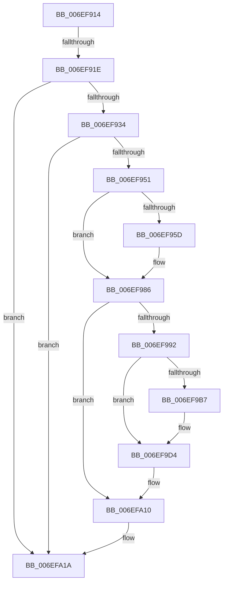

# sub_006EF914

- RVA: `0x006EF914`–`0x006EFA24` (길이 `272` bytes)
- VA: `0x00000001406EF914`
- 실행 섹션: `.text`
- PDB 이름 있음: `아니요`; PDB Function 태그: `아니요`
- unwind 정보 RVA: `0x000A4ED4`
- 디코드: `49`개 명령, `272/272` bytes 표시
- 미해석 바이트: `0` (있으면 어셈블리에 `.byte`로 보존)

> 이 문서는 커널 이미지의 기계어와 PDB 기호를 분석해 생성했습니다. 4번과 5번은 함수 원형과 자료형을 바이너리 사용 방식에서 추정한 C 해석이며 원본 소스 복구 결과는 아닙니다.

## 1. Dependencies

- 직접 호출 지점: **4**; 고유 호출 대상: **4**
- 직접 호출자로 확인된 함수: **0**
- RIP 상대 이미지 참조: **3**

### Outgoing calls
- `0x006EF981` → [DbgPrintEx](../35/DbgPrintEx_function_00359290.md) (function, `0x00359290`)
- `0x006EF9CE` → [KeBugCheckEx](../4F/KeBugCheckEx_function_004FD660.md) (function, `0x004FD660`)
- `0x006EFA0B` → [DbgkWerCaptureLiveKernelDump](../../page/AC/DbgkWerCaptureLiveKernelDump_function_00AC1E90.md) (function, `0x00AC1E90`)
- `0x006EFA15` → [KeRaiseUserException](../4D/KeRaiseUserException_function_004D7750.md) (function, `0x004D7750`)

### Direct callers
- 이 함수 시작 RVA로 연결되는 직접 call은 확인되지 않았습니다. 간접 호출은 완전히 역산할 수 없습니다.

### Static image references
- `0x006EF951` → RVA `0x00FC42C0` (`.data`; read)
- `0x006EF966` → RVA `0x006D0050` (` ?? ::FNODOBFM::`string'`; read)
- `0x006EF9D6` → RVA `0x006D0080` (` ?? ::FNODOBFM::`string'`; read)

## 2. Other-region calls and transfers

- 다른 실행 섹션으로 향하는 call: **1**
  - `0x006EFA0B` → [DbgkWerCaptureLiveKernelDump](../../page/AC/DbgkWerCaptureLiveKernelDump_function_00AC1E90.md) (`.text` → `PAGE`)
- call이 아닌 외부 분기/꼬리 이동: **2**
  - `0x006EF918` → [sub_006EFA24](Unknown_function_006EFA24.md) (`tail-transfer`)
  - `0x006EFA1F` → [ExHandleLogBadReference + 0x1F](../44/ExHandleLogBadReference_function_00440580.md) (`tail-transfer`)

## 3. Assembly (complete function range)

```asm
006EF914  40 80 FE 01                     cmp sil, 1
006EF918  0F 85 06 01 00 00               jne 0x1406efa24
006EF91E  65 48 8B 04 25 88 01 00 00      mov rax, qword ptr gs:[0x188]
006EF927  40 38 B0 4A 02 00 00            cmp byte ptr [rax + 0x24a], sil
006EF92E  0F 84 E6 00 00 00               je 0x1406efa1a
006EF934  65 48 8B 04 25 88 01 00 00      mov rax, qword ptr gs:[0x188]
006EF93D  48 8B 88 B8 00 00 00            mov rcx, qword ptr [rax + 0xb8]
006EF944  48 3B 99 00 03 00 00            cmp rbx, qword ptr [rcx + 0x300]
006EF94B  0F 85 C9 00 00 00               jne 0x1406efa1a
006EF951  F7 05 65 49 8D 00 00 01 00 00   test dword ptr [rip + 0x8d4965], 0x100
006EF95B  74 29                           je 0x1406ef986
006EF95D  65 48 8B 04 25 88 01 00 00      mov rax, qword ptr gs:[0x188]
006EF966  4C 8D 05 E3 06 FE FF            lea r8, [rip - 0x1f91d]
006EF96D  33 D2                           xor edx, edx
006EF96F  4C 8B CF                        mov r9, rdi
006EF972  48 8B 88 B8 00 00 00            mov rcx, qword ptr [rax + 0xb8]
006EF979  48 89 4C 24 20                  mov qword ptr [rsp + 0x20], rcx
006EF97E  8D 4A 5D                        lea ecx, [rdx + 0x5d]
006EF981  E8 0A 99 C6 FF                  call 0x140359290
006EF986  F7 85 A4 05 00 00 00 10 00 00   test dword ptr [rbp + 0x5a4], 0x1000
006EF990  74 7E                           je 0x1406efa10
006EF992  65 48 8B 14 25 88 01 00 00      mov rdx, qword ptr gs:[0x188]
006EF99B  65 48 8B 04 25 88 01 00 00      mov rax, qword ptr gs:[0x188]
006EF9A4  48 8B 88 B8 00 00 00            mov rcx, qword ptr [rax + 0xb8]
006EF9AB  F7 81 F4 01 00 00 00 20 00 00   test dword ptr [rcx + 0x1f4], 0x2000
006EF9B5  74 1D                           je 0x1406ef9d4
006EF9B7  4C 8B 8A B8 00 00 00            mov r9, qword ptr [rdx + 0xb8]
006EF9BE  4C 8B C3                        mov r8, rbx
006EF9C1  48 8B D7                        mov rdx, rdi
006EF9C4  48 89 6C 24 20                  mov qword ptr [rsp + 0x20], rbp
006EF9C9  B9 ED 01 00 00                  mov ecx, 0x1ed
006EF9CE  E8 8D DC E0 FF                  call 0x1404fd660
006EF9D3  CC                              int3
006EF9D4  33 C0                           xor eax, eax
006EF9D6  48 8D 0D A3 06 FE FF            lea rcx, [rip - 0x1f95d]
006EF9DD  89 44 24 40                     mov dword ptr [rsp + 0x40], eax
006EF9E1  4C 8B CD                        mov r9, rbp
006EF9E4  48 89 44 24 38                  mov qword ptr [rsp + 0x38], rax
006EF9E9  49 C7 C0 08 00 00 C0            mov r8, 0xffffffffc0000008
006EF9F0  48 89 44 24 30                  mov qword ptr [rsp + 0x30], rax
006EF9F5  48 8B 82 B8 00 00 00            mov rax, qword ptr [rdx + 0xb8]
006EF9FC  BA EC 01 00 00                  mov edx, 0x1ec
006EFA01  48 89 7C 24 28                  mov qword ptr [rsp + 0x28], rdi
006EFA06  48 89 44 24 20                  mov qword ptr [rsp + 0x20], rax
006EFA0B  E8 80 24 3D 00                  call 0x140ac1e90
006EFA10  B9 08 00 00 C0                  mov ecx, 0xc0000008
006EFA15  E8 36 7D DE FF                  call 0x1404d7750
006EFA1A  48 8B 6C 24 60                  mov rbp, qword ptr [rsp + 0x60]
006EFA1F  E9 7B 0B D5 FF                  jmp 0x14044059f
```

## 4. C-style interpretation (structured pseudocode)

```c
__int64 __fastcall sub_006EF914(__int64 a1, int a2, __int64 a3, __int64 a4, __int64 a5, __int64 a6, __int64 a7, __int64 a8, __int64 a9, __int64 a10, __int64 a11, __int64 a12)
{
    __int64 result;
    unsigned __int64 v_stack_p20;
    unsigned __int64 v_stack_p28;
    unsigned __int64 v_stack_p30;
    unsigned __int64 v_stack_p38;
    unsigned int v_stack_p40;

    if ((*(unsigned __int8 *)(*(unsigned __int64 *)(gs_base + (0 + 392)) + 586)) == ((unsigned __int8)(v_rsi))) goto loc_006EFA1A;
    if (v_rbx != (*(unsigned __int64 *)(*(unsigned __int64 *)(*(unsigned __int64 *)(gs_base + (0 + 392)) + 184) + 768))) goto loc_006EFA1A;
    result = *(unsigned __int64 *)(gs_base + (0 + 392));
    if (((*(unsigned int *)(v_rip + 9259365)) & (256)) != 0) {
        result = *(unsigned __int64 *)(gs_base + (0 + 392));
        a3 = v_rip - 129309;
        a2 = 0;
        a4 = v_rdi;
        a1 = *(unsigned __int64 *)(result + 184);
        v_stack_p20 = a1;
        a1 = a2 + 93;
        result = DbgPrintEx(a1, a2, a3, a4);
    }
    if (((*(unsigned int *)(v_rbp + 1444)) & (0x1000ULL)) == 0) goto loc_006EFA10;
    result = *(unsigned __int64 *)(gs_base + (0 + 392));
    if (((*(unsigned int *)(*(unsigned __int64 *)(*(unsigned __int64 *)(gs_base + (0 + 392)) + 184) + 500)) & (0x2000ULL)) != 0) {
        a4 = *(unsigned __int64 *)(*(unsigned __int64 *)(gs_base + (0 + 392)) + 184);
        a3 = v_rbx;
        a2 = v_rdi;
        v_stack_p20 = v_rbp;
        a1 = 493;
        result = KeBugCheckEx(a1, a2, a3, a4);
    }
    result = 0;
    v_stack_p40 = 0;
    v_stack_p38 = 0;
    v_stack_p30 = 0;
    v_stack_p28 = v_rdi;
    v_stack_p20 = *(unsigned __int64 *)(a2 + 184);
    result = DbgkWerCaptureLiveKernelDump(v_rip - 129373, 492, 0xFFFFFFFFC0000008ULL, v_rbp);
loc_006EFA10:
    result = KeRaiseUserException((unsigned int)(0xC0000008ULL), 492, 0xFFFFFFFFC0000008ULL, v_rbp);
loc_006EFA1A:
}
```

## 5. (Beta) C Style

```c
int64_t sub_006EF914(int64_t Arg1, int32_t Arg2, int64_t Arg3, int64_t Arg4, uint64_t Arg5, uint64_t Arg6, uint64_t Arg7, uint64_t Arg8, uint64_t Arg9, uint64_t Arg10, uint64_t Arg11, int64_t Arg12)
{
    int64_t result;
    uint64_t v_stack_p20;
    uint64_t v_stack_p28;
    uint64_t v_stack_p30;
    uint64_t v_stack_p38;
    uint32_t v_stack_p40;

    if ((*(uint8_t *)(*(uint64_t *)(gs_base + (0 + 0x188)) + 0x24A)) == ((uint8_t)(local_rsi))) goto loc_006EFA1A;
    if (local_rbx != (*(uint64_t *)(*(uint64_t *)(*(uint64_t *)(gs_base + (0 + 0x188)) + 0xB8) + 0x300))) goto loc_006EFA1A;
    result = *(uint64_t *)(gs_base + (0 + 0x188));
    if (((*(uint32_t *)(v_rip + 0x8D4965)) & (256)) != 0) {
        result = *(uint64_t *)(gs_base + (0 + 0x188));
        Arg3 = v_rip - 129309;
        Arg2 = 0;
        Arg4 = local_rdi;
        Arg1 = *(uint64_t *)(result + 0xB8);
        v_stack_p20 = Arg1;
        Arg1 = Arg2 + 93;
        result = DbgPrintEx(Arg1, Arg2, Arg3, Arg4);
    }
    if (((*(uint32_t *)(local_rbp + 0x5A4)) & (0x1000ULL)) == 0) goto loc_006EFA10;
    result = *(uint64_t *)(gs_base + (0 + 0x188));
    if (((*(uint32_t *)(*(uint64_t *)(*(uint64_t *)(gs_base + (0 + 0x188)) + 0xB8) + 0x1F4)) & (0x2000ULL)) != 0) {
        Arg4 = *(uint64_t *)(*(uint64_t *)(gs_base + (0 + 0x188)) + 0xB8);
        Arg3 = local_rbx;
        Arg2 = local_rdi;
        v_stack_p20 = local_rbp;
        Arg1 = 493;
        result = KeBugCheckEx(Arg1, Arg2, Arg3, Arg4);
    }
    result = 0;
    v_stack_p40 = 0;
    v_stack_p38 = 0;
    v_stack_p30 = 0;
    v_stack_p28 = local_rdi;
    v_stack_p20 = *(uint64_t *)(Arg2 + 0xB8);
    result = DbgkWerCaptureLiveKernelDump(v_rip - 129373, 492, 0xFFFFFFFFC0000008ULL, local_rbp);
loc_006EFA10:
    result = KeRaiseUserException((uint32_t)(0xC0000008ULL), 492, 0xFFFFFFFFC0000008ULL, local_rbp);
loc_006EFA1A:
}
```

## 6. Execution-region graph

[열기: 2D/3D 그래프와 함수 탐색 컨트롤 패널](../../../control-panel.html?section=text&rva=0x006EF914&view=graph)

- 2D 그래프는 위에서 아래로 흐르고, 3D 그래프는 빈 공간을 드래그해 회전합니다. Shift+드래그는 이동, 휠은 확대·축소, 함수 노드 선택은 대상 보고서 이동입니다.

### Static fallback


