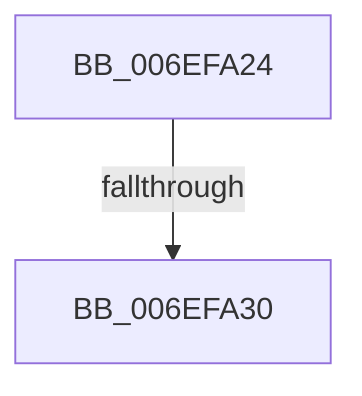

# sub_006EFA24

- RVA: `0x006EFA24`–`0x006EFA4D` (길이 `41` bytes)
- VA: `0x00000001406EFA24`
- 실행 섹션: `.text`
- PDB 이름 있음: `아니요`; PDB Function 태그: `아니요`
- unwind 정보 RVA: `0x000A4EE8`
- 디코드: `9`개 명령, `41/41` bytes 표시
- 미해석 바이트: `0` (있으면 어셈블리에 `.byte`로 보존)

> 이 문서는 커널 이미지의 기계어와 PDB 기호를 분석해 생성했습니다. 4번과 5번은 함수 원형과 자료형을 바이너리 사용 방식에서 추정한 C 해석이며 원본 소스 복구 결과는 아닙니다.

## 1. Dependencies

- 직접 호출 지점: **1**; 고유 호출 대상: **1**
- 직접 호출자로 확인된 함수: **0**
- RIP 상대 이미지 참조: **1**

### Outgoing calls
- `0x006EFA47` → [KeBugCheckEx](../4F/KeBugCheckEx_function_004FD660.md) (function, `0x004FD660`)

### Direct callers
- 이 함수 시작 RVA로 연결되는 직접 call은 확인되지 않았습니다. 간접 호출은 완전히 역산할 수 없습니다.

### Static image references
- `0x006EFA24` → RVA `0x00FC42C0` (`.data`; read)

## 2. Other-region calls and transfers

- 다른 실행 섹션으로 향하는 call: **0**
- call이 아닌 외부 분기/꼬리 이동: **1**
  - `0x006EFA2E` → [sub_006EF914 + 0x106](Unknown_function_006EF914.md) (`tail-transfer`)

## 3. Assembly (complete function range)

```asm
006EFA24  F7 05 92 48 8D 00 00 00 00 40   test dword ptr [rip + 0x8d4892], 0x40000000
006EFA2E  74 EA                           je 0x1406efa1a
006EFA30  45 33 C9                        xor r9d, r9d
006EFA33  48 C7 44 24 20 01 00 00 00      mov qword ptr [rsp + 0x20], 1
006EFA3C  4C 8B C3                        mov r8, rbx
006EFA3F  48 8B D7                        mov rdx, rdi
006EFA42  B9 93 00 00 00                  mov ecx, 0x93
006EFA47  E8 14 DC E0 FF                  call 0x1404fd660
006EFA4C  CC                              int3
```

## 4. C-style interpretation (structured pseudocode)

```c
__int64 __fastcall sub_006EFA24(__int64 a1, __int64 a2, __int64 a3, int a4)
{
    __int64 result;
    unsigned __int64 v_stack_p20;

    a4 = 0;
    v_stack_p20 = 1;
    result = KeBugCheckEx(147, v_rdi, v_rbx, a4);
    return result;
}
```

## 5. (Beta) C Style

```c
int64_t sub_006EFA24(int64_t Arg1, int64_t Arg2, int64_t Arg3, int32_t Arg4)
{
    int64_t result;
    uint64_t v_stack_p20;

    Arg4 = 0;
    v_stack_p20 = 1;
    result = KeBugCheckEx(147, local_rdi, local_rbx, Arg4);
    return result;
}
```

## 6. Execution-region graph

[열기: 2D/3D 그래프와 함수 탐색 컨트롤 패널](../../../control-panel.html?section=text&rva=0x006EFA24&view=graph)

- 2D 그래프는 위에서 아래로 흐르고, 3D 그래프는 빈 공간을 드래그해 회전합니다. Shift+드래그는 이동, 휠은 확대·축소, 함수 노드 선택은 대상 보고서 이동입니다.

### Static fallback


