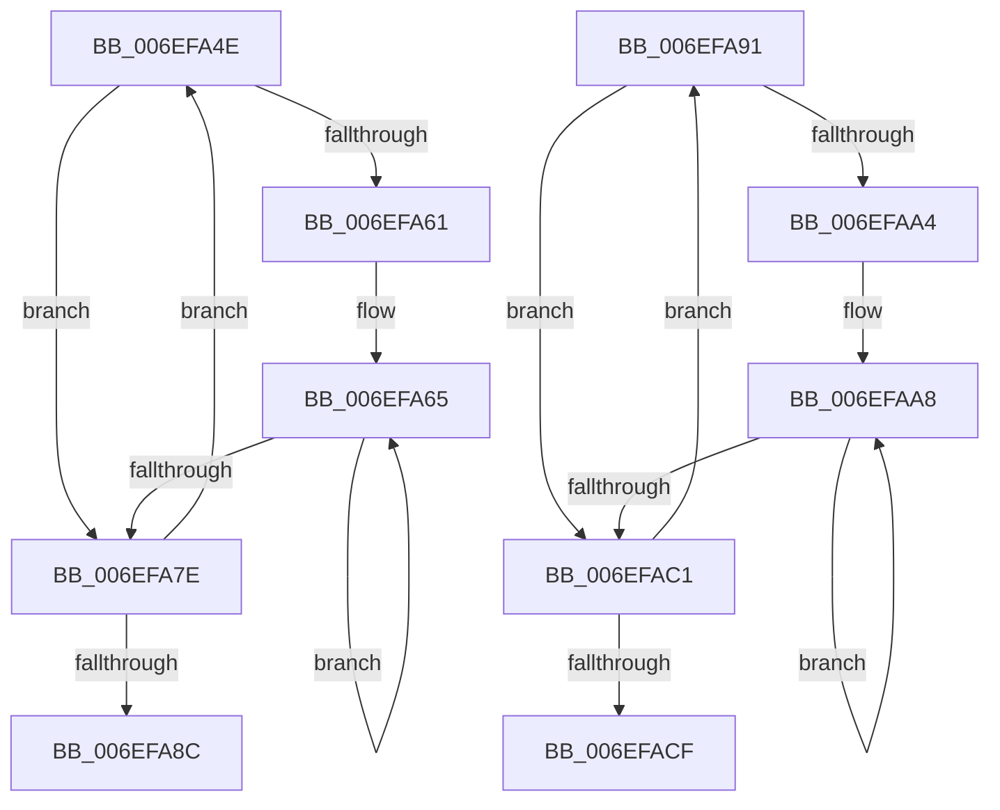

# sub_006EFA4E

- RVA: `0x006EFA4E`–`0x006EFAD4` (길이 `134` bytes)
- VA: `0x00000001406EFA4E`
- 실행 섹션: `.text`
- PDB 이름 있음: `아니요`; PDB Function 태그: `아니요`
- unwind 정보 RVA: `0x000A5068`
- 디코드: `44`개 명령, `134/134` bytes 표시
- 미해석 바이트: `0` (있으면 어셈블리에 `.byte`로 보존)

> 이 문서는 커널 이미지의 기계어와 PDB 기호를 분석해 생성했습니다. 4번과 5번은 함수 원형과 자료형을 바이너리 사용 방식에서 추정한 C 해석이며 원본 소스 복구 결과는 아닙니다.

## 1. Dependencies

- 직접 호출 지점: **2**; 고유 호출 대상: **1**
- 직접 호출자로 확인된 함수: **0**
- RIP 상대 이미지 참조: **0**

### Outgoing calls
- `0x006EFA73` → [KiHaltOnAddress](../4F/KiHaltOnAddress_function_004FBA3C.md) (function, `0x004FBA3C`)
- `0x006EFAB6` → [KiHaltOnAddress](../4F/KiHaltOnAddress_function_004FBA3C.md) (function, `0x004FBA3C`)

### Direct callers
- 이 함수 시작 RVA로 연결되는 직접 call은 확인되지 않았습니다. 간접 호출은 완전히 역산할 수 없습니다.

### Static image references
- 디코드된 RIP-relative 메모리 참조가 없습니다.

## 2. Other-region calls and transfers

- 다른 실행 섹션으로 향하는 call: **0**
- call이 아닌 외부 분기/꼬리 이동: **2**
  - `0x006EFA8C` → [ExpGetPoolTagInfoTarget + 0x57](../44/ExpGetPoolTagInfoTarget_function_004407D0.md) (`tail-transfer`)
  - `0x006EFACF` → [ExpGetPoolTagInfoTarget + 0xBF](../44/ExpGetPoolTagInfoTarget_function_004407D0.md) (`tail-transfer`)

## 3. Assembly (complete function range)

```asm
006EFA4E  0F BA E9 1E                     bts ecx, 0x1e
006EFA52  8B C2                           mov eax, edx
006EFA54  8B F1                           mov esi, ecx
006EFA56  F0 0F B1 33                     lock cmpxchg dword ptr [rbx], esi
006EFA5A  8B C8                           mov ecx, eax
006EFA5C  41 3B C0                        cmp eax, r8d
006EFA5F  75 1D                           jne 0x1406efa7e
006EFA61  89 74 24 58                     mov dword ptr [rsp + 0x58], esi
006EFA65  41 B8 04 00 00 00               mov r8d, 4
006EFA6B  48 8D 54 24 58                  lea rdx, [rsp + 0x58]
006EFA70  48 8B CB                        mov rcx, rbx
006EFA73  E8 C4 BF E0 FF                  call 0x1404fba3c
006EFA78  8B 0B                           mov ecx, dword ptr [rbx]
006EFA7A  3B CE                           cmp ecx, esi
006EFA7C  74 E7                           je 0x1406efa65
006EFA7E  8B C1                           mov eax, ecx
006EFA80  8B D1                           mov edx, ecx
006EFA82  41 23 C5                        and eax, r13d
006EFA85  44 8B C1                        mov r8d, ecx
006EFA88  3B C7                           cmp eax, edi
006EFA8A  75 C2                           jne 0x1406efa4e
006EFA8C  E9 96 0D D5 FF                  jmp 0x140440827
006EFA91  0F BA E9 1E                     bts ecx, 0x1e
006EFA95  8B C2                           mov eax, edx
006EFA97  8B E9                           mov ebp, ecx
006EFA99  F0 0F B1 2B                     lock cmpxchg dword ptr [rbx], ebp
006EFA9D  8B C8                           mov ecx, eax
006EFA9F  41 3B C0                        cmp eax, r8d
006EFAA2  75 1D                           jne 0x1406efac1
006EFAA4  89 6C 24 68                     mov dword ptr [rsp + 0x68], ebp
006EFAA8  41 B8 04 00 00 00               mov r8d, 4
006EFAAE  48 8D 54 24 68                  lea rdx, [rsp + 0x68]
006EFAB3  48 8B CB                        mov rcx, rbx
006EFAB6  E8 81 BF E0 FF                  call 0x1404fba3c
006EFABB  8B 0B                           mov ecx, dword ptr [rbx]
006EFABD  3B CD                           cmp ecx, ebp
006EFABF  74 E7                           je 0x1406efaa8
006EFAC1  8B C1                           mov eax, ecx
006EFAC3  8B D1                           mov edx, ecx
006EFAC5  41 23 C5                        and eax, r13d
006EFAC8  44 8B C1                        mov r8d, ecx
006EFACB  3B C7                           cmp eax, edi
006EFACD  75 C2                           jne 0x1406efa91
006EFACF  E9 BB 0D D5 FF                  jmp 0x14044088f
```

## 4. C-style interpretation (structured pseudocode)

```c
__int64 __fastcall sub_006EFA4E(int a1, int a2, int a3, __int64 a4, __int64 a5, __int64 a6, __int64 a7, __int64 a8, __int64 a9, __int64 a10, __int64 a11)
{
    __int64 result;
    unsigned int v_stack_p58;
    unsigned int v_stack_p68;

    if (((unsigned int)((unsigned int)(a2))) != a3) goto loc_006EFA7E;
    v_stack_p58 = (unsigned int)((unsigned int)(a1));
loc_006EFA65:
    result = KiHaltOnAddress(v_rbx, a11, 4, a4);
    if (((unsigned int)((unsigned int)(*(unsigned int *)(v_rbx)))) == ((unsigned int)((unsigned int)(a1)))) goto loc_006EFA65;
loc_006EFA7E:
    result = (unsigned int)(((unsigned int)((unsigned int)((unsigned int)(*(unsigned int *)(v_rbx))))) & ((unsigned int)(v_r13)));
    if (((unsigned int)(result)) != ((unsigned int)(v_rdi))) goto loc_006EFA4E;
}
```

## 5. (Beta) C Style

```c
int64_t sub_006EFA4E(int32_t Arg1, int32_t Arg2, int32_t Arg3, int64_t Arg4, uint64_t Arg5, uint64_t Arg6, uint64_t Arg7, uint64_t Arg8, uint64_t Arg9, uint64_t Arg10, int64_t Arg11)
{
    int64_t result;
    uint32_t v_stack_p58;
    uint32_t v_stack_p68;

    if (((uint32_t)((uint32_t)(Arg2))) != Arg3) goto loc_006EFA7E;
    v_stack_p58 = (uint32_t)((uint32_t)(Arg1));
loc_006EFA65:
    result = KiHaltOnAddress(local_rbx, Arg11, 4, Arg4);
    if (((uint32_t)((uint32_t)(*(uint32_t *)(local_rbx)))) == ((uint32_t)((uint32_t)(Arg1)))) goto loc_006EFA65;
loc_006EFA7E:
    result = (uint32_t)(((uint32_t)((uint32_t)((uint32_t)(*(uint32_t *)(local_rbx))))) & ((uint32_t)(local_r13)));
    if (((uint32_t)(result)) != ((uint32_t)(local_rdi))) goto loc_006EFA4E;
}
```

## 6. Execution-region graph

[열기: 2D/3D 그래프와 함수 탐색 컨트롤 패널](../../../control-panel.html?section=text&rva=0x006EFA4E&view=graph)

- 2D 그래프는 위에서 아래로 흐르고, 3D 그래프는 빈 공간을 드래그해 회전합니다. Shift+드래그는 이동, 휠은 확대·축소, 함수 노드 선택은 대상 보고서 이동입니다.

### Static fallback


