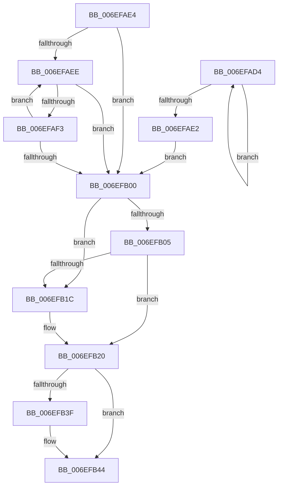

# sub_006EFAD4

- RVA: `0x006EFAD4`–`0x006EFB50` (길이 `124` bytes)
- VA: `0x00000001406EFAD4`
- 실행 섹션: `.text`
- PDB 이름 있음: `아니요`; PDB Function 태그: `아니요`
- unwind 정보 RVA: `0x000A5408`
- 디코드: `39`개 명령, `124/124` bytes 표시
- 미해석 바이트: `0` (있으면 어셈블리에 `.byte`로 보존)

> 이 문서는 커널 이미지의 기계어와 PDB 기호를 분석해 생성했습니다. 4번과 5번은 함수 원형과 자료형을 바이너리 사용 방식에서 추정한 C 해석이며 원본 소스 복구 결과는 아닙니다.

## 1. Dependencies

- 직접 호출 지점: **1**; 고유 호출 대상: **1**
- 직접 호출자로 확인된 함수: **0**
- RIP 상대 이미지 참조: **0**

### Outgoing calls
- `0x006EFB33` → [IopMcReferenceBufferEntry](../5A/IopMcReferenceBufferEntry_function_005A3CAC.md) (function, `0x005A3CAC`)

### Direct callers
- 이 함수 시작 RVA로 연결되는 직접 call은 확인되지 않았습니다. 간접 호출은 완전히 역산할 수 없습니다.

### Static image references
- 디코드된 RIP-relative 메모리 참조가 없습니다.

## 2. Other-region calls and transfers

- 다른 실행 섹션으로 향하는 call: **0**
- call이 아닌 외부 분기/꼬리 이동: **1**
  - `0x006EFB4B` → [sub_00442C79 + 0x51](../44/Unknown_function_00442C79.md) (`tail-transfer`)

## 3. Assembly (complete function range)

```asm
006EFAD4  48 8B 01                        mov rax, qword ptr [rcx]
006EFAD7  4C 8B C1                        mov r8, rcx
006EFADA  48 8B C8                        mov rcx, rax
006EFADD  48 85 C0                        test rax, rax
006EFAE0  75 F2                           jne 0x1406efad4
006EFAE2  EB 1C                           jmp 0x1406efb00
006EFAE4  4D 8B 43 10                     mov r8, qword ptr [r11 + 0x10]
006EFAE8  49 83 E0 FC                     and r8, 0xfffffffffffffffc
006EFAEC  74 12                           je 0x1406efb00
006EFAEE  4D 39 18                        cmp qword ptr [r8], r11
006EFAF1  74 0D                           je 0x1406efb00
006EFAF3  4D 8B D8                        mov r11, r8
006EFAF6  4D 8B 40 10                     mov r8, qword ptr [r8 + 0x10]
006EFAFA  49 83 E0 FC                     and r8, 0xfffffffffffffffc
006EFAFE  75 EE                           jne 0x1406efaee
006EFB00  4D 85 C0                        test r8, r8
006EFB03  74 17                           je 0x1406efb1c
006EFB05  41 8B 50 18                     mov edx, dword ptr [r8 + 0x18]
006EFB09  8D 4A 03                        lea ecx, [rdx + 3]
006EFB0C  C1 E1 05                        shl ecx, 5
006EFB0F  4C 2B C1                        sub r8, rcx
006EFB12  49 8B 48 58                     mov rcx, qword ptr [r8 + 0x58]
006EFB16  4C 39 14 D1                     cmp qword ptr [rcx + rdx*8], r10
006EFB1A  74 04                           je 0x1406efb20
006EFB1C  C6 47 10 01                     mov byte ptr [rdi + 0x10], 1
006EFB20  8B 43 18                        mov eax, dword ptr [rbx + 0x18]
006EFB23  83 C0 03                        add eax, 3
006EFB26  C1 E0 05                        shl eax, 5
006EFB29  48 2B D8                        sub rbx, rax
006EFB2C  48 8B CB                        mov rcx, rbx
006EFB2F  48 89 5F 08                     mov qword ptr [rdi + 8], rbx
006EFB33  E8 74 41 EB FF                  call 0x1405a3cac
006EFB38  8B 43 0C                        mov eax, dword ptr [rbx + 0xc]
006EFB3B  A8 01                           test al, 1
006EFB3D  75 05                           jne 0x1406efb44
006EFB3F  F0 83 4B 0C 01                  lock or dword ptr [rbx + 0xc], 1
006EFB44  48 8B 43 38                     mov rax, qword ptr [rbx + 0x38]
006EFB48  48 89 06                        mov qword ptr [rsi], rax
006EFB4B  E9 7A 31 D5 FF                  jmp 0x140442cca
```

## 4. C-style interpretation (structured pseudocode)

```c
__int64 __fastcall sub_006EFAD4(__int64 a1)
{
    __int64 result;
    __int64 v_rbx;

    if (*(unsigned __int64 *)(a1) != 0) goto loc_006EFAD4;
    goto loc_006EFB00;
loc_006EFB00:
    if (a1 == 0) goto loc_006EFB1C;
    a1 = (unsigned int)(((unsigned int)(*(unsigned int *)(a1 + 24)) + 3) << (5));
    a3 = (a1) - (a1);
    if ((*(unsigned __int64 *)(*(unsigned __int64 *)(a3 + 88) + (unsigned int)(*(unsigned int *)(a1 + 24)) * 8)) != v_r10) {
        *(unsigned __int8 *)(v_rdi + 16) = 1;
    }
    result = (unsigned int)(((unsigned int)(*(unsigned int *)(v_rbx + 24))) + (3));
    result = (unsigned int)((result) << (5));
    v_rbx = (v_rbx) - (result);
    *(unsigned __int64 *)(v_rdi + 8) = v_rbx;
    result = IopMcReferenceBufferEntry(v_rbx, (unsigned int)(*(unsigned int *)(a1 + 24)), a3, a4);
    if ((((unsigned __int8)((unsigned int)(*(unsigned int *)(v_rbx + 12)))) & (1)) == 0) {
    }
    *(unsigned __int64 *)(v_rsi) = *(unsigned __int64 *)(v_rbx + 56);
}
```

## 5. (Beta) C Style

```c
int64_t sub_006EFAD4(int64_t Arg1)
{
    int64_t result;
    int64_t local_rbx;

    if (*(uint64_t *)(Arg1) != 0) goto loc_006EFAD4;
    goto loc_006EFB00;
loc_006EFB00:
    if (Arg1 == 0) goto loc_006EFB1C;
    Arg1 = (uint32_t)(((uint32_t)(*(uint32_t *)(Arg1 + 0x18)) + 3) << (5));
    a3 = (Arg1) - (Arg1);
    if ((*(uint64_t *)(*(uint64_t *)(a3 + 0x58) + (uint32_t)(*(uint32_t *)(Arg1 + 0x18)) * 8)) != local_r10) {
        *(uint8_t *)(local_rdi + 0x10) = 1;
    }
    result = (uint32_t)(((uint32_t)(*(uint32_t *)(local_rbx + 0x18))) + (3));
    result = (uint32_t)((result) << (5));
    local_rbx = (local_rbx) - (result);
    *(uint64_t *)(local_rdi + 0x8) = local_rbx;
    result = IopMcReferenceBufferEntry(local_rbx, (uint32_t)(*(uint32_t *)(Arg1 + 0x18)), a3, a4);
    if ((((uint8_t)((uint32_t)(*(uint32_t *)(local_rbx + 0xC)))) & (1)) == 0) {
    }
    *(uint64_t *)(local_rsi) = *(uint64_t *)(local_rbx + 0x38);
}
```

## 6. Execution-region graph

[열기: 2D/3D 그래프와 함수 탐색 컨트롤 패널](../../../control-panel.html?section=text&rva=0x006EFAD4&view=graph)

- 2D 그래프는 위에서 아래로 흐르고, 3D 그래프는 빈 공간을 드래그해 회전합니다. Shift+드래그는 이동, 휠은 확대·축소, 함수 노드 선택은 대상 보고서 이동입니다.

### Static fallback


