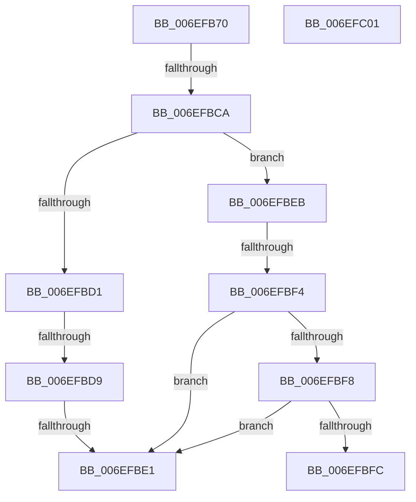

# sub_006EFB70

- RVA: `0x006EFB70`–`0x006EFC5A` (길이 `234` bytes)
- VA: `0x00000001406EFB70`
- 실행 섹션: `.text`
- PDB 이름 있음: `아니요`; PDB Function 태그: `아니요`
- unwind 정보 RVA: `0x000A5454`
- 디코드: `50`개 명령, `234/234` bytes 표시
- 미해석 바이트: `0` (있으면 어셈블리에 `.byte`로 보존)

> 이 문서는 커널 이미지의 기계어와 PDB 기호를 분석해 생성했습니다. 4번과 5번은 함수 원형과 자료형을 바이너리 사용 방식에서 추정한 C 해석이며 원본 소스 복구 결과는 아닙니다.

## 1. Dependencies

- 직접 호출 지점: **2**; 고유 호출 대상: **1**
- 직접 호출자로 확인된 함수: **0**
- RIP 상대 이미지 참조: **0**

### Outgoing calls
- `0x006EFBBD` → [EmpEvaluateNodeLink](../44/EmpEvaluateNodeLink_function_0044313C.md) (function, `0x0044313C`)
- `0x006EFC4E` → [EmpEvaluateNodeLink](../44/EmpEvaluateNodeLink_function_0044313C.md) (function, `0x0044313C`)

### Direct callers
- 이 함수 시작 RVA로 연결되는 직접 call은 확인되지 않았습니다. 간접 호출은 완전히 역산할 수 없습니다.

### Static image references
- 디코드된 RIP-relative 메모리 참조가 없습니다.

## 2. Other-region calls and transfers

- 다른 실행 섹션으로 향하는 call: **0**
- call이 아닌 외부 분기/꼬리 이동: **7**
  - `0x006EFBC4` → [EmpEvaluateNodeLink + 0x356](../44/EmpEvaluateNodeLink_function_0044313C.md) (`tail-transfer`)
  - `0x006EFBD3` → [EmpEvaluateNodeLink + 0x24E](../44/EmpEvaluateNodeLink_function_0044313C.md) (`tail-transfer`)
  - `0x006EFBDB` → [EmpEvaluateNodeLink + 0x24E](../44/EmpEvaluateNodeLink_function_0044313C.md) (`tail-transfer`)
  - `0x006EFBE6` → [EmpEvaluateNodeLink + 0x356](../44/EmpEvaluateNodeLink_function_0044313C.md) (`tail-transfer`)
  - `0x006EFBEE` → [EmpEvaluateNodeLink + 0x356](../44/EmpEvaluateNodeLink_function_0044313C.md) (`tail-transfer`)
  - `0x006EFBFC` → [EmpEvaluateNodeLink + 0x24E](../44/EmpEvaluateNodeLink_function_0044313C.md) (`tail-transfer`)
  - `0x006EFC55` → [EmpEvaluateNodeLink + 0x356](../44/EmpEvaluateNodeLink_function_0044313C.md) (`tail-transfer`)

## 3. Assembly (complete function range)

```asm
006EFB70  8B 46 28                        mov eax, dword ptr [rsi + 0x28]
006EFB73  44 8B AC 24 30 01 00 00         mov r13d, dword ptr [rsp + 0x130]
006EFB7B  4C 8B 8C 24 F8 00 00 00         mov r9, qword ptr [rsp + 0xf8]
006EFB83  44 8B 84 24 F0 00 00 00         mov r8d, dword ptr [rsp + 0xf0]
006EFB8B  48 8B 94 24 E8 00 00 00         mov rdx, qword ptr [rsp + 0xe8]
006EFB93  48 8B 4E 20                     mov rcx, qword ptr [rsi + 0x20]
006EFB97  44 89 6C 24 50                  mov dword ptr [rsp + 0x50], r13d
006EFB9C  48 89 7C 24 48                  mov qword ptr [rsp + 0x48], rdi
006EFBA1  89 44 24 40                     mov dword ptr [rsp + 0x40], eax
006EFBA5  48 8B 46 30                     mov rax, qword ptr [rsi + 0x30]
006EFBA9  48 89 44 24 38                  mov qword ptr [rsp + 0x38], rax
006EFBAE  44 89 74 24 30                  mov dword ptr [rsp + 0x30], r14d
006EFBB3  4C 89 7C 24 28                  mov qword ptr [rsp + 0x28], r15
006EFBB8  44 89 64 24 20                  mov dword ptr [rsp + 0x20], r12d
006EFBBD  E8 7A 35 D5 FF                  call 0x14044313c
006EFBC2  3B C3                           cmp eax, ebx
006EFBC4  0F 84 C8 38 D5 FF               je 0x140443492
006EFBCA  8A 0E                           mov cl, byte ptr [rsi]
006EFBCC  80 F9 26                        cmp cl, 0x26
006EFBCF  75 1A                           jne 0x1406efbeb
006EFBD1  85 ED                           test ebp, ebp
006EFBD3  0F 84 B1 37 D5 FF               je 0x14044338a
006EFBD9  85 C0                           test eax, eax
006EFBDB  0F 84 A9 37 D5 FF               je 0x14044338a
006EFBE1  BB 02 00 00 00                  mov ebx, 2
006EFBE6  E9 A7 38 D5 FF                  jmp 0x140443492
006EFBEB  80 F9 7C                        cmp cl, 0x7c
006EFBEE  0F 85 9E 38 D5 FF               jne 0x140443492
006EFBF4  85 ED                           test ebp, ebp
006EFBF6  75 E9                           jne 0x1406efbe1
006EFBF8  85 C0                           test eax, eax
006EFBFA  75 E5                           jne 0x1406efbe1
006EFBFC  E9 89 37 D5 FF                  jmp 0x14044338a
006EFC01  8B 84 24 10 01 00 00            mov eax, dword ptr [rsp + 0x110]
006EFC08  4C 8B 8C 24 F8 00 00 00         mov r9, qword ptr [rsp + 0xf8]
006EFC10  48 8B 94 24 E8 00 00 00         mov rdx, qword ptr [rsp + 0xe8]
006EFC18  49 8B 4A 60                     mov rcx, qword ptr [r10 + 0x60]
006EFC1C  44 89 44 24 50                  mov dword ptr [rsp + 0x50], r8d
006EFC21  45 8B C3                        mov r8d, r11d
006EFC24  48 89 7C 24 48                  mov qword ptr [rsp + 0x48], rdi
006EFC29  21 74 24 40                     and dword ptr [rsp + 0x40], esi
006EFC2D  48 21 74 24 38                  and qword ptr [rsp + 0x38], rsi
006EFC32  89 44 24 30                     mov dword ptr [rsp + 0x30], eax
006EFC36  48 8B 84 24 08 01 00 00         mov rax, qword ptr [rsp + 0x108]
006EFC3E  48 89 44 24 28                  mov qword ptr [rsp + 0x28], rax
006EFC43  8B 84 24 00 01 00 00            mov eax, dword ptr [rsp + 0x100]
006EFC4A  89 44 24 20                     mov dword ptr [rsp + 0x20], eax
006EFC4E  E8 E9 34 D5 FF                  call 0x14044313c
006EFC53  8B D8                           mov ebx, eax
006EFC55  E9 38 38 D5 FF                  jmp 0x140443492
```

## 4. C-style interpretation (structured pseudocode)

```c
__int64 __fastcall sub_006EFB70(__int64 a1, __int64 a2, __int64 a3, __int64 a4, __int64 a5, __int64 a6, __int64 a7, __int64 a8, __int64 a9, __int64 a10, __int64 a11, __int64 a12, __int64 a13, __int64 a14, __int64 a15, __int64 a16, __int64 a17, __int64 a18, __int64 a19, __int64 a20, __int64 a21, __int64 a22, __int64 a23, __int64 a24, __int64 a25, __int64 a26, __int64 a27, __int64 a28, __int64 a29, unsigned int a30, __int64 a31, __int64 a32, __int64 a33, __int64 a34, __int64 a35, __int64 a36, __int64 a37, unsigned int a38)
{
    __int64 result;
    unsigned int v_stack_p100;
    unsigned __int64 v_stack_p108;
    unsigned int v_stack_p110;
    unsigned int v_stack_p20;
    unsigned __int64 v_stack_p28;
    unsigned int v_stack_p30;
    unsigned __int64 v_stack_p38;
    unsigned int v_stack_p40;
    unsigned __int64 v_stack_p48;
    unsigned int v_stack_p50;
    unsigned __int64 v_stack_pE8;
    unsigned __int64 v_stack_pF8;

    v_stack_p50 = (unsigned int)((unsigned int)(a38));
    v_stack_p48 = v_rdi;
    v_stack_p40 = (unsigned int)((unsigned int)(*(unsigned int *)(v_rsi + 40)));
    v_stack_p38 = *(unsigned __int64 *)(v_rsi + 48);
    v_stack_p30 = (unsigned int)(v_r14);
    v_stack_p28 = v_r15;
    v_stack_p20 = (unsigned int)(v_r12);
    result = EmpEvaluateNodeLink(*(unsigned __int64 *)(v_rsi + 32), a29, (unsigned int)(a30), a31);
    if (((unsigned __int8)(*(unsigned __int8 *)(v_rsi))) != 38) goto loc_006EFBEB;
loc_006EFBE1:
loc_006EFBEB:
    if ((unsigned int)(v_rbp) != 0) goto loc_006EFBE1;
    if ((unsigned int)(result) != 0) goto loc_006EFBE1;
}
```

## 5. (Beta) C Style

```c
int64_t sub_006EFB70(int64_t Arg1, int64_t Arg2, int64_t Arg3, int64_t Arg4, uint64_t Arg5, uint64_t Arg6, uint64_t Arg7, uint64_t Arg8, uint64_t Arg9, uint64_t Arg10, uint64_t Arg11, uint64_t Arg12, uint64_t Arg13, uint64_t Arg14, uint64_t Arg15, uint64_t Arg16, uint64_t Arg17, uint64_t Arg18, uint64_t Arg19, uint64_t Arg20, uint64_t Arg21, uint64_t Arg22, uint64_t Arg23, uint64_t Arg24, uint64_t Arg25, uint64_t Arg26, uint64_t Arg27, uint64_t Arg28, int64_t Arg29, uint32_t Arg30, int64_t Arg31, uint64_t Arg32, uint64_t Arg33, uint64_t Arg34, uint64_t Arg35, uint64_t Arg36, uint64_t Arg37, uint32_t Arg38)
{
    int64_t result;
    uint32_t v_stack_p100;
    uint64_t v_stack_p108;
    uint32_t v_stack_p110;
    uint32_t v_stack_p20;
    uint64_t v_stack_p28;
    uint32_t v_stack_p30;
    uint64_t v_stack_p38;
    uint32_t v_stack_p40;
    uint64_t v_stack_p48;
    uint32_t v_stack_p50;
    uint64_t v_stack_pE8;
    uint64_t v_stack_pF8;

    v_stack_p50 = (uint32_t)((uint32_t)(Arg38));
    v_stack_p48 = local_rdi;
    v_stack_p40 = (uint32_t)((uint32_t)(*(uint32_t *)(local_rsi + 0x28)));
    v_stack_p38 = *(uint64_t *)(local_rsi + 0x30);
    v_stack_p30 = (uint32_t)(local_r14);
    v_stack_p28 = local_r15;
    v_stack_p20 = (uint32_t)(local_r12);
    result = EmpEvaluateNodeLink(*(uint64_t *)(local_rsi + 0x20), Arg29, (uint32_t)(Arg30), Arg31);
    if (((uint8_t)(*(uint8_t *)(local_rsi))) != 38) goto loc_006EFBEB;
loc_006EFBE1:
loc_006EFBEB:
    if ((uint32_t)(local_rbp) != 0) goto loc_006EFBE1;
    if ((uint32_t)(result) != 0) goto loc_006EFBE1;
}
```

## 6. Execution-region graph

[열기: 2D/3D 그래프와 함수 탐색 컨트롤 패널](../../../control-panel.html?section=text&rva=0x006EFB70&view=graph)

- 2D 그래프는 위에서 아래로 흐르고, 3D 그래프는 빈 공간을 드래그해 회전합니다. Shift+드래그는 이동, 휠은 확대·축소, 함수 노드 선택은 대상 보고서 이동입니다.

### Static fallback


