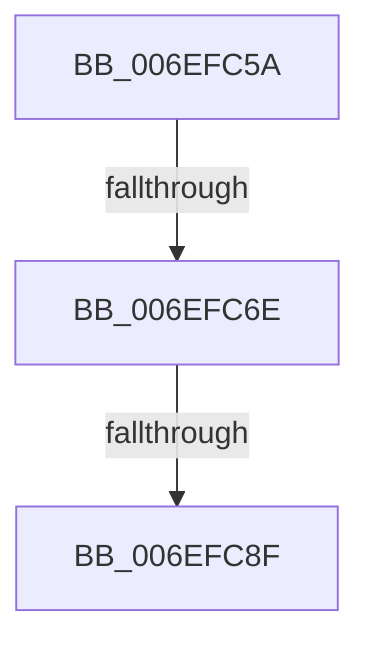

# sub_006EFC5A

- RVA: `0x006EFC5A`–`0x006EFCBB` (길이 `97` bytes)
- VA: `0x00000001406EFC5A`
- 실행 섹션: `.text`
- PDB 이름 있음: `아니요`; PDB Function 태그: `아니요`
- unwind 정보 RVA: `0x000A56AC`
- 디코드: `20`개 명령, `97/97` bytes 표시
- 미해석 바이트: `0` (있으면 어셈블리에 `.byte`로 보존)

> 이 문서는 커널 이미지의 기계어와 PDB 기호를 분석해 생성했습니다. 4번과 5번은 함수 원형과 자료형을 바이너리 사용 방식에서 추정한 C 해석이며 원본 소스 복구 결과는 아닙니다.

## 1. Dependencies

- 직접 호출 지점: **1**; 고유 호출 대상: **1**
- 직접 호출자로 확인된 함수: **0**
- RIP 상대 이미지 참조: **1**

### Outgoing calls
- `0x006EFCB0` → [KiSetTimerEx](../23/KiSetTimerEx_function_00232CB0.md) (function, `0x00232CB0`)

### Direct callers
- 이 함수 시작 RVA로 연결되는 직접 call은 확인되지 않았습니다. 간접 호출은 완전히 역산할 수 없습니다.

### Static image references
- `0x006EFCA6` → RVA `0x000134D0` (`.rdata`; read)

## 2. Other-region calls and transfers

- 다른 실행 섹션으로 향하는 call: **0**
- call이 아닌 외부 분기/꼬리 이동: **3**
  - `0x006EFC68` → [MiInsertUnusedSegment + 0x89](../44/MiInsertUnusedSegment_function_004443DC.md) (`tail-transfer`)
  - `0x006EFC89` → [MiInsertUnusedSegment + 0x9E](../44/MiInsertUnusedSegment_function_004443DC.md) (`tail-transfer`)
  - `0x006EFCB6` → [MiInsertUnusedSegment + 0x9E](../44/MiInsertUnusedSegment_function_004443DC.md) (`tail-transfer`)

## 3. Assembly (complete function range)

```asm
006EFC5A  48 8D 87 C8 07 00 00            lea rax, [rdi + 0x7c8]
006EFC61  48 8B 50 08                     mov rdx, qword ptr [rax + 8]
006EFC65  48 39 02                        cmp qword ptr [rdx], rax
006EFC68  0F 85 F7 47 D5 FF               jne 0x140444465
006EFC6E  48 89 01                        mov qword ptr [rcx], rax
006EFC71  48 89 51 08                     mov qword ptr [rcx + 8], rdx
006EFC75  48 89 0A                        mov qword ptr [rdx], rcx
006EFC78  48 89 48 08                     mov qword ptr [rax + 8], rcx
006EFC7C  FF 87 C4 06 00 00               inc dword ptr [rdi + 0x6c4]
006EFC82  80 BF 28 08 00 00 00            cmp byte ptr [rdi + 0x828], 0
006EFC89  0F 85 EB 47 D5 FF               jne 0x14044447a
006EFC8F  48 83 64 24 20 00               and qword ptr [rsp + 0x20], 0
006EFC95  48 8D 8F E8 07 00 00            lea rcx, [rdi + 0x7e8]
006EFC9C  C6 87 28 08 00 00 01            mov byte ptr [rdi + 0x828], 1
006EFCA3  45 33 C9                        xor r9d, r9d
006EFCA6  48 8B 15 23 38 92 FF            mov rdx, qword ptr [rip - 0x6dc7dd]
006EFCAD  45 33 C0                        xor r8d, r8d
006EFCB0  E8 FB 2F B4 FF                  call 0x140232cb0
006EFCB5  90                              nop
006EFCB6  E9 BF 47 D5 FF                  jmp 0x14044447a
```

## 4. C-style interpretation (structured pseudocode)

```c
__int64 __fastcall sub_006EFC5A(__int64 a1, __int64 a2, int a3, int a4)
{
    __int64 result;
    unsigned __int64 v_stack_p20;

    *(unsigned __int64 *)(a1) = v_rdi + 1992;
    *(unsigned __int64 *)(a1 + 8) = *(unsigned __int64 *)(v_rdi + 1992 + 8);
    *(unsigned __int64 *)(*(unsigned __int64 *)(v_rdi + 1992 + 8)) = a1;
    *(unsigned __int64 *)(v_rdi + 1992 + 8) = a1;
    *(unsigned __int8 *)(v_rdi + 2088) = 1;
    a4 = 0;
    a3 = 0;
    result = KiSetTimerEx(v_rdi + 2024, *(unsigned __int64 *)(v_rip - 7194589), a3, a4);
}
```

## 5. (Beta) C Style

```c
int64_t sub_006EFC5A(void *Arg1, int64_t Arg2, int32_t Arg3, int32_t Arg4)
{
    uint8_t *arg1 = (uint8_t *)Arg1;

    int64_t result;
    uint64_t v_stack_p20;

    *(uint64_t *)(arg1) = local_rdi + 1992;
    *(uint64_t *)(arg1 + 0x8) = *(uint64_t *)(local_rdi + 0x7C8 + 0x8);
    *(void **)(*(uint64_t *)(local_rdi + 0x7C8 + 0x8)) = Arg1;
    *(void **)(local_rdi + 0x7C8 + 0x8) = Arg1;
    *(uint8_t *)(local_rdi + 0x828) = 1;
    Arg4 = 0;
    Arg3 = 0;
    result = KiSetTimerEx(local_rdi + 2024, *(uint64_t *)(v_rip - 0x6DC7DD), Arg3, Arg4);
}
```

### 관측된 메모리 오프셋

구조체 형식이 확인되지 않은 접근은 인자 기준의 오프셋으로만 기록했습니다.

| 기준 인자 | 오프셋 표현 | 폭 (bit) | 접근 |
|---|---:|---:|---|
| `Arg1` | `+ 0x0` | `64` | `W` |
| `Arg1` | `+ 0x8` | `64` | `W` |

## 6. Execution-region graph

[열기: 2D/3D 그래프와 함수 탐색 컨트롤 패널](../../../control-panel.html?section=text&rva=0x006EFC5A&view=graph)

- 2D 그래프는 위에서 아래로 흐르고, 3D 그래프는 빈 공간을 드래그해 회전합니다. Shift+드래그는 이동, 휠은 확대·축소, 함수 노드 선택은 대상 보고서 이동입니다.

### Static fallback


