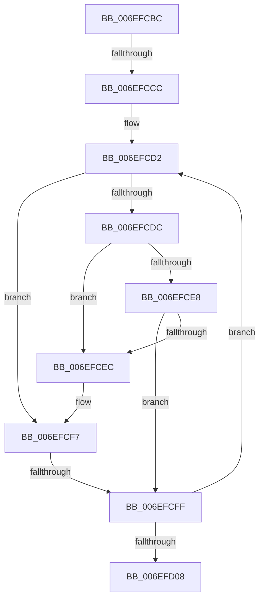

# sub_006EFCBC

- RVA: `0x006EFCBC`–`0x006EFD0D` (길이 `81` bytes)
- VA: `0x00000001406EFCBC`
- 실행 섹션: `.text`
- PDB 이름 있음: `아니요`; PDB Function 태그: `아니요`
- unwind 정보 RVA: `0x000A56D8`
- 디코드: `22`개 명령, `81/81` bytes 표시
- 미해석 바이트: `0` (있으면 어셈블리에 `.byte`로 보존)

> 이 문서는 커널 이미지의 기계어와 PDB 기호를 분석해 생성했습니다. 4번과 5번은 함수 원형과 자료형을 바이너리 사용 방식에서 추정한 C 해석이며 원본 소스 복구 결과는 아닙니다.

## 1. Dependencies

- 직접 호출 지점: **1**; 고유 호출 대상: **1**
- 직접 호출자로 확인된 함수: **0**
- RIP 상대 이미지 참조: **0**

### Outgoing calls
- `0x006EFCEF` → [MiComputeCrossPartitionSectionCharges](../32/MiComputeCrossPartitionSectionCharges_function_00325BBC.md) (function, `0x00325BBC`)

### Direct callers
- 이 함수 시작 RVA로 연결되는 직접 call은 확인되지 않았습니다. 간접 호출은 완전히 역산할 수 없습니다.

### Static image references
- 디코드된 RIP-relative 메모리 참조가 없습니다.

## 2. Other-region calls and transfers

- 다른 실행 섹션으로 향하는 call: **0**
- call이 아닌 외부 분기/꼬리 이동: **3**
  - `0x006EFCC6` → [MiReleaseControlAreaCharges + 0xAB](../44/MiReleaseControlAreaCharges_function_004444BC.md) (`tail-transfer`)
  - `0x006EFCF9` → [MiReleaseControlAreaCharges + 0xAB](../44/MiReleaseControlAreaCharges_function_004444BC.md) (`tail-transfer`)
  - `0x006EFD08` → [MiReleaseControlAreaCharges + 0xAB](../44/MiReleaseControlAreaCharges_function_004444BC.md) (`tail-transfer`)

## 3. Assembly (complete function range)

```asm
006EFCBC  4C 8D 83 80 00 00 00            lea r8, [rbx + 0x80]
006EFCC3  4D 85 C0                        test r8, r8
006EFCC6  0F 84 9B 48 D5 FF               je 0x140444567
006EFCCC  41 B9 FF FF FF 3F               mov r9d, 0x3fffffff
006EFCD2  41 8B 40 20                     mov eax, dword ptr [r8 + 0x20]
006EFCD6  0F BA E0 10                     bt eax, 0x10
006EFCDA  72 1B                           jb 0x1406efcf7
006EFCDC  41 8B 40 30                     mov eax, dword ptr [r8 + 0x30]
006EFCE0  41 23 C1                        and eax, r9d
006EFCE3  41 3B C1                        cmp eax, r9d
006EFCE6  74 04                           je 0x1406efcec
006EFCE8  85 ED                           test ebp, ebp
006EFCEA  74 13                           je 0x1406efcff
006EFCEC  49 8B C8                        mov rcx, r8
006EFCEF  E8 C8 5E C3 FF                  call 0x140325bbc
006EFCF4  4C 03 F0                        add r14, rax
006EFCF7  85 ED                           test ebp, ebp
006EFCF9  0F 85 68 48 D5 FF               jne 0x140444567
006EFCFF  4D 8B 40 10                     mov r8, qword ptr [r8 + 0x10]
006EFD03  4D 85 C0                        test r8, r8
006EFD06  75 CA                           jne 0x1406efcd2
006EFD08  E9 5A 48 D5 FF                  jmp 0x140444567
```

## 4. C-style interpretation (structured pseudocode)

```c
__int64 __fastcall sub_006EFCBC(void)
{
    __int64 result;
    __int64 v_r14;

loc_006EFCD2:
    if (condition_is_below) goto loc_006EFCF7;
    result = (unsigned int)(((unsigned int)(*(unsigned int *)(v_rbx + 128 + 48))) & ((unsigned int)((unsigned int)(0x3FFFFFFFULL))));
    if (((unsigned int)(result)) == ((unsigned int)((unsigned int)(0x3FFFFFFFULL)))) goto loc_006EFCEC;
    if ((unsigned int)(v_rbp) == 0) goto loc_006EFCFF;
loc_006EFCEC:
    result = MiComputeCrossPartitionSectionCharges(v_rbx + 128, a2, v_rbx + 128, (unsigned int)(0x3FFFFFFFULL));
    v_r14 = (v_r14) + (result);
loc_006EFCF7:
loc_006EFCFF:
    if (*(unsigned __int64 *)(v_rbx + 128 + 16) != 0) goto loc_006EFCD2;
}
```

## 5. (Beta) C Style

```c
void sub_006EFCBC(void)
{
    int64_t result;
    int64_t local_r14;

loc_006EFCD2:
    if (condition_is_below) goto loc_006EFCF7;
    result = (uint32_t)(((uint32_t)(*(uint32_t *)(local_rbx + 0x80 + 0x30))) & ((uint32_t)((uint32_t)(0x3FFFFFFFULL))));
    if (((uint32_t)(result)) == ((uint32_t)((uint32_t)(0x3FFFFFFFULL)))) goto loc_006EFCEC;
    if ((uint32_t)(local_rbp) == 0) goto loc_006EFCFF;
loc_006EFCEC:
    result = MiComputeCrossPartitionSectionCharges(local_rbx + 128, a2, local_rbx + 128, (uint32_t)(0x3FFFFFFFULL));
    local_r14 = (local_r14) + (result);
loc_006EFCF7:
loc_006EFCFF:
    if (*(uint64_t *)(local_rbx + 0x80 + 0x10) != 0) goto loc_006EFCD2;
}
```

## 6. Execution-region graph

[열기: 2D/3D 그래프와 함수 탐색 컨트롤 패널](../../../control-panel.html?section=text&rva=0x006EFCBC&view=graph)

- 2D 그래프는 위에서 아래로 흐르고, 3D 그래프는 빈 공간을 드래그해 회전합니다. Shift+드래그는 이동, 휠은 확대·축소, 함수 노드 선택은 대상 보고서 이동입니다.

### Static fallback


