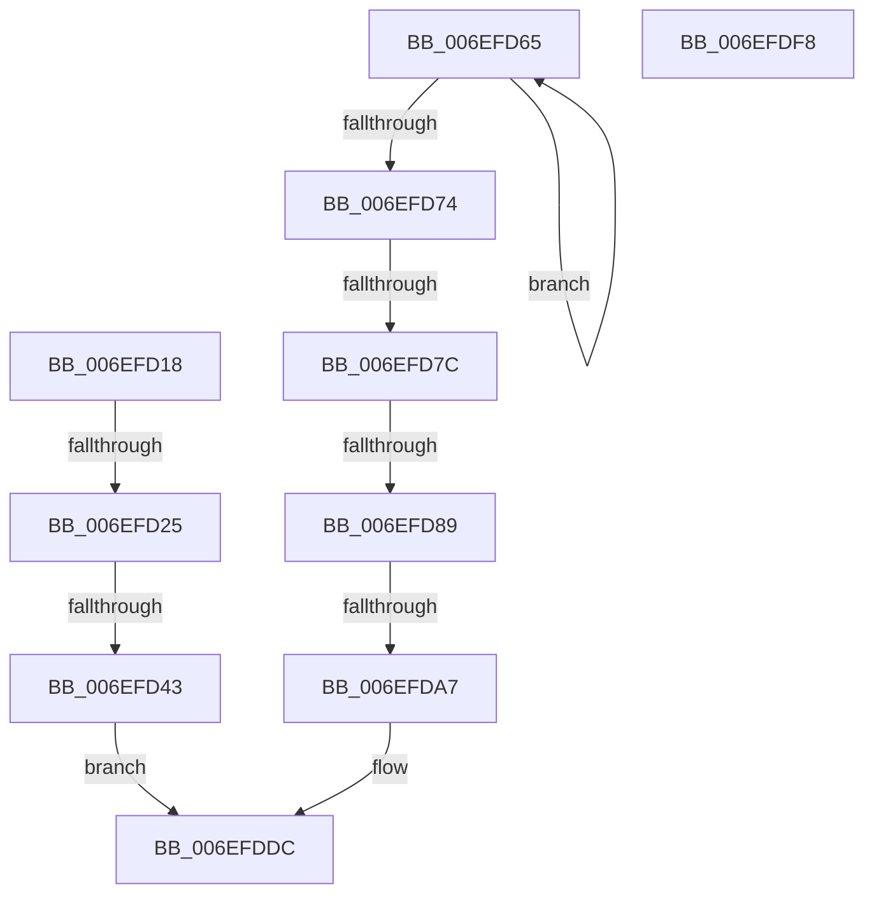

# sub_006EFD18

- RVA: `0x006EFD18`–`0x006EFE28` (길이 `272` bytes)
- VA: `0x00000001406EFD18`
- 실행 섹션: `.text`
- PDB 이름 있음: `아니요`; PDB Function 태그: `아니요`
- unwind 정보 RVA: `0x000A58A8`
- 디코드: `55`개 명령, `272/272` bytes 표시
- 미해석 바이트: `0` (있으면 어셈블리에 `.byte`로 보존)

> 이 문서는 커널 이미지의 기계어와 PDB 기호를 분석해 생성했습니다. 4번과 5번은 함수 원형과 자료형을 바이너리 사용 방식에서 추정한 C 해석이며 원본 소스 복구 결과는 아닙니다.

## 1. Dependencies

- 직접 호출 지점: **4**; 고유 호출 대상: **3**
- 직접 호출자로 확인된 함수: **0**
- RIP 상대 이미지 참조: **5**

### Outgoing calls
- `0x006EFD36` → [tlgKeywordOn](../42/tlgKeywordOn_function_0042EAA0.md) (function, `0x0042EAA0`)
- `0x006EFD9A` → [tlgKeywordOn](../42/tlgKeywordOn_function_0042EAA0.md) (function, `0x0042EAA0`)
- `0x006EFDED` → [tlgWriteEx_EtwWriteEx](../4A/tlgWriteEx_EtwWriteEx_function_004AA348.md) (function, `0x004AA348`)
- `0x006EFE1D` → [EtwWriteEx](../25/EtwWriteEx_function_0025F0D0.md) (function, `0x0025F0D0`)

### Direct callers
- 이 함수 시작 RVA로 연결되는 직접 call은 확인되지 않았습니다. 간접 호출은 완전히 역산할 수 없습니다.

### Static image references
- `0x006EFD18` → RVA `0x00E07748` (`.data`; read)
- `0x006EFD4B` → RVA `0x0004A399` (`.rdata`; read)
- `0x006EFD6A` → RVA `0x00E0B590` (`.data`; read)
- `0x006EFDB7` → RVA `0x0004A230` (`.rdata`; read)
- `0x006EFDF8` → RVA `0x00F0B408` (`.data`; read)

## 2. Other-region calls and transfers

- 다른 실행 섹션으로 향하는 call: **0**
- call이 아닌 외부 분기/꼬리 이동: **7**
  - `0x006EFD1F` → [PopDiagTraceFxDefaultPepWorkerEnd + 0x60](../44/PopDiagTraceFxDefaultPepWorkerEnd_function_004451E8.md) (`tail-transfer`)
  - `0x006EFD3D` → [PopDiagTraceFxDefaultPepWorkerEnd + 0x60](../44/PopDiagTraceFxDefaultPepWorkerEnd_function_004451E8.md) (`tail-transfer`)
  - `0x006EFD76` → [PopDiagTraceFxDefaultPepWorkerEnd + 0x60](../44/PopDiagTraceFxDefaultPepWorkerEnd_function_004451E8.md) (`tail-transfer`)
  - `0x006EFD83` → [PopDiagTraceFxDefaultPepWorkerEnd + 0x60](../44/PopDiagTraceFxDefaultPepWorkerEnd_function_004451E8.md) (`tail-transfer`)
  - `0x006EFDA1` → [PopDiagTraceFxDefaultPepWorkerEnd + 0x60](../44/PopDiagTraceFxDefaultPepWorkerEnd_function_004451E8.md) (`tail-transfer`)
  - `0x006EFDF3` → [PopDiagTraceFxDefaultPepWorkerEnd + 0x60](../44/PopDiagTraceFxDefaultPepWorkerEnd_function_004451E8.md) (`tail-transfer`)
  - `0x006EFE23` → [PopDiagTraceFxDefaultPepWorkerEnd + 0xDE](../44/PopDiagTraceFxDefaultPepWorkerEnd_function_004451E8.md) (`tail-transfer`)

## 3. Assembly (complete function range)

```asm
006EFD18  83 3D 29 7A 71 00 05            cmp dword ptr [rip + 0x717a29], 5
006EFD1F  0F 86 23 55 D5 FF               jbe 0x140445248
006EFD25  48 BA 00 00 00 00 00 40 00 00   movabs rdx, 0x400000000000
006EFD2F  48 8D 0D 12 7A 71 00            lea rcx, [rip + 0x717a12]
006EFD36  E8 65 ED D3 FF                  call 0x14042eaa0
006EFD3B  84 C0                           test al, al
006EFD3D  0F 84 05 55 D5 FF               je 0x140445248
006EFD43  48 8D 45 93                     lea rax, [rbp - 0x6d]
006EFD47  48 89 45 FF                     mov qword ptr [rbp - 1], rax
006EFD4B  48 8D 15 47 A6 95 FF            lea rdx, [rip - 0x6a59b9]
006EFD52  48 8D 45 DF                     lea rax, [rbp - 0x21]
006EFD56  48 89 44 24 38                  mov qword ptr [rsp + 0x38], rax
006EFD5B  C7 44 24 30 03 00 00 00         mov dword ptr [rsp + 0x30], 3
006EFD63  EB 77                           jmp 0x1406efddc
006EFD65  8B C8                           mov ecx, eax
006EFD67  41 23 CF                        and ecx, r15d
006EFD6A  F0 0F B1 0D 1E B8 71 00         lock cmpxchg dword ptr [rip + 0x71b81e], ecx
006EFD72  75 F1                           jne 0x1406efd65
006EFD74  85 C0                           test eax, eax
006EFD76  0F 84 CC 54 D5 FF               je 0x140445248
006EFD7C  83 3D C5 79 71 00 05            cmp dword ptr [rip + 0x7179c5], 5
006EFD83  0F 86 BF 54 D5 FF               jbe 0x140445248
006EFD89  48 BA 00 00 00 00 00 40 00 00   movabs rdx, 0x400000000000
006EFD93  48 8D 0D AE 79 71 00            lea rcx, [rip + 0x7179ae]
006EFD9A  E8 01 ED D3 FF                  call 0x14042eaa0
006EFD9F  84 C0                           test al, al
006EFDA1  0F 84 A1 54 D5 FF               je 0x140445248
006EFDA7  48 8D 45 93                     lea rax, [rbp - 0x6d]
006EFDAB  48 C7 45 97 00 00 00 01         mov qword ptr [rbp - 0x69], 0x1000000
006EFDB3  48 89 45 FF                     mov qword ptr [rbp - 1], rax
006EFDB7  48 8D 15 72 A4 95 FF            lea rdx, [rip - 0x6a5b8e]
006EFDBE  48 8D 45 97                     lea rax, [rbp - 0x69]
006EFDC2  48 C7 45 17 08 00 00 00         mov qword ptr [rbp + 0x17], 8
006EFDCA  48 89 45 0F                     mov qword ptr [rbp + 0xf], rax
006EFDCE  48 8D 45 DF                     lea rax, [rbp - 0x21]
006EFDD2  48 89 44 24 38                  mov qword ptr [rsp + 0x38], rax
006EFDD7  44 89 6C 24 30                  mov dword ptr [rsp + 0x30], r13d
006EFDDC  45 8B CC                        mov r9d, r12d
006EFDDF  89 75 93                        mov dword ptr [rbp - 0x6d], esi
006EFDE2  48 8D 0D 5F 79 71 00            lea rcx, [rip + 0x71795f]
006EFDE9  4C 89 6D 07                     mov qword ptr [rbp + 7], r13
006EFDED  E8 56 A5 DB FF                  call 0x1404aa348
006EFDF2  90                              nop
006EFDF3  E9 50 54 D5 FF                  jmp 0x140445248
006EFDF8  48 8B 0D 09 B6 81 00            mov rcx, qword ptr [rip + 0x81b609]
006EFDFF  48 8D 45 9F                     lea rax, [rbp - 0x61]
006EFE03  48 89 44 24 38                  mov qword ptr [rsp + 0x38], rax
006EFE08  45 8B CC                        mov r9d, r12d
006EFE0B  44 89 6C 24 30                  mov dword ptr [rsp + 0x30], r13d
006EFE10  45 33 C0                        xor r8d, r8d
006EFE13  4C 89 7C 24 28                  mov qword ptr [rsp + 0x28], r15
006EFE18  4C 89 7C 24 20                  mov qword ptr [rsp + 0x20], r15
006EFE1D  E8 AE F2 B6 FF                  call 0x14025f0d0
006EFE22  90                              nop
006EFE23  E9 9E 54 D5 FF                  jmp 0x1404452c6
```

## 4. C-style interpretation (structured pseudocode)

```c
__int64 __fastcall sub_006EFD18(__int64 a1, __int64 a2, int a3)
{
    __int64 result;
    unsigned __int64 v_stack_p20;
    unsigned __int64 v_stack_p28;
    unsigned int v_stack_p30;
    unsigned __int64 v_stack_p38;

    result = tlgKeywordOn(v_rip + 7436818, a2, a3, a4);
    *(unsigned __int64 *)(v_rbp - 1) = v_rbp - 109;
    v_stack_p38 = v_rbp - 33;
    v_stack_p30 = 3;
    goto loc_006EFDDC;
loc_006EFDDC:
    *(unsigned int *)(v_rbp - 109) = (unsigned int)(v_rsi);
    *(unsigned __int64 *)(v_rbp + 7) = v_r13;
    result = tlgWriteEx_EtwWriteEx(v_rip + 7436639, v_rip - 6969785, a3, (unsigned int)((unsigned int)(v_r12)));
}
```

## 5. (Beta) C Style

```c
int64_t sub_006EFD18(int64_t Arg1, int64_t Arg2, int32_t Arg3)
{
    int64_t result;
    uint64_t v_stack_p20;
    uint64_t v_stack_p28;
    uint32_t v_stack_p30;
    uint64_t v_stack_p38;

    result = tlgKeywordOn(v_rip + 7436818, Arg2, Arg3, a4);
    *(uint64_t *)(local_rbp - 0x1) = local_rbp - 109;
    v_stack_p38 = local_rbp - 33;
    v_stack_p30 = 3;
    goto loc_006EFDDC;
loc_006EFDDC:
    *(uint32_t *)(local_rbp - 0x6D) = (uint32_t)(local_rsi);
    *(uint64_t *)(local_rbp + 0x7) = local_r13;
    result = tlgWriteEx_EtwWriteEx(v_rip + 7436639, v_rip - 6969785, Arg3, (uint32_t)((uint32_t)(local_r12)));
}
```

## 6. Execution-region graph

[열기: 2D/3D 그래프와 함수 탐색 컨트롤 패널](../../../control-panel.html?section=text&rva=0x006EFD18&view=graph)

- 2D 그래프는 위에서 아래로 흐르고, 3D 그래프는 빈 공간을 드래그해 회전합니다. Shift+드래그는 이동, 휠은 확대·축소, 함수 노드 선택은 대상 보고서 이동입니다.

### Static fallback


