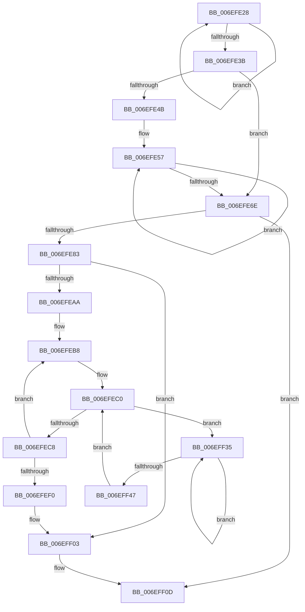

# sub_006EFE28

- RVA: `0x006EFE28`–`0x006EFF4C` (길이 `292` bytes)
- VA: `0x00000001406EFE28`
- 실행 섹션: `.text`
- PDB 이름 있음: `아니요`; PDB Function 태그: `아니요`
- unwind 정보 RVA: `0x000A5948`
- 디코드: `69`개 명령, `292/292` bytes 표시
- 미해석 바이트: `0` (있으면 어셈블리에 `.byte`로 보존)

> 이 문서는 커널 이미지의 기계어와 PDB 기호를 분석해 생성했습니다. 4번과 5번은 함수 원형과 자료형을 바이너리 사용 방식에서 추정한 C 해석이며 원본 소스 복구 결과는 아닙니다.

## 1. Dependencies

- 직접 호출 지점: **3**; 고유 호출 대상: **3**
- 직접 호출자로 확인된 함수: **0**
- RIP 상대 이미지 참조: **0**

### Outgoing calls
- `0x006EFED0` → [MiSetPfnModified](../36/MiSetPfnModified_function_00362960.md) (function, `0x00362960`)
- `0x006EFF11` → [MiGetLeafVa](../27/MiGetLeafVa_function_0027C0A0.md) (function, `0x0027C0A0`)
- `0x006EFF3A` → [KeYieldProcessorEx](../3F/KeYieldProcessorEx_function_003FBD00.md) (function, `0x003FBD00`)

### Direct callers
- 이 함수 시작 RVA로 연결되는 직접 call은 확인되지 않았습니다. 간접 호출은 완전히 역산할 수 없습니다.

### Static image references
- 디코드된 RIP-relative 메모리 참조가 없습니다.

## 2. Other-region calls and transfers

- 다른 실행 섹션으로 향하는 call: **0**
- call이 아닌 외부 분기/꼬리 이동: **1**
  - `0x006EFF30` → [sub_0044565B + 0x1A2](../44/Unknown_function_0044565B.md) (`tail-transfer`)

## 3. Assembly (complete function range)

```asm
006EFE28  49 C1 E8 09                     shr r8, 9
006EFE2C  4D 23 C6                        and r8, r14
006EFE2F  48 8B C3                        mov rax, rbx
006EFE32  4C 03 C0                        add r8, rax
006EFE35  48 83 EA 01                     sub rdx, 1
006EFE39  75 ED                           jne 0x1406efe28
006EFE3B  4C 89 44 24 40                  mov qword ptr [rsp + 0x40], r8
006EFE40  41 BE 00 00 20 00               mov r14d, 0x200000
006EFE46  83 F9 01                        cmp ecx, 1
006EFE49  76 23                           jbe 0x1406efe6e
006EFE4B  FF C9                           dec ecx
006EFE4D  48 BA F8 FF FF FF 7F 00 00 00   movabs rdx, 0x7ffffffff8
006EFE57  48 C1 EE 09                     shr rsi, 9
006EFE5B  48 23 F2                        and rsi, rdx
006EFE5E  48 8B C3                        mov rax, rbx
006EFE61  48 03 F0                        add rsi, rax
006EFE64  49 C1 E6 09                     shl r14, 9
006EFE68  48 83 E9 01                     sub rcx, 1
006EFE6C  75 E9                           jne 0x1406efe57
006EFE6E  48 8B 06                        mov rax, qword ptr [rsi]
006EFE71  A8 42                           test al, 0x42
006EFE73  0F 95 C2                        setne dl
006EFE76  A8 01                           test al, 1
006EFE78  0F 95 C1                        setne cl
006EFE7B  84 D1                           test cl, dl
006EFE7D  0F 84 8A 00 00 00               je 0x1406eff0d
006EFE83  48 C1 E8 0C                     shr rax, 0xc
006EFE87  48 B9 FF FF FF FF FF 00 00 00   movabs rcx, 0xffffffffff
006EFE91  48 23 C1                        and rax, rcx
006EFE94  48 8D 3C 40                     lea rdi, [rax + rax*2]
006EFE98  48 C1 E7 04                     shl rdi, 4
006EFE9C  49 8B C7                        mov rax, r15
006EFE9F  48 03 F8                        add rdi, rax
006EFEA2  45 33 FF                        xor r15d, r15d
006EFEA5  4D 85 F6                        test r14, r14
006EFEA8  74 59                           je 0x1406eff03
006EFEAA  48 8D 5F 18                     lea rbx, [rdi + 0x18]
006EFEAE  49 BC FF FF FF FF FF FF FF 7F   movabs r12, 0x7fffffffffffffff
006EFEB8  C7 44 24 34 00 00 00 00         mov dword ptr [rsp + 0x34], 0
006EFEC0  F0 48 0F BA 2B 3F               lock bts qword ptr [rbx], 0x3f
006EFEC6  72 6D                           jb 0x1406eff35
006EFEC8  BA 01 00 00 00                  mov edx, 1
006EFECD  48 8B CF                        mov rcx, rdi
006EFED0  E8 8B 2A C7 FF                  call 0x140362960
006EFED5  F0 4C 21 23                     lock and qword ptr [rbx], r12
006EFED9  41 81 C7 00 10 00 00            add r15d, 0x1000
006EFEE0  48 83 C7 30                     add rdi, 0x30
006EFEE4  41 8B C7                        mov eax, r15d
006EFEE7  48 83 C3 30                     add rbx, 0x30
006EFEEB  49 3B C6                        cmp rax, r14
006EFEEE  72 C8                           jb 0x1406efeb8
006EFEF0  44 0F B6 A4 24 98 00 00 00      movzx r12d, byte ptr [rsp + 0x98]
006EFEF9  48 BB 00 00 00 00 80 F6 FF FF   movabs rbx, 0xfffff68000000000
006EFF03  49 BF 00 00 00 00 00 DE FF FF   movabs r15, 0xffffde0000000000
006EFF0D  48 8D 4E 08                     lea rcx, [rsi + 8]
006EFF11  E8 8A C1 B8 FF                  call 0x14027c0a0
006EFF16  48 8B F8                        mov rdi, rax
006EFF19  49 BE F8 FF FF FF 7F 00 00 00   movabs r14, 0x7ffffffff8
006EFF23  48 C1 EF 09                     shr rdi, 9
006EFF27  49 23 FE                        and rdi, r14
006EFF2A  48 8B C3                        mov rax, rbx
006EFF2D  48 03 F8                        add rdi, rax
006EFF30  E9 C8 58 D5 FF                  jmp 0x1404457fd
006EFF35  48 8D 4C 24 34                  lea rcx, [rsp + 0x34]
006EFF3A  E8 C1 BD D0 FF                  call 0x1403fbd00
006EFF3F  48 8B 03                        mov rax, qword ptr [rbx]
006EFF42  48 85 C0                        test rax, rax
006EFF45  78 EE                           js 0x1406eff35
006EFF47  E9 74 FF FF FF                  jmp 0x1406efec0
```

## 4. C-style interpretation (structured pseudocode)

```c
__int64 __fastcall sub_006EFE28(int a1, __int64 a2, __int64 a3, __int64 a4, __int64 a5, __int64 a6, __int64 a7, __int64 a8, __int64 a9, __int64 a10, __int64 a11, __int64 a12, __int64 a13, __int64 a14, __int64 a15, __int64 a16, __int64 a17, __int64 a18, unsigned __int8 a19)
{
    __int64 result;
    __int64 v_r14;
    __int64 v_r15;
    __int64 v_rbx;
    __int64 v_rdi;
    __int64 v_rsi;
    unsigned int v_stack_p34;
    unsigned __int64 v_stack_p40;

    a3 = (a3) >> (9);
    a3 = (a3) & (v_r14);
    a3 = (a3) + (v_rbx);
    a2 = (a2) - (1);
    if (condition_is_not_equal) goto loc_006EFE28;
    v_stack_p40 = a3;
    if (a1 <= 1) goto loc_006EFE6E;
    a1 = (unsigned int)((a1) - 1);
loc_006EFE57:
    v_rsi = (v_rsi) >> (9);
    v_rsi = (v_rsi) & (a2);
    v_rsi = (v_rsi) + (v_rbx);
    v_r14 = ((unsigned int)(0x200000ULL)) << (9);
    a1 = (a1) - (1);
    if (condition_is_not_equal) goto loc_006EFE57;
loc_006EFE6E:
    a2 = ((((unsigned __int8)(*(unsigned __int64 *)(v_rsi))) & (66)) != 0) ? 1 : 0;
    a1 = ((((unsigned __int8)(*(unsigned __int64 *)(v_rsi))) & (1)) != 0) ? 1 : 0;
    if ((((unsigned __int8)(a1)) & ((unsigned __int8)(a2))) == 0) goto loc_006EFF0D;
    result = (*(unsigned __int64 *)(v_rsi)) >> (12);
    result = (result) & (a1);
    v_rdi = (result + result * 2) << (4);
    v_rdi = (v_rdi) + (v_r15);
    v_r15 = 0;
    if (v_r14 == 0) goto loc_006EFF03;
loc_006EFEB8:
    v_stack_p34 = 0;
loc_006EFEC0:
    if (condition_is_below) goto loc_006EFF35;
    result = MiSetPfnModified(v_rdi, 1, a3, a4);
    v_r15 = (unsigned int)((v_r15) + (0x1000ULL));
    v_rdi = (v_rdi) + (48);
    v_rbx = (v_rdi + 24) + (48);
    if (((unsigned int)((unsigned int)(v_r15))) < v_r14) goto loc_006EFEB8;
loc_006EFF03:
loc_006EFF0D:
    result = MiGetLeafVa(v_rsi + 8, 1, a3, a4);
    v_rdi = (result) >> (9);
    v_rdi = (v_rdi) & (v_r14);
    v_rdi = (v_rdi) + (v_rbx);
loc_006EFF35:
    result = KeYieldProcessorEx(v_stack_p34, 1, a3, a4);
    if (sign_flag) goto loc_006EFF35;
    goto loc_006EFEC0;
}
```

## 5. (Beta) C Style

```c
int64_t sub_006EFE28(int32_t Arg1, int64_t Arg2, int64_t Arg3, int64_t Arg4, uint64_t Arg5, uint64_t Arg6, uint64_t Arg7, uint64_t Arg8, uint64_t Arg9, uint64_t Arg10, uint64_t Arg11, uint64_t Arg12, uint64_t Arg13, uint64_t Arg14, uint64_t Arg15, uint64_t Arg16, uint64_t Arg17, uint64_t Arg18, uint8_t Arg19)
{
    int64_t result;
    int64_t local_r14;
    int64_t local_r15;
    int64_t local_rbx;
    int64_t local_rdi;
    int64_t local_rsi;
    uint32_t v_stack_p34;
    uint64_t v_stack_p40;

    Arg3 = (Arg3) >> (9);
    Arg3 = (Arg3) & (local_r14);
    Arg3 = (Arg3) + (local_rbx);
    Arg2 = (Arg2) - (1);
    if (condition_is_not_equal) goto loc_006EFE28;
    v_stack_p40 = Arg3;
    if (Arg1 <= 1) goto loc_006EFE6E;
    Arg1 = (uint32_t)((Arg1) - 1);
loc_006EFE57:
    local_rsi = (local_rsi) >> (9);
    local_rsi = (local_rsi) & (Arg2);
    local_rsi = (local_rsi) + (local_rbx);
    local_r14 = ((uint32_t)(0x200000ULL)) << (9);
    Arg1 = (Arg1) - (1);
    if (condition_is_not_equal) goto loc_006EFE57;
loc_006EFE6E:
    Arg2 = ((((uint8_t)(*(uint64_t *)(local_rsi))) & (66)) != 0) ? 1 : 0;
    Arg1 = ((((uint8_t)(*(uint64_t *)(local_rsi))) & (1)) != 0) ? 1 : 0;
    if ((((uint8_t)(Arg1)) & ((uint8_t)(Arg2))) == 0) goto loc_006EFF0D;
    result = (*(uint64_t *)(local_rsi)) >> (12);
    result = (result) & (Arg1);
    local_rdi = (result + result * 2) << (4);
    local_rdi = (local_rdi) + (local_r15);
    local_r15 = 0;
    if (local_r14 == 0) goto loc_006EFF03;
loc_006EFEB8:
    v_stack_p34 = 0;
loc_006EFEC0:
    if (condition_is_below) goto loc_006EFF35;
    result = MiSetPfnModified(local_rdi, 1, Arg3, Arg4);
    local_r15 = (uint32_t)((local_r15) + (0x1000ULL));
    local_rdi = (local_rdi) + (48);
    local_rbx = (local_rdi + 24) + (48);
    if (((uint32_t)((uint32_t)(local_r15))) < local_r14) goto loc_006EFEB8;
loc_006EFF03:
loc_006EFF0D:
    result = MiGetLeafVa(local_rsi + 8, 1, Arg3, Arg4);
    local_rdi = (result) >> (9);
    local_rdi = (local_rdi) & (local_r14);
    local_rdi = (local_rdi) + (local_rbx);
loc_006EFF35:
    result = KeYieldProcessorEx(v_stack_p34, 1, Arg3, Arg4);
    if (sign_flag) goto loc_006EFF35;
    goto loc_006EFEC0;
}
```

## 6. Execution-region graph

[열기: 2D/3D 그래프와 함수 탐색 컨트롤 패널](../../../control-panel.html?section=text&rva=0x006EFE28&view=graph)

- 2D 그래프는 위에서 아래로 흐르고, 3D 그래프는 빈 공간을 드래그해 회전합니다. Shift+드래그는 이동, 휠은 확대·축소, 함수 노드 선택은 대상 보고서 이동입니다.

### Static fallback


