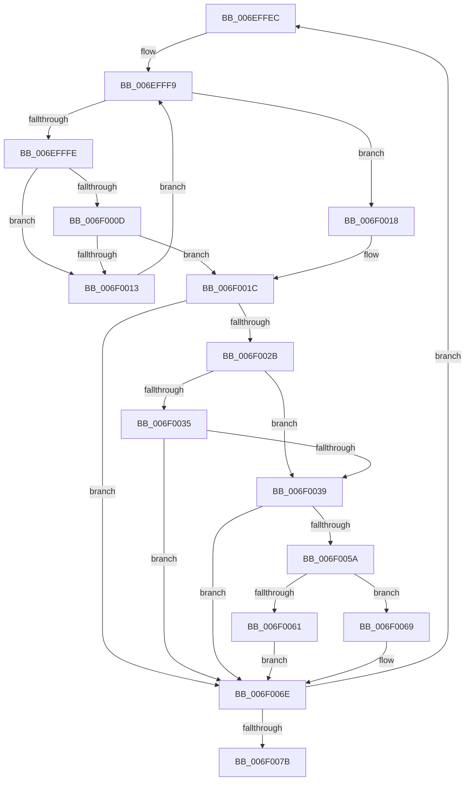

# sub_006EFFEC

- RVA: `0x006EFFEC`–`0x006F0080` (길이 `148` bytes)
- VA: `0x00000001406EFFEC`
- 실행 섹션: `.text`
- PDB 이름 있음: `아니요`; PDB Function 태그: `아니요`
- unwind 정보 RVA: `0x000A59D4`
- 디코드: `43`개 명령, `148/148` bytes 표시
- 미해석 바이트: `0` (있으면 어셈블리에 `.byte`로 보존)

> 이 문서는 커널 이미지의 기계어와 PDB 기호를 분석해 생성했습니다. 4번과 5번은 함수 원형과 자료형을 바이너리 사용 방식에서 추정한 C 해석이며 원본 소스 복구 결과는 아닙니다.

## 1. Dependencies

- 직접 호출 지점: **1**; 고유 호출 대상: **1**
- 직접 호출자로 확인된 함수: **0**
- RIP 상대 이미지 참조: **1**

### Outgoing calls
- `0x006F0051` → [guard_dispatch_icall](../6B/guard_dispatch_icall_function_006BAAD0.md) (function, `0x006BAAD0`)

### Direct callers
- 이 함수 시작 RVA로 연결되는 직접 call은 확인되지 않았습니다. 간접 호출은 완전히 역산할 수 없습니다.

### Static image references
- `0x006F0039` → RVA `0x00E03B20` (`.data`; read)

## 2. Other-region calls and transfers

- 다른 실행 섹션으로 향하는 call: **0**
- call이 아닌 외부 분기/꼬리 이동: **1**
  - `0x006F007B` → [HalpScanForProfilingCorruptionInternal + 0x88](../44/HalpScanForProfilingCorruptionInternal_function_00445A64.md) (`tail-transfer`)

## 3. Assembly (complete function range)

```asm
006EFFEC  4C 8B 57 10                     mov r10, qword ptr [rdi + 0x10]
006EFFF0  33 D2                           xor edx, edx
006EFFF2  44 8B 47 08                     mov r8d, dword ptr [rdi + 8]
006EFFF6  45 33 C9                        xor r9d, r9d
006EFFF9  45 3B C8                        cmp r9d, r8d
006EFFFC  77 1A                           ja 0x1406f0018
006EFFFE  4B 8D 0C 49                     lea rcx, [r9 + r9*2]
006F0002  48 03 C9                        add rcx, rcx
006F0005  41 83 7C CA 1C 03               cmp dword ptr [r10 + rcx*8 + 0x1c], 3
006F000B  74 06                           je 0x1406f0013
006F000D  FF C2                           inc edx
006F000F  3B D5                           cmp edx, ebp
006F0011  77 09                           ja 0x1406f001c
006F0013  41 FF C1                        inc r9d
006F0016  EB E1                           jmp 0x1406efff9
006F0018  41 83 C9 FF                     or r9d, 0xffffffff
006F001C  4B 8D 34 49                     lea rsi, [r9 + r9*2]
006F0020  48 03 F6                        add rsi, rsi
006F0023  41 80 7C F6 28 00               cmp byte ptr [r14 + rsi*8 + 0x28], 0
006F0029  75 43                           jne 0x1406f006e
006F002B  41 8B 44 F6 18                  mov eax, dword ptr [r14 + rsi*8 + 0x18]
006F0030  83 F8 01                        cmp eax, 1
006F0033  74 04                           je 0x1406f0039
006F0035  85 C0                           test eax, eax
006F0037  75 35                           jne 0x1406f006e
006F0039  48 8B 05 E0 3A 71 00            mov rax, qword ptr [rip + 0x713ae0]
006F0040  4C 8D 44 24 40                  lea r8, [rsp + 0x40]
006F0045  8B 17                           mov edx, dword ptr [rdi]
006F0047  41 8B C9                        mov ecx, r9d
006F004A  48 8B 80 90 00 00 00            mov rax, qword ptr [rax + 0x90]
006F0051  E8 7A AA FC FF                  call 0x1406baad0
006F0056  85 C0                           test eax, eax
006F0058  78 14                           js 0x1406f006e
006F005A  80 7C 24 40 00                  cmp byte ptr [rsp + 0x40], 0
006F005F  74 08                           je 0x1406f0069
006F0061  41 C6 44 F6 28 01               mov byte ptr [r14 + rsi*8 + 0x28], 1
006F0067  EB 05                           jmp 0x1406f006e
006F0069  49 89 5C F6 08                  mov qword ptr [r14 + rsi*8 + 8], rbx
006F006E  8B 47 04                        mov eax, dword ptr [rdi + 4]
006F0071  FF C5                           inc ebp
006F0073  3B E8                           cmp ebp, eax
006F0075  0F 82 71 FF FF FF               jb 0x1406effec
006F007B  E9 6C 5A D5 FF                  jmp 0x140445aec
```

## 4. C-style interpretation (structured pseudocode)

```c
__int64 __fastcall sub_006EFFEC(__int64 a1, int a2, __int64 a3, int a4, __int64 a5, __int64 a6, __int64 a7, unsigned __int8 a8)
{
    __int64 result;
    __int64 v_rbp;
    __int64 v_rsi;

    a2 = 0;
    a4 = 0;
loc_006EFFF9:
    if (0 > ((unsigned int)((unsigned int)(*(unsigned int *)(v_rdi + 8))))) goto loc_006F0018;
    a1 = (a4 + a4 * 2) + (a4 + a4 * 2);
    if ((*(unsigned int *)(*(unsigned __int64 *)(v_rdi + 16) + a1 * 8 + 28)) == 3) goto loc_006F0013;
    a2 = (unsigned int)((a2) + 1);
    if (a2 > ((unsigned int)(v_rbp))) goto loc_006F001C;
loc_006F0013:
    a4 = (unsigned int)((a4) + 1);
    goto loc_006EFFF9;
loc_006F0018:
    a4 = (unsigned int)((a4) | (0xFFFFFFFFULL));
loc_006F001C:
    v_rsi = (a4 + a4 * 2) + (a4 + a4 * 2);
    if ((*(unsigned __int8 *)(v_r14 + v_rsi * 8 + 40)) != 0) goto loc_006F006E;
    if (((unsigned int)((unsigned int)(*(unsigned int *)(v_r14 + v_rsi * 8 + 24)))) == 1) goto loc_006F0039;
    if ((unsigned int)((unsigned int)(*(unsigned int *)(v_r14 + v_rsi * 8 + 24))) != 0) goto loc_006F006E;
loc_006F0039:
    result = guard_dispatch_icall((unsigned int)(a4), (unsigned int)(*(unsigned int *)(v_rdi)), a8, a4);
    if (sign_flag) goto loc_006F006E;
    if (a8 == 0) goto loc_006F0069;
    *(unsigned __int8 *)(v_r14 + v_rsi * 8 + 40) = 1;
    goto loc_006F006E;
loc_006F0069:
    *(unsigned __int64 *)(v_r14 + v_rsi * 8 + 8) = v_rbx;
loc_006F006E:
    v_rbp = (unsigned int)((v_rbp) + 1);
    if (((unsigned int)(v_rbp)) < ((unsigned int)((unsigned int)(*(unsigned int *)(v_rdi + 4))))) goto loc_006EFFEC;
}
```

## 5. (Beta) C Style

```c
int64_t sub_006EFFEC(int64_t Arg1, int32_t Arg2, int64_t Arg3, int32_t Arg4, uint64_t Arg5, uint64_t Arg6, uint64_t Arg7, uint8_t Arg8)
{
    int64_t result;
    int64_t local_rbp;
    int64_t local_rsi;

    Arg2 = 0;
    Arg4 = 0;
loc_006EFFF9:
    if (0 > ((uint32_t)((uint32_t)(*(uint32_t *)(local_rdi + 0x8))))) goto loc_006F0018;
    Arg1 = (Arg4 + Arg4 * 2) + (Arg4 + Arg4 * 2);
    if ((*(uint32_t *)(*(uint64_t *)(local_rdi + 0x10) + Arg1 * 8 + 0x1C)) == 3) goto loc_006F0013;
    Arg2 = (uint32_t)((Arg2) + 1);
    if (Arg2 > ((uint32_t)(local_rbp))) goto loc_006F001C;
loc_006F0013:
    Arg4 = (uint32_t)((Arg4) + 1);
    goto loc_006EFFF9;
loc_006F0018:
    Arg4 = (uint32_t)((Arg4) | (0xFFFFFFFFULL));
loc_006F001C:
    local_rsi = (Arg4 + Arg4 * 2) + (Arg4 + Arg4 * 2);
    if ((*(uint8_t *)(local_r14 + local_rsi * 8 + 0x28)) != 0) goto loc_006F006E;
    if (((uint32_t)((uint32_t)(*(uint32_t *)(local_r14 + local_rsi * 8 + 0x18)))) == 1) goto loc_006F0039;
    if ((uint32_t)((uint32_t)(*(uint32_t *)(local_r14 + local_rsi * 8 + 0x18))) != 0) goto loc_006F006E;
loc_006F0039:
    result = guard_dispatch_icall((uint32_t)(Arg4), (uint32_t)(*(uint32_t *)(local_rdi)), Arg8, Arg4);
    if (sign_flag) goto loc_006F006E;
    if (Arg8 == 0) goto loc_006F0069;
    *(uint8_t *)(local_r14 + local_rsi * 8 + 0x28) = 1;
    goto loc_006F006E;
loc_006F0069:
    *(uint64_t *)(local_r14 + local_rsi * 8 + 0x8) = local_rbx;
loc_006F006E:
    local_rbp = (uint32_t)((local_rbp) + 1);
    if (((uint32_t)(local_rbp)) < ((uint32_t)((uint32_t)(*(uint32_t *)(local_rdi + 0x4))))) goto loc_006EFFEC;
}
```

## 6. Execution-region graph

[열기: 2D/3D 그래프와 함수 탐색 컨트롤 패널](../../../control-panel.html?section=text&rva=0x006EFFEC&view=graph)

- 2D 그래프는 위에서 아래로 흐르고, 3D 그래프는 빈 공간을 드래그해 회전합니다. Shift+드래그는 이동, 휠은 확대·축소, 함수 노드 선택은 대상 보고서 이동입니다.

### Static fallback


