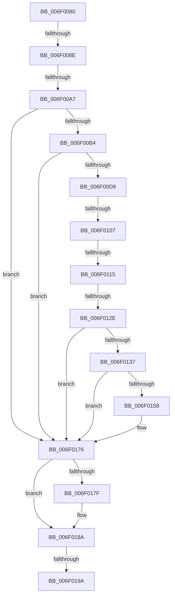

# sub_006F0080

- RVA: `0x006F0080`–`0x006F01A8` (길이 `296` bytes)
- VA: `0x00000001406F0080`
- 실행 섹션: `.text`
- PDB 이름 있음: `아니요`; PDB Function 태그: `아니요`
- unwind 정보 RVA: `0x000A59F4`
- 디코드: `72`개 명령, `296/296` bytes 표시
- 미해석 바이트: `0` (있으면 어셈블리에 `.byte`로 보존)

> 이 문서는 커널 이미지의 기계어와 PDB 기호를 분석해 생성했습니다. 4번과 5번은 함수 원형과 자료형을 바이너리 사용 방식에서 추정한 C 해석이며 원본 소스 복구 결과는 아닙니다.

## 1. Dependencies

- 직접 호출 지점: **4**; 고유 호출 대상: **2**
- 직접 호출자로 확인된 함수: **0**
- RIP 상대 이미지 참조: **4**

### Outgoing calls
- `0x006F00F1` → [KeBugCheckEx](../4F/KeBugCheckEx_function_004FD660.md) (function, `0x004FD660`)
- `0x006F0170` → [KeBugCheckEx](../4F/KeBugCheckEx_function_004FD660.md) (function, `0x004FD660`)
- `0x006F0182` → [guard_dispatch_icall](../6B/guard_dispatch_icall_function_006BAAD0.md) (function, `0x006BAAD0`)
- `0x006F019D` → [guard_dispatch_icall](../6B/guard_dispatch_icall_function_006BAAD0.md) (function, `0x006BAAD0`)

### Direct callers
- 이 함수 시작 RVA로 연결되는 직접 call은 확인되지 않았습니다. 간접 호출은 완전히 역산할 수 없습니다.

### Static image references
- `0x006F0080` → RVA `0x00FC2C38` (`.data`; read)
- `0x006F00A7` → RVA `0x00F475DC` (`.data`; read)
- `0x006F00F7` → RVA `0x00007850` (`.rdata`; read)
- `0x006F018A` → RVA `0x00E10308` (`.data`; read)

## 2. Other-region calls and transfers

- 다른 실행 섹션으로 향하는 call: **0**
- call이 아닌 외부 분기/꼬리 이동: **7**
  - `0x006F0088` → [HalpPerfInterrupt + 0x38](../44/HalpPerfInterrupt_function_00445B70.md) (`tail-transfer`)
  - `0x006F00A1` → [HalpPerfInterrupt + 0x38](../44/HalpPerfInterrupt_function_00445B70.md) (`tail-transfer`)
  - `0x006F0101` → [HalpPerfInterrupt + 0x38](../44/HalpPerfInterrupt_function_00445B70.md) (`tail-transfer`)
  - `0x006F010F` → [HalpPerfInterrupt + 0x38](../44/HalpPerfInterrupt_function_00445B70.md) (`tail-transfer`)
  - `0x006F0128` → [HalpPerfInterrupt + 0x38](../44/HalpPerfInterrupt_function_00445B70.md) (`tail-transfer`)
  - `0x006F0194` → [HalpPerfInterrupt + 0x38](../44/HalpPerfInterrupt_function_00445B70.md) (`tail-transfer`)
  - `0x006F01A3` → [HalpPerfInterrupt + 0x38](../44/HalpPerfInterrupt_function_00445B70.md) (`tail-transfer`)

## 3. Assembly (complete function range)

```asm
006F0080  8B 05 B2 2B 8D 00               mov eax, dword ptr [rip + 0x8d2bb2]
006F0086  A8 01                           test al, 1
006F0088  0F 84 1A 5B D5 FF               je 0x140445ba8
006F008E  B9 8E 03 00 00                  mov ecx, 0x38e
006F0093  0F 32                           rdmsr
006F0095  48 C1 E2 20                     shl rdx, 0x20
006F0099  48 0B C2                        or rax, rdx
006F009C  48 0F BA E0 37                  bt rax, 0x37
006F00A1  0F 83 01 5B D5 FF               jae 0x140445ba8
006F00A7  40 38 3D 2E 75 85 00            cmp byte ptr [rip + 0x85752e], dil
006F00AE  0F 84 C2 00 00 00               je 0x1406f0176
006F00B4  41 B8 70 05 00 00               mov r8d, 0x570
006F00BA  41 8B C8                        mov ecx, r8d
006F00BD  0F 32                           rdmsr
006F00BF  48 C1 E2 20                     shl rdx, 0x20
006F00C3  49 BA 00 00 00 00 11 11 00 00   movabs r10, 0x111100000000
006F00CD  48 0B C2                        or rax, rdx
006F00D0  49 85 C2                        test r10, rax
006F00D3  0F 84 9D 00 00 00               je 0x1406f0176
006F00D9  0F 32                           rdmsr
006F00DB  48 C1 E2 20                     shl rdx, 0x20
006F00DF  B9 7B 01 00 00                  mov ecx, 0x17b
006F00E4  48 0B C2                        or rax, rdx
006F00E7  4C 89 54 24 20                  mov qword ptr [rsp + 0x20], r10
006F00EC  4C 8B C8                        mov r9, rax
006F00EF  33 D2                           xor edx, edx
006F00F1  E8 6A D5 E0 FF                  call 0x1404fd660
006F00F6  CC                              int3
006F00F7  48 8D 05 52 77 91 FF            lea rax, [rip - 0x6e88ae]
006F00FE  4C 3B C8                        cmp r9, rax
006F0101  0F 85 A1 5A D5 FF               jne 0x140445ba8
006F0107  8B 05 2B 2B 8D 00               mov eax, dword ptr [rip + 0x8d2b2b]
006F010D  A8 01                           test al, 1
006F010F  0F 84 93 5A D5 FF               je 0x140445ba8
006F0115  B9 8E 03 00 00                  mov ecx, 0x38e
006F011A  0F 32                           rdmsr
006F011C  48 C1 E2 20                     shl rdx, 0x20
006F0120  48 0B C2                        or rax, rdx
006F0123  48 0F BA E0 37                  bt rax, 0x37
006F0128  0F 83 7A 5A D5 FF               jae 0x140445ba8
006F012E  40 38 3D A7 74 85 00            cmp byte ptr [rip + 0x8574a7], dil
006F0135  74 3F                           je 0x1406f0176
006F0137  41 B8 70 05 00 00               mov r8d, 0x570
006F013D  41 8B C8                        mov ecx, r8d
006F0140  0F 32                           rdmsr
006F0142  48 C1 E2 20                     shl rdx, 0x20
006F0146  49 BA 00 00 00 00 11 11 00 00   movabs r10, 0x111100000000
006F0150  48 0B C2                        or rax, rdx
006F0153  49 85 C2                        test r10, rax
006F0156  74 1E                           je 0x1406f0176
006F0158  0F 32                           rdmsr
006F015A  48 C1 E2 20                     shl rdx, 0x20
006F015E  B9 7B 01 00 00                  mov ecx, 0x17b
006F0163  48 0B C2                        or rax, rdx
006F0166  4C 89 54 24 20                  mov qword ptr [rsp + 0x20], r10
006F016B  4C 8B C8                        mov r9, rax
006F016E  33 D2                           xor edx, edx
006F0170  E8 EB D4 E0 FF                  call 0x1404fd660
006F0175  CC                              int3
006F0176  49 8B 41 68                     mov rax, qword ptr [r9 + 0x68]
006F017A  48 85 C0                        test rax, rax
006F017D  74 0B                           je 0x1406f018a
006F017F  48 8B CB                        mov rcx, rbx
006F0182  E8 49 A9 FC FF                  call 0x1406baad0
006F0187  40 B7 01                        mov dil, 1
006F018A  48 8B 05 77 01 72 00            mov rax, qword ptr [rip + 0x720177]
006F0191  48 85 C0                        test rax, rax
006F0194  0F 84 0E 5A D5 FF               je 0x140445ba8
006F019A  48 8B CB                        mov rcx, rbx
006F019D  E8 2E A9 FC FF                  call 0x1406baad0
006F01A2  90                              nop
006F01A3  E9 00 5A D5 FF                  jmp 0x140445ba8
```

## 4. C-style interpretation (structured pseudocode)

```c
__int64 __fastcall sub_006F0080(__int64 a1, __int64 a2)
{
    __int64 result;
    __int64 v_rdi;
    unsigned __int64 v_stack_p20;

    a2 = (a2) << (32);
    result = ((unsigned int)(*(unsigned int *)(v_rip + 9251762))) | (a2);
    if ((*(unsigned __int8 *)(v_rip + 8746286)) == ((unsigned __int8)(v_rdi))) goto loc_006F0176;
    a2 = (a2) << (32);
    result = (result) | (a2);
    if (((v_r10) & (result)) == 0) goto loc_006F0176;
    a2 = (a2) << (32);
    result = (result) | (a2);
    v_stack_p20 = v_r10;
    a2 = 0;
    result = KeBugCheckEx(379, a2, (unsigned int)(0x570ULL), result);
    a2 = (a2) << (32);
    result = ((unsigned int)(*(unsigned int *)(v_rip + 9251627))) | (a2);
    if ((*(unsigned __int8 *)(v_rip + 8746151)) == ((unsigned __int8)(v_rdi))) goto loc_006F0176;
    a2 = (a2) << (32);
    result = (result) | (a2);
    if (((v_r10) & (result)) != 0) {
        a2 = (a2) << (32);
        a1 = 379;
        result = (result) | (a2);
        v_stack_p20 = v_r10;
        a4 = result;
        a2 = 0;
        result = KeBugCheckEx(a1, a2, (unsigned int)(0x570ULL), a4);
    }
    result = *(unsigned __int64 *)(a4 + 104);
    if (*(unsigned __int64 *)(a4 + 104) != 0) {
        a1 = v_rbx;
        result = guard_dispatch_icall(a1, a2, (unsigned int)(0x570ULL), a4);
        v_rdi = 1;
    }
    result = guard_dispatch_icall(v_rbx, a2, (unsigned int)(0x570ULL), a4);
}
```

## 5. (Beta) C Style

```c
int64_t sub_006F0080(int64_t Arg1, int64_t Arg2)
{
    int64_t result;
    int64_t local_rdi;
    uint64_t v_stack_p20;

    Arg2 = (Arg2) << (32);
    result = ((uint32_t)(*(uint32_t *)(v_rip + 0x8D2BB2))) | (Arg2);
    if ((*(uint8_t *)(v_rip + 0x85752E)) == ((uint8_t)(local_rdi))) goto loc_006F0176;
    Arg2 = (Arg2) << (32);
    result = (result) | (Arg2);
    if (((local_r10) & (result)) == 0) goto loc_006F0176;
    Arg2 = (Arg2) << (32);
    result = (result) | (Arg2);
    v_stack_p20 = local_r10;
    Arg2 = 0;
    result = KeBugCheckEx(379, Arg2, (uint32_t)(0x570ULL), result);
    Arg2 = (Arg2) << (32);
    result = ((uint32_t)(*(uint32_t *)(v_rip + 0x8D2B2B))) | (Arg2);
    if ((*(uint8_t *)(v_rip + 0x8574A7)) == ((uint8_t)(local_rdi))) goto loc_006F0176;
    Arg2 = (Arg2) << (32);
    result = (result) | (Arg2);
    if (((local_r10) & (result)) != 0) {
        Arg2 = (Arg2) << (32);
        Arg1 = 379;
        result = (result) | (Arg2);
        v_stack_p20 = local_r10;
        a4 = result;
        Arg2 = 0;
        result = KeBugCheckEx(Arg1, Arg2, (uint32_t)(0x570ULL), a4);
    }
    result = *(uint64_t *)(a4 + 0x68);
    if (*(uint64_t *)(a4 + 0x68) != 0) {
        Arg1 = local_rbx;
        result = guard_dispatch_icall(Arg1, Arg2, (uint32_t)(0x570ULL), a4);
        local_rdi = 1;
    }
    result = guard_dispatch_icall(local_rbx, Arg2, (uint32_t)(0x570ULL), a4);
}
```

## 6. Execution-region graph

[열기: 2D/3D 그래프와 함수 탐색 컨트롤 패널](../../../control-panel.html?section=text&rva=0x006F0080&view=graph)

- 2D 그래프는 위에서 아래로 흐르고, 3D 그래프는 빈 공간을 드래그해 회전합니다. Shift+드래그는 이동, 휠은 확대·축소, 함수 노드 선택은 대상 보고서 이동입니다.

### Static fallback


