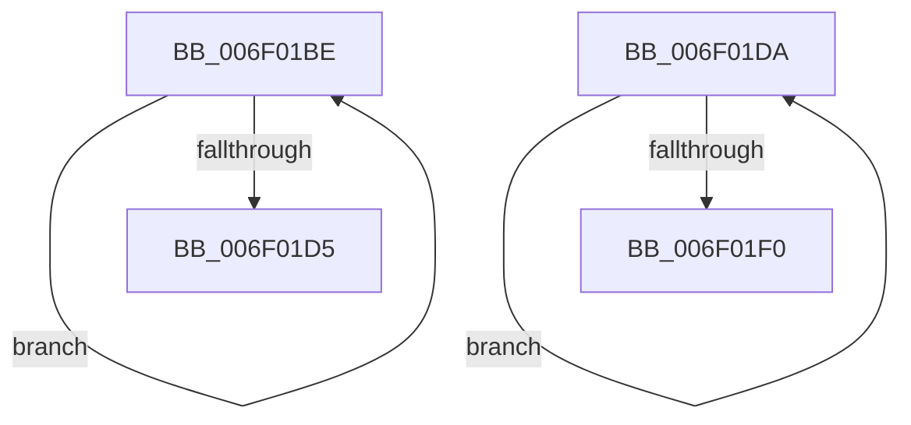

# sub_006F01BE

- RVA: `0x006F01BE`–`0x006F01F5` (길이 `55` bytes)
- VA: `0x00000001406F01BE`
- 실행 섹션: `.text`
- PDB 이름 있음: `아니요`; PDB Function 태그: `아니요`
- unwind 정보 RVA: `0x000A5E80`
- 디코드: `14`개 명령, `55/55` bytes 표시
- 미해석 바이트: `0` (있으면 어셈블리에 `.byte`로 보존)

> 이 문서는 커널 이미지의 기계어와 PDB 기호를 분석해 생성했습니다. 4번과 5번은 함수 원형과 자료형을 바이너리 사용 방식에서 추정한 C 해석이며 원본 소스 복구 결과는 아닙니다.

## 1. Dependencies

- 직접 호출 지점: **0**; 고유 호출 대상: **0**
- 직접 호출자로 확인된 함수: **0**
- RIP 상대 이미지 참조: **0**

### Outgoing calls
- 직접 디코드된 call 명령이 없습니다.

### Direct callers
- 이 함수 시작 RVA로 연결되는 직접 call은 확인되지 않았습니다. 간접 호출은 완전히 역산할 수 없습니다.

### Static image references
- 디코드된 RIP-relative 메모리 참조가 없습니다.

## 2. Other-region calls and transfers

- 다른 실행 섹션으로 향하는 call: **0**
- call이 아닌 외부 분기/꼬리 이동: **2**
  - `0x006F01D5` → [PpmInstallNewIdleStates + 0x9D](../44/PpmInstallNewIdleStates_function_00446E80.md) (`tail-transfer`)
  - `0x006F01F0` → [PpmInstallNewIdleStates + 0x32F](../44/PpmInstallNewIdleStates_function_00446E80.md) (`tail-transfer`)

## 3. Assembly (complete function range)

```asm
006F01BE  44 85 21                        test dword ptr [rcx], r12d
006F01C1  41 8D 46 01                     lea eax, [r14 + 1]
006F01C5  41 0F 45 C6                     cmovne eax, r14d
006F01C9  49 03 C8                        add rcx, r8
006F01CC  44 8B F0                        mov r14d, eax
006F01CF  48 83 EA 01                     sub rdx, 1
006F01D3  75 E9                           jne 0x1406f01be
006F01D5  E9 43 6D D5 FF                  jmp 0x140446f1d
006F01DA  48 89 08                        mov qword ptr [rax], rcx
006F01DD  48 81 C1 58 01 00 00            add rcx, 0x158
006F01E4  48 8D 80 F8 03 00 00            lea rax, [rax + 0x3f8]
006F01EB  49 2B D4                        sub rdx, r12
006F01EE  75 EA                           jne 0x1406f01da
006F01F0  E9 BA 6F D5 FF                  jmp 0x1404471af
```

## 4. C-style interpretation (structured pseudocode)

```c
__int64 __fastcall sub_006F01BE(__int64 a1, __int64 a2, __int64 a3)
{
    __int64 result;

    result = v_r14 + 1;
    if (((*(unsigned int *)(a1)) & ((unsigned int)(v_r12))) != 0) { result = (unsigned int)(v_r14); }
    a1 = (a1) + (a3);
    a2 = (a2) - (1);
    if (condition_is_not_equal) goto loc_006F01BE;
}
```

## 5. (Beta) C Style

```c
int64_t sub_006F01BE(void *Arg1, int64_t Arg2, int64_t Arg3)
{
    uint8_t *arg1 = (uint8_t *)Arg1;

    int64_t result;

    result = local_r14 + 1;
    if (((*(uint32_t *)(arg1)) & ((uint32_t)(local_r12))) != 0) { result = (uint32_t)(local_r14); }
    Arg1 = (Arg1) + (Arg3);
    Arg2 = (Arg2) - (1);
    if (condition_is_not_equal) goto loc_006F01BE;
}
```

### 관측된 메모리 오프셋

구조체 형식이 확인되지 않은 접근은 인자 기준의 오프셋으로만 기록했습니다.

| 기준 인자 | 오프셋 표현 | 폭 (bit) | 접근 |
|---|---:|---:|---|
| `Arg1` | `+ 0x0` | `32` | `R` |

## 6. Execution-region graph

[열기: 2D/3D 그래프와 함수 탐색 컨트롤 패널](../../../control-panel.html?section=text&rva=0x006F01BE&view=graph)

- 2D 그래프는 위에서 아래로 흐르고, 3D 그래프는 빈 공간을 드래그해 회전합니다. Shift+드래그는 이동, 휠은 확대·축소, 함수 노드 선택은 대상 보고서 이동입니다.

### Static fallback


