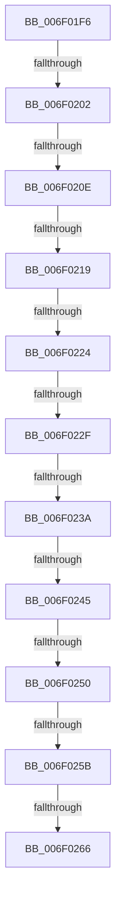

# sub_006F01F6

- RVA: `0x006F01F6`–`0x006F026B` (길이 `117` bytes)
- VA: `0x00000001406F01F6`
- 실행 섹션: `.text`
- PDB 이름 있음: `아니요`; PDB Function 태그: `아니요`
- unwind 정보 RVA: `0x000A5FC4`
- 디코드: `21`개 명령, `117/117` bytes 표시
- 미해석 바이트: `0` (있으면 어셈블리에 `.byte`로 보존)

> 이 문서는 커널 이미지의 기계어와 PDB 기호를 분석해 생성했습니다. 4번과 5번은 함수 원형과 자료형을 바이너리 사용 방식에서 추정한 C 해석이며 원본 소스 복구 결과는 아닙니다.

## 1. Dependencies

- 직접 호출 지점: **0**; 고유 호출 대상: **0**
- 직접 호출자로 확인된 함수: **0**
- RIP 상대 이미지 참조: **0**

### Outgoing calls
- 직접 디코드된 call 명령이 없습니다.

### Direct callers
- 이 함수 시작 RVA로 연결되는 직접 call은 확인되지 않았습니다. 간접 호출은 완전히 역산할 수 없습니다.

### Static image references
- 디코드된 RIP-relative 메모리 참조가 없습니다.

## 2. Other-region calls and transfers

- 다른 실행 섹션으로 향하는 call: **0**
- call이 아닌 외부 분기/꼬리 이동: **11**
  - `0x006F01FC` → [FsRtlValidateReparsePointBuffer + 0x9B](../44/FsRtlValidateReparsePointBuffer_function_00447D90.md) (`tail-transfer`)
  - `0x006F0208` → [FsRtlValidateReparsePointBuffer + 0x9B](../44/FsRtlValidateReparsePointBuffer_function_00447D90.md) (`tail-transfer`)
  - `0x006F0213` → [FsRtlValidateReparsePointBuffer + 0x9B](../44/FsRtlValidateReparsePointBuffer_function_00447D90.md) (`tail-transfer`)
  - `0x006F021E` → [FsRtlValidateReparsePointBuffer + 0x9B](../44/FsRtlValidateReparsePointBuffer_function_00447D90.md) (`tail-transfer`)
  - `0x006F0229` → [FsRtlValidateReparsePointBuffer + 0x9B](../44/FsRtlValidateReparsePointBuffer_function_00447D90.md) (`tail-transfer`)
  - `0x006F0234` → [FsRtlValidateReparsePointBuffer + 0x9B](../44/FsRtlValidateReparsePointBuffer_function_00447D90.md) (`tail-transfer`)
  - `0x006F023F` → [FsRtlValidateReparsePointBuffer + 0x9B](../44/FsRtlValidateReparsePointBuffer_function_00447D90.md) (`tail-transfer`)
  - `0x006F024A` → [FsRtlValidateReparsePointBuffer + 0x9B](../44/FsRtlValidateReparsePointBuffer_function_00447D90.md) (`tail-transfer`)
  - `0x006F0255` → [FsRtlValidateReparsePointBuffer + 0x9B](../44/FsRtlValidateReparsePointBuffer_function_00447D90.md) (`tail-transfer`)
  - `0x006F0260` → [FsRtlValidateReparsePointBuffer + 0x87](../44/FsRtlValidateReparsePointBuffer_function_00447D90.md) (`tail-transfer`)
  - `0x006F0266` → [FsRtlValidateReparsePointBuffer + 0x9B](../44/FsRtlValidateReparsePointBuffer_function_00447D90.md) (`tail-transfer`)

## 3. Assembly (complete function range)

```asm
006F01F6  66 41 83 79 0C 00               cmp word ptr [r9 + 0xc], 0
006F01FC  0F 85 29 7C D5 FF               jne 0x140447e2b
006F0202  66 41 83 79 0E 00               cmp word ptr [r9 + 0xe], 0
006F0208  0F 85 1D 7C D5 FF               jne 0x140447e2b
006F020E  41 80 79 10 00                  cmp byte ptr [r9 + 0x10], 0
006F0213  0F 85 12 7C D5 FF               jne 0x140447e2b
006F0219  41 80 79 11 00                  cmp byte ptr [r9 + 0x11], 0
006F021E  0F 85 07 7C D5 FF               jne 0x140447e2b
006F0224  41 80 79 12 00                  cmp byte ptr [r9 + 0x12], 0
006F0229  0F 85 FC 7B D5 FF               jne 0x140447e2b
006F022F  41 80 79 13 00                  cmp byte ptr [r9 + 0x13], 0
006F0234  0F 85 F1 7B D5 FF               jne 0x140447e2b
006F023A  41 80 79 14 00                  cmp byte ptr [r9 + 0x14], 0
006F023F  0F 85 E6 7B D5 FF               jne 0x140447e2b
006F0245  41 80 79 15 00                  cmp byte ptr [r9 + 0x15], 0
006F024A  0F 85 DB 7B D5 FF               jne 0x140447e2b
006F0250  41 80 79 16 00                  cmp byte ptr [r9 + 0x16], 0
006F0255  0F 85 D0 7B D5 FF               jne 0x140447e2b
006F025B  41 80 79 17 00                  cmp byte ptr [r9 + 0x17], 0
006F0260  0F 84 B1 7B D5 FF               je 0x140447e17
006F0266  E9 C0 7B D5 FF                  jmp 0x140447e2b
```

## 4. C-style interpretation (structured pseudocode)

```c
void __fastcall sub_006F01F6(__int64 a1, __int64 a2, __int64 a3, __int64 a4)
{
}
```

## 5. (Beta) C Style

```c
void sub_006F01F6(int64_t Arg1, int64_t Arg2, int64_t Arg3, void *Arg4)
{
    uint8_t *arg4 = (uint8_t *)Arg4;

}
```

### 관측된 메모리 오프셋

구조체 형식이 확인되지 않은 접근은 인자 기준의 오프셋으로만 기록했습니다.

| 기준 인자 | 오프셋 표현 | 폭 (bit) | 접근 |
|---|---:|---:|---|
| `Arg4` | `+ 0xC` | `16` | `R` |
| `Arg4` | `+ 0xE` | `16` | `R` |
| `Arg4` | `+ 0x10` | `8` | `R` |
| `Arg4` | `+ 0x11` | `8` | `R` |
| `Arg4` | `+ 0x12` | `8` | `R` |
| `Arg4` | `+ 0x13` | `8` | `R` |
| `Arg4` | `+ 0x14` | `8` | `R` |
| `Arg4` | `+ 0x15` | `8` | `R` |
| `Arg4` | `+ 0x16` | `8` | `R` |
| `Arg4` | `+ 0x17` | `8` | `R` |

## 6. Execution-region graph

[열기: 2D/3D 그래프와 함수 탐색 컨트롤 패널](../../../control-panel.html?section=text&rva=0x006F01F6&view=graph)

- 2D 그래프는 위에서 아래로 흐르고, 3D 그래프는 빈 공간을 드래그해 회전합니다. Shift+드래그는 이동, 휠은 확대·축소, 함수 노드 선택은 대상 보고서 이동입니다.

### Static fallback


