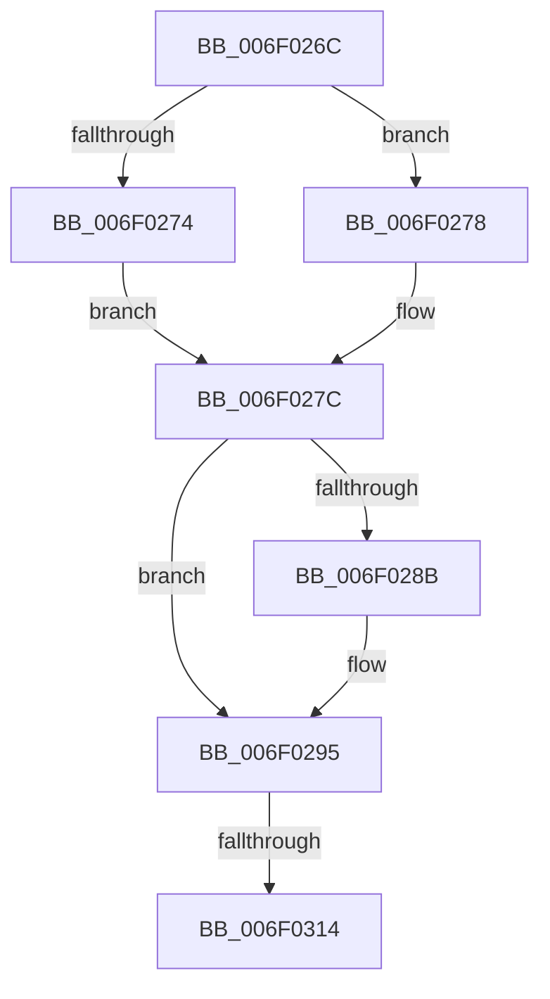

# sub_006F026C

- RVA: `0x006F026C`–`0x006F0328` (길이 `188` bytes)
- VA: `0x00000001406F026C`
- 실행 섹션: `.text`
- PDB 이름 있음: `아니요`; PDB Function 태그: `아니요`
- unwind 정보 RVA: `0x000A60E8`
- 디코드: `49`개 명령, `188/188` bytes 표시
- 미해석 바이트: `0` (있으면 어셈블리에 `.byte`로 보존)

> 이 문서는 커널 이미지의 기계어와 PDB 기호를 분석해 생성했습니다. 4번과 5번은 함수 원형과 자료형을 바이너리 사용 방식에서 추정한 C 해석이며 원본 소스 복구 결과는 아닙니다.

## 1. Dependencies

- 직접 호출 지점: **4**; 고유 호출 대상: **4**
- 직접 호출자로 확인된 함수: **0**
- RIP 상대 이미지 참조: **0**

### Outgoing calls
- `0x006F029C` → [_chkstk](../6B/_chkstk_function_006BA960.md) (function, `0x006BA960`)
- `0x006F02D1` → [B_TREE<unsigned long,ST_STORE<SM_TRAITS>::_ST_REGION_ENTRY,4096,NP_CONTEXT,ST_STORE<SM_TRAITS>::ST_REGION_ENTRY_COMPARATOR>::BTreeSearchKey](../3A/B_TREE_unsigned_long_ST_STORE_SM_TRAITS__ST_REGION_ENTRY_4096_NP_CONTEXT_ST_STORE_SM_TRAITS_ST_REGIO_function_003ACD20.md) (function, `0x003ACD20`)
- `0x006F02EC` → [B_TREE<unsigned long,ST_STORE<SM_TRAITS>::_ST_REGION_ENTRY,4096,NP_CONTEXT,ST_STORE<SM_TRAITS>::ST_REGION_ENTRY_COMPARATOR>::BTreeSearchResultDeref](../3A/B_TREE_unsigned_long_ST_STORE_SM_TRAITS__ST_REGION_ENTRY_4096_NP_CONTEXT_ST_STORE_SM_TRAITS_ST_REGIO_function_003AD260.md) (function, `0x003AD260`)
- `0x006F031D` → [NP_CONTEXT::NpLeafRefInternal](../3A/NP_CONTEXT_NpLeafRefInternal_function_003AA340.md) (function, `0x003AA340`)

### Direct callers
- 이 함수 시작 RVA로 연결되는 직접 call은 확인되지 않았습니다. 간접 호출은 완전히 역산할 수 없습니다.

### Static image references
- 디코드된 RIP-relative 메모리 참조가 없습니다.

## 2. Other-region calls and transfers

- 다른 실행 섹션으로 향하는 call: **0**
- call이 아닌 외부 분기/꼬리 이동: **2**
  - `0x006F030E` → [B_TREE<unsigned long,ST_STORE<SM_TRAITS>::_ST_REGION_ENTRY,4096,NP_CONTEXT,ST_STORE<SM_TRAITS>::ST_REGION_ENTRY_COMPARATOR>::BTreeIteratorFromSearchResult + 0x6E](../44/B_TREE_unsigned_long_ST_STORE_SM_TRAITS__ST_REGION_ENTRY_4096_NP_CONTEXT_ST_STORE_SM_TRAITS_ST_REGIO_function_004483D0.md) (`tail-transfer`)
  - `0x006F0323` → [B_TREE<unsigned long,ST_STORE<SM_TRAITS>::_ST_REGION_ENTRY,4096,NP_CONTEXT,ST_STORE<SM_TRAITS>::ST_REGION_ENTRY_COMPARATOR>::BTreeIteratorFromSearchResult + 0x6E](../44/B_TREE_unsigned_long_ST_STORE_SM_TRAITS__ST_REGION_ENTRY_4096_NP_CONTEXT_ST_STORE_SM_TRAITS_ST_REGIO_function_004483D0.md) (`tail-transfer`)

## 3. Assembly (complete function range)

```asm
006F026C  49 8B 10                        mov rdx, qword ptr [r8]
006F026F  48 85 C0                        test rax, rax
006F0272  75 04                           jne 0x1406f0278
006F0274  33 FF                           xor edi, edi
006F0276  EB 04                           jmp 0x1406f027c
006F0278  0F B6 78 02                     movzx edi, byte ptr [rax + 2]
006F027C  8B C7                           mov eax, edi
006F027E  48 C1 E0 04                     shl rax, 4
006F0282  48 8D 48 0F                     lea rcx, [rax + 0xf]
006F0286  48 3B C8                        cmp rcx, rax
006F0289  77 0A                           ja 0x1406f0295
006F028B  48 B9 F0 FF FF FF FF FF FF 0F   movabs rcx, 0xffffffffffffff0
006F0295  48 83 E1 F0                     and rcx, 0xfffffffffffffff0
006F0299  48 8B C1                        mov rax, rcx
006F029C  E8 BF A6 FC FF                  call 0x1406ba960
006F02A1  8B 52 10                        mov edx, dword ptr [rdx + 0x10]
006F02A4  4C 8D 45 00                     lea r8, [rbp]
006F02A8  83 65 24 00                     and dword ptr [rbp + 0x24], 0
006F02AC  48 2B E1                        sub rsp, rcx
006F02AF  83 65 18 00                     and dword ptr [rbp + 0x18], 0
006F02B3  0F 57 C0                        xorps xmm0, xmm0
006F02B6  49 8B CE                        mov rcx, r14
006F02B9  C7 45 20 01 00 00 00            mov dword ptr [rbp + 0x20], 1
006F02C0  F3 0F 7F 45 08                  movdqu xmmword ptr [rbp + 8], xmm0
006F02C5  48 8D 5C 24 20                  lea rbx, [rsp + 0x20]
006F02CA  89 7D 1C                        mov dword ptr [rbp + 0x1c], edi
006F02CD  48 89 5D 00                     mov qword ptr [rbp], rbx
006F02D1  E8 4A CA CB FF                  call 0x1403acd20
006F02D6  8D 4F FE                        lea ecx, [rdi - 2]
006F02D9  48 03 C9                        add rcx, rcx
006F02DC  48 8D 55 00                     lea rdx, [rbp]
006F02E0  48 8B 7C CB 08                  mov rdi, qword ptr [rbx + rcx*8 + 8]
006F02E5  48 8B 1C CB                     mov rbx, qword ptr [rbx + rcx*8]
006F02E9  49 8B CE                        mov rcx, r14
006F02EC  E8 6F CF CB FF                  call 0x1403ad260
006F02F1  48 8D 4B 10                     lea rcx, [rbx + 0x10]
006F02F5  48 3B F9                        cmp rdi, rcx
006F02F8  48 8D 43 08                     lea rax, [rbx + 8]
006F02FC  4C 8D 4F F8                     lea r9, [rdi - 8]
006F0300  4C 0F 46 C8                     cmovbe r9, rax
006F0304  49 8D 4E 10                     lea rcx, [r14 + 0x10]
006F0308  48 8B 01                        mov rax, qword ptr [rcx]
006F030B  44 39 38                        cmp dword ptr [rax], r15d
006F030E  0F 84 2A 81 D5 FF               je 0x14044843e
006F0314  41 B8 03 00 00 00               mov r8d, 3
006F031A  49 8B D1                        mov rdx, r9
006F031D  E8 1E A0 CB FF                  call 0x1403aa340
006F0322  90                              nop
006F0323  E9 16 81 D5 FF                  jmp 0x14044843e
```

## 4. C-style interpretation (structured pseudocode)

```c
__int64 __fastcall sub_006F026C(__int64 a1, __int64 a2, __int64 a3)
{
    __int64 result;
    __int64 v_rdi;
    __int64 v_rsp;
    unsigned __int64 v_stack_p20;

    if (result != 0) goto loc_006F0278;
    v_rdi = 0;
    goto loc_006F027C;
loc_006F0278:
loc_006F027C:
    result = ((unsigned int)((unsigned int)(*(unsigned __int8 *)(result + 2)))) << (4);
    if ((result + 15) <= result) {
    }
    a1 = (result + 15) & (-16);
    result = _chkstk(a1, *(unsigned __int64 *)(a3), a3, a4);
    v_rsp = (v_rsp) - (a1);
    *(unsigned int *)(v_rbp + 32) = 1;
    *(unsigned __int64 *)(v_rbp + 8) = v_xmm0;
    *(unsigned int *)(v_rbp + 28) = (unsigned int)(*(unsigned __int8 *)(result + 2));
    *(unsigned __int64 *)(v_rbp) = v_stack_p20;
    result = B_TREE_unsigned_long_ST_STORE_SM_TRAITS____ST_REGION_ENTRY_4096_NP_CONTEXT_ST_STORE_SM_TRAITS___ST_R(v_r14, (unsigned int)(*(unsigned int *)(*(unsigned __int64 *)(a3) + 16)), v_rbp, a4);
    a1 = (*(unsigned __int8 *)(result + 2) - 2) + (*(unsigned __int8 *)(result + 2) - 2);
    result = B_TREE_unsigned_long_ST_STORE_SM_TRAITS____ST_REGION_ENTRY_4096_NP_CONTEXT_ST_STORE_SM_TRAITS___ST_R(v_r14, v_rbp, v_rbp, a4);
    a4 = *(unsigned __int64 *)(v_stack_p20 + a1 * 8 + 8) - 8;
    if ((*(unsigned __int64 *)(v_stack_p20 + a1 * 8 + 8)) <= (*(unsigned __int64 *)(v_stack_p20 + a1 * 8) + 16)) { a4 = *(unsigned __int64 *)(v_stack_p20 + a1 * 8) + 8; }
    result = NP_CONTEXT__NpLeafRefInternal(v_r14 + 16, a4, 3, a4);
}
```

## 5. (Beta) C Style

```c
int64_t sub_006F026C(int64_t Arg1, int64_t Arg2, void *Arg3)
{
    uint8_t *arg3 = (uint8_t *)Arg3;

    int64_t result;
    int64_t local_rdi;
    int64_t local_rsp;
    uint64_t v_stack_p20;

    if (result != 0) goto loc_006F0278;
    local_rdi = 0;
    goto loc_006F027C;
loc_006F0278:
loc_006F027C:
    result = ((uint32_t)((uint32_t)(*(uint8_t *)(result + 0x2)))) << (4);
    if ((result + 15) <= result) {
    }
    Arg1 = (result + 15) & (-16);
    result = _chkstk(Arg1, *(uint64_t *)(arg3), Arg3, a4);
    local_rsp = (local_rsp) - (Arg1);
    *(uint32_t *)(local_rbp + 0x20) = 1;
    *(uint64_t *)(local_rbp + 0x8) = v_xmm0;
    *(uint32_t *)(local_rbp + 0x1C) = (uint32_t)(*(uint8_t *)(result + 0x2));
    *(uint64_t *)(local_rbp) = v_stack_p20;
    result = B_TREE_unsigned_long_ST_STORE_SM_TRAITS____ST_REGION_ENTRY_4096_NP_CONTEXT_ST_STORE_SM_TRAITS___ST_R(local_r14, (uint32_t)(*(uint32_t *)(*(uint64_t *)(arg3) + 0x10)), local_rbp, a4);
    Arg1 = (*(uint8_t *)(result + 0x2) - 2) + (*(uint8_t *)(result + 0x2) - 2);
    result = B_TREE_unsigned_long_ST_STORE_SM_TRAITS____ST_REGION_ENTRY_4096_NP_CONTEXT_ST_STORE_SM_TRAITS___ST_R(local_r14, local_rbp, local_rbp, a4);
    a4 = *(uint64_t *)(v_stack_p20 + Arg1 * 8 + 0x8) - 8;
    if ((*(uint64_t *)(v_stack_p20 + Arg1 * 8 + 0x8)) <= (*(uint64_t *)(v_stack_p20 + Arg1 * 8) + 16)) { a4 = *(uint64_t *)(v_stack_p20 + Arg1 * 8) + 8; }
    result = NP_CONTEXT__NpLeafRefInternal(local_r14 + 16, a4, 3, a4);
}
```

### 관측된 메모리 오프셋

구조체 형식이 확인되지 않은 접근은 인자 기준의 오프셋으로만 기록했습니다.

| 기준 인자 | 오프셋 표현 | 폭 (bit) | 접근 |
|---|---:|---:|---|
| `Arg3` | `+ 0x0` | `64` | `R` |

## 6. Execution-region graph

[열기: 2D/3D 그래프와 함수 탐색 컨트롤 패널](../../../control-panel.html?section=text&rva=0x006F026C&view=graph)

- 2D 그래프는 위에서 아래로 흐르고, 3D 그래프는 빈 공간을 드래그해 회전합니다. Shift+드래그는 이동, 휠은 확대·축소, 함수 노드 선택은 대상 보고서 이동입니다.

### Static fallback


