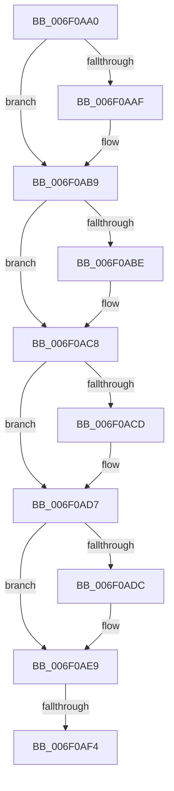

# sub_006F0AA0

- RVA: `0x006F0AA0`–`0x006F0B3C` (길이 `156` bytes)
- VA: `0x00000001406F0AA0`
- 실행 섹션: `.text`
- PDB 이름 있음: `아니요`; PDB Function 태그: `아니요`
- unwind 정보 RVA: `0x000A6154`
- 디코드: `45`개 명령, `156/156` bytes 표시
- 미해석 바이트: `0` (있으면 어셈블리에 `.byte`로 보존)

> 이 문서는 커널 이미지의 기계어와 PDB 기호를 분석해 생성했습니다. 4번과 5번은 함수 원형과 자료형을 바이너리 사용 방식에서 추정한 C 해석이며 원본 소스 복구 결과는 아닙니다.

## 1. Dependencies

- 직접 호출 지점: **10**; 고유 호출 대상: **2**
- 직접 호출자로 확인된 함수: **0**
- RIP 상대 이미지 참조: **0**

### Outgoing calls
- `0x006F0AA5` → [ExFreePoolWithTag](../../poolcode/B8/ExFreePoolWithTag_function_00B82870.md) (function, `0x00B82870`)
- `0x006F0AB4` → [ExFreePoolWithTag](../../poolcode/B8/ExFreePoolWithTag_function_00B82870.md) (function, `0x00B82870`)
- `0x006F0AC3` → [ExFreePoolWithTag](../../poolcode/B8/ExFreePoolWithTag_function_00B82870.md) (function, `0x00B82870`)
- `0x006F0AD2` → [ExFreePoolWithTag](../../poolcode/B8/ExFreePoolWithTag_function_00B82870.md) (function, `0x00B82870`)
- `0x006F0AE4` → [ObfDereferenceObjectWithTag](../2F/ObfDereferenceObjectWithTag_function_002F78E0.md) (function, `0x002F78E0`)
- `0x006F0B02` → [ExFreePoolWithTag](../../poolcode/B8/ExFreePoolWithTag_function_00B82870.md) (function, `0x00B82870`)
- `0x006F0B0D` → [ExFreePoolWithTag](../../poolcode/B8/ExFreePoolWithTag_function_00B82870.md) (function, `0x00B82870`)
- `0x006F0B1C` → [ExFreePoolWithTag](../../poolcode/B8/ExFreePoolWithTag_function_00B82870.md) (function, `0x00B82870`)
- `0x006F0B27` → [ExFreePoolWithTag](../../poolcode/B8/ExFreePoolWithTag_function_00B82870.md) (function, `0x00B82870`)
- `0x006F0B31` → [ExFreePoolWithTag](../../poolcode/B8/ExFreePoolWithTag_function_00B82870.md) (function, `0x00B82870`)

### Direct callers
- 이 함수 시작 RVA로 연결되는 직접 call은 확인되지 않았습니다. 간접 호출은 완전히 역산할 수 없습니다.

### Static image references
- 디코드된 RIP-relative 메모리 참조가 없습니다.

## 2. Other-region calls and transfers

- 다른 실행 섹션으로 향하는 call: **9**
  - `0x006F0AA5` → [ExFreePoolWithTag](../../poolcode/B8/ExFreePoolWithTag_function_00B82870.md) (`.text` → `POOLCODE`)
  - `0x006F0AB4` → [ExFreePoolWithTag](../../poolcode/B8/ExFreePoolWithTag_function_00B82870.md) (`.text` → `POOLCODE`)
  - `0x006F0AC3` → [ExFreePoolWithTag](../../poolcode/B8/ExFreePoolWithTag_function_00B82870.md) (`.text` → `POOLCODE`)
  - `0x006F0AD2` → [ExFreePoolWithTag](../../poolcode/B8/ExFreePoolWithTag_function_00B82870.md) (`.text` → `POOLCODE`)
  - `0x006F0B02` → [ExFreePoolWithTag](../../poolcode/B8/ExFreePoolWithTag_function_00B82870.md) (`.text` → `POOLCODE`)
  - `0x006F0B0D` → [ExFreePoolWithTag](../../poolcode/B8/ExFreePoolWithTag_function_00B82870.md) (`.text` → `POOLCODE`)
  - `0x006F0B1C` → [ExFreePoolWithTag](../../poolcode/B8/ExFreePoolWithTag_function_00B82870.md) (`.text` → `POOLCODE`)
  - `0x006F0B27` → [ExFreePoolWithTag](../../poolcode/B8/ExFreePoolWithTag_function_00B82870.md) (`.text` → `POOLCODE`)
  - `0x006F0B31` → [ExFreePoolWithTag](../../poolcode/B8/ExFreePoolWithTag_function_00B82870.md) (`.text` → `POOLCODE`)
- call이 아닌 외부 분기/꼬리 이동: **2**
  - `0x006F0AEE` → [SeLogAccessFailure + 0xD7](../44/SeLogAccessFailure_function_00448550.md) (`tail-transfer`)
  - `0x006F0B37` → [SeLogAccessFailure + 0xD7](../44/SeLogAccessFailure_function_00448550.md) (`tail-transfer`)

## 3. Assembly (complete function range)

```asm
006F0AA0  33 D2                           xor edx, edx
006F0AA2  48 8B C8                        mov rcx, rax
006F0AA5  E8 C6 1D 49 00                  call 0x140b82870
006F0AAA  4D 85 FF                        test r15, r15
006F0AAD  74 0A                           je 0x1406f0ab9
006F0AAF  33 D2                           xor edx, edx
006F0AB1  49 8B CF                        mov rcx, r15
006F0AB4  E8 B7 1D 49 00                  call 0x140b82870
006F0AB9  4D 85 ED                        test r13, r13
006F0ABC  74 0A                           je 0x1406f0ac8
006F0ABE  33 D2                           xor edx, edx
006F0AC0  49 8B CD                        mov rcx, r13
006F0AC3  E8 A8 1D 49 00                  call 0x140b82870
006F0AC8  4D 85 F6                        test r14, r14
006F0ACB  74 0A                           je 0x1406f0ad7
006F0ACD  33 D2                           xor edx, edx
006F0ACF  49 8B CE                        mov rcx, r14
006F0AD2  E8 99 1D 49 00                  call 0x140b82870
006F0AD7  40 84 F6                        test sil, sil
006F0ADA  74 0D                           je 0x1406f0ae9
006F0ADC  BA 53 65 44 67                  mov edx, 0x67446553
006F0AE1  48 8B CB                        mov rcx, rbx
006F0AE4  E8 F7 6D C0 FF                  call 0x1402f78e0
006F0AE9  80 7C 24 41 00                  cmp byte ptr [rsp + 0x41], 0
006F0AEE  0F 84 33 7B D5 FF               je 0x140448627
006F0AF4  48 8B 5D A0                     mov rbx, qword ptr [rbp - 0x60]
006F0AF8  33 D2                           xor edx, edx
006F0AFA  48 8B 4B 10                     mov rcx, qword ptr [rbx + 0x10]
006F0AFE  48 8B 49 08                     mov rcx, qword ptr [rcx + 8]
006F0B02  E8 69 1D 49 00                  call 0x140b82870
006F0B07  48 8B 4B 10                     mov rcx, qword ptr [rbx + 0x10]
006F0B0B  33 D2                           xor edx, edx
006F0B0D  E8 5E 1D 49 00                  call 0x140b82870
006F0B12  48 8B 4B 18                     mov rcx, qword ptr [rbx + 0x18]
006F0B16  33 D2                           xor edx, edx
006F0B18  48 8B 49 08                     mov rcx, qword ptr [rcx + 8]
006F0B1C  E8 4F 1D 49 00                  call 0x140b82870
006F0B21  48 8B 4B 18                     mov rcx, qword ptr [rbx + 0x18]
006F0B25  33 D2                           xor edx, edx
006F0B27  E8 44 1D 49 00                  call 0x140b82870
006F0B2C  33 D2                           xor edx, edx
006F0B2E  48 8B CB                        mov rcx, rbx
006F0B31  E8 3A 1D 49 00                  call 0x140b82870
006F0B36  90                              nop
006F0B37  E9 EB 7A D5 FF                  jmp 0x140448627
```

## 4. C-style interpretation (structured pseudocode)

```c
__int64 __fastcall sub_006F0AA0(__int64 a1, int a2)
{
    __int64 result;
    unsigned __int8 v_stack_p41;

    a2 = 0;
    result = ExFreePoolWithTag(result, a2, a3, a4);
    if (v_r15 != 0) {
        a2 = 0;
        a1 = v_r15;
        result = ExFreePoolWithTag(a1, a2, a3, a4);
    }
    if (v_r13 != 0) {
        a2 = 0;
        a1 = v_r13;
        result = ExFreePoolWithTag(a1, a2, a3, a4);
    }
    if (v_r14 != 0) {
        a2 = 0;
        a1 = v_r14;
        result = ExFreePoolWithTag(a1, a2, a3, a4);
    }
    if ((unsigned __int8)(v_rsi) != 0) {
        a2 = 0x67446553ULL;
        a1 = v_rbx;
        result = ObfDereferenceObjectWithTag(a1, a2, a3, a4);
    }
    a2 = 0;
    result = ExFreePoolWithTag(*(unsigned __int64 *)(*(unsigned __int64 *)(*(unsigned __int64 *)(v_rbp - 96) + 16) + 8), a2, a3, a4);
    a2 = 0;
    result = ExFreePoolWithTag(*(unsigned __int64 *)(*(unsigned __int64 *)(v_rbp - 96) + 16), a2, a3, a4);
    a2 = 0;
    result = ExFreePoolWithTag(*(unsigned __int64 *)(*(unsigned __int64 *)(*(unsigned __int64 *)(v_rbp - 96) + 24) + 8), a2, a3, a4);
    a2 = 0;
    result = ExFreePoolWithTag(*(unsigned __int64 *)(*(unsigned __int64 *)(v_rbp - 96) + 24), a2, a3, a4);
    a2 = 0;
    result = ExFreePoolWithTag(*(unsigned __int64 *)(v_rbp - 96), a2, a3, a4);
}
```

## 5. (Beta) C Style

```c
int64_t sub_006F0AA0(int64_t Arg1, int32_t Arg2)
{
    int64_t result;
    uint8_t v_stack_p41;

    Arg2 = 0;
    result = ExFreePoolWithTag(result, Arg2, a3, a4);
    if (local_r15 != 0) {
        Arg2 = 0;
        Arg1 = local_r15;
        result = ExFreePoolWithTag(Arg1, Arg2, a3, a4);
    }
    if (local_r13 != 0) {
        Arg2 = 0;
        Arg1 = local_r13;
        result = ExFreePoolWithTag(Arg1, Arg2, a3, a4);
    }
    if (local_r14 != 0) {
        Arg2 = 0;
        Arg1 = local_r14;
        result = ExFreePoolWithTag(Arg1, Arg2, a3, a4);
    }
    if ((uint8_t)(local_rsi) != 0) {
        Arg2 = 0x67446553ULL;
        Arg1 = local_rbx;
        result = ObfDereferenceObjectWithTag(Arg1, Arg2, a3, a4);
    }
    Arg2 = 0;
    result = ExFreePoolWithTag(*(uint64_t *)(*(uint64_t *)(*(uint64_t *)(local_rbp - 0x60) + 0x10) + 0x8), Arg2, a3, a4);
    Arg2 = 0;
    result = ExFreePoolWithTag(*(uint64_t *)(*(uint64_t *)(local_rbp - 0x60) + 0x10), Arg2, a3, a4);
    Arg2 = 0;
    result = ExFreePoolWithTag(*(uint64_t *)(*(uint64_t *)(*(uint64_t *)(local_rbp - 0x60) + 0x18) + 0x8), Arg2, a3, a4);
    Arg2 = 0;
    result = ExFreePoolWithTag(*(uint64_t *)(*(uint64_t *)(local_rbp - 0x60) + 0x18), Arg2, a3, a4);
    Arg2 = 0;
    result = ExFreePoolWithTag(*(uint64_t *)(local_rbp - 0x60), Arg2, a3, a4);
}
```

## 6. Execution-region graph

[열기: 2D/3D 그래프와 함수 탐색 컨트롤 패널](../../../control-panel.html?section=text&rva=0x006F0AA0&view=graph)

- 2D 그래프는 위에서 아래로 흐르고, 3D 그래프는 빈 공간을 드래그해 회전합니다. Shift+드래그는 이동, 휠은 확대·축소, 함수 노드 선택은 대상 보고서 이동입니다.

### Static fallback


