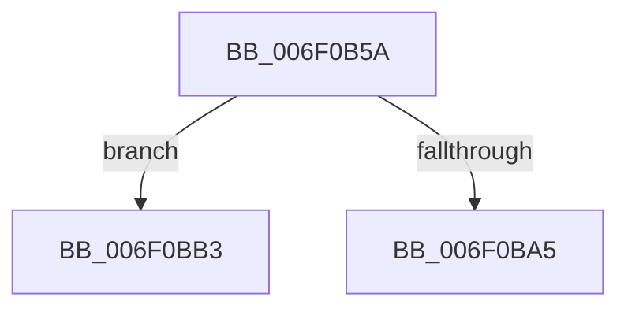

# sub_006F0B5A

- RVA: `0x006F0B5A`–`0x006F0BD0` (길이 `118` bytes)
- VA: `0x00000001406F0B5A`
- 실행 섹션: `.text`
- PDB 이름 있음: `아니요`; PDB Function 태그: `아니요`
- unwind 정보 RVA: `0x000A63E8`
- 디코드: `33`개 명령, `118/118` bytes 표시
- 미해석 바이트: `0` (있으면 어셈블리에 `.byte`로 보존)

> 이 문서는 커널 이미지의 기계어와 PDB 기호를 분석해 생성했습니다. 4번과 5번은 함수 원형과 자료형을 바이너리 사용 방식에서 추정한 C 해석이며 원본 소스 복구 결과는 아닙니다.

## 1. Dependencies

- 직접 호출 지점: **5**; 고유 호출 대상: **5**
- 직접 호출자로 확인된 함수: **0**
- RIP 상대 이미지 참조: **0**

### Outgoing calls
- `0x006F0B60` → [MiUnlockPageTable](../21/MiUnlockPageTable_function_00216EC0.md) (function, `0x00216EC0`)
- `0x006F0B6D` → [MiUnlockWorkingSetShared](../27/MiUnlockWorkingSetShared_function_0027D690.md) (function, `0x0027D690`)
- `0x006F0B9C` → [MmAccessFault](../27/MmAccessFault_function_0027EE80.md) (function, `0x0027EE80`)
- `0x006F0BA8` → [MiLockWorkingSetShared](../27/MiLockWorkingSetShared_function_0027CBF0.md) (function, `0x0027CBF0`)
- `0x006F0BCA` → [KeBugCheckEx](../4F/KeBugCheckEx_function_004FD660.md) (function, `0x004FD660`)

### Direct callers
- 이 함수 시작 RVA로 연결되는 직접 call은 확인되지 않았습니다. 간접 호출은 완전히 역산할 수 없습니다.

### Static image references
- 디코드된 RIP-relative 메모리 참조가 없습니다.

## 2. Other-region calls and transfers

- 다른 실행 섹션으로 향하는 call: **0**
- call이 아닌 외부 분기/꼬리 이동: **1**
  - `0x006F0BAE` → [MiUpdateImportRelocationsOnDriverPrivatePages + 0x19A](../44/MiUpdateImportRelocationsOnDriverPrivatePages_function_00449BCC.md) (`tail-transfer`)

## 3. Assembly (complete function range)

```asm
006F0B5A  48 8B D5                        mov rdx, rbp
006F0B5D  49 8B CE                        mov rcx, r14
006F0B60  E8 5B 63 B2 FF                  call 0x140216ec0
006F0B65  41 8A D5                        mov dl, r13b
006F0B68  49 8B CE                        mov rcx, r14
006F0B6B  33 ED                           xor ebp, ebp
006F0B6D  E8 1E CB B8 FF                  call 0x14027d690
006F0B72  48 8B FE                        mov rdi, rsi
006F0B75  48 B8 00 00 00 00 80 F6 FF FF   movabs rax, 0xfffff68000000000
006F0B7F  48 C1 E7 19                     shl rdi, 0x19
006F0B83  48 8B C0                        mov rax, rax
006F0B86  48 C1 E0 19                     shl rax, 0x19
006F0B8A  45 33 C9                        xor r9d, r9d
006F0B8D  48 2B F8                        sub rdi, rax
006F0B90  45 33 C0                        xor r8d, r8d
006F0B93  48 C1 FF 10                     sar rdi, 0x10
006F0B97  33 C9                           xor ecx, ecx
006F0B99  48 8B D7                        mov rdx, rdi
006F0B9C  E8 DF E2 B8 FF                  call 0x14027ee80
006F0BA1  85 C0                           test eax, eax
006F0BA3  78 0E                           js 0x1406f0bb3
006F0BA5  49 8B CE                        mov rcx, r14
006F0BA8  E8 43 C0 B8 FF                  call 0x14027cbf0
006F0BAD  90                              nop
006F0BAE  E9 B3 91 D5 FF                  jmp 0x140449d66
006F0BB3  48 98                           cdqe
006F0BB5  4C 8B CB                        mov r9, rbx
006F0BB8  4C 8B C7                        mov r8, rdi
006F0BBB  48 89 44 24 20                  mov qword ptr [rsp + 0x20], rax
006F0BC0  BA 81 10 00 00                  mov edx, 0x1081
006F0BC5  B9 1A 00 00 00                  mov ecx, 0x1a
006F0BCA  E8 91 CA E0 FF                  call 0x1404fd660
006F0BCF  CC                              int3
```

## 4. C-style interpretation (structured pseudocode)

```c
__int64 __fastcall sub_006F0B5A(__int64 a1, __int64 a2, int a3, int a4)
{
    __int64 result;
    __int64 v_rbp;
    __int64 v_rdi;
    unsigned __int64 v_stack_p20;

    result = MiUnlockPageTable(v_r14, v_rbp, a3, a4);
    v_rbp = 0;
    result = MiUnlockWorkingSetShared(v_r14, (unsigned __int8)(v_r13), a3, a4);
    v_rdi = (v_rsi) << (25);
    result = (result) << (25);
    a4 = 0;
    v_rdi = (v_rdi) - (result);
    a3 = 0;
    v_rdi = (v_rdi) >> (16);
    a1 = 0;
    result = MmAccessFault(a1, v_rdi, a3, a4);
    if (sign_flag) goto loc_006F0BB3;
    result = MiLockWorkingSetShared(v_r14, v_rdi, a3, a4);
loc_006F0BB3:
    v_stack_p20 = result;
    result = KeBugCheckEx(26, (unsigned int)(0x1081ULL), v_rdi, v_rbx);
    return result;
}
```

## 5. (Beta) C Style

```c
int64_t sub_006F0B5A(int64_t Arg1, int64_t Arg2, int32_t Arg3, int32_t Arg4)
{
    int64_t result;
    int64_t local_rbp;
    int64_t local_rdi;
    uint64_t v_stack_p20;

    result = MiUnlockPageTable(local_r14, local_rbp, Arg3, Arg4);
    local_rbp = 0;
    result = MiUnlockWorkingSetShared(local_r14, (uint8_t)(local_r13), Arg3, Arg4);
    local_rdi = (local_rsi) << (25);
    result = (result) << (25);
    Arg4 = 0;
    local_rdi = (local_rdi) - (result);
    Arg3 = 0;
    local_rdi = (local_rdi) >> (16);
    Arg1 = 0;
    result = MmAccessFault(Arg1, local_rdi, Arg3, Arg4);
    if (sign_flag) goto loc_006F0BB3;
    result = MiLockWorkingSetShared(local_r14, local_rdi, Arg3, Arg4);
loc_006F0BB3:
    v_stack_p20 = result;
    result = KeBugCheckEx(26, (uint32_t)(0x1081ULL), local_rdi, local_rbx);
    return result;
}
```

## 6. Execution-region graph

[열기: 2D/3D 그래프와 함수 탐색 컨트롤 패널](../../../control-panel.html?section=text&rva=0x006F0B5A&view=graph)

- 2D 그래프는 위에서 아래로 흐르고, 3D 그래프는 빈 공간을 드래그해 회전합니다. Shift+드래그는 이동, 휠은 확대·축소, 함수 노드 선택은 대상 보고서 이동입니다.

### Static fallback


