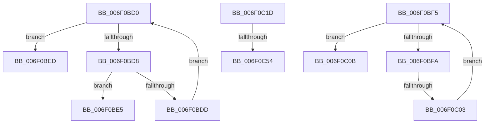

# sub_006F0BD0

- RVA: `0x006F0BD0`–`0x006F0C64` (길이 `148` bytes)
- VA: `0x00000001406F0BD0`
- 실행 섹션: `.text`
- PDB 이름 있음: `아니요`; PDB Function 태그: `아니요`
- unwind 정보 RVA: `0x000A6530`
- 디코드: `40`개 명령, `148/148` bytes 표시
- 미해석 바이트: `0` (있으면 어셈블리에 `.byte`로 보존)

> 이 문서는 커널 이미지의 기계어와 PDB 기호를 분석해 생성했습니다. 4번과 5번은 함수 원형과 자료형을 바이너리 사용 방식에서 추정한 C 해석이며 원본 소스 복구 결과는 아닙니다.

## 1. Dependencies

- 직접 호출 지점: **1**; 고유 호출 대상: **1**
- 직접 호출자로 확인된 함수: **0**
- RIP 상대 이미지 참조: **3**

### Outgoing calls
- `0x006F0C3A` → [KeInsertQueueDpc](../20/KeInsertQueueDpc_function_00207C50.md) (function, `0x00207C50`)

### Direct callers
- 이 함수 시작 RVA로 연결되는 직접 call은 확인되지 않았습니다. 간접 호출은 완전히 역산할 수 없습니다.

### Static image references
- `0x006F0BD0` → RVA `0x00FC6BA0` (`ALMOSTRO`; read)
- `0x006F0C0D` → RVA `0x00E3ED60` (`.data`; read)
- `0x006F0C28` → RVA `0x00E3EE10` (`.data`; read)

## 2. Other-region calls and transfers

- 다른 실행 섹션으로 향하는 call: **0**
- call이 아닌 외부 분기/꼬리 이동: **6**
  - `0x006F0BE8` → [HvlSharedIsr + 0x26](../44/HvlSharedIsr_function_0044B020.md) (`tail-transfer`)
  - `0x006F0BF0` → [HvlSharedIsr + 0x26](../44/HvlSharedIsr_function_0044B020.md) (`tail-transfer`)
  - `0x006F0BFD` → [HvlSharedIsr + 0x44](../44/HvlSharedIsr_function_0044B020.md) (`tail-transfer`)
  - `0x006F0C18` → [HvlSharedIsr + 0x44](../44/HvlSharedIsr_function_0044B020.md) (`tail-transfer`)
  - `0x006F0C4E` → [HvlSharedIsr + 0x5F](../44/HvlSharedIsr_function_0044B020.md) (`tail-transfer`)
  - `0x006F0C5F` → [HvlSharedIsr + 0x5F](../44/HvlSharedIsr_function_0044B020.md) (`tail-transfer`)

## 3. Assembly (complete function range)

```asm
006F0BD0  3B 0D CA 5F 8D 00               cmp ecx, dword ptr [rip + 0x8d5fca]
006F0BD6  73 15                           jae 0x1406f0bed
006F0BD8  39 50 14                        cmp dword ptr [rax + 0x14], edx
006F0BDB  74 08                           je 0x1406f0be5
006F0BDD  FF C1                           inc ecx
006F0BDF  48 83 C0 68                     add rax, 0x68
006F0BE3  EB EB                           jmp 0x1406f0bd0
006F0BE5  8B 50 04                        mov edx, dword ptr [rax + 4]
006F0BE8  E9 59 A4 D5 FF                  jmp 0x14044b046
006F0BED  83 CA FF                        or edx, 0xffffffff
006F0BF0  E9 51 A4 D5 FF                  jmp 0x14044b046
006F0BF5  41 3B C0                        cmp eax, r8d
006F0BF8  73 11                           jae 0x1406f0c0b
006F0BFA  39 51 04                        cmp dword ptr [rcx + 4], edx
006F0BFD  0F 84 61 A4 D5 FF               je 0x14044b064
006F0C03  FF C0                           inc eax
006F0C05  48 83 C1 68                     add rcx, 0x68
006F0C09  EB EA                           jmp 0x1406f0bf5
006F0C0B  85 D2                           test edx, edx
006F0C0D  48 8D 0D 4C E1 74 00            lea rcx, [rip + 0x74e14c]
006F0C14  48 0F 45 CB                     cmovne rcx, rbx
006F0C18  E9 47 A4 D5 FF                  jmp 0x14044b064
006F0C1D  8B 01                           mov eax, dword ptr [rcx]
006F0C1F  45 33 C0                        xor r8d, r8d
006F0C22  48 6B C8 68                     imul rcx, rax, 0x68
006F0C26  33 D2                           xor edx, edx
006F0C28  48 03 0D E1 E1 74 00            add rcx, qword ptr [rip + 0x74e1e1]
006F0C2F  C7 41 04 02 00 00 00            mov dword ptr [rcx + 4], 2
006F0C36  48 83 C1 08                     add rcx, 8
006F0C3A  E8 11 70 B1 FF                  call 0x140207c50
006F0C3F  89 9F 00 04 00 00               mov dword ptr [rdi + 0x400], ebx
006F0C45  90                              nop
006F0C46  8A 87 05 04 00 00               mov al, byte ptr [rdi + 0x405]
006F0C4C  A8 01                           test al, 1
006F0C4E  0F 84 2B A4 D5 FF               je 0x14044b07f
006F0C54  33 C0                           xor eax, eax
006F0C56  B9 84 00 00 40                  mov ecx, 0x40000084
006F0C5B  33 D2                           xor edx, edx
006F0C5D  0F 30                           wrmsr
006F0C5F  E9 1B A4 D5 FF                  jmp 0x14044b07f
```

## 4. C-style interpretation (structured pseudocode)

```c
__int64 __fastcall sub_006F0BD0(int a1, int a2, int a3)
{
    __int64 result;

    if (a1 >= (*(unsigned int *)(v_rip + 9265098))) goto loc_006F0BED;
    if ((*(unsigned int *)(result + 20)) == a2) goto loc_006F0BE5;
    a1 = (unsigned int)((a1) + 1);
    result = (result) + (104);
    goto loc_006F0BD0;
loc_006F0BE5:
loc_006F0BED:
    a2 = (unsigned int)(((unsigned int)(*(unsigned int *)(result + 4))) | (0xFFFFFFFFULL));
}
```

## 5. (Beta) C Style

```c
int64_t sub_006F0BD0(int32_t Arg1, int32_t Arg2, int32_t Arg3)
{
    int64_t result;

    if (Arg1 >= (*(uint32_t *)(v_rip + 0x8D5FCA))) goto loc_006F0BED;
    if ((*(uint32_t *)(result + 0x14)) == Arg2) goto loc_006F0BE5;
    Arg1 = (uint32_t)((Arg1) + 1);
    result = (result) + (104);
    goto loc_006F0BD0;
loc_006F0BE5:
loc_006F0BED:
    Arg2 = (uint32_t)(((uint32_t)(*(uint32_t *)(result + 0x4))) | (0xFFFFFFFFULL));
}
```

## 6. Execution-region graph

[열기: 2D/3D 그래프와 함수 탐색 컨트롤 패널](../../../control-panel.html?section=text&rva=0x006F0BD0&view=graph)

- 2D 그래프는 위에서 아래로 흐르고, 3D 그래프는 빈 공간을 드래그해 회전합니다. Shift+드래그는 이동, 휠은 확대·축소, 함수 노드 선택은 대상 보고서 이동입니다.

### Static fallback


