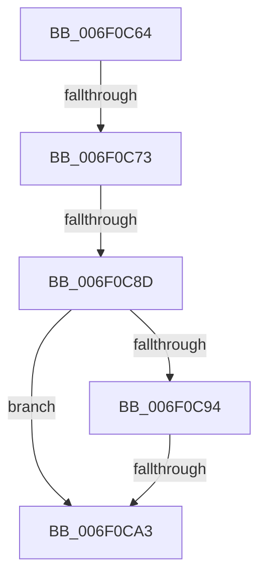

# sub_006F0C64

- RVA: `0x006F0C64`–`0x006F0CB7` (길이 `83` bytes)
- VA: `0x00000001406F0C64`
- 실행 섹션: `.text`
- PDB 이름 있음: `아니요`; PDB Function 태그: `아니요`
- unwind 정보 RVA: `0x000A6690`
- 디코드: `18`개 명령, `83/83` bytes 표시
- 미해석 바이트: `0` (있으면 어셈블리에 `.byte`로 보존)

> 이 문서는 커널 이미지의 기계어와 PDB 기호를 분석해 생성했습니다. 4번과 5번은 함수 원형과 자료형을 바이너리 사용 방식에서 추정한 C 해석이며 원본 소스 복구 결과는 아닙니다.

## 1. Dependencies

- 직접 호출 지점: **0**; 고유 호출 대상: **0**
- 직접 호출자로 확인된 함수: **0**
- RIP 상대 이미지 참조: **0**

### Outgoing calls
- 직접 디코드된 call 명령이 없습니다.

### Direct callers
- 이 함수 시작 RVA로 연결되는 직접 call은 확인되지 않았습니다. 간접 호출은 완전히 역산할 수 없습니다.

### Static image references
- 디코드된 RIP-relative 메모리 참조가 없습니다.

## 2. Other-region calls and transfers

- 다른 실행 섹션으로 향하는 call: **0**
- call이 아닌 외부 분기/꼬리 이동: **3**
  - `0x006F0C6D` → [KePrepareToDispatchVirtualProcessor + 0x66](../44/KePrepareToDispatchVirtualProcessor_function_0044B3C0.md) (`tail-transfer`)
  - `0x006F0C87` → [KePrepareToDispatchVirtualProcessor + 0x66](../44/KePrepareToDispatchVirtualProcessor_function_0044B3C0.md) (`tail-transfer`)
  - `0x006F0C9D` → [KePrepareToDispatchVirtualProcessor + 0x66](../44/KePrepareToDispatchVirtualProcessor_function_0044B3C0.md) (`tail-transfer`)

## 3. Assembly (complete function range)

```asm
006F0C64  0F B7 83 D8 06 00 00            movzx eax, word ptr [rbx + 0x6d8]
006F0C6B  A8 08                           test al, 8
006F0C6D  0F 85 B3 A7 D5 FF               jne 0x14044b426
006F0C73  B9 04 00 00 00                  mov ecx, 4
006F0C78  66 0F A3 C8                     bt ax, cx
006F0C7C  0F 92 C0                        setb al
006F0C7F  22 83 DE 06 00 00               and al, byte ptr [rbx + 0x6de]
006F0C85  A8 01                           test al, 1
006F0C87  0F 85 99 A7 D5 FF               jne 0x14044b426
006F0C8D  F6 44 24 20 10                  test byte ptr [rsp + 0x20], 0x10
006F0C92  74 0F                           je 0x1406f0ca3
006F0C94  48 F7 44 24 20 00 10 00 00      test qword ptr [rsp + 0x20], 0x1000
006F0C9D  0F 84 83 A7 D5 FF               je 0x14044b426
006F0CA3  41 C6 01 01                     mov byte ptr [r9], 1
006F0CA7  4C 8B FB                        mov r15, rbx
006F0CAA  BD D8 06 00 00                  mov ebp, 0x6d8
006F0CAF  48 8B CB                        mov rcx, rbx
006F0CB2  B8 DE 06 00 00                  mov eax, 0x6de
```

## 4. C-style interpretation (structured pseudocode)

```c
__int64 __fastcall sub_006F0C64(__int64 a1, __int64 a2, __int64 a3, __int64 a4)
{
    __int64 result;
    unsigned __int8 v_stack_p20;

    result = (condition_is_below) ? 1 : 0;
    result = (unsigned __int8)((result) & (*(unsigned __int8 *)(v_rbx + 1758)));
    if (((v_stack_p20) & (16)) == 0) goto loc_006F0CA3;
loc_006F0CA3:
    *(unsigned __int8 *)(a4) = 1;
    return (unsigned int)(0x6DEULL);
}
```

## 5. (Beta) C Style

```c
int64_t sub_006F0C64(int64_t Arg1, int64_t Arg2, int64_t Arg3, void *Arg4)
{
    uint8_t *arg4 = (uint8_t *)Arg4;

    int64_t result;
    uint8_t v_stack_p20;

    result = (condition_is_below) ? 1 : 0;
    result = (uint8_t)((result) & (*(uint8_t *)(local_rbx + 0x6DE)));
    if (((v_stack_p20) & (16)) == 0) goto loc_006F0CA3;
loc_006F0CA3:
    *(uint8_t *)(arg4) = 1;
    return (uint32_t)(0x6DEULL);
}
```

### 관측된 메모리 오프셋

구조체 형식이 확인되지 않은 접근은 인자 기준의 오프셋으로만 기록했습니다.

| 기준 인자 | 오프셋 표현 | 폭 (bit) | 접근 |
|---|---:|---:|---|
| `Arg4` | `+ 0x0` | `8` | `W` |

## 6. Execution-region graph

[열기: 2D/3D 그래프와 함수 탐색 컨트롤 패널](../../../control-panel.html?section=text&rva=0x006F0C64&view=graph)

- 2D 그래프는 위에서 아래로 흐르고, 3D 그래프는 빈 공간을 드래그해 회전합니다. Shift+드래그는 이동, 휠은 확대·축소, 함수 노드 선택은 대상 보고서 이동입니다.

### Static fallback


