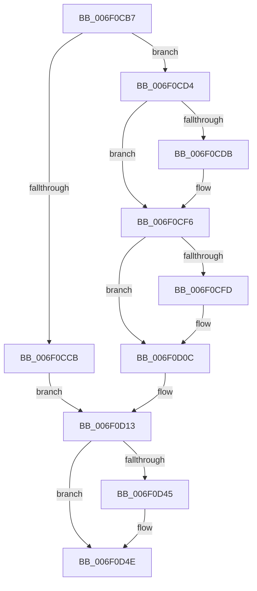

# sub_006F0CB7

- RVA: `0x006F0CB7`–`0x006F0D60` (길이 `169` bytes)
- VA: `0x00000001406F0CB7`
- 실행 섹션: `.text`
- PDB 이름 있음: `아니요`; PDB Function 태그: `아니요`
- unwind 정보 RVA: `0x000A66A0`
- 디코드: `36`개 명령, `169/169` bytes 표시
- 미해석 바이트: `0` (있으면 어셈블리에 `.byte`로 보존)

> 이 문서는 커널 이미지의 기계어와 PDB 기호를 분석해 생성했습니다. 4번과 5번은 함수 원형과 자료형을 바이너리 사용 방식에서 추정한 C 해석이며 원본 소스 복구 결과는 아닙니다.

## 1. Dependencies

- 직접 호출 지점: **2**; 고유 호출 대상: **2**
- 직접 호출자로 확인된 함수: **0**
- RIP 상대 이미지 참조: **0**

### Outgoing calls
- `0x006F0CCD` → [KiUpdateStibpPairing](../3E/KiUpdateStibpPairing_function_003E71C0.md) (function, `0x003E71C0`)
- `0x006F0CFD` → [KiFlushCurrentRsb](../6C/KiFlushCurrentRsb_function_006C6540.md) (function, `0x006C6540`)

### Direct callers
- 이 함수 시작 RVA로 연결되는 직접 call은 확인되지 않았습니다. 간접 호출은 완전히 역산할 수 없습니다.

### Static image references
- 디코드된 RIP-relative 메모리 참조가 없습니다.

## 2. Other-region calls and transfers

- 다른 실행 섹션으로 향하는 call: **0**
- call이 아닌 외부 분기/꼬리 이동: **1**
  - `0x006F0D5A` → [KePrepareToDispatchVirtualProcessor + 0xA1](../44/KePrepareToDispatchVirtualProcessor_function_0044B3C0.md) (`tail-transfer`)

## 3. Assembly (complete function range)

```asm
006F0CB7  4C 89 6C 24 70                  mov qword ptr [rsp + 0x70], r13
006F0CBC  4C 8D 2C 03                     lea r13, [rbx + rax]
006F0CC0  0F B7 83 E0 06 00 00            movzx eax, word ptr [rbx + 0x6e0]
006F0CC7  A8 02                           test al, 2
006F0CC9  74 09                           je 0x1406f0cd4
006F0CCB  33 C9                           xor ecx, ecx
006F0CCD  E8 EE 64 CF FF                  call 0x1403e71c0
006F0CD2  EB 3F                           jmp 0x1406f0d13
006F0CD4  41 F6 04 2F 04                  test byte ptr [r15 + rbp], 4
006F0CD9  74 1B                           je 0x1406f0cf6
006F0CDB  B8 01 00 00 00                  mov eax, 1
006F0CE0  33 D2                           xor edx, edx
006F0CE2  B9 49 00 00 00                  mov ecx, 0x49
006F0CE7  0F 30                           wrmsr
006F0CE9  BF FB FF 00 00                  mov edi, 0xfffb
006F0CEE  66 41 21 3C 2F                  and word ptr [r15 + rbp], di
006F0CF3  41 88 02                        mov byte ptr [r10], al
006F0CF6  41 F6 04 2F 20                  test byte ptr [r15 + rbp], 0x20
006F0CFB  74 0F                           je 0x1406f0d0c
006F0CFD  E8 3E 58 FD FF                  call 0x1406c6540
006F0D02  B8 DF FF 00 00                  mov eax, 0xffdf
006F0D07  66 41 21 04 2F                  and word ptr [r15 + rbp], ax
006F0D0C  4C 89 A3 D0 06 00 00            mov qword ptr [rbx + 0x6d0], r12
006F0D13  41 0F B7 04 2F                  movzx eax, word ptr [r15 + rbp]
006F0D18  0F B7 93 E2 06 00 00            movzx edx, word ptr [rbx + 0x6e2]
006F0D1F  0F B7 8B E8 06 00 00            movzx ecx, word ptr [rbx + 0x6e8]
006F0D26  66 89 83 DA 06 00 00            mov word ptr [rbx + 0x6da], ax
006F0D2D  48 B8 00 00 00 00 00 02 00 00   movabs rax, 0x20000000000
006F0D37  66 89 93 E4 06 00 00            mov word ptr [rbx + 0x6e4], dx
006F0D3E  48 85 44 24 20                  test qword ptr [rsp + 0x20], rax
006F0D43  74 09                           je 0x1406f0d4e
006F0D45  41 F6 45 00 01                  test byte ptr [r13], 1
006F0D4A  66 0F 45 CA                     cmovne cx, dx
006F0D4E  4C 8B 6C 24 70                  mov r13, qword ptr [rsp + 0x70]
006F0D53  66 39 8B E6 06 00 00            cmp word ptr [rbx + 0x6e6], cx
006F0D5A  0F 84 01 A7 D5 FF               je 0x14044b461
```

## 4. C-style interpretation (structured pseudocode)

```c
__int64 __fastcall sub_006F0CB7(int a1, int a2, __int64 a3, __int64 a4, __int64 a5, __int64 a6, __int64 a7, __int64 a8, __int64 a9, __int64 a10, __int64 a11, __int64 a12, __int64 a13, __int64 a14)
{
    __int64 result;
    __int64 v_rdi;
    unsigned __int64 v_stack_p20;
    unsigned __int64 v_stack_p70;

    v_stack_p70 = v_r13;
    if ((((unsigned __int8)(*(unsigned __int16 *)(v_rbx + 1760))) & (2)) == 0) goto loc_006F0CD4;
    a1 = 0;
    result = KiUpdateStibpPairing(a1, a2, a3, a4);
    goto loc_006F0D13;
loc_006F0CD4:
    if (((*(unsigned __int8 *)(v_r15 + v_rbp * 1)) & (4)) != 0) {
        result = 1;
        a2 = 0;
        a1 = 73;
        v_rdi = 0xFFFBULL;
        *(unsigned __int8 *)(v_r10) = (unsigned __int8)(result);
    }
    if (((*(unsigned __int8 *)(v_r15 + v_rbp * 1)) & (32)) != 0) {
        result = KiFlushCurrentRsb(a1, a2, a3, a4);
        result = 0xFFDFULL;
    }
    *(unsigned __int64 *)(v_rbx + 1744) = v_r12;
loc_006F0D13:
    *(unsigned __int16 *)(v_rbx + 1754) = (unsigned __int16)(*(unsigned __int16 *)(v_r15 + v_rbp * 1));
    *(unsigned __int16 *)(v_rbx + 1764) = (unsigned __int16)(*(unsigned __int16 *)(v_rbx + 1762));
    if (((v_stack_p20) & (*(unsigned __int16 *)(v_r15 + v_rbp * 1))) != 0) {
        a1 = *(unsigned __int16 *)(v_rbx + 1768);
        if (((*(unsigned __int8 *)(v_rbx + result * 1)) & (1)) != 0) { a1 = (unsigned __int16)(*(unsigned __int16 *)(v_rbx + 1762)); }
    }
}
```

## 5. (Beta) C Style

```c
int64_t sub_006F0CB7(int32_t Arg1, int32_t Arg2, int64_t Arg3, int64_t Arg4, uint64_t Arg5, uint64_t Arg6, uint64_t Arg7, uint64_t Arg8, uint64_t Arg9, uint64_t Arg10, uint64_t Arg11, uint64_t Arg12, uint64_t Arg13, int64_t Arg14)
{
    int64_t result;
    int64_t local_rdi;
    uint64_t v_stack_p20;
    uint64_t v_stack_p70;

    v_stack_p70 = local_r13;
    if ((((uint8_t)(*(uint16_t *)(local_rbx + 0x6E0))) & (2)) == 0) goto loc_006F0CD4;
    Arg1 = 0;
    result = KiUpdateStibpPairing(Arg1, Arg2, Arg3, Arg4);
    goto loc_006F0D13;
loc_006F0CD4:
    if (((*(uint8_t *)(local_r15 + local_rbp * 1)) & (4)) != 0) {
        result = 1;
        Arg2 = 0;
        Arg1 = 73;
        local_rdi = 0xFFFBULL;
        *(uint8_t *)(local_r10) = (uint8_t)(result);
    }
    if (((*(uint8_t *)(local_r15 + local_rbp * 1)) & (32)) != 0) {
        result = KiFlushCurrentRsb(Arg1, Arg2, Arg3, Arg4);
        result = 0xFFDFULL;
    }
    *(uint64_t *)(local_rbx + 0x6D0) = local_r12;
loc_006F0D13:
    *(uint16_t *)(local_rbx + 0x6DA) = (uint16_t)(*(uint16_t *)(local_r15 + local_rbp * 1));
    *(uint16_t *)(local_rbx + 0x6E4) = (uint16_t)(*(uint16_t *)(local_rbx + 0x6E2));
    if (((v_stack_p20) & (*(uint16_t *)(local_r15 + local_rbp * 1))) != 0) {
        Arg1 = *(uint16_t *)(local_rbx + 0x6E8);
        if (((*(uint8_t *)(local_rbx + result * 1)) & (1)) != 0) { Arg1 = (uint16_t)(*(uint16_t *)(local_rbx + 0x6E2)); }
    }
}
```

## 6. Execution-region graph

[열기: 2D/3D 그래프와 함수 탐색 컨트롤 패널](../../../control-panel.html?section=text&rva=0x006F0CB7&view=graph)

- 2D 그래프는 위에서 아래로 흐르고, 3D 그래프는 빈 공간을 드래그해 회전합니다. Shift+드래그는 이동, 휠은 확대·축소, 함수 노드 선택은 대상 보고서 이동입니다.

### Static fallback


